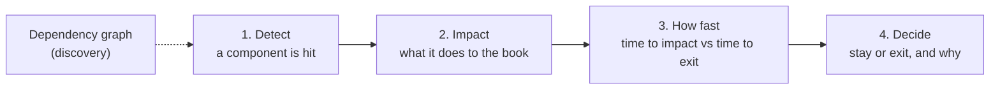

# Current analysis: the brief's question against what the tool does

This note records an assessment made on 2026-10-10, after the merge of the sibling-markets work. It re-reads the challenge brief (`docs/hackaton_instruction/GOAL.md` and the PDF next to it) as a chain of four steps, checks each step against the code, and draws the consequences for the Monte Carlo simulation and for the next tasks. It complements `GAP.md` (the model's gaps K1–K25), `NEXT_STEP_V2.md` (the plan) and `NEXT_TASK.md` (the two next tasks), and it changes the order they propose.

## Contents

- [1. The brief's question is a chain](#1-the-briefs-question-is-a-chain)
- [2. Step 1: detect the incident](#2-step-1-detect-the-incident)
- [3. Step 2: compute the impact](#3-step-2-compute-the-impact)
- [4. Step 3: how fast](#4-step-3-how-fast)
- [5. Step 4: stay or exit](#5-step-4-stay-or-exit)
- [6. Is the Monte Carlo relevant?](#6-is-the-monte-carlo-relevant)
- [7. What changes in the plan](#7-what-changes-in-the-plan)
- [8. Summary](#8-summary)

## 1. The brief's question is a chain

The brief's problem statement:

> When one component is hit by a security incident, a market disruption or a technical failure, the hard part is not noticing the incident. It is working out what it does to your book, and how fast.

Its task: "automatically identify the dependencies of a position, and estimate the potential economic impact on that position **when one of them is affected**", then answer "should we stay in the position, or is the expected loss high enough to justify exiting despite execution costs?", on a book of ten 10 % pockets where unwinding costs 11 %.

Read as a pipeline, that is four steps, with discovery underneath:

The incident is **known** when the question is asked. The brief does not ask how likely an incident is; it asks what a known incident does. Detection is needed to start the chain, but the brief puts the difficulty in steps 2 to 4.

| Step | Status today | Where |
|---|---|---|
| Discovery | strong in `graph` (siblings, oracle classes, admin surface, curves); shallower in `analyze` | `graph.py`, `siblings.py`, `oracle_class.py`, `admin.py`, `discover.py` |
| 1. Detect | partial: many on-chain incidents, in the watches only; some checks slow; off-chain incidents and the Pendle pool not watched | `watch.py`, `watch_user.py`, `rules.py`, `admin.py`, `drain.py` |
| 2. Impact | pieces exist, never applied to an observed incident | `propagate.loss`, `market_risk.py`, `exit_queue.py`, `drain.py` |
| 3. How fast | missing as an output | — |
| 4. Decide | exists, but on an unconditional question | `decide.py` |
| **The links between steps** | **missing**: an alert does not trigger an impact, and the verdict does not take an incident as input | — |

## 2. Step 1: detect the incident

### What is detected

| Incident type | Detected by | Delay |
|---|---|---|
| Oracle price moves sharply | oracle move ≥ 5 % between two reads; oracle stops answering | every batch (12 s polling, 2 blocks behind the head) |
| Oracle disagrees with the market | `OracleDivergence`, warning from a 3 % gap against DefiLlama | every batch, with DefiLlama prices at most 25 blocks (~5 min) old; it was every 300 blocks (~1 h) before D97 |
| Collateral depegs below an oracle that does not follow it | `DrainWindow`, from the same gap | every 25 blocks, about 5 min |
| Contract upgraded, admin or owner changed, feed replaced, token paused, outsized mint | admin-surface alerts | events every batch; storage slots every 300 blocks |
| Morpho Blue owner actions | Blue owner events | every batch |
| Liquidation with bad debt; debt underwater not yet written off | `Blue.Liquidate`, `UnrealisedBadDebt` | every batch |
| Liquidity squeeze | utilisation ≥ 99 %, large withdrawals, a main lender leaving, `ExitQueue` | every batch |
| Curator actions | timelocked submissions, cap and gate changes, `forceDeallocate` | every batch |
| The user's own position | health-factor levels, actions on their behalf | every batch |

### What is not detected

- **Off-chain incidents**: a custodian or exchange failure, a fund manager's loss (Stream xUSD), a compromised signing key (Resolv USR). They are seen only once they reach the chain, as a mint, a price move or a depeg.
- **The Pendle pool**: implied-yield spikes, a pool draining, a TWAP oracle pushed by a trade (PT-reUSD, 2026-08-25). Only the oracle's reaction is seen.
- **Indirect depegs**: the issuer's own backing, or tokens of sibling markets. Prices are checked only for the watched markets' collateral and loan tokens.
- **Exploits outside the admin surface**: a hack of another protocol that holds the same collateral.
- **Feed staleness**: a feed that stops updating, unless the price moves (`NEXT_STEP_V2.md` E2).
- **`analyze`**: a one-shot report; it detects nothing.

### Two weaknesses of what is detected

- **Too slow for the fastest incidents.** The oracle-versus-market check ran about once an hour; USR fell 97 % in 17 minutes. *(update 2026-10-10: it now runs every batch with market prices at most 25 blocks old, D97.)* A further step is to trigger it on price-moving events such as large swaps in the collateral's pools.
- **Detection ends at the alert.** An alert says what happened, not what it costs the book, how fast, or what to do. That is the missing link to step 2 (`GAP.md` K20).

## 3. Step 2: compute the impact

The pieces that compute an impact exist, but none takes an observed incident as input:

| Piece | Computes | Missing for step 2 |
|---|---|---|
| `propagate.loss` | the loss of one position for a given set of shocks, with Morpho's liquidation rule and limited liability | no entry point: `analyze` only calls it from the Monte Carlo, with drawn shocks (`--shock` is task 1 of `NEXT_TASK.md`) |
| `market_risk.py` | each watched market's liquidation curve at 2, 5, 10, 20 % and the bad debt it leaves | fixed drops, not the observed one; no link to the user's loss |
| `exit_queue.py` | what a vault depositor recovers at par and loses, by queue position | loss cases are uniform drops, not the incident |
| `drain.py` | how much a depeg past d\* lets an arbitrageur borrow, and the bad debt | the discount is measured, but the impact is not passed on to the user's position |
| `graph` | which other markets share the hit asset, oracle or feed, and their curves | drawn, not computed: the propagation engine of `docs/graph-propagation.md` is not built |

So the tool can say "the oracle diverges by 4 %" and, separately, "a 5 % drop liquidates 68 % of this market", but not "this 4 % divergence costs your book X, through these markets".

## 4. Step 3: how fast

Speed decides whether the exit is possible: the liquidation comes either before or after the user can leave.

| What decides the time to impact | Known today? |
|---|---|
| Oracle type: a feed updates at its next round; a Pendle TWAP lags by its window (900 s on PT-reUSD); a meta-oracle switches after its challenge timelock; a fixed or linear oracle never liquidates | the class is known in `graph` (`oracle_class.py`, with the TWAP duration in `Probe.getters`); the meta-oracle's timelock is readable (verified source, D68); none of it reaches a report |
| Time to exit: one block through the Pendle pool, at the depth left; a vault withdrawal depends on idle liquidity and the queue | the exit quote and the exit queue exist; no comparison with the time to impact |

Nothing in the tool outputs "liquidation in about 15 min; exit takes one block; exit now". It is `GAP.md` K22.

## 5. Step 4: stay or exit

`decide.verdict` gives STAY, REDUCE or EXIT from the carry, a real exit quote, the simulated expected loss and CVaR, and the liquidation distance against a stress drop. It also sizes a de-lever. Three limits for the brief's question:

- **It answers the unconditional question**: the expected loss over 30 days from yearly probabilities, not the loss given the incident.
- **It works on one position**, not on the brief's book of pockets (`GAP.md` K21).
- **One of its reasons sits inside the sampling noise.** On the demo, the expected loss is 6,265 ± 380 USD (one standard error at 20,000 paths, about 6 %), so its 95 % interval, roughly 5,500 to 7,000 USD, contains the carry of 5,697 USD. "The carry does not cover the expected loss" is not established by the simulation. The verdict stays REDUCE on its two other reasons: CVaR 99 % at 98 % of the equity, and a liquidation distance (5.16 %) below the stress drop (12.2 %).

## 6. Is the Monte Carlo relevant?

### What it does today

`simulate.run` draws, for each layer, whether it fails over the horizon (a yearly probability converted to 30 days) and how badly (a Beta severity), runs `propagate.loss` on each of 20,000 paths, and reports the expected loss, VaR and CVaR (`docs/monte-carlo.md`). This is an ex-ante, insurance-style view: what to expect before anything has happened. Its weakest input is the yearly probabilities, built from a hack history that is biased and quickly out of date (`GAP.md` K1, K17).

### Against the brief

The brief's main question starts from a **known** incident. For that question, the probability of the incident is not an input: it is 1. Drawing incidents with guessed yearly probabilities is not what the brief asks first.

### What stays uncertain once the incident is known

The brief itself says "exiting is expensive and certain, staying is cheap and uncertain". Knowing that a depeg or an oracle failure is under way leaves open:

- **how deep it goes**: a depeg at −8 % can recover (USDe on 2025-10-10) or collapse (USR, −97 % in 17 minutes);
- **whether it spreads**: other issuers, the Pendle pool draining, the oracle switching source, liquidations cascading through sibling markets;
- **how rates react**: utilisation spikes, and the borrow rate can rise to 4× the rate at target;
- **whether the exit happens in time**: the oracle's lag against the depth left in the pool.

"Is the expected loss of staying high enough to justify exiting?" is an expectation over those outcomes, and computing it needs a distribution of consequences given the incident. That is where Monte Carlo is the right tool.

### The reframing

| | Current simulation | Conditional simulation |
|---|---|---|
| The incident | drawn with a yearly probability | **observed**: forced in every path |
| Its size | drawn from a prior Beta | starts at the observed size; what is drawn is how far it goes from there, and whether it recovers |
| Other layers | independent background draws | drawn **given** the incident: contagion, pool drain, cascade, rate response (`GAP.md` K6, K9, K10) |
| Output | expected loss over 30 days, CVaR | the loss distribution of staying, against the certain cost of exiting; the breakeven p\*; the time to impact |
| Weakest input | yearly base rates from a biased hack history | how this kind of incident evolves: narrower, and easier to calibrate from past incidents of the same kind (depeg depths and recoveries, TWAP pushes) |

Three outputs, in order of importance:

1. **The deterministic impact** of the observed incident: one answer, no probabilities (`NEXT_TASK.md` task 1).
2. **The conditional Monte Carlo** around it: the uncertainty of staying, with p\* so that a manager can apply their own view.
3. **The current unconditional run**, kept as a secondary, ex-ante view: useful before any incident, to rank positions or to pre-select protocols (the brief's setter deploys only on protocols that clear a pre-selection scorecard), not for the main question.

### What it costs in the code

Little, because `simulate.run` already draws per layer:

- force `hits[event] = True` for the observed layer in every path;
- draw its severity from "the observed size or worse, with a probability of recovery" instead of the prior;
- make the other layers' probabilities depend on the incident, which is the K6 work already planned, now with a clear purpose.

The conditional run still needs judgement, for example how often a −8 % depeg of a synthetic dollar reaches −50 %. That is a narrower and more checkable question than a protocol's yearly hack rate, and the breakeven p\* leaves the final judgement with the manager.

## 7. What changes in the plan

`NEXT_STEP_V2.md` phase A and `NEXT_TASK.md` task 1 already propose incident mode. This assessment adds three things to them and changes the order:

| Order | Step | What it delivers | Gaps |
|---|---|---|---|
| 1 | **Incident mode** (`--shock`) — **done** | the deterministic impact of a given incident: loss, liquidation, verdict with the incident certain | K20 |
| 2 | **Time to impact** — **done** | per incident, the time to liquidation from the oracle class (`oracle_class.py`, TWAP window, meta-oracle timelock) against the time to exit | K22 |
| 3 | **Detection → impact** — **done** | a critical alert that maps to a layer (depeg, oracle divergence, upgrade of the oracle or collateral, `DrainWindow`) calls incident mode with the observed size; the alert carries the loss, the time to impact and the decision | K20 |
| 4 | **Conditional Monte Carlo** | the observed incident forced in every path; its evolution and the other layers' reactions drawn given it; loss distribution of staying, p\* | K6, K21 |
| 5 | **The book** | pockets, shared layers drawn once, the brief's 10 × 10 % / 11 % example | K21, M6 |
| 6 | **Faster and broader detection** | collateral prices every few blocks; the Pendle pool's implied yield and depth; feed staleness; sibling markets' liquidations and oracle moves; an external early-warning feed for off-chain events (Pharos, with a key; `EXTERNAL_SOURCE.md`) | K23, R6 |
| 7 | **Report the sampling error** | the expected loss with its standard error; a verdict reason that rests on a difference inside the interval is marked as such | K14 |
| — | The unconditional Monte Carlo | kept, presented as the ex-ante view, after the incident analysis | — |

Steps 1 to 3 together are the brief's chain end to end on one position: detect, impact, how fast, decide. **They were implemented on 2026-10-10** (plan `2026-10-10-incident-mode`); the detection link covers `OracleDivergence` in `watch --user` only. Steps 4 and 5 add the uncertainty and the book (`NEXT_TASK.md` tasks 3 and 2).

## 8. Summary

- **The brief asks a conditional question.** An incident is known; the work is its impact on the book, how fast it arrives, and whether to exit. Detection starts the chain but is not where the brief puts the difficulty.
- **Detection is partial.** The watches catch many on-chain incidents within a batch, but the oracle-versus-market check ran only about once an hour (now every batch with market prices at most 5 minutes old), off-chain incidents and the Pendle pool are not watched, and `analyze` detects nothing.
- **The impact pieces exist but are not connected.** `propagate.loss`, the liquidation curves, the exit queue and the drain threshold compute impacts at fixed or drawn shocks, never at an observed one, and no alert triggers them.
- **"How fast" is not an output**, although the oracle class and the timelocks needed for it are now readable.
- **The current Monte Carlo answers a secondary question.** It prices incidents with guessed yearly probabilities. Its right use for the brief is conditional: force the observed incident, draw how it evolves and spreads, and compare the loss distribution of staying with the certain cost of exiting.
- **One verdict reason is within sampling noise** on the demo: the carry (5,697 USD) lies inside the expected loss's 95 % interval (about 5,500 to 7,000 USD).
- **The next work** is incident mode, time to impact and the detection-to-impact link, then the conditional simulation and the book.
