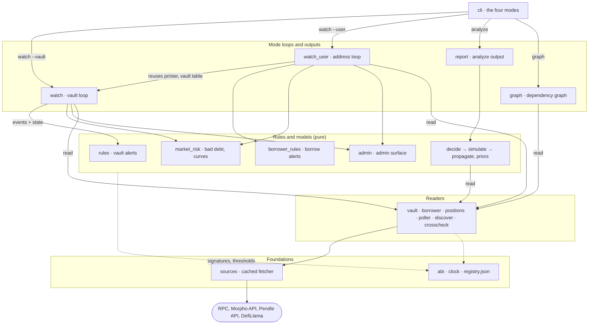
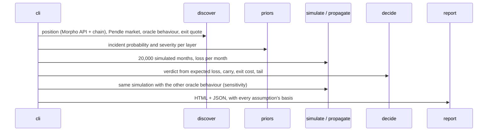
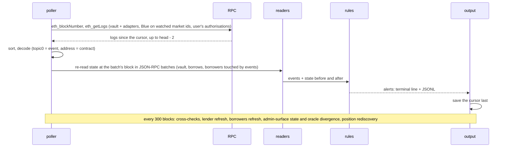

# Architecture

`riskdep` is a Python command-line tool that measures and monitors the risk of DeFi positions on Ethereum, centred on [Morpho](https://morpho.org/) (Morpho Blue markets and Morpho Vault V2). This document explains how the system is built: its modes, its components, where its data comes from, how each mode runs, and where its state lives. It describes the code as it is; the detailed mechanics are in the documents listed at the end.

## Contents

- [1. What the tool does](#1-what-the-tool-does)
- [2. Components](#2-components)
- [3. Data sources and trust](#3-data-sources-and-trust)
- [4. How each mode runs](#4-how-each-mode-runs)
- [5. State and files](#5-state-and-files)
- [6. Design principles](#6-design-principles)
- [7. Testing](#7-testing)
- [8. Decisions](#8-decisions)
- [9. Limits](#9-limits)
- [10. Where to read more](#10-where-to-read-more)

## 1. What the tool does

One command, `python3 -m riskdep`, with four modes:

| Mode | For whom | What it produces | When it runs |
|---|---|---|---|
| `analyze` | a risk or portfolio manager | a STAY / REDUCE / EXIT verdict for one Pendle PT position used as Morpho Blue collateral, with the reasons, an HTML report and JSON | once, on demand |
| `watch --vault` | a Vault V2 depositor | alerts on every transaction that changes the depositor's exposure, losses, exit capacity or the vault's governance | continuously, block by block |
| `watch --user` | an address with Morpho positions | the same for every Blue borrow and Vault V2 deposit of the address: health factor, liquidation, lenders, rate, curves | continuously, block by block |
| `graph` | anyone reviewing a position | an interactive dependency graph (HTML) and its data (JSON) | once, on demand |

`analyze` estimates a risk; the two `watch` modes detect events; `graph` draws dependencies. All four read the same sources through the same modules.

## 2. Components

The package has 24 Python files (about 4,400 lines), in five layers. The diagram shows the main path of each mode; the table under it lists every import, taken from the code.

| Module | Imports |
|---|---|
| `cli` | `clock`, `crosscheck`, `decide`, `discover`, `graph`, `priors`, `report`, `simulate`, `sources`, `watch`, `watch_user` |
| `watch` | `admin`, `crosscheck`, `discover`, `market_risk`, `poller`, `rules`, `sources`, `vault` |
| `watch_user` | `abi`, `admin`, `borrower`, `borrower_rules`, `crosscheck`, `discover`, `market_risk`, `poller`, `positions`, `rules`, `sources`, `vault`, `watch` |
| `report` | `clock`, `decide`, `discover`, `priors`, `simulate` |
| `graph` | `abi`, `borrower`, `discover`, `positions`, `sources`, `vault` |
| `rules` | `abi`, `discover`, `vault` |
| `borrower_rules` | `abi`, `borrower`, `discover`, `rules` |
| `market_risk` | `abi`, `discover`, `rules`, `sources`, `vault` |
| `admin` | `abi`, `borrower`, `discover`, `rules`, `sources`, `vault` |
| `decide` | `discover`, `simulate` |
| `simulate` | `discover`, `priors`, `propagate` |
| `propagate` | — |
| `priors` | `clock`, `discover`, `sources` |
| `vault` | `abi`, `sources` |
| `borrower` | `abi`, `discover`, `sources`, `vault` |
| `positions` | `sources` |
| `poller` | `abi`, `sources` |
| `discover` | `clock`, `sources` |
| `crosscheck` | `abi`, `sources` |
| `sources` | `clock` |
| `abi` | — |
| `clock` | — |

The layers, from the bottom:

- **Foundations.** `sources.py` is the only module that touches the network: one `Fetcher` that caches every request (section 5). `abi.py` holds the event and function signatures of Morpho Blue, Vault V2 and its adapters, copied from their source at pinned commits. `clock.py` gives the analysis one notion of "now". `registry.json` holds every fact and threshold that is not read live; `discover.py` loads it and the other modules read it from there.
- **Readers.** They turn raw sources into typed state:
  - `vault.py`: a vault's structure (adapters, markets, caps, timelocks) and its state at a block;
  - `borrower.py`: a borrower's positions and a market's main lenders;
  - `positions.py`: what an address holds;
  - `poller.py`: the logs of new blocks;
  - `discover.py`: a PT position and its layers, for `analyze`;
  - `crosscheck.py`: whether two sources agree.
- **Rules and models.** Pure functions from state to alerts or numbers:
  - `rules.py` (vault) and `borrower_rules.py` (borrows) map decoded events and before/after state to alerts;
  - `market_risk.py` values every borrower of a market;
  - `priors.py`, `propagate.py`, `simulate.py` and `decide.py` form the `analyze` model.

  `market_risk.py` and `admin.py` mix both kinds: `market_risk`'s `Tracker` and `admin`'s `AdminWatch` read state, and their `value` and `assess_*` functions are pure. `admin.py` covers the contracts a market depends on beyond Morpho (oracles, feeds, tokens, Pendle SY): upgradeability, admins, owners, feeds, pauses, mints, and the oracle's gap to DefiLlama's price.
- **Mode loops and outputs.** `watch.py` and `watch_user.py` run the polling loops; `report.py` and `graph.py` write the HTML and JSON outputs.
- **Entry.** `cli.py` parses the command line and dispatches.

## 3. Data sources and trust

Every source is public and needs no API key.

| Source | Used for | Read by |
|---|---|---|
| Ethereum RPC `ethereum-rpc.publicnode.com` (HTTP, JSON-RPC batches) | all on-chain state (`eth_call` at a fixed block), new blocks and logs (`eth_blockNumber`, `eth_getLogs`), contract code | `sources` for every reader |
| Second RPC `eth.drpc.org`, then `1rpc.io` | block hash comparison only | `crosscheck` |
| Morpho API `blue-api.morpho.org/graphql` | finding things the chain cannot list cheaply: a user's positions, a market's borrowers and top suppliers, a vault's allocators and sentinels, a default depositor | `positions`, `borrower`, `market_risk`, `graph`, `vault` |
| Pendle API `api-v2.pendle.finance/core` | PT markets, implied yield, real swap quotes for exit costs | `discover`, `watch_user` |
| DefiLlama `api.llama.fi`, `coins.llama.fi` | protocol list and hack record (incident base rates), token prices and one-year price history, the independent price oracles are compared with | `priors`, `discover`, `admin` |

**Trust model.**
- **The chain is authoritative.** The APIs are used to *find* positions and addresses; every amount, health factor, cap and price used in a decision is then read on-chain.
- **Cross-checks.** At start and every 300 blocks, the main RPC's block hash is compared with an independent node (a mismatch is a critical alert), and the Morpho API's numbers with the chain (a mismatch beyond 0.5 % is a warn). A check that cannot run says "not checked" and never stops the run.
- **Limits of the free RPC.** It serves state only about 90 to 126 blocks back (the tool reads at most 64 back) and refuses old log ranges, so the watch reports a gap rather than backfilling. It accepts at most 9 addresses per log filter, so the poller splits longer lists, and it intermittently refuses a recent range as "archive", so the poller retries before declaring a gap.

## 4. How each mode runs

### `analyze`

Details and a worked example: `docs/how-risk-is-computed.md`.

### `watch --vault` and `watch --user`: one batch

Both watches share the same loop; `watch --user` runs one target per kind of position (all borrows together, one target per vault).

Details, with a real transaction decoded step by step: `docs/how-a-block-is-analysed.md`. Why polling rather than a WebSocket: `docs/websocket-vs-polling.md`.

### `graph`

`graph` calls the readers once (positions, vaults, markets, oracles and their feeds, main lenders, admins) and builds typed nodes (Actor, Pool, Asset, Oracle, Admin, External) and edges carrying amounts. It writes them as JSON and as an HTML page rendered with Cytoscape.js. The node model is explained in `ANALYSIS_MONITORING.md` §1.

## 5. State and files

| State | Where | Written by | Notes |
|---|---|---|---|
| Request cache | `data/snapshot/*.json` | `sources.Fetcher` in `live` and `refresh` modes | key = hash of (method, URL, body); doubles as the offline demo of `analyze` |
| Date of the snapshot | `data/snapshot/as_of.json` | `analyze --refresh` | offline runs use it as "now" through `clock.py` |
| Recorded watch ranges | `data/replay/<vault>/`, `data/replay/user-<address>/` | `watch --blocks N --record` | re-run offline by `--replay` and by the tests |
| Facts and thresholds | `riskdep/registry.json` | a person, by hand | every value has its basis; reference in `docs/registry-reference.md` |
| Cursor | `out/watch-*.cursor` | the watch loops, last in each batch | a restart resumes after it |
| Alerts | `out/watch-*.jsonl` | the watch loops | one JSON object per alert |
| Reports and graphs | `out/report.html/.json`, `out/graph.html/.json` | `report`, `graph` | `out/` is git-ignored |

The `Fetcher` has four modes: `offline` (cache only; a miss is an error), `live` (cache first, network on a miss), `refresh` (network always, cache rewritten) and `direct` (network always, nothing cached; used by the live watches).

## 6. Design principles

- **Design first.** Each mode was built from a plan in `plan/`, with numbered decisions; code comments cite them (for example `D21`, `D45`).
- **Pure rules, I/O at the edges.** Rules take decoded events and state and return alerts; they never fetch. This is what lets every rule be tested with synthetic events.
- **The chain decides, the APIs find.** See section 3.
- **One state read per batch, at one block.** All values in a batch come from one block, so they are consistent with each other; JSON-RPC batches keep it to a few requests.
- **Alerts first, cursor last.** A crash replays a batch rather than skipping one; an alert can repeat, a block is never missed.
- **One clock, one cache.** Offline runs are reproducible on any later day, and any live run can become a test fixture.
- **No literal thresholds.** Every threshold and assumption lives in `registry.json` with its basis.

## 7. Testing

`uv run pytest -q tests` runs 112 tests, all offline:

| Kind | Files | What it covers |
|---|---|---|
| Rule tests on synthetic events and states | `test_watch_rules.py`, `test_borrower.py`, `test_market_risk.py`, `test_admin.py` | every alert fires at its threshold and stays silent below it |
| Model tests | `test_propagate.py`, `test_decide.py` | loss propagation and the verdict |
| End to end on recorded real data | `test_demo_snapshot.py`, `test_watch_replay.py`, `test_watch_user_replay.py` | the `analyze` demo and three recorded watch ranges (a vault, a borrower with 6 borrows, a depositor) |
| Fixes and tools | `test_fixes.py`, `test_graph.py` | the snapshot clock, oracle ambiguity, cross-checks, the graph output |

**Re-recording.** When a reader starts making new requests, the replays miss them. Re-record with `watch --blocks 1000 --record` (vault) or `watch --user <address> --blocks 300 --record`, then prune the responses the tests no longer read. The free RPC's short state window means a recording must be made in one go, close to the chain head.

## 8. Decisions

The design decisions are numbered across six plans, in the order the increments were built:

| Plan | Increment | Decisions |
|---|---|---|
| `plan/2026-10-10-defi-risk-dependency.plan.md` | `analyze`: the PT position model and verdict | D1–D17, D18a–c |
| `plan/2026-10-10-morpho-vault-v2-watcher.plan.md` | `watch --vault` | D18–D30 |
| `plan/2026-10-10-morpho-user-watcher.plan.md` | `watch --user` | D31–D40 |
| `plan/2026-10-10-lenders-and-timelocks.plan.md` | main lenders, timelock lengths | D41–D44 |
| `plan/2026-10-10-market-borrowers.plan.md` | every borrower: unrealised bad debt, liquidation curves | D45–D51 |
| `plan/2026-10-10-admin-surface.plan.md` | admins of oracles, Morpho Blue and collateral issuers; oracle divergence | D52–D60 |

A change that departs from a decision is recorded in that plan's table.

## 9. Limits

- **Ethereum mainnet only,** and Morpho Blue and Vault V2 only: no direct Blue supply positions, Vault V1 deposits are not expanded, `analyze` supports only Pendle PT collateral.
- **Detection, not action.** The tool never signs or sends a transaction.
- **Free infrastructure:** about 25 to 40 seconds of latency (2 confirmations, 12-second polling), no history beyond the RPC's window, no protection against reorgs deeper than 2 blocks, alerts in the terminal and a file only.
- **Model assumptions** in `analyze`: base-rate probabilities, mostly independent failures, constant rates over the horizon.

The full list, with impact and effort, is §5 of `ANALYSIS_MONITORING.md`.

## 10. Where to read more

| Document | Read it for |
|---|---|
| `README.md` | how to run each mode, the alert trigger tables |
| `ANALYSIS_MONITORING.md` | the risk model (graph, impact, monitoring, execution) and the gaps |
| `docs/how-risk-is-computed.md` | the `analyze` model, step by step |
| `docs/how-a-block-is-analysed.md` | one watch batch, with a real transaction |
| `docs/alert-runbook.md` | what each alert means and what to do |
| `docs/glossary.md` | the terms |
| `docs/registry-reference.md` | every key of `registry.json` |
| `docs/websocket-vs-polling.md` | the choice of polling |
| `docs/user-watcher-options.md` | the options behind `watch --user` |
| `docs/graph-example.html` | a rendered dependency graph |
| `NEXT_STEP.md` | what comes next, and what each step needs |
| `CLAUDE.md` / `AGENTS.md` | conventions for editing the code |
