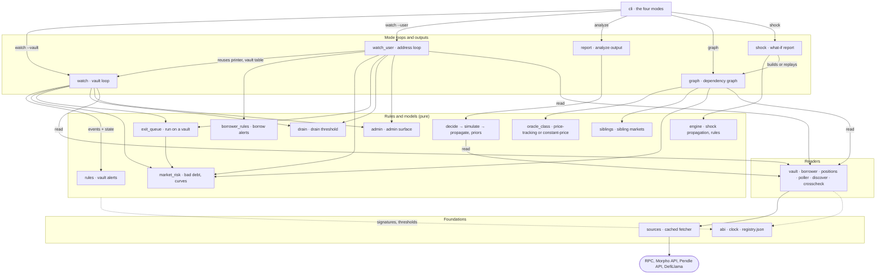
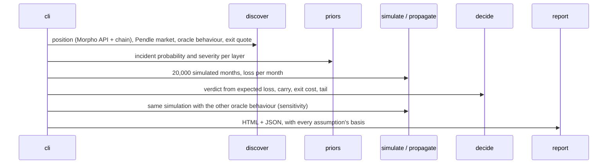
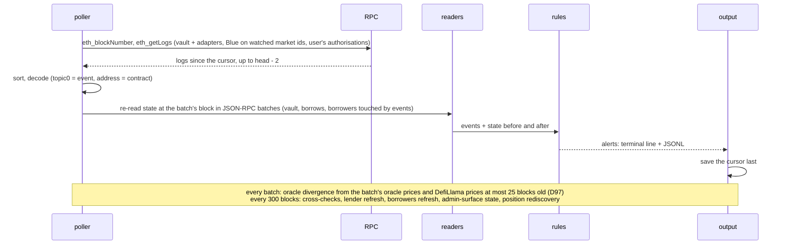

# Architecture

`riskdep` is a Python command-line tool that measures and monitors the risk of DeFi positions on Ethereum, centred on [Morpho](https://morpho.org/) (Morpho Blue markets and Morpho Vault V2). This document explains how the system is built: its modes, its components, where its data comes from, how each mode runs, and where its state lives. It describes the code as it is; the detailed mechanics are in the documents listed at the end.

## Contents

- [1. What the tool does](#1-what-the-tool-does)
- [2. Components](#2-components)
- [3. Data sources and trust](#3-data-sources-and-trust)
- [4. How each mode runs](#4-how-each-mode-runs)
- [5. State and files](#5-state-and-files)
- [6. Design principles](#6-design-principles)
- [7. Testing](#7-testing)
- [8. Decisions](#8-decisions)
- [9. Limits](#9-limits)
- [10. Where to read more](#10-where-to-read-more)

## 1. What the tool does

One command, `python3 -m riskdep`, with five modes:

| Mode | For whom | What it produces | When it runs |
|---|---|---|---|
| `analyze` | a risk or portfolio manager | a STAY / REDUCE / EXIT verdict for one Pendle PT position used as Morpho Blue collateral, with the reasons, an HTML report and JSON | once, on demand |
| `watch --vault` | a Vault V2 depositor | alerts on every transaction that changes the depositor's exposure, losses, exit capacity or the vault's governance | continuously, block by block |
| `watch --user` | an address with Morpho positions | the same for every Blue borrow and Vault V2 deposit of the address: health factor, liquidation, lenders, rate, curves | continuously, block by block |
| `graph` | anyone reviewing a position | an interactive dependency graph (HTML) and its data (JSON), with sibling markets and oracle classes | once, on demand |
| `shock` | a vault owner or risk analyst | what each market, the vault and a depositor lose when a node fails (oracle reading low or high, frozen feed, collateral falling), with the path, or a ranking of every oracle by that loss | once, on demand |

`analyze` estimates a risk; the two `watch` modes detect events; `graph` draws dependencies; `shock` propagates a failure through them. All five read the same sources through the same modules; `shock` adds a pure engine on top of the graph.

## 2. Components

The package has 30 Python files (about 8,100 lines), in five layers. The diagram shows the main path of each mode; the table under it lists every import, taken from the code.

| Module | Imports |
|---|---|
| `cli` | `clock`, `crosscheck`, `decide`, `discover`, `engine`, `graph`, `pharos`, `priors`, `report`, `scenario`, `shock`, `simulate`, `sources`, `vault_book`, `vault_incident`, `watch`, `watch_user` |
| `scenario` | `decide`, `discover`, `oracle_class`, `propagate`, `sources`, `vault` |
| `vault_incident` | `discover`, `engine`, `exit_queue`, `market_risk`, `nexus`, `oracle_class`, `pharos`, `scenario`, `sources`, `vault` |
| `vault_book` | `vault_incident` |
| `watch` | `admin`, `crosscheck`, `discover`, `drain`, `exit_queue`, `market_risk`, `poller`, `rules`, `sources`, `vault` |
| `watch_user` | `abi`, `admin`, `borrower`, `borrower_rules`, `crosscheck`, `discover`, `drain`, `exit_queue`, `market_risk`, `poller`, `positions`, `rules`, `scenario`, `sources`, `vault`, `watch` |
| `report` | `clock`, `decide`, `discover`, `priors`, `simulate` |
| `graph` | `abi`, `borrower`, `clock`, `discover`, `market_risk`, `oracle_class`, `positions`, `siblings`, `sources`, `vault` |
| `engine` | `discover`, `drain` (pure: reads only the graph) |
| `shock` | `engine` |
| `rules` | `abi`, `discover`, `vault` |
| `borrower_rules` | `abi`, `borrower`, `discover`, `rules` |
| `market_risk` | `abi`, `discover`, `rules`, `sources`, `vault` |
| `exit_queue` | `discover`, `market_risk`, `rules`, `sources` |
| `drain` | `discover`, `rules`, `sources`, `vault` |
| `oracle_class` | `discover`, `sources`, `vault` |
| `siblings` | `discover`, `sources`, `vault` |
| `admin` | `abi`, `borrower`, `discover`, `rules`, `sources`, `vault` |
| `decide` | `discover`, `simulate` |
| `simulate` | `discover`, `priors`, `propagate` |
| `propagate` | — |
| `priors` | `clock`, `discover`, `sources` |
| `vault` | `abi`, `sources` |
| `borrower` | `abi`, `discover`, `sources`, `vault` |
| `positions` | `sources` |
| `poller` | `abi`, `sources` |
| `discover` | `clock`, `sources` |
| `crosscheck` | `abi`, `sources` |
| `sources` | `clock` |
| `abi` | — |
| `clock` | — |

The layers, from the bottom:

- **Foundations.** `sources.py` is the only module that touches the network: one `Fetcher` that caches every request (section 5). `abi.py` holds the event and function signatures of Morpho Blue, Vault V2 and its adapters, copied from their source at pinned commits. `clock.py` gives the analysis one notion of "now". `registry.json` holds every fact and threshold that is not read live; `discover.py` loads it and the other modules read it from there.
- **Readers.** They turn raw sources into typed state:
  - `vault.py`: a vault's structure (adapters, markets, caps, timelocks) and its state at a block;
  - `borrower.py`: a borrower's positions and a market's main lenders;
  - `positions.py`: what an address holds;
  - `poller.py`: the logs of new blocks;
  - `discover.py`: a PT position and its layers, for `analyze`;
  - `crosscheck.py`: whether two sources agree.
- **Rules and models.** Pure functions from state to alerts or numbers:
  - `rules.py` (vault) and `borrower_rules.py` (borrows) map decoded events and before/after state to alerts;
  - `market_risk.py` values every borrower of a market;
  - `vault_book.py` applies one incident to a user-defined book of vaults and adds it up in USD;
  - `vault_incident.py` is incident mode for a vault depositor: a collateral's oracle price falls, every borrower of the hit markets is valued at the new price, and the vault's and the depositor's losses, what can leave and a verdict follow;
  - `scenario.py` is incident mode: the impact of a known incident, its time to impact and the verdict with the incident certain, and the impact attached to `OracleDivergence` alerts in `watch --user`;
  - `drain.py` computes each vault market's drain threshold d\* and what a drain would take (`docs/watch/drain-threshold.md`);
  - `exit_queue.py` models a run on a vault: what a depositor recovers at par and loses at each queue position (`docs/watch/exit-queue.md`);
  - `priors.py`, `propagate.py`, `simulate.py` and `decide.py` form the `analyze` model.

  `market_risk.py`, `drain.py`, `exit_queue.py` and `admin.py` mix both kinds: `market_risk`'s `Tracker`, `drain`'s `read_pa`, `exit_queue`'s `holders` and `admin`'s `AdminWatch` read state, and their `value` and `assess_*` functions are pure. `admin.py` covers the contracts a market depends on beyond Morpho (oracles, feeds, tokens, Pendle SY): upgradeability, admins, owners, feeds, pauses, mints, and the oracle's gap to DefiLlama's price.
- **Mode loops and outputs.** `watch.py` and `watch_user.py` run the polling loops; `report.py` and `graph.py` write the HTML and JSON outputs.
- **Entry.** `cli.py` parses the command line and dispatches.

## 3. Data sources and trust

Every source is public and needs no API key. The exact endpoints, queries and measured limits are listed in `PROVIDERS.md`.

| Source | Used for | Read by |
|---|---|---|
| Ethereum RPC `ethereum-rpc.publicnode.com` (HTTP, JSON-RPC batches) | all on-chain state (`eth_call` at a fixed block), new blocks and logs (`eth_blockNumber`, `eth_getLogs`), contract code | `sources` for every reader |
| Second RPC `eth.drpc.org`, then `1rpc.io` (discontinued, answers 410) | block hash comparison only | `crosscheck` |
| eRPC, optional, run locally (`erpc.yaml`) | the main RPC's requests when `RISKDEP_RPC_URL` points at it: six free upstreams, failover, an in-memory cache | `sources` (routing only; cache keys keep the public URL) |
| Morpho API `blue-api.morpho.org/graphql` | finding things the chain cannot list cheaply: a user's positions, a market's borrowers and top suppliers, a vault's allocators, sentinels and holders, a default depositor, every market above a TVL floor (sibling search) | `positions`, `borrower`, `market_risk`, `exit_queue`, `graph`, `siblings`, `vault` |
| Pendle API `api-v2.pendle.finance/core` | PT markets, implied yield, real swap quotes for exit costs, a PT's underlying | `discover`, `watch_user`, `siblings` |
| DefiLlama `api.llama.fi`, `coins.llama.fi` | protocol list and hack record (incident base rates), token prices and one-year price history, the independent price oracles are compared with | `priors`, `discover`, `admin` |
| Nexus Mutual `api.nexusmutual.io/v2` (optional, keyless) | cover prices per protocol: an outside probability next to the breakeven p\* | `nexus`, `vault_incident` |
| Pharos `api.pharos.watch` (optional, keyless) | issuer grades, off-chain backing and common-mode groups of stablecoins; shown next to our numbers, and the backing as a path an incident follows (`docs/risk-assessment/outside-providers.md`) | `pharos`, `vault_incident`, `graph` |
| Etherscan `api.etherscan.io/v2/api`, key in `keys.ini` (optional) | whether the `analyze` oracle's source is verified; the contract name of an oracle input no other rule classifies; without the key, "not checked" / "not classified" | `discover`, `oracle_class` (via `sources.contract_source`) |

**Trust model.**
- **The chain is authoritative.** The APIs are used to *find* positions and addresses; every amount, health factor, cap and price used in a decision is then read on-chain.
- **Cross-checks.** At start and every 300 blocks, the main RPC's block hash is compared with an independent node (a mismatch is a critical alert), and the Morpho API's numbers with the chain (a mismatch beyond 0.5 % is a warn). A check that cannot run says "not checked" and never stops the run.
- **Limits of the free RPC.** It serves state only about 90 to 126 blocks back (the tool reads at most 64 back) and refuses old log ranges, so the watch reports a gap rather than backfilling. It accepts at most 9 addresses per log filter, so the poller splits longer lists, and it intermittently refuses a recent range as "archive", so the poller retries before declaring a gap.

## 4. How each mode runs

### `analyze`

Details and a worked example: `docs/model/how-risk-is-computed.md`.

### `analyze --vault` and `--book`: a known incident

`pipeline.incident` (shared with `POST /api/incident`) parses the shocks (`token=<collateral>:<fall>`, `borrower=<target>:<recovery>[:<n>]`), reads Pharos and Nexus once, and for each vault of the book runs `vault_incident.run` at the vault's recorded or live block:
1. **Hits.** Each shock is matched to the vault's markets through the collateral itself, what it wraps on-chain (PT, ERC-4626), or Pharos's off-chain backing.
2. **Market loss.** Every borrower is valued at the shocked price (`market_risk.value`); a constant-price oracle on a wrapper does not move, so the loss is the hidden shortfall; a default removes the defaulters at their recovery. With a recorded graph, the shock engine replaces these figures on the markets it reaches and adds sibling markets.
3. **Depositor.** The exit queue (`exit_queue.py`) gives the loss if the depositor stays and if it leaves first; `decide` gives STAY or EXIT given the incident; `breakeven` gives p\*, the incident probability above which leaving now pays.

`vault_book.aggregate` adds the vaults in USD and names the vault to act on first (lowest p\*); `--conditional` reruns every vault at multiples of the fall and draws the loss of staying (`conditional.py`). Details, with diagrams and a worked example: `docs/model/vault-incident.md`.

### `watch --vault` and `watch --user`: one batch

Both watches share the same loop; `watch --user` runs one target per kind of position (all borrows together, one target per vault).

Details, with a real transaction decoded step by step: `docs/watch/how-a-block-is-analysed.md`. Why polling rather than a WebSocket: `docs/watch/websocket-vs-polling.md`.

### `graph`

`graph` calls the readers once (positions, vaults, markets, oracles and their feeds, main lenders, admins) and builds typed nodes (Actor, Pool, Asset, Oracle, Admin, External) and edges carrying amounts. It writes them as JSON and as an HTML page rendered with Cytoscape.js. The node model is explained in `ANALYSIS_MONITORING.md` §1.

Then, by default (plan `2026-10-10-sibling-markets`):
1. **Sibling markets.** `siblings.candidates` lists every Ethereum Blue market above the TVL floor, $1M supplied (Morpho API); `siblings.underlyings` reads each collateral's underlying (Pendle lists for PTs, `asset()` for ERC-4626 shares); the pure `siblings.match` keeps those linked to a held market by the same collateral, the same underlying, a shared base price input, or lending that collateral. Each is re-read on-chain and added like a held market, so it joins the graph through the shared asset, oracle or feed node.
2. **Oracle classes.** `_oracle` probes each base-side input (`oracle_class.probe`: answer, description, round history, composite and structural getters) and `oracle_class.classify_oracle` labels the oracle `price-tracking`, `constant-price` or `not classified`, with its basis.
3. **Wraps, tracks and market state.**
   - An ERC-4626 asset gets a `wraps` edge to the token it redeems into.
   - An oracle input gets a `tracks` edge to the market it reads: a Pendle TWAP to its PT (from `market()`), a price-tracking "SYM / USD" feed to that asset.
   - Each PT gets two Pendle quote ladders, turned into sale-impact curves with a capacity: PT → underlying, on the PT; PT → loan token, on the underlying.
   - Every Blue market, held or sibling, gets supply, borrow, the collateral of its borrowers, its positions and the liquidation curve from `market_risk`.

   That is the data the propagation engine needs.

`--record` saves every response under `fixtures/replay/graph-<target>/` with a `meta.json` (block, targets, the time of the recording); `--replay` rebuilds the graph offline from it, with the recording's time as "now" (a PT's days to maturity).

### `shock`

`shock` builds or replays the graph (`graph.load`), which also carries every market's borrower positions, LLTV and free liquidity, and a Pendle pool's liquidity and implied yield. It parses the shocks and hands both to `engine.run`, a pure function:
1. **Inputs.** Each shock becomes an input of its node: a misreport, a freeze or a price factor.
2. **Node models.** A node's model recomputes its effects from its inputs. A Blue market evaluates every borrower (liquidations, Blue's write-off, insolvent debt, the drain), net of its state before the shock. An asset applies the impact of the collateral sold into its pool, down to a PT's floor.
3. **Edge rules.** For each changed effect, the first matching edge rule of `registry.json` (`engine`), or of a `--rules` file, picks the transmission that carries it to the next node.
4. **Fixed point.** The run repeats until no input moves (ε) or the evaluation budget is spent.

`shock.report` prints each market's outcome, each vault's and depositor's loss and the path (`engine.path`). `shock.trace` writes the same run as data for a front end (D119): the graph with edge ids, every step with its edge and wave, each node's final state (`docs/model/shock-trace.md`). `--sweep` runs one shock per oracle (or asset) and ranks them. Details and the rule format: `docs/model/shock-engine.md`.

## 5. State and files

| State | Where | Written by | Notes |
|---|---|---|---|
| Request cache | `fixtures/snapshot/*.json` | `sources.Fetcher` in `live` and `refresh` modes | key = hash of (method, URL, body); doubles as the offline demo of `analyze` |
| Date of the snapshot | `fixtures/snapshot/as_of.json` | `analyze --refresh` | offline runs use it as "now" through `clock.py` |
| Recorded watch ranges | `fixtures/replay/<vault>/`, `fixtures/replay/user-<address>/` | `watch --blocks N --record` | re-run offline by `--replay` and by the tests |
| Recorded graphs | `fixtures/replay/graph-<target>/` | `graph --record` | rebuilt offline by `graph --replay` and by `test_graph.py` |
| Facts and thresholds | `riskdep/registry.json` | a person, by hand | every value has its basis; reference in `docs/reference/registry-reference.md` |
| Cursor | `out/watch-*.cursor` | the watch loops, last in each batch | a restart resumes after it |
| Alerts | `out/watch-*.jsonl` | the watch loops | one JSON object per alert |
| Reports and graphs | `out/report.html/.json`, `out/graph.html/.json` | `report`, `graph` | `out/` is git-ignored |

The `Fetcher` has four modes: `offline` (cache only; a miss is an error), `live` (cache first, network on a miss), `refresh` (network always, cache rewritten; a request repeated in the same run gets its first answer, so a recording replays what it computed from) and `direct` (network always, nothing cached; used by the live watches).

## 6. Design principles

- **Design first.** Each mode was built from a plan in `plan/`, with numbered decisions; code comments cite them (for example `D21`, `D45`).
- **Pure rules, I/O at the edges.** Rules take decoded events and state and return alerts; they never fetch. This is what lets every rule be tested with synthetic events.
- **The chain decides, the APIs find.** See section 3.
- **One state read per batch, at one block.** All values in a batch come from one block, so they are consistent with each other; JSON-RPC batches keep it to a few requests. A live batch with no event reads only the values that move without one, the rest carried from the last full read (D61).
- **Alerts first, cursor last.** A crash replays a batch rather than skipping one; an alert can repeat, a block is never missed.
- **One clock, one cache.** Offline runs are reproducible on any later day, and any live run can become a test fixture.
- **No literal thresholds.** Every threshold and assumption lives in `registry.json` with its basis.

## 7. Testing

`uv run pytest -q tests` runs 234 tests, all offline:

| Kind | Files | What it covers |
|---|---|---|
| Rule tests on synthetic events and states | `test_watch_rules.py`, `test_borrower.py`, `test_market_risk.py`, `test_exit_queue.py`, `test_drain.py`, `test_admin.py` | every alert fires at its threshold and stays silent below it |
| Classifier and matcher tests | `test_oracle_class.py`, `test_siblings.py` | every oracle-class rule (D83) and every sibling relation, floor and cap (D77, D79) |
| Engine tests | `test_engine.py` | every transmission and node model on a hand-worked graph, every rule criterion, a rules file overriding the defaults, the squeeze down to the PT floor, and three scenarios on the recorded RockawayX graph |
| Model tests | `test_propagate.py`, `test_decide.py`, `test_scenario.py`, `test_vault_incident.py` | loss propagation, the verdict, and incident mode for a position and for a vault depositor |
| End to end on recorded real data | `test_demo_snapshot.py`, `test_watch_replay.py`, `test_watch_user_replay.py`, `test_graph.py` | the `analyze` demo, three recorded watch ranges (a vault, a borrower with 6 borrows, a depositor) and the recorded RockawayX USDC Yield graph (10 siblings, 6 oracle classes) |
| HTTP API | `test_api.py` | every route, the block cursor of `/api/alerts`, the shock trace against the committed example, the 404s that name the command to run, and the OpenAPI surface |
| Fixes and tools | `test_fixes.py`, `test_graph.py`, `test_light_reads.py` | the snapshot clock, oracle ambiguity, cross-checks, the graph output, light reads on quiet batches (D61), RPC routing and retries, throttled batches (a 429, or rate-limit errors inside a reply) resent and never recorded |

**Re-recording.** When a reader starts making new requests, the replays miss them. Re-record with `watch --blocks 1000 --record` (vault), `watch --user <address> --blocks 300 --record` or `graph --vault <vault> --record`, then prune the responses the tests no longer read. The free RPC's short state window means a recording must be made in one go, close to the chain head.

## 8. Decisions

The design decisions are numbered across twelve plans, in the order the increments were built:

| Plan | Increment | Decisions |
|---|---|---|
| `plan/2026-10-10-defi-risk-dependency.plan.md` | `analyze`: the PT position model and verdict | D1–D17, D18a–c, D68 |
| `plan/2026-10-10-morpho-vault-v2-watcher.plan.md` | `watch --vault` | D18–D30 |
| `plan/2026-10-10-morpho-user-watcher.plan.md` | `watch --user` | D31–D40 |
| `plan/2026-10-10-lenders-and-timelocks.plan.md` | main lenders, timelock lengths | D41–D44 |
| `plan/2026-10-10-market-borrowers.plan.md` | every borrower: unrealised bad debt, liquidation curves | D45–D51 |
| `plan/2026-10-10-admin-surface.plan.md` | admins of oracles, Morpho Blue and collateral issuers; oracle divergence | D52–D60 |
| `plan/2026-10-10-exit-queue.plan.md` | a depositor's place in a run on a vault | D62–D67 |
| `plan/2026-10-10-drain-threshold.plan.md` | when a depeg empties a market: d\*, the Public Allocator, `DrainWindow` | D69–D74 |
| `plan/2026-10-10-sibling-markets.plan.md` | sibling markets and oracle classes in the dependency graph; eRPC; the TVL floor | D75–D88 |
| `plan/2026-10-10-incident-mode.plan.md` | incident mode: a known incident's impact, time to impact and verdict; alert impacts in `watch --user` | D89–D97 |
| `plan/2026-10-11-vault-incident.plan.md` | incident mode for a vault depositor; curve widened to −30 and −50 % | D98–D103 |
| `plan/2026-10-10-propagation-engine.plan.md` | the shock engine: a deterministic failure through the graph, driven by rules; calibrated on Pendle quotes | D104–D119 |
| `plan/2026-10-11-vault-book.plan.md` | a book of vaults under one incident; recording any vault | D120–D125 |
| `plan/2026-10-11-wrapped-collateral.plan.md` | a token shock reaches the markets whose collateral wraps it | D126–D127 |
| `plan/2026-10-11-borrower-concentration.plan.md` | borrower concentration and default; exit liquidity; the no-liquidator branch | D128–D132 |
| `plan/2026-10-11-pharos.plan.md` | Pharos, keyless: grades, off-chain backing, common-mode groups | D133–D138 |
| `plan/2026-10-11-one-number.plan.md` | the shock engine as the impact core of vault and book incidents | D139–D141 |
| `plan/2026-10-11-breakeven.plan.md` | the breakeven probability p\* of vault and book incidents; Nexus as an outside view | D142–D146 |
| `plan/2026-10-11-alerts-and-verdict.plan.md` | `FeedStale`; the Zama batcher and wrapper alerts; the PT verdict's horizon and tail (K12, K13) | D190–D196 |
| `plan/2026-10-11-detect.plan.md` | detection → impact for a vault: `OracleImpact` in both watches | D187–D189 |
| `plan/2026-10-11-mixed-book.plan.md` | borrow pockets in a book, the brief's PT loop among them | D177–D178 |
| `plan/2026-10-11-zama.plan.md` | Zama confidential vaults: the cShare pool, the two exits, the hidden layer | D171–D176 |
| `plan/2026-10-11-pt-channels.plan.md` | the PT loop's implied-yield and borrow-rate incidents | D169–D170 |
| `plan/2026-10-11-conditional.plan.md` | the loss of staying given the incident, drawn, against the certain cost of leaving | D165–D168 |
| `plan/2026-10-11-admin-impact.plan.md` | admin changes by what they can do to deposits; who holds each role | D244–D245 |
| `plan/2026-10-11-gapv2-fixes.plan.md` | GAPV2 G19, G11, G12, G1: ERC-4626 rates, the Midas band, values computed on read, exposure up to the caps | D240–D243 |
| `plan/2026-10-11-cascade-and-liquidity.plan.md` | the cascade through the pool, backtested; the liquidity liquidations return in vault incidents | D238–D239 |
| `plan/2026-10-11-priors-k5-k15-k17.plan.md` | hacks weighted by age; the age factor a judgement; the PT stress from a measured spike; a synthetic dollar's collapse | D234–D237 |
| `plan/2026-10-11-priors-k3-k4.plan.md` | oracle exploits counted once; Morpho Blue's core prior without the Lending multiplier | D232–D233 |
| `plan/2026-10-11-after.plan.md` | a vault after an incident: landed, unrealised, pending; the verdict on what is still at risk; `POST /api/incident/after` | D228–D231 |
| `plan/2026-10-11-value-at-risk.plan.md` | one value-at-risk block per vault and book incident, in the CLI, the JSON and the API | D227 |
| `plan/2026-10-11-sky.plan.md` | Sky's backing read on-chain: sources, surplus, debt auctions, sky incidents | D223–D226 |
| `plan/2026-10-11-venues.plan.md` | the venues behind USDe: backing by exchange, reserve fund, venue incidents, funding stress | D218–D221 |
| `plan/2026-10-11-shared-and-supply.plan.md` | shared feeds and oracles; supply concentration; the position's share of its market and pool | D215–D217 |
| `plan/2026-10-11-exit-liquidity.plan.md` | exit liquidity live from KyberSwap in vault incidents | D212–D214 |
| `plan/2026-10-11-pendle-pool.plan.md` | a Pendle pool rebuilt at a past block; the sale behind the backtest's fall and the squeeze; the backtest from the sale alone; `pool_move` on the pool's math | D207–D211 |
| `plan/2026-10-11-stressed-exit.plan.md` | the exit cost after the incident's own liquidations | D206 |
| `plan/2026-10-11-oracle-kinds.plan.md` | constant-price oracles split by kind; a markdown reaches only the kinds that move | D205 |
| `plan/2026-10-11-pool-move.plan.md` | the pool move as a loss channel: a sale into the PT's Pendle pool through the oracle | D204 |
| `plan/2026-10-11-depth.plan.md` | discovery depth for the PT position: the graph's layers in `analyze` | D199–D202 |
| `plan/2026-10-11-backtest-crash.plan.md` | a second backtest: the 2025-10-10 crash, every over-prediction accounted for | D197–D198 |
| `plan/2026-10-11-backtest.plan.md` | `backtest`: the 2026-08-25 PT-reUSD liquidations replayed against the prediction | D161–D164 |
| `plan/2026-10-11-feed-quality.plan.md` | feed freshness in `graph` and vault incidents; TVL concentration of the graph's protocols | D155–D160 |
| `plan/2026-10-11-judge-path.plan.md` | the brief's ten pockets and `--exit-cost`; a reason on every verdict; the sampling error in the PT verdict | D150–D154 |
| `plan/2026-10-11-incident-api.plan.md` | `POST /api/incident`, `GET /api/books`; the incident run moved to `pipeline` | D147–D149 |

A change that departs from a decision is recorded in that plan's table.

## 9. Limits

- **Ethereum mainnet only,** and Morpho Blue and Vault V2 only: no direct Blue supply positions, Vault V1 deposits are not expanded, `analyze` supports only Pendle PT collateral. `graph`'s sibling markets are Blue markets only: the same collateral on Euler, Aave, Silo or Fluid is not seen.
- **Detection, not action.** The tool never signs or sends a transaction.
- **Free infrastructure:** about 25 to 40 seconds of latency (2 confirmations, 12-second polling), no history beyond the RPC's window, no protection against reorgs deeper than 2 blocks, alerts in the terminal and a file only.
- **Model assumptions** in `analyze`: base-rate probabilities, mostly independent failures, constant rates over the horizon.

The full list, with impact and effort, is §5 of `ANALYSIS_MONITORING.md`.

## 10. Where to read more

| Document | Read it for |
|---|---|
| `README.md` | how to run each mode, the alert trigger tables |
| `ANALYSIS_MONITORING.md` | the risk model (graph, impact, monitoring, execution) and the gaps |
| `docs/model/how-risk-is-computed.md` | the `analyze` model, step by step |
| `docs/model/scenarios-and-breakeven.md` | scenarios and breakeven probabilities as a complement to the Monte Carlo, with a learn section |
| `docs/model/vault-depositor-scenarios.md` | a vault depositor's loss under a scenario, on Sentora RLUSD Main, with a learn section |
| `docs/model/graph-propagation.md` | the dependency graph as a propagation engine (transmission functions, DebtRank), with a learn section |
| `docs/watch/how-a-block-is-analysed.md` | one watch batch, with a real transaction |
| `docs/reference/alert-runbook.md` | what each alert means and what to do |
| `docs/reference/glossary.md` | the terms |
| `docs/reference/registry-reference.md` | every key of `registry.json` |
| `docs/watch/websocket-vs-polling.md` | the choice of polling |
| `docs/watch/user-watcher-options.md` | the options behind `watch --user` |
| `docs/examples/graph-example.html` | a rendered dependency graph |
| `PROVIDERS.md` | every external provider: endpoints, queries, measured limits, trust model |
| `NEXT_STEP.md` | what comes next, and what each step needs |
| `CLAUDE.md` / `AGENTS.md` | conventions for editing the code |
