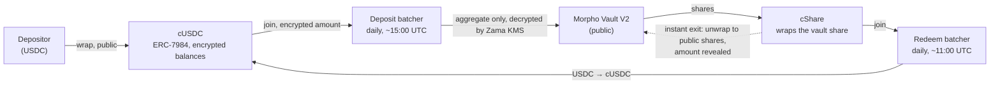

# Zama confidential vaults: what they change for `riskdep`, and how to analyse them

Two RockawayX vaults can be entered confidentially through Zama's Confidential Vault protocol: RockawayX Confidential RWA USDC (`0xc207…Da36`) and RockawayX USDC Yield (`0xE018…1965`, the `graph` demo vault). Addresses and on-chain figures are in `ROCK-VAULT.md` §2. This note says what confidentiality hides and what it does not, what new dependencies and failure modes it adds, and how to build it into the project. Source: the Zama docs in `docs/external/docs.zama.org-protocol-docs/confidential-vault/` and `eth_call` reads made on 2026-10-11. **Status 2026-10-11:** Z1, Z2 and Z3 are built (plan `2026-10-11-zama`): the 16 mainnet vaults in the registry, checked on-chain; the cShare as a pool in the depositor choice and the exit queue; the confidential share and the two exits in vault incidents; the hidden layer in `graph`. Z5 is left out: the shock engine models losses through markets, not withdrawals, so a decryption halt (exits frozen, no loss) is stated by the incident instead. Z4 is built too (plan `2026-10-11-alerts-and-verdict`): the day's confidential outflow, instant exits, canceled batches, pauses, upgrades and owner changes alert in `watch --vault`; empty days stay silent. Z6 and Z7 are open (`NEXT_STEP.md`). What the code computes today is explained in `docs/model/zama-confidential-vaults.md`.

## 1. How a Zama confidential vault works

- **The vault itself is a normal public Morpho Vault V2.** Its markets, collateral, oracles, borrowers, allocations and curator actions are all public, so everything `riskdep` computes about the vault still works.
- **What is hidden is who owns how much.** The vault's shares sit in the cShare wrapper; each depositor's slice is an encrypted `euint64` that only they can decrypt. On-chain, `0xc207` has one dominant holder, the cShare wrapper, with 99.1 % of the shares. `0xE018` has 0.8 % behind it.
- **Public anyway:** who joined each batch, each batch's decrypted aggregate, its exchange rate, wrap and unwrap amounts (`concepts/confidentiality.md`). A lone depositor in a batch is fully revealed.
- **Exits.** The batched redemption is confidential but runs once a day: dispatch about 11:00 UTC, claimable minutes later, with no slippage bound. The instant path unwraps cShare to public vault shares and redeems them directly. It takes minutes and reveals the amount. Both need a Zama decryption (the batch aggregate, or the unwrap).
- **Deposit gate.** `0xc207` has a `WhitelistSendAssetsGate`: only its deposit batcher may deposit, so it can be entered only confidentially. Redemptions are never gated.

## 2. What it changes for the analysis

### 2.1 New dependency layers (dependency discovery)

A confidential depositor depends on everything a public depositor does, plus:

| Layer | What can fail | Effect on the depositor |
|---|---|---|
| **Zama Protocol** (coprocessors, KMS, gateway) | decryption halts or is delayed | no batch can finalize and no unwrap can complete: **neither exit works** until it resumes; a dispatched batch cancels after its 12 h deadline and the funds go back to the input token |
| **cUSDC and cShare wrappers** (`ERC7984ERC20Wrapper`, Zama registry) | the registry's governance pauses a wrapper; a wrapper bug | position frozen, or lost if the wrapper's backing is wrong |
| **Deposit and redeem batchers** | owner pauses joins and dispatch (bounded: no fund movement, no upgrade; `concepts/trust-model.md`); vault call reverts | exit delayed by days; quit and claim stay available |
| **Operator (keeper)** | stops dispatching | anyone can dispatch, so this is a delay, not a loss |
| **FHE cryptography / ACL** | a flaw in decryption permissions | confidentiality lost, not funds |
| **Batch schedule** | structural | up to about 24 h to exit confidentially; the incident may land first |

None of these is in the graph today. They are what the brief means by "hidden dependencies": the vault page shows a Morpho vault and says nothing about Zama.

### 2.2 Time to exit (decision usefulness)

`riskdep` compares time to impact with time to exit (`scenario.py`, incident mode). For a confidential holder:

- **Confidential exit:** the time to the next redeem dispatch (`batchCreatedAt(currentBatchId) + batchMinBatchAge`), plus a few minutes. Up to about 24 h, and a join after 11:00 UTC waits for the next day.
- **Instant exit:** minutes, but the amount becomes public. Choosing it under stress is a trade-off between confidentiality and loss, and the tool should state it.
- **Settlement price:** a batch settles at the vault's share price at finalization, with no slippage bound. A NAV markdown published between joining and dispatch is borne in full.

On the RWA vault, whose oracles are issuer NAVs (`ROCK-VAULT.md` §1), a markdown lands at once. A daily batch therefore never beats it; only the instant path can, and only with a warning before the markdown.

### 2.3 The exit queue is wrong today for `0xc207`

`exit_queue.py` puts every contract holder ahead of the depositor (D66). On `0xc207` the cShare wrapper is a contract holding 99.1 %, so every depositor looks "behind a contract holder", and `ExitQueue` fires on a structure that is really the pooled confidential depositors themselves. Two fixes are needed:

- recognise a Zama cShare as a **pool of depositors**, not one fast holder;
- model its exits as daily batches (the confidential path) plus individual unwraps (the instant path, at any time).

It is also the likely reason the book shows `STAY` with nothing saved on this vault (`IMPROVEMENT.md` §2.1), not yet checked in the code: leaving first cannot help a depositor who is, on-chain, part of the 99 % holder.

### 2.4 Finding a user's position (`watch --user`, books)

- The Morpho API sees only the cShare wrapper, so `watch --user <address>` finds no position for a confidential depositor.
- `Joined` events are public, so the batchers an address joined are discoverable. Router joins add encrypted-zero decoy legs, so an address appears in vaults where it holds nothing. Participation is therefore an upper bound on exposure, never the exposure.
- **The amount must come from the user.** Only they can decrypt it (Zama relayer SDK, user decryption with an EIP-712 signature). `riskdep` must never hold that key, which follows the same rule as execution (`NEXT_STEP.md` D5).

### 2.5 New signals worth watching (detection)

Everything at batch level is public, so a watch can follow it:

| Signal | Source | Level |
|---|---|---|
| Redeem batch aggregate ≥ x % of the vault (a confidential run forming) | `dispatchBatchCallback` cleartext, `BatchFinalized` | warn / critical |
| Large pending redeem batch participation (count of `Joined` before dispatch) | `Joined` events | info |
| Batch canceled | `BatchCanceled` | warn |
| Batch dispatched and not finalized after N hours (Zama decryption delayed) | `batchDispatchedAt`, state | warn, then critical near the 12 h deadline |
| Batcher paused, owner changed | `Paused`, `OwnershipTransferred` | critical / warn |
| Wrapper paused or dropped from the registry | wrapper and registry events | critical |
| Large unwrap of cShare (an informed holder leaving fast, publicly) | wrapper unwrap events | warn |

The redeem aggregate is the most useful one. It is a daily, public measure of confidential outflows that a public vault does not offer in one number.

## 3. How to build it into `riskdep`

Same order as the rest of the project: discovery and data first, then rules, then impact and decision. Each step is small.

| # | Step | Where | Size |
|---|---|---|---|
| Z1 | **Detect a confidential vault and read its wiring.** Registry entry per Zama vault (batchers, cShare, cAsset, gate), from `confidential-vault/reference/addresses.md`, with its basis. Check it on-chain (`batcher.vault()`, `fromToken()`, `toToken()`), and read the cShare balance of the vault shares (the confidential fraction), `currentBatchId`, `batchState`, `minBatchAge`, `callbackDeadline`, `paused`, `owner`. | new `riskdep/zama.py` (fetching), `registry.json` `zama` | S |
| Z2 | **Graph.** Nodes for Zama Protocol (KMS), cUSDC, cShare, the two batchers, the router and the wrapper registry; edges vault → cShare → depositor. Kind and colour in `graph.py` and `web/src/lib/graph.ts`. | `graph.py` | S |
| Z3 | **Exit queue.** Treat a cShare holder as a pool; add a confidential exit (next redeem dispatch time) and an instant exit (minutes, amount public) to `exit_queue.py` and to the time-to-exit of incident mode. | `exit_queue.py`, `scenario.py`, `vault_incident.py` | S–M |
| Z4 | **Rules and alerts.** The signals of §2.5 as pure rules over decoded batcher and wrapper events, with thresholds in `registry.json` `watch` and rows in `docs/reference/alert-runbook.md`. Batcher addresses join the watched filters (the poller already splits lists above nine). | `abi.py`, `rules.py`, `watch.py` | M |
| Z5 | **Shock engine rules.** `Zama Protocol:halted` (both exits frozen for the outage; the 12 h deadline then cancels pending batches) and `cShare:paused`, as rules in `registry.json` `engine`, not new code. | `registry.json` | S |
| Z6 | **User position.** `watch --user` and the book file accept a confidential position given by hand (`zama_shares` or USD, per vault). They also list the batchers an address joined, marked "participation, may be a decoy". The decryption stays on the user's side: optionally a small documented script that uses the Zama relayer SDK with the user's wallet, kept out of `riskdep`. | `positions.py`, `vault_book.py` | S |
| Z7 | **Priors.** A prior for the Zama layer (FHE stack, KMS, young protocol). There is no hack history yet, so it is a stated assumption with a basis, like the other young-issuer priors (`NEXT_STEP.md` B5). | `registry.json`, `priors.py` | S |

**Data and tests.** All reads are keyless `eth_call` and `eth_getLogs` on the public RPC, so no new provider is needed beyond the existing RPC (record it in `PROVIDERS.md` as new contracts read, not a new endpoint). Record a watch range that includes one daily dispatch and finalization of both batchers (about 24 h of blocks, two `--record` runs around 11:00 and 15:00 UTC), so the rules are tested offline on real batches.

**Privacy rules for the tool itself.** A decrypted amount a user gives is private by design: keep it out of `fixtures/`, out of committed book files and out of the Telegram messages (`TELEGRAM_BOT.md`). Output only what the user already knows.

## 4. Why this matters for the brief

- **Dependency discovery:** a whole stack (FHE coprocessors, KMS, wrappers, batchers) that the vault page does not show. This is exactly the brief's "most of that chain is invisible from the position itself".
- **Decision:** confidentiality has a measurable price, up to a day of exit delay or the amount revealed. The tool can state it in the stay-or-exit answer, for example: "confidential exit settles in 19 h, after the NAV update; the instant exit reveals 2.1M USDC".
- **Relevance to the sponsor:** institutional allocators want confidential positions, and the RWA vault already holds 99 % of its shares this way. A risk tool that cannot see these positions, or misreads their exit queue as it does today, misses a growing share of the book.

## 5. Open questions

- The behaviour of the other mainnet Zama vaults (Bitwise, Flowdesk, Wintermute, Steakhouse) is the same protocol; covering them comes free once Z1 reads the address list. Their underlying Morpho vaults would then need recording too.
- How long Zama decryption has taken in practice: measure it from `batchDispatchedAt` against the finalization block over past batches (28 batches so far on each RockawayX batcher). That gives the delay distribution for the time-to-exit and for the decryption-delay threshold.
- Whether the instant unwrap is usable for a large position under stress (it needs an `unwrap` decryption too, and then the vault's own liquidity).
