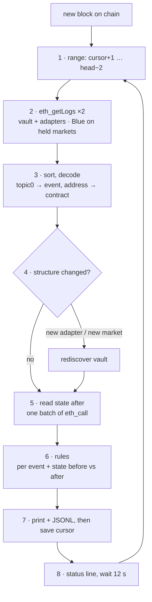

# How the watcher analyses a new block

This document follows what `python3 -m riskdep watch` does from the moment a new Ethereum block exists to the moment an alert is printed. The worked example is a real transaction on the Morpho Vault V2 **Sentora RLUSD Main** (`0x6dc5…e6bf`), taken from the recorded range in `data/replay/`. Design decisions are cited by their id in `plan/2026-10-10-morpho-vault-v2-watcher.plan.md`.

## Contents

- [The idea in one paragraph](#the-idea-in-one-paragraph)
- [What the watcher knows before the first block](#what-the-watcher-knows-before-the-first-block)
- [The eight steps](#the-eight-steps)
  - [1. Is there a new block to look at?](#1-is-there-a-new-block-to-look-at)
  - [2. Fetch only the logs that can matter](#2-fetch-only-the-logs-that-can-matter)
  - [3. Put the logs in order and decode them](#3-put-the-logs-in-order-and-decode-them)
  - [4. Did the vault's structure change?](#4-did-the-vaults-structure-change)
  - [5. Read the state after the block](#5-read-the-state-after-the-block)
  - [6. Apply the rules](#6-apply-the-rules)
  - [7. Write the alerts, then move the cursor](#7-write-the-alerts-then-move-the-cursor)
  - [8. Print the status line](#8-print-the-status-line)
- [Worked example: one real transaction](#worked-example-one-real-transaction)
- [What can go wrong, and what happens](#what-can-go-wrong-and-what-happens)
- [Where it is in the code](#where-it-is-in-the-code)

## The idea in one paragraph

A transaction leaves a trace in the block: **logs** (events) emitted by the contracts it touched. The watcher doesn't read whole blocks or every transaction. It asks the node only for the logs emitted by the contracts that can affect a depositor: the vault, its adapters, and Morpho Blue restricted to the markets the vault holds. It decodes them, reads the resulting state of the vault in one request, and compares that state with the state after the previous batch. A rule table then turns each relevant event, or state change, into an alert ranked *critical*, *warn* or *info*.



## What the watcher knows before the first block

At start-up (`watch.run`) the watcher reads, on-chain and at one block:

- **The structure** (`vault.discover_vault`): the vault's asset and its adapters (`adaptersLength`, `adapters(i)`). For each `MorphoMarketV1AdapterV2`, it reads the markets the adapter holds (`marketIds(i)`) and their parameters in Morpho Blue (`idToMarketParams`): loan token, collateral, oracle, IRM, LLTV. For Sentora RLUSD Main that's 1 adapter and 10 markets.
- **The state** (`vault.read_state`), described in step 5.
- **The depositor**: `--user`, or by default the largest holder according to the Morpho API (D24).

From the structure it builds two things the poller needs:

- `kinds`: which address is the vault, which are adapters, and which is Morpho Blue (`0xbbbb…effcb`);
- `market_ids`: the 10 Blue market ids the vault is exposed to.

## The eight steps

### 1. Is there a new block to look at?

`Poller.next_batch` calls `eth_blockNumber` and computes the **safe head** = head − 2 (D21). The watcher stays 2 blocks behind, so a block that is later replaced by a short chain reorganisation is never analysed.

The range to analyse runs from `cursor + 1` to `min(safe head, cursor + 500)`. The **cursor** is the last block whose alerts were written. It lives in `out/watch-<vault>.cursor`, so a restart resumes where it stopped. If the safe head is not past the cursor, there's nothing new: the watcher waits 12 s and asks again.

In live mode a batch is usually 1 or 2 blocks. After a pause, or with `--blocks N`, it can be up to 500.

### 2. Fetch only the logs that can matter

Two `eth_getLogs` requests cover the whole range. The node filters on its side, so only matching logs travel:

| Filter | Addresses | Topics | Why |
|---|---|---|---|
| A | the vault and each adapter | any | everything these contracts emit can matter: allocation, interest, timelocks, fees, gates |
| B | Morpho Blue | `topic0` ∈ the 9 Blue events, `topic1` ∈ the 10 held market ids | Blue emits thousands of events for hundreds of markets; only the vault's markets matter |

`topic1` works as a market filter because every Blue event has the market `id` as its first indexed argument.

### 3. Put the logs in order and decode them

The logs are sorted by block, then by `logIndex` (their position in the block), so events are handled in the order they happened.

Each log is decoded by `abi.decode_log`:

1. **`topic0` gives the event.** It is `keccak256` of the event signature, e.g. `Deallocate(bytes32,uint256,uint256)`. The table `abi.EVENTS` lists every event of Morpho Blue, Vault V2 and `MorphoMarketV1AdapterV2`, copied from their `EventsLib.sol` / interfaces on GitHub (D19, D29).
2. **The emitting address gives the contract.** Some events share a name or even a signature: `Submit` exists on the vault and on the adapter, and `Withdraw` exists on Blue and on the vault with different arguments. The address says which one it is.
3. **Indexed arguments come from `topics[1..]`; the others from `data`**, decoded with `eth_abi` against the event's types.

A log on our filters that no signature matches is counted as *undecoded* and shown on the status line, never dropped silently. On the 1000 recorded blocks the count was 0.

A log the node flags `removed: true` (a reorg) is ignored by the rules.

### 4. Did the vault's structure change?

If the batch contains `AddAdapter` or `RemoveAdapter`, or an adapter allocates to a market id the watcher doesn't know, the structure is read again. The poller's filters are then updated, so the new market's Blue events are fetched from the next batch on.

### 5. Read the state after the block

The vault's state is read **in one JSON-RPC batch** (`sources.rpc_batch`), every call pinned to the same block, so all numbers are consistent with each other. For Sentora RLUSD Main that's 104 `eth_call`s in one HTTP request:

| Read | Calls | Gives |
|---|---|---|
| `totalAssets`, `totalSupply`, asset `balanceOf(vault)`, `performanceFee`, `managementFee` | 5 | share price, idle cash, fees |
| `balanceOf(depositor)`, `canSendShares(depositor)`, `canReceiveAssets(depositor)` | 3 | the depositor's shares, hence their assets, and whether a gate blocks their exit |
| `_totalAssets()` | 1 | the stored total, which only `accrueInterest` updates |
| per adapter: `realAssets()`, vault `forceDeallocatePenalty(adapter)` | 2 | what the adapter holds, and the cost of forcing liquidity out of it |
| per market: adapter `supplyShares(id)`, Blue `market(id)`, oracle `price()` | 3 × 10 | the vault's assets in the market, utilisation, free liquidity, collateral price |
| per cap id: `allocation`, `absoluteCap`, `relativeCap` | 3 × 21 | caps and current allocation for the adapter id, the 10 collateral ids and the 10 market ids |

The vault's assets in a market = adapter supply shares × market total supply assets / total supply shares (with Blue's virtual shares).

**What a plain withdrawal can pay** = vault idle cash + min(the vault's assets, the market's free liquidity) for the single market named in the vault's `liquidityData`, when a liquidity adapter is set. This is the Morpho docs' rule ("Compute deposit and withdrawal limits"). The other markets can be reached only with `forceDeallocate`, which charges the adapter's penalty; the watcher reports that amount separately. The V2 `max*` functions are not used: per the Morpho docs they always return 0 (D25).

**Loss recorded, not yet accrued.** `totalAssets()` is computed as if interest were accrued now, so it already includes a loss an adapter has recorded. The stored `_totalAssets` changes only when `accrueInterest` runs. When `totalAssets()` is below `_totalAssets`, a loss has been recorded but not yet accrued. Every deposit and withdrawal accrues first, so nobody can exit at the old price; the check is a catch-all that catches a loss from any adapter. The window in which early exits shift a loss onto others comes earlier, while a borrower is underwater and Blue has not yet written off the bad debt, and the watcher does not follow individual borrowers.

**Which block is read.** Normally the batch's last block. The free RPC serves state only ~64–90 blocks back, though, so for an older batch the watcher reads the oldest block it can (D28). Events carry their own numbers, so the rules that use them stay exact; the state-based rules start at that block.

**A batch with no event reads less (D61).** Most batches of a live watch hold one block and no event. Without an event of the watched filters, Blue's stored market totals, the adapters' supply shares, caps, fees, penalties and the depositor's shares cannot change, so a live batch with no event (and no undecoded log, no gap, no refresh) reads only what can: `totalAssets()`, the asset's `balanceOf(vault)`, each adapter's `realAssets()`, each market's oracle `price()`, and the depositor's two gates. For Sentora RLUSD Main that is 15 calls instead of 104; for borrows, the oracle prices only. Everything else is carried from the last full read, which runs on any event and at least every `full_state_every_blocks` (25 blocks, ~5 min), so the borrow rate and anything changed without a fetched event are at most that stale. Replays and `--blocks` runs always read in full.

The state after the *previous* batch is kept in memory as **before**. The rules see both.

### 6. Apply the rules

`rules.assess_batch` runs two kinds of rules.

**Per event** (`assess_event`), in log order:

| Event | Check | Level |
|---|---|---|
| Blue `Liquidate` in a held market | `badDebtAssets > 0` → vault loss = bad debt × the vault's share of the market's supply; your loss = vault loss × your share of the vault | critical |
| Blue `Liquidate`, no bad debt | — | info |
| vault `AccrueInterest` | `newTotalAssets < previousTotalAssets` → your loss pro rata. A normal increase stays silent | critical |
| adapter `BurnShares` | shares written off → assets removed | critical |
| vault / adapter `Submit` | calldata decoded: which timelocked function, which market or collateral, which value, executable from when | warn |
| `Accept` / `Revoke` | a pending change became live / was cancelled | warn / info |
| adapter `Allocate` / `Deallocate` | new allocation and its share of the vault; warn if it crosses 25 % or the market is new | info / warn |
| vault `Allocate` / `Deallocate` | silent when the adapter's own event already names the market; info for an opaque adapter (D23) | — / info |
| `ForceDeallocate`, `SetLiquidityAdapterAndData`, cap increases, `AddAdapter`, fee, gate, owner, curator, allocator, shorter timelock | configuration that changes risk or exit | warn |
| cap decreases, `RemoveAdapter` | exposure reduced | info |
| Blue `Withdraw` / `Borrow` in a held market | utilisation crosses 99 % on a market holding ≥ 10 % of the vault | warn |
| vault `Deposit` / `Withdraw` / `Transfer` | yours, or someone else's above 1 % of the vault | info |

Events of markets the vault doesn't hold are ignored. So is ordinary activity: a Blue `Supply` or `Repay`, or interest accrual that only raises the share price.

**State, before vs after** (`assess_state`):

- an oracle price moved ≥ 5 % on a market where the vault has money → warn;
- a loss recorded by an adapter but not yet accrued (`totalAssets()` < `_totalAssets`) → critical;
- you could exit in full with a plain withdrawal before, and can't any more → warn;
- a gate started blocking you (`canSendShares` or `canReceiveAssets` false) → warn.

Thresholds are in `riskdep/registry.json` under `watch` (D26).

### 7. Write the alerts, then move the cursor

Each alert is printed on one line and appended to `out/watch-<vault>.jsonl` with its level, block, transaction, event, title, detail, your impact in the vault's asset, and the raw numbers.

**Only then** is the cursor saved, to a temporary file renamed into place. If the watcher crashes in between, the batch is analysed again after the restart. An alert can then be repeated, but a block is never skipped.

Every 300 blocks the watcher also runs the cross-checks (`riskdep/crosscheck.py`): it compares the block hash from the main RPC with an independent one, and the Morpho API's total assets with the chain. A disagreement raises an alert.

### 8. Print the status line

```
·        #26161576–26162075: 74 events · share price 1.013823 · plain withdrawal 39,085,099
```

It shows the range, how many logs were decoded (and how many were not, if any), the share price, and what a plain withdrawal can pay. The watcher then waits 12 s and starts again at step 1.

## Worked example: one real transaction

Block **26 161 224** (`0x18f3048`), transaction `0x2dcc1a5f…5127a91`, sent by the vault's allocator `0xc4ba…79d3`.

**Step 2** returns 8 logs for this transaction, 4 from each filter:

| logIndex | Contract | Event (after step 3) | Meaning |
|---|---|---|---|
| 0x63a | Morpho Blue | `AccrueInterest` on the weETH market | interest brought up to date before the withdrawal |
| 0x63b | Morpho Blue | `Withdraw` 162 831 RLUSD, onBehalf = the adapter | the adapter takes money out of the weETH market |
| 0x63d | adapter | `Deallocate` marketId = weETH, newAllocation 105 705 541 | the adapter's view: what is left in that market |
| 0x63f | vault | `Deallocate` 162 831 RLUSD, 3 ids, change −161 637 | the vault's view of the same move |
| 0x641 … 0x646 | the same four | for the cbBTC market: 5 705 RLUSD out, 13 071 936 left | |

**Step 3** decodes the adapter's log. Raw:

```json
{"address": "0x3c6eab22cfc03fc32ad1bf836f2f886a5015dfff",
 "topics": ["0xc3505702fbdd1c334673aa66559f4546d749681c4d2509c99c07fabf01b3227f",
            "0xea4bfb18df0ee6bffb7b3f0270899a8adb92ab6b684709634c8276128813cfd4"],
 "data": "0x…577004e6259090f14a3cb5…0204e38cfdb8ba9fc7ba819bce"}
```

- the address is in `kinds` as the **adapter**;
- `topics[0]` = `keccak256("Deallocate(bytes32,uint256,uint256)")` → the adapter's `Deallocate`;
- `topics[1]` = the indexed `marketId` → the weETH/RLUSD market;
- `data` = `newAllocation` 105 705 541.72 RLUSD and `burnedShares`.

Two details the decoded logs show:

- **The 3 ids** in the vault's `Deallocate` are the cap ids the adapter registers (adapter, collateral, market). The first, `0x9944…6a1e`, is the same in both of the vault's logs: it's the adapter id.
- **`change` (−161 637) is smaller than `assets` (162 831).** The difference, ~1 194 RLUSD, is interest the position had earned since its last allocation, realised by the withdrawal. It matches the `interest` in the `AccrueInterest` just before it.

**Step 6:** the vault's `Deallocate` is silent, because the adapter's event names the market. Each adapter `Deallocate` gives one alert. weETH stays at 23 % of the vault, below the 25 % threshold, so the level is info:

```
INFO     #26161224 tx 0x2dcc1a5fe8… Deallocate weETH/RLUSD (LLTV 86.0%) — allocation now 105,705,542 RLUSD (23% of the vault, was 23%)
INFO     #26161224 tx 0x2dcc1a5fe8… Deallocate cbBTC/RLUSD (LLTV 86.0%) — allocation now 13,071,937 RLUSD (3% of the vault, was 3%)
```

The two Blue `Withdraw` logs give nothing: utilisation stayed below 99 %. Neither do the two Blue `AccrueInterest` logs, since a market's interest accrual isn't a vault loss.

## What can go wrong, and what happens

| Situation | What the watcher does |
|---|---|
| RPC down or erroring | prints a warning, waits 12 s then up to 60 s, doesn't move the cursor |
| range refused as too large | halves the range and tries again |
| range too old for the free node ("archive") | jumps to the oldest range it serves and raises a **Gap** alert naming the blocks it couldn't check |
| state too old | reads the oldest state it can (step 5) |
| unknown event on our filters | counted as *undecoded* on the status line |
| reorg ≤ 2 blocks | never seen: the watcher stays 2 blocks behind |
| reorg > 2 blocks | not handled: an alert may refer to a dropped transaction |
| crash after alerts, before the cursor | the batch is analysed again; alerts may repeat, no block is skipped |

## Where it is in the code

| Step | Function |
|---|---|
| start-up | `riskdep/watch.py` `run`, `riskdep/vault.py` `discover_vault`, `largest_depositor` |
| 1–3 | `riskdep/poller.py` `Poller.next_batch`, `riskdep/abi.py` `decode_log`, `EVENTS` |
| 4 | `riskdep/watch.py` `run`, the batch loop |
| 5 | `riskdep/vault.py` `read_state`, `riskdep/sources.py` `rpc_batch` |
| 6 | `riskdep/rules.py` `assess_batch`, `assess_event`, `assess_state` |
| 7–8 | `riskdep/watch.py` `Printer.alert`, `Poller.save` |

The tests in `tests/test_watch_rules.py` make each rule fire on a synthetic event. `tests/test_watch_replay.py` re-runs steps 1 to 8 offline on the recorded 1000 blocks, including a restart from the cursor.
