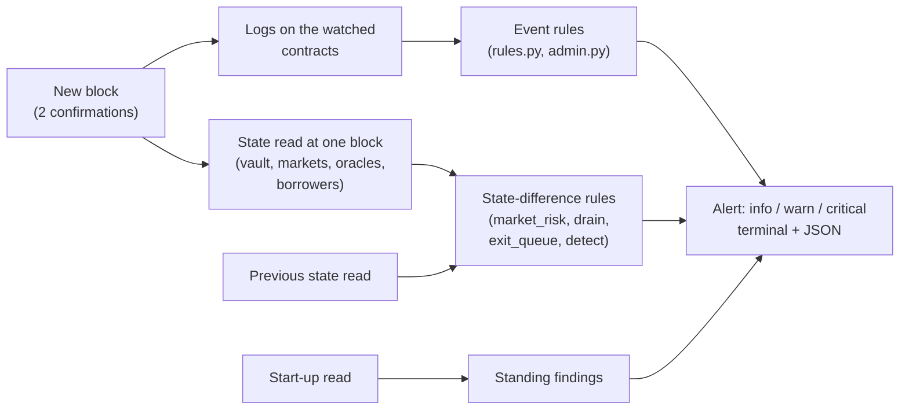

# How riskdep detects an incident

An incident, for a depositor or a borrower, is anything that changes what the position is worth, what it can lose, or whether it can leave: an oracle that falls, a borrower who can no longer repay, a contract whose code is replaced, a market that runs out of liquidity. Most of these leave a trace on Ethereum before or when they happen, and `riskdep watch` reads that trace block by block.

This document is organised by **kind of incident**: for each one, which signal reveals it, how early, at what threshold, and what the alert says. It complements two other documents: `docs/how-a-block-is-analysed.md` follows the mechanics of one block through the watcher (fetch, decode, read, assess, cursor), and `docs/alert-runbook.md` says what to do about each alert. Thresholds are those of `riskdep/registry.json` (`watch`) on 2026-10-11.

## Contents

- [Three ways an incident shows itself](#three-ways-an-incident-shows-itself)
- [When the watcher sees it](#when-the-watcher-sees-it)
- [Incidents, family by family](#incidents-family-by-family)
- [From detection to impact: OracleImpact](#from-detection-to-impact-oracleimpact)
- [Before it lands: the early warnings](#before-it-lands-the-early-warnings)
- [Worked example: the fork crisis](#worked-example-the-fork-crisis)
- [What is not detected](#what-is-not-detected)
- [Conclusion](#conclusion)
- [Where it is in the code](#where-it-is-in-the-code)
- [Key terms](#key-terms)
- [Frequently asked questions](#frequently-asked-questions)
- [References](#references)

## Three ways an incident shows itself

The watcher has three detectors, and most incidents are caught by more than one.

- **An event in a block.** A transaction emits a log the watcher decodes: a liquidation with bad debt, an upgrade of a feed, a timelocked change submitted, a large mint of a collateral token. The event carries its own data, so the alert can name the transaction and the amount.
- **A change between two state reads.** Some incidents emit nothing the watcher listens to, or emit it on a contract it does not watch: an oracle's price moves, a borrower slides underwater, a market's utilisation reaches 100 %. The watcher reads the state after every batch at one block and compares it with the previous read.
- **A standing condition at start-up.** Some risks are present before anything happens: 86 % of a vault in one market, a feed that cannot fall below a floor, a change that can be made with no notice. The watcher reports them once, at start, so the depositor knows what to watch for.

## When the watcher sees it

| Step | Value | Effect on detection |
|---|---|---|
| Poll | every 12 s (`watch.poll_seconds`, Ethereum's block time) | a new block is noticed within one poll |
| Confirmations | 2 blocks (`watch.confirmations`) | a block is analysed once two more exist: about 24 to 36 s after its own |
| State read | every batch with an event, and in full at least every 25 blocks (`watch.full_state_every_blocks`) | a quiet batch re-reads only what moves without an event: oracle prices, total assets, idle cash, the depositor's gates (D61) |
| Refresh | every 300 blocks (`watch.crosscheck_every_blocks`) | admin state, borrowers and the cross-checks are re-read in full |
| Market prices | DefiLlama, at most 25 blocks old (`watch.divergence_check_every_blocks`) | oracle-versus-market gaps are checked about every 5 minutes |

So an incident visible on-chain is reported **within about half a minute of its block**, except a slot change that emits no event, which waits for the next full read or refresh. Deeper reorgs than 2 blocks are not handled.

## Incidents, family by family

### Price: the oracle moves

| Signal | Detector | Threshold | Alert |
|---|---|---|---|
| A held market's oracle price changes between two reads | state | ≥ 5 % (`oracle_move_warn`) | `Oracle`, warn |
| It falls, and the impact is computed | state | ≥ 2 % (`impact_oracle_fall`) | `OracleImpact`, critical with a loss, warn otherwise (next section) |
| The oracle departs from DefiLlama's market price | state + DefiLlama | ≥ 3 % (`oracle_divergence_warn`) | `OracleDivergence`, warn |
| A Chainlink aggregator is proposed or confirmed | event | any | `Admin.AggregatorProposed` / `AggregatorConfirmed`, warn |
| A custom feed cannot report below a floor near its answer | start-up | floor within 50 % (`feed_band_report_floor`) | `FeedBand`, warn |

An issuer-priced oracle (a NAV feed, an exchange rate) moves only when the issuer publishes. The divergence check is what reveals a market fall that such an oracle does not follow: the oracle stays, DefiLlama's price drops, and the gap is the warning.

### Solvency: borrowers who cannot repay

| Signal | Detector | Threshold | Alert |
|---|---|---|---|
| Borrowers underwater, not yet liquidated | state (every borrower revalued) | ≥ 0.01 % of the vault warn, ≥ 0.1 % critical | `UnrealisedBadDebt` |
| A small oracle fall would liquidate much of a market | state | a 5 % fall makes ≥ 25 % of the debt liquidatable, in a market holding ≥ 10 % of the vault | `LiquidationCurve`, warn |
| A liquidation | event | any | `Blue.Liquidate`, info; critical when it leaves bad debt, with the vault's and the depositor's share |
| A loss booked by an adapter, not yet in the vault's total | state | any | `PendingLoss`, critical |
| One borrower holds most of a market | state | ≥ 50 % of the debt, or fewer than 5 borrowers | `BorrowerConcentration`, warn |
| The collateral trades far enough below its oracle to drain the market | state + DefiLlama | within 2 points of the drain threshold d\* | `DrainWindow`, warn then critical |

Unrealised bad debt is the earliest solvency signal. Morpho writes bad debt off only when a liquidation empties a position, so between the price fall and that liquidation the share price still reads par, and the first depositors to leave pass the loss to the others. The watcher counts it the moment the price lands.

### Issuer and token: what backs the collateral

| Signal | Detector | Threshold | Alert |
|---|---|---|---|
| A large mint of a collateral or yield token | event (`Transfer` from zero) | ≥ 5 % of the supply in one transaction (`mint_share_critical`) | `Admin.Mint`, critical |
| A collateral token paused | event | any | `Admin.Paused`, critical (liquidations can fail) |
| A token, oracle or feed upgraded | event | any | `Admin.Upgraded`, critical |
| An owner, proxy admin or admin role changed | event, or a slot change at refresh | any | `Admin.*` or `AdminState`, warn |

An unbacked mint is the signature of the USR depeg of March 2026, which left bad debt in Morpho markets. The watcher does not see the issuer's reserves; it sees the supply jump.

### Governance: the curator, the vault and the timelocks

| Signal | Detector | Threshold | Alert |
|---|---|---|---|
| A risk-increasing change submitted with a 0 timelock | event (`Submit`) | any | critical: "pending change with no notice" |
| A timelocked change submitted | event | any | warn, with the date it becomes executable |
| A submitted change executed or revoked | event | any | `Accept` warn, `Revoke` info |
| A submission for an abdicated function | event | any | info: it can never execute |
| An upgrade queued on a timelock above a dependency | event (`CallScheduled`) | any | `Admin.CallScheduled`, warn, with the delay |
| Changes that can be made with no notice | start-up | timelock 0, not abdicated | `Timelock`, warn; `ExitGate` for the withdrawal gates |

### Liquidity: can the depositor leave

| Signal | Detector | Threshold | Alert |
|---|---|---|---|
| A market holding much of the vault is fully lent | state | ≥ 99 % utilisation on a market holding ≥ 10 % | warn |
| The depositor cannot withdraw in full | state | position above what a plain withdrawal pays | `Liquidity`, warn |
| The depositor would be stuck in a run | state | ≥ 50 % stuck behind the vault's contract holders | `ExitQueue`, warn; critical with unrealised bad debt |
| Someone else moves a large amount | event | ≥ 1 % of total assets | info |
| A gate refuses the depositor | state | any | `Gate`, warn |

### Borrower side: `watch --user`

For an address that borrows, the watcher adds health-factor zones (info, warn and critical below 1.10, 1.05 and 1.02 by default, `--hf`), actions taken on the address's behalf, borrow-rate jumps, and the main lenders of the market withdrawing. A vault deposit held by the same address gets the vault rules above.

### Data integrity

The main RPC's block hash is compared with an independent node, and the Morpho API with the chain, at start and every 300 blocks (`CrossCheck`). A disagreement is critical for the block hash and a warn for the API. A range the free RPC refuses is reported as a gap rather than skipped silently.

## From detection to impact: OracleImpact

Detecting a fall is only half the brief's question; the other half is what it costs. Since D187–D189 (`plan/2026-10-11-detect.plan.md`), when a vault market's oracle falls at least 2 % within a batch, the watcher turns the detection into an impact in the same alert, from what it already holds:

- **the fall**, per market, measured from the oracle's last answer (an oracle that stops answering during an upgrade keeps its last answer, so the fall across the gap counts);
- **the vault's loss now**: the unrealised bad debt of each market at the new price, times the vault's share of that market;
- **what is liquidatable now** in the fallen markets;
- **the depositor's loss** if it stays, and if it leaves first with what a withdrawal can pay;
- **the verdict**, by the same rule as `analyze --vault` (`vault_incident.decide`).

The alert is critical when the vault already loses, warn otherwise. It needs no network call, so recorded runs test it.

## Before it lands: the early warnings

Several detectors fire before the loss, which is where the time to act comes from:

| Warning | How much earlier | Why |
|---|---|---|
| `Admin.CallScheduled` | the timelock's delay (48 h for Midas) | an upgrade is seen when queued, not when executed |
| A timelocked `Submit` on the vault | the vault's timelock (3 to 7 days on the RockawayX vaults) | the change is announced before it can apply |
| `FeedBand` | from start-up | says how far the oracle can fall before new code is needed |
| `LiquidationCurve` | before the fall | says how much a small fall would liquidate |
| `OracleDivergence`, `DrainWindow` | as the market moves | the collateral's market price leaves an issuer-priced oracle behind |
| `UnrealisedBadDebt` | before the write-off | the loss exists before Morpho books it |

## Worked example: the fork crisis

`scripts/fork/crisis-belem.sh` plays a crisis on a mainnet fork of the Belem RWA EURCV vault (86 % lent against mGLOeuro, one borrower, a feed one EOA writes), and `fixtures/replay/fork-belem/` holds the watch's recording, one block per batch:

| Block | Act | Alerts |
|---|---|---|
| start | — | `FeedBand` (mGLOeuro cannot fall below 90,000 without an upgrade behind a 48 h timelock), `ExitGate` (gates abdicated), the timelock watched, cross-checks "not checked" on a fork |
| 26,165,573 | the issuer sets the NAV to 90,000 (−10 %) | `Oracle` −10 %; `OracleImpact` warn: 3,679,003 EURCV liquidatable, no loss yet, STAY; `LiquidationCurve`; `OracleDivergence` |
| 26,165,578 | a partial liquidation | `Blue.Liquidate` info, no bad debt |
| 26,165,583 | depositors withdraw | the market 100 % utilised (warn) |
| 26,165,590 | an upgrade of the feed is scheduled | `Admin.CallScheduled` warn: executable in 48 h |
| 26,165,595 | after 48 h, the upgrade executes | `Admin.Upgraded` critical; `Admin.CallExecuted` |
| 26,165,596 | the NAV lands at 70,000 (−22.2 % from 90,000) | `OracleImpact` critical: the vault's loss 215,003 EURCV; `UnrealisedBadDebt` critical; `ExitQueue` critical |
| 26,165,600 | the rest is liquidated | `Blue.Liquidate` critical: 217,286 EURCV of bad debt realised; `PendingLoss` |

The loss stated when the price landed, 215,003 EURCV, is 1.1 % from the 217,286 realised four blocks later. The upgrade was reported 48 hours before it could apply.

## What is not detected

- **What has not reached the chain.** An issuer's NAV markdown is seen when it is published, not when the fund loses; a reserve shortfall is seen only through what it does on-chain (a mint, a price, a pause).
- **The mempool.** A transaction is seen once included, not while pending.
- **Other chains.** The watcher reads Ethereum only; Solana, Base and other venues of the same issuers are not followed.
- **A feed that freezes.** Morpho's standard oracle has no staleness check, and a feed that stops updating is not yet an alert (planned as `FeedStale`).
- **Reorgs deeper than 2 blocks,** and ranges older than the free RPC's state window, reported as a gap.
- **A slot changed with no event,** until the next refresh (300 blocks, about an hour).

## Conclusion

`riskdep watch` detects an incident from three kinds of signal:

- **Events** in each block: liquidations, upgrades, mints, pauses, submitted and queued governance changes.
- **State differences** between two reads at one block: oracle moves, unrealised bad debt, utilisation, exit capacity, oracle-versus-market gaps.
- **Standing conditions** read at start-up: concentration, feed bands, changes possible with no notice, abdicated gates.

An incident on-chain is reported within about half a minute of its block. The early warnings (a queued upgrade, a timelocked submission, a feed band, a steep liquidation curve, unrealised bad debt) give the depositor time before the loss lands, and `OracleImpact` states the loss and the verdict the moment an oracle falls. What happens off-chain, in the mempool or on another chain is outside its view.

## Where it is in the code

| What | Code |
|---|---|
| The loop: poll, batch, state read, cursor | `riskdep/watch.py`, `riskdep/watch_user.py`, `riskdep/poller.py` |
| Event rules and standing findings for a vault | `riskdep/rules.py`: `assess_event`, `assess_state`, `startup_findings` |
| Borrowers, unrealised bad debt, liquidation curves, concentration | `riskdep/market_risk.py` |
| Drain threshold d\* | `riskdep/drain.py` |
| Exit queue | `riskdep/exit_queue.py` |
| Admin surface, mints, pauses, upgrades, timelock queue, feed band, divergence | `riskdep/admin.py` |
| Detection to impact | `riskdep/detect.py` (D187–D189) |
| Borrower rules | `riskdep/borrower_rules.py` |
| Cross-checks | `riskdep/crosscheck.py` |
| Thresholds | `riskdep/registry.json` (`watch`), documented in `docs/registry-reference.md` |

## Key terms

| Term | Definition |
|------|------------|
| **Incident** | Anything that changes what a position is worth, what it can lose, or whether it can be withdrawn. |
| **Event** | A log emitted by a transaction on a watched contract, decoded by the watcher. |
| **State read** | A batch of calls at one block that reads the vault, its markets, oracles and borrowers together. |
| **Light read** | A state read limited to the values that move without an event, used on quiet batches. |
| **Confirmation** | A block built after the one analysed; the watcher waits for two. |
| **Standing finding** | A risk present before any incident, reported once at start-up. |
| **Oracle price** | The price a Morpho market uses to decide liquidation, which can differ from the market price. |
| **Issuer-priced oracle** | An oracle that reports a NAV or exchange rate published by the issuer, and does not follow the market. |
| **Unrealised bad debt** | Debt no longer covered by its collateral, not yet written off by a liquidation. |
| **Liquidation curve** | How much of a market's debt becomes liquidatable for each oracle fall. |
| **Drain threshold (d\*)** | The discount of the collateral to its oracle past which the market's free liquidity can be borrowed in one block. |
| **Exit queue** | The order in which depositors could withdraw in a run, and what each would recover. |
| **Timelock** | A delay between the announcement of a change and the moment it can apply. |
| **Abdicated** | A vault function given up for good: it can never be called again. |
| **Feed band** | The fixed minimum and maximum a custom feed accepts; below the minimum, the feed needs new code. |
| **OracleImpact** | The alert that turns an oracle fall into the vault's loss, the debt liquidatable, the depositor's loss and a verdict. |
| **Cross-check** | A comparison of a source with an independent one: the block hash with a second node, the API with the chain. |

## Frequently asked questions

**Q: How long after a transaction does the alert appear?**

About 24 to 36 seconds on mainnet: the watcher analyses a block once two more exist (two blocks of 12 s) and polls every 12 s. A change that emits no event the watcher listens to, such as a storage slot rewritten directly, waits for the next full read or the 300-block refresh.

**Q: Why does an issuer's markdown not trigger the divergence alert?**

The divergence alert compares the oracle with DefiLlama's market price. When an issuer marks its NAV down, the oracle and, usually, the quoted price move together, so the gap does not open. The markdown is caught as an oracle move instead (`Oracle`, and `OracleImpact` with its loss). Divergence catches the opposite case: the market falls and the issuer-priced oracle does not follow.

**Q: Why is unrealised bad debt reported before any liquidation?**

Because Morpho books bad debt only when a liquidation empties a position. Between the price fall and that liquidation, the vault's share price still reads par, and depositors who leave first pass the loss to those who stay. The watcher revalues every borrower at the new price and counts the shortfall immediately.

**Q: Which alerts give the most time to act?**

The governance ones, because a timelock enforces the delay:

- `Admin.CallScheduled`: an upgrade of a feed, token or oracle is reported when queued, a full delay before it can execute (48 h on the Midas timelock).
- A timelocked `Submit` on the vault: 3 to 7 days on the RockawayX vaults.

`FeedBand` and `LiquidationCurve` are reported at start-up and say how exposed the position is before anything moves.

**Q: In the fork crisis, how close was the loss announced when the price landed to the loss realised?**

`OracleImpact` stated 215,003 EURCV when the NAV reached 70,000; the liquidation four blocks later realised 217,286 EURCV, a 1.1 % difference. The impact was computed from the borrowers revalued at the new price, with no network call.

**Q: What would the watcher miss in a real crisis?**

Anything that has not reached Ethereum yet:

- a fund's loss before the issuer publishes it;
- a pending transaction in the mempool;
- the same issuer's positions on Solana or Base;
- a feed that simply stops updating (planned as `FeedStale`).

## References

- `docs/how-a-block-is-analysed.md` (the mechanics of one block), `docs/alert-runbook.md` (what to do about each alert), `docs/registry-reference.md` (every threshold), `docs/drain-threshold.md`, `docs/exit-queue.md`
- Plans: `plan/2026-10-10-morpho-vault-v2-watcher.plan.md`, `plan/2026-10-10-market-borrowers.plan.md`, `plan/2026-10-10-admin-surface.plan.md`, `plan/2026-10-10-drain-threshold.plan.md`, `plan/2026-10-11-detect.plan.md` (D187–D189), `plan/2026-10-11-fork-demo.plan.md` (D180–D186)
- The fork crisis: `scripts/fork/README.md`, `scripts/fork/DEMO-EXPLAINED.md`, `fixtures/replay/fork-belem/`
- Diagrams in `docs/img/`: `detection-mindmap`, `detection-signals-concept` (where each signal comes from), `detection-timeline-workflow` (from a block to an alert); each `.puml` next to its `.png`
- [Morpho documentation](https://docs.morpho.org/): Blue liquidations and bad debt, Vault V2 timelocks and gates
