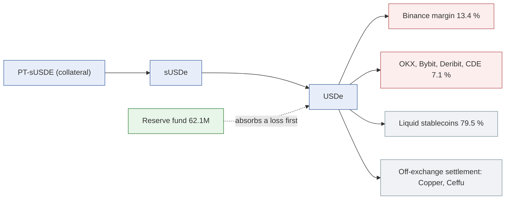

# Ethena (USDe, sUSDe): how riskdep computes its risk

USDe is Ethena's synthetic dollar. It is a delta-neutral position: crypto collateral, held by off-exchange settlement providers (Copper, Ceffu), is delegated to exchanges as margin for short perpetuals, and the rest sits in liquid stablecoins. sUSDe is the staked claim on USDe that earns the funding and staking yield. Ethena reaches riskdep's positions through sUSDe and its Pendle PTs: the `analyze` demo is a PT-sUSDE loop on Morpho, the brief's mixed book holds the same loop, and sUSDe is collateral in several Blue markets.

This document says what is computed for Ethena, from which data, and what is not. The decisions are D218–D221 (plan `2026-10-11-venues`). The general method is in `how-risk-is-computed.md` and `how-probabilities-are-computed.md`. The figures are from the offline recordings: the demo position at block 26,162,041, and Ethena's backing as of 2026-10-10 22:58 UTC.

| Question | Answer | Where |
|---|---|---|
| What does sUSDe depend on? | Hedges on exchanges, the custodians, the mint/redeem desk, the backing assets; drawn by venue in the graph | `registry.json` `issuers`, `graph.annotate_ethena` (D221) |
| How likely is a loss? | A depeg prior (12 %/yr) and an exploit prior (1.33 %/yr), in the Monte Carlo | `priors.layer_priors` |
| How does a loss reach a position? | Through the PT price and the oracle, whose class decides when it is seen | `propagate`, `scenario` |
| What if an exchange fails? | `venue=<exchange>:<loss>`: the reserve fund absorbs first, the rest marks USDe and sUSDe down | `ethena.venue_loss` (D219–D220) |
| What if funding turns negative? | A stated scenario: how many days the reserve fund lasts | `Snapshot.lines` (D221) |
| Who else is hit? | Sibling markets on sUSDe, and every vault and pocket holding USDe or sUSDe collateral | `siblings`, `pipeline.incident` |
| Is it watched live? | Only through the oracles of the watched markets; nothing reads Ethena itself in `watch` | — |

## 1. The data

Ethena's transparency dashboard serves three keyless endpoints, recorded under `fixtures/replay/ethena/` and read offline by default (D218):

| Endpoint | What is kept | Recorded value |
|---|---|---|
| `/api/positions/current/collateral` | The backing by venue (each exchange, and "Unallocated" for what is not on one) and by asset | 4,769M USD in total |
| `/api/solvency/reserve-fund` | The reserve fund's last point | 62.1M USD, 1.30 % of the backing |
| `/api/yields/protocol-and-staking-yield` | The 30-day average yields | protocol 4.96 %, sUSDe 4.83 % |

The backing by venue:

| Venue | Share of the backing |
|---|---|
| Not on an exchange (liquid stablecoins, with Copper and Ceffu) | 79.5 % |
| Binance | 13.4 % |
| OKX | 4.2 % |
| Bybit | 2.3 % |
| Deribit | 0.4 % |
| CDE | 0.2 % |

By asset, 3,889M USD is liquid cash, 466M BTC, 338M ETH, then SOL, XRP and smaller lines. The dashboard splits the backing by exchange, not by custodian: what each custodian holds is not known.

Next to it, three outside sources describe Ethena:

- **Pharos** grades sUSDe C 55 and records it as backed 100 % by USDe, so a USDe shock reaches sUSDe markets through that backing (`docs/risk-assessment/pharos.md`).
- **DefiLlama** gives Ethena USDe 4,779M USD of TVL: 0.81 % of DeFi but 61.1 % of its category, Basis Trading, which is flagged as a concentration.
- **Nexus Mutual** maps no product to USDe or sUSDe in the registry, so there is no outside price for an Ethena loss next to the breakeven.

## 2. Discovery: the dependencies

The registry entry of sUSDe (`issuers.0x9d39…3497`) lists its off-chain dependencies: delta-hedged perp shorts on exchanges (funding-rate risk), the off-exchange custodians, the KYC'd mint/redeem desk, and the staked ETH, BTC and stablecoin backing.

`graph` makes the venues visible (`annotate_ethena`, D221). Behind the USDe node it adds:

- one External node per exchange holding margin, with its USD amount and share of the backing (`backing held at (Ethena)`);
- one node for what is not on an exchange;
- one node for the off-exchange settlement providers (`custodied by (Ethena)`);
- the backing and the reserve fund as details of the USDe node.



For a position on USDe or sUSDe, the PT report's discovery depth prints the same backing as text: the venues, the reserve fund, the yields and the funding-stress line (D221).

## 3. Probabilities

Two Ethena events enter `analyze`'s Monte Carlo, each with a yearly probability, a Beta severity and a recovery:

| Event | p per year | Severity | Mean severity | Recovery | Basis |
|---|---|---|---|---|---|
| sUSDe depeg (`issuer_depeg`) | 12 % | Beta(1.6, 18) | 8.2 % | 75 % by the horizon | USDe printed about 0.65 on one exchange's order book in the 2025-10-10 cascade while on-chain pools held; about −0.3 % in April 2024 on negative funding |
| Exploit or loss of backing (`issuer_hack`) | 1.33 % | Beta(1.2, 3.0) | 28.6 % | none | The hack base rate: tier ≥ 100M USD 2.66 %/yr × category Basis Trading 0.50 × age 1.0 |

The exploit rate follows the general rule, r_tier × m_category × f_age (`how-probabilities-are-computed.md`): 34 hacks over 256 protocols of that size in five years, halved because Basis Trading has 1 hack over 29 protocols. The depeg prior is a stated assumption from Ethena's own history, as for every issuer depeg.

Over the demo's 30-day horizon, p_h = 1 − (1 − p)^(30/365):

| Event | Chance over 30 days | Expected loss | Rank among the six layers |
|---|---|---|---|
| sUSDe depeg | 1.05 % | 3,760 USD (359,761 if it happens; liquidates 76 % of the time) | 1st |
| Ethena exploit | 0.11 % | 511 USD | 4th |

The depeg is the position's largest driver, ahead of a Morpho exploit (1,066 USD). The total expected loss is 6,265 USD against 5,697 USD of carry: the verdict is REDUCE.

## 4. How a loss reaches the position

The two events take different paths (`propagate.py`):

- **A depeg** moves the market price of sUSDe: the trough is value × (1 − s), and (1 − recovery) of it stays. A price-tracking oracle sees the trough, amplified by the PT's stress discount; a constant-price oracle does not.
- **An exploit** lowers the backing itself, so the SY exchange rate falls and every oracle sees it.

The oracle's class decides when a depeg becomes a liquidation. The demo's oracle is a meta-oracle that reads a constant-price primary and switches, after 16 hours of a divergence above 0.75 %, to a price-tracking source. A depeg is therefore invisible to the oracle for 16 hours, then lands at once.

## 5. A venue failure (D219–D220)

`venue=<exchange>:<loss>` says that an exchange loses a share of the backing it holds (an exchange failure, a seizure, a frozen withdrawal). The computation:

```
lost       = backing at the venue × loss
absorbed   = min(lost, reserve fund)
markdown   = (lost − absorbed) ÷ total backing
```

The markdown applies to USDe and, by the same fraction, to sUSDe, its staked claim. Several venues add up, capped at 99 %. Nothing of it is recovered (D220): a loss of backing is permanent, unlike a market depeg. The hedges held at that venue are lost too, leaving that collateral unhedged until they are reopened elsewhere. This is stated, not priced.

Example, `--shock venue=Binance:0.5`:

| Step | Value |
|---|---|
| Backing at Binance | 638M USD (13.4 %) |
| Lost (50 %) | 319.0M USD |
| Absorbed by the reserve fund | 62.1M USD |
| Markdown of USDe and sUSDe | 256.9M ÷ 4,769M = 5.39 % |

What each entry point does with the markdown:

| Entry point | The venue loss becomes | Result in the example |
|---|---|---|
| `analyze` (the demo position) | `issuer_depeg` of 5.39 %, no recovery | Not liquidated at first: loss 211,960 USD (40.7 % of equity). After the oracle switches (16 h): liquidated, loss 403,965 USD (77.7 %). Verdict EXIT: staying loses more than the 78,946 USD it costs to leave, with 16 h to act |
| `analyze --vault` / `--book`, `POST /api/incident` | `token=USDe` and `token=sUSDe` markdowns of 5.39 % | The brief's mixed book loses 407,431 USD (4.07 % of 10M), all in the PT-sUSDe loop. Leaving it costs 110,000 USD (the brief's 11 %) and pays above a 27.0 % chance over 30 days |

A loss smaller than the reserve fund marks nothing down. A vault or book incident then refuses the shock and says so ("within the reserve fund: no markdown of USDe").

## 6. Funding stress (D221)

USDe earns from short perpetuals. When funding turns negative, the shorts pay, and Ethena pays from its reserve fund. riskdep states one scenario, `ethena.funding_stress` = −10 %/yr on the hedged notional, taken as the margin on exchanges:

```
hedged      = 975M USD (all venues but "Unallocated")
daily cost  = 975M × 10 % ÷ 365 = 267k USD
reserve     = 62.1M USD → covers 232 days
```

After that, the loss reaches USDe holders. It is a stated scenario, not a forecast (funding was negative for weeks in 2022 and in parts of 2025). It is printed in the discovery depth. It is not a shock and not in the Monte Carlo.

## 7. Contagion

- **Through the markets that take sUSDe.** The sibling markets of the demo position sell the same collateral or read the same price. At a 10 % fall: sUSDe/PYUSD 96,963,152 PYUSD liquidatable, sUSDe/DAI 964,053 DAI, sUSDe/USDtb 911,976 USDtb. Their liquidations sell into the same market and can deepen the fall.
- **Through the tokens.** A venue loss marks down USDe and sUSDe together, so every market whose collateral is either, or wraps either (a PT on sUSDe), is reached; markets reached through Pharos's off-chain backing are hit in proportion to that backing, by the same incident.
- **Through concentration.** 9.4 % of sUSDe's supply is posted as collateral in the three Morpho markets of the demo's graph. The demo's PT market holds 8.2 times the PT in its Pendle pool, which accepts at most 2.7M more. A forced exit is thin.

## 8. Detection

Nothing in `watch` reads Ethena itself: no backing, reserve-fund or funding alert. An Ethena incident is detected through the markets it hits, as an oracle move (`OracleImpact`, from a 2 % fall), a health-factor alert for a borrower, or bad debt (`docs/watch/how-an-incident-is-detected.md`). With the demo's meta-oracle, a depeg shows only once the oracle switches, 16 hours in.

## 9. What is not computed

| Gap | Effect |
|---|---|
| The backing by custodian | The dashboard splits by exchange; a custodian's failure cannot be shocked on its own |
| The lost hedges | Stated after a venue loss, not priced: the unhedged collateral's price risk is not added |
| Funding stress in the simulation | A stated line, not an event with a probability |
| The mint/redeem desk and sUSDe's unstaking cooldown | Listed as dependencies, not modelled: a redemption's delay is not in the exit |
| An outside price | No Nexus product is mapped to Ethena |
| Live monitoring of Ethena | The backing is read when a run asks for it; `watch` sees only the oracles |

## 10. In the code

| File | Role |
|---|---|
| `riskdep/ethena.py` | `load` (the three reads), `Snapshot.lines` (the backing in words, the funding stress), `venue_loss`, `parse_venue` |
| `riskdep/pipeline.py` | `ethena_snapshot`; `venue_shocks` (a venue loss into `issuer_depeg` or `token=` markdowns); the backing in the discovery depth |
| `riskdep/graph.py` `annotate_ethena` | The venues behind USDe in the graph |
| `riskdep/priors.py`, `riskdep/propagate.py` | The depeg and exploit priors, and their paths to the position |
| `riskdep/registry.json` | `issuers.0x9d39…3497` (sUSDe's priors and dependencies), `ethena` (addresses, custodians, `funding_stress`) |
| `fixtures/replay/ethena/` | The recorded dashboard responses |
| `tests/test_ethena.py` | The reads, the venue loss and the shocks, offline |
