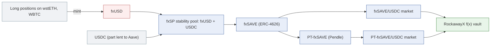

# f(x) Protocol (fxSAVE, PT-fxSAVE): how riskdep computes its risk

f(x) Protocol (AladdinDAO) issues fxUSD, a stablecoin minted against leveraged long positions on wstETH and WBTC. Its stability pool, fxSP, holds fxUSD and USDC and repays those positions' debt when they are rebalanced or liquidated. fxSAVE is an ERC-4626 vault over fxSP: its share price follows the pool's NAV. In riskdep's recordings, fxSAVE and its Pendle PT are the collateral of the **RockawayX f(x) Protocol Ecosystem USDC** vault (`0x2cA2…a423`): fxSAVE/USDC and PT-fxSAVE-29OCT2026/USDC, both at LLTV 91.5 %.

As for Midas, there is no f(x) module: the risk comes from the generic oracle classification, the incident engine, the exit-liquidity table and the outside providers. This document says what they give for fxSAVE and what is not computed. Figures: the vault incident at block 26,165,060, the graph at block 26,165,485. The protocol's mechanics are cited from the pinned sources in `docs/external/fx-protocol/` (its `README.md` gives `file:line`).

| Question | Answer | Where |
|---|---|---|
| How is fxSAVE priced? | A constant-price oracle reading a "Net Asset Value in USD" feed; the PT market's oracle prices the PT by time alone | `oracle_class` |
| What does a markdown cost? | −30 %: the vault loses 1,806,122 USDC (8.61 %) | `vault_incident`, shock engine |
| Who sees it on the PT market? | Nobody: the PT oracle does not move, so the loss is hidden (152,851 left insolvent) | `vault_incident` (hidden loss) |
| Can liquidators act? | Thin: selling the 1.53M seized costs 34.5 %; a 1M sale loses 27 % | `exit_liquidity` (KyberSwap, registry) |
| Should the depositor leave? | EXIT, and leaving pays above a 7.92 % chance over 30 days | `vault_incident`, breakeven |
| How likely is it? | No prior; Pharos grades fxSAVE F 36; Nexus covers f(x) | `pharos.py`, `nexus.py` |

## 1. What backs fxSAVE, and how it loses value

From the pinned contracts:

- `nav(fxSAVE) = nav(fxSP) × convertToAssets(1e18) / 1e18` (`SavingFxUSD.sol:164-166`).
- `nav(fxSP) = (fxUSD held × fxUSD price + USDC held × USDC price) / supply` (`FxUSDBasePool.sol:255-264`). fxUSD is valued at its Curve EMA × Chainlink USDC/USD (`FxUSDPriceOracle.sol:130-140`), not at 1.
- The USDC side includes what is lent to Aave (`FxUSDBasePool.sol:682-690`), up to 80 % per the docs.
- On a rebalance or a liquidation, the pool's fxUSD then USDC repays the debt, and the keeper takes the collateral and repays the pool at par (`FxUSDBasePool.sol:653-680`). The pool never holds wstETH or WBTC: a collateral price gap falls on the keeper, then the reserve fund, then the other positions (bad-debt redistribution, `BasePool.sol:640-646`).

So fxSAVE loses value through:

| Path | What falls |
|---|---|
| fxUSD depegs on Curve | the NAV, by fxUSD's share of the pool × the depeg |
| USDC depegs | the USDC side |
| A loss or a freeze at Aave | the lent USDC |
| Collateral gaps faster than keepers, then reserve and redistribution exhausted | fxUSD becomes under-backed, then the first path |
| An upgrade or a role change | anything |

riskdep draws part of this in `graph`: fxSAVE `wraps` fxSP, and fxSAVE is `backed by (Pharos)` fxUSD. The USDC side, Aave, the Curve pool behind fxUSD's price and the long positions are not drawn.

## 2. The incident

`analyze --vault 0x2cA2…a423 --shock token=fxSAVE:0.30`, offline:

| Market | Vault's share | Liquidatable | Bad debt | Vault's loss |
|---|---|---|---|---|
| fxSAVE/USDC | 71 % | 1,494,648 of 25,324,668 USDC (19 borrowers) | 2,284,812 | 1,618,951 |
| PT-fxSAVE/USDC | 90 % | 0 of 1,006,550 (15 borrowers) | 208,452 (hidden) | 187,170 |
| **Vault** | | | | **1,806,122 USDC, 8.61 % of 20,979,234** |

- **The fxSAVE market.** The oracle falls 30 %; the shock engine finds 1,494,648 USDC liquidated and 2,109,828 left insolvent, because the market cannot absorb the collateral. The largest borrower holds 36 % of the debt, the three largest 65 %.
- **The PT market.** Its oracle prices the PT by a linear discount to maturity, so it does not move (`oracle × 1.000`). Nobody is liquidated; the lenders' shortfall if the markdown persists is counted as the loss, marked hidden. The PT reaches fxSAVE through what it wraps (`PT-fxSAVE-29OCT2026 → fxSAVE`).
- **Liquidators.** Selling the 1,533,759 USDC of seized collateral costs 34.48 % against the oracle on KyberSwap. If nobody liquidates, the loss is 1,497,214 USDC and the market's liquidity stays locked.
- **The depositor** (0x4f87…0545, 11.92 % of the vault, 2,500,571 USDC): staying loses 215,276; leaving first recovers everything. **EXIT**. If the incident is not certain, leaving forgoes 17,042 USDC of yield over 30 days (8.29 %/yr) and pays above a **7.92 %** chance over 30 days (63.3 %/yr).

## 3. Exits

- **The DEX** (`exit_liquidity.tokens`, measured): −0.5 % for 100k, −27 % for 1M, −83 % for 5M. "Thin".
- **f(x)'s own redemption**: `requestRedeem` then `claim` after a cooldown of up to 7 days; each new request restarts the timer for the whole pending amount, and the locked shares still bear the pool's losses (`FxUSDBasePool.sol:301-351`). It pays a pro-rata mix of fxUSD and USDC. The instant route charges a fee of up to 5 % (`:354-392`).

The incident uses the DEX route only.

## 4. Probabilities and outside views

- **No prior.** `registry.json` `issuers` has no fxSAVE entry; an `analyze` run on an fxSAVE position would use `unknown_issuer`.
- **Pharos** grades fxSAVE **F 36** and fxUSD **D 44**, and records fxSAVE as backed by fxUSD. The grade is printed on each hit market.
- **Nexus Mutual**: product 137 covers f(x) Protocol at 1.82 %–8.20 %/yr, capacity 2,539,669 USDC, implying 1.2 %–13.7 %/yr for an exploit at this severity. Product 311 is an fxUSD depeg cover. Both are shown next to p\*, never used in the verdict.
- **DefiLlama**: fx Protocol holds 125M USD, 0.02 % of DeFi, but 56.9 % of its category (Dual-Token Stablecoin, #1).

## 5. Admin

From `docs/external/fx-protocol/README.md` (`more/resources/multisig.md`, `FxUSDBasePool.sol`):

- the ProxyAdmin sits behind a 3-day timelock, except "oracle source updates", which bypass it;
- `FxUSDBasePool`'s admin role can change the depeg price, the cooldown (≤ 7 days) and the instant fee (≤ 5 %) with no on-chain delay unless the role holder is the timelock;
- an emergency Safe (3 signatures) can pause the long and short pool managers.

riskdep's admin surface follows the proxies, owners and AccessControl role changes of the contracts it discovers (`admin.ADMIN_EVENTS`).

## 6. What is not computed

| Gap | Effect |
|---|---|
| **The NAV's components** | fxSAVE is shocked by a chosen markdown. There is no reader of fxSP's fxUSD and USDC balances, the Aave share or the Curve EMA, so an fxUSD depeg cannot be turned into the fxSAVE markdown it causes (as `venue=` does for USDe) |
| **The oracle's timing** | The feed is classified "published" by its name ("Net Asset Value"), so the incident says the loss lands "at its next published round". The pinned source computes the NAV on-chain from the Curve EMA: an fxUSD depeg moves the oracle as the EMA moves, without a transaction by the issuer. To verify on the feed, then add a pattern for an on-chain computed NAV |
| **Oracle-source updates without a timelock** | They are called out by f(x)'s own docs but are not decoded: `UpdateCurvePool` and `UpdateMaxPriceDeviation` (`IFxUSDPriceOracle.sol`) are not in `admin.ADMIN_EVENTS`, and `FxUSDPriceOracle` sits behind fxSAVE's NAV, deeper than the discovery reaches |
| **f(x)'s redemption** | The cooldown, its restart, the fxUSD/USDC mix and the instant fee are not in the exit |
| **The f(x) layers in the graph** | USDC, Aave, the Curve pool and the long positions behind fxUSD are not drawn |
| An issuer prior | Only the generic default would apply |

## 7. In the code

| File | Role |
|---|---|
| `riskdep/registry.json` | `graph.oracle_patterns` (the "net asset value" pattern), `exit_liquidity.tokens` (fxSAVE: thin), `pharos.ids` (fxSAVE, fxUSD), `nexus.products` (137, 311), `tvl.tokens` (`fx-protocol`) |
| `riskdep/vault_incident.py`, `riskdep/engine.py` | The markdown, the hidden loss on the PT market, liquidations, the verdict |
| `riskdep/exit_liquidity.py` | The DEX route, live from KyberSwap |
| `riskdep/pharos.py`, `riskdep/nexus.py`, `riskdep/tvl.py` | The grades, the cover prices, the TVL concentration |
| `docs/external/fx-protocol/README.md` | The protocol's mechanics with `file:line` at the pinned commit |
