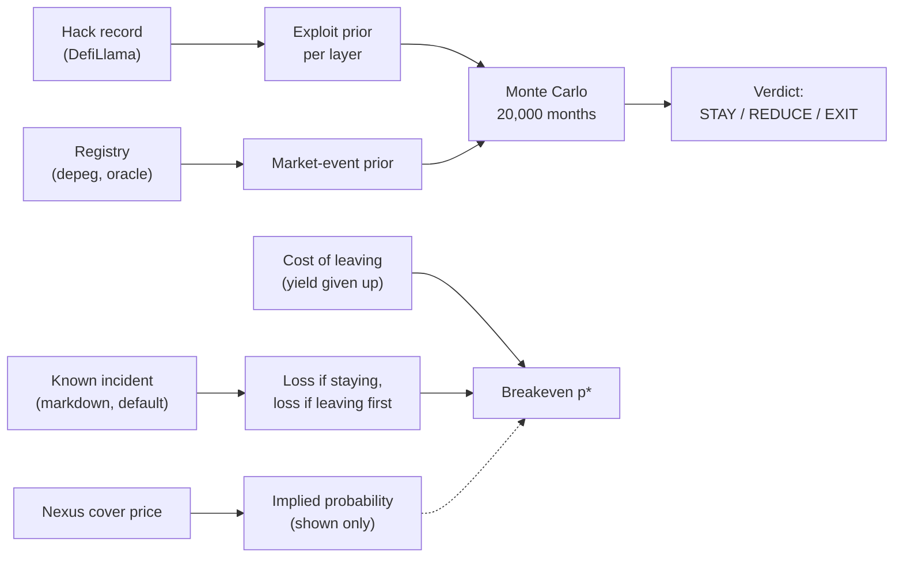
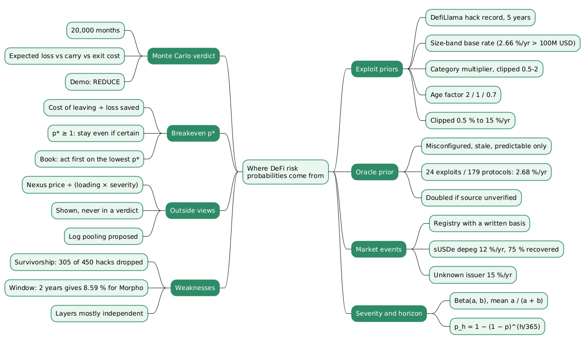

# Where riskdep's probabilities come from: hack base rates, breakeven and outside views

A risk simulation turns probabilities into losses; it does not produce the probabilities. It can draw twenty thousand months with exact arithmetic and still mislead if the chance it gives each incident has no defensible origin. This document looks at that input: where the probability of an exploit, an oracle failure or a depeg comes from, in a working tool, and what replaces it when no probability can be defended.

This document covers that input for riskdep. `docs/model/monte-carlo.md` explains how sampled incidents become a loss distribution, VaR and CVaR, and `docs/model/how-risk-is-computed.md` walks through the whole `analyze` pipeline; this one stays upstream of the sampling. Figures are those of the offline demo and of the incident runs recorded in `fixtures/`, as of 2026-10-11.

## Contents

- [Two questions, two probabilities](#two-questions-two-probabilities)
- [The layers of a position](#the-layers-of-a-position)
- [Exploit priors from the hack record](#exploit-priors-from-the-hack-record)
- [The oracle prior](#the-oracle-prior)
- [Market events from a registry](#market-events-from-a-registry)
- [Severity as a Beta distribution](#severity-as-a-beta-distribution)
- [From a year to a horizon](#from-a-year-to-a-horizon)
- [How the probabilities enter the simulation](#how-the-probabilities-enter-the-simulation)
- [The breakeven probability](#the-breakeven-probability)
- [Outside views](#outside-views)
- [Weaknesses of the priors](#weaknesses-of-the-priors)
- [Conclusion](#conclusion)
- [Where it is in the code](#where-it-is-in-the-code)
- [Key terms](#key-terms)
- [Frequently asked questions](#frequently-asked-questions)
- [References](#references)

## Two questions, two probabilities

riskdep asks two different questions, and each needs a different kind of probability.

- **How likely is an incident?** Each dependency of a position (its *layer*) gets a yearly probability of failing and a distribution of how badly. These *priors* drive the Monte Carlo simulation of `riskdep analyze`, which ends with a STAY, REDUCE or EXIT verdict.
- **How likely must an incident be for leaving to pay?** When a specific incident is examined (a 30 % markdown of a collateral, a borrower defaulting), the tool computes the loss if the depositor stays and if it leaves first, and the cost of leaving. The ratio is a **breakeven probability** p\*: no prior is needed, and the reader decides whether the incident is more likely than p\*.

A third kind, outside prices from cover providers such as Nexus Mutual, is converted to an implied probability and shown next to the other two. It is never used in a verdict.

## The layers of a position

The tool does not list a position's dependencies by hand. It reads the position, then the market it sits in, the oracle of that market, the Pendle market behind a principal token, and the issuer behind the yield-bearing asset. The running example is the offline demo of `analyze`: the largest borrower of the Morpho Blue market PT-sUSDE-26NOV2026 / USDC, with data as of 2026-10-10.

| Layer | In the demo | Kind of incident |
|---|---|---|
| Settlement chain | Ethereum | chain incident |
| Yield source (issuer) | sUSDe, issued by Ethena | exploit or loss of backing; depeg |
| Pendle market | the PT/SY pool | exploit of the market or the SY adapter |
| Lending market | Morpho Blue, LLTV 91.5 % | exploit of the lending protocol |
| Oracle | a `MetaOracleDeviationTimelock` | misprice |

Each layer receives a yearly probability $p$ and a severity $s$ between 0 and 1. The rest of the document is about where those two numbers come from.

## Exploit priors from the hack record

### The formula

For the issuer, Pendle and Morpho, the probability of an exploit comes from the record of hacks published by DefiLlama over the last five years:

$$
\begin{aligned}
p = \min\Big(0.15,\ \max\big(0.005,\ r_{\text{tier}} \times m_{\text{cat}} \times f_{\text{age}}\big)\Big)
\end{aligned}
$$

Three factors, each with a stated reason:

- **$r_{\text{tier}}$, the size-band base rate.** The number of hacks of protocols in the same band of deposits, divided by the number of protocols in that band and by five years. The bands are under 10M, 10M to 100M and over 100M USD.
- **$m_{\text{cat}}$, the category multiplier.** The hack rate of the protocol's category divided by the rate across all categories, clipped to the range 0.5 to 2.
- **$f_{\text{age}}$, the age factor.** 2 for a protocol listed less than a year ago, 1 between one and three years, 0.7 beyond.

The result is clipped between 0.5 % and 15 % a year. Every parameter lives in `riskdep/registry.json` (`frequency`, `oracle`, `issuers`, `unknown_issuer`), with the reason written next to it, so the numbers can be challenged without reading code.

### The demo's terms

All three demo protocols sit in the top band, where 20.0 weighted hacks among 256 protocols over the window's 2.38 weighted years give a base rate of **3.29 % a year**: each hack weighs half as much every two years (D234, GAP K17), so the recent attack mix counts more. Oracle exploits (four in the window) are left out of these counts: the oracle layer counts them (D232, GAP K3). Morpho Blue's isolated markets carry the Lending category's oracle and configuration risk per market, through the oracle layer, so its core gets the band's rate alone (D233, GAP K4).

| Protocol | Category | $m_{\text{cat}}$ | $f_{\text{age}}$ | Prior per year |
|---|---|---|---|---|
| Morpho Blue | Lending | not applied (isolated markets) | 1 | 3.29 % × 1 = 3.29 % |
| Ethena | Basis Trading | 0.50 (floor) | 1 | 3.29 % × 0.50 × 1 = 1.65 % |
| Pendle | Yield | 0.71 | 0.7 (a judgement) | 3.29 % × 0.71 × 0.7 = 1.64 % |

### Why the size band matters

An earlier version used the category rate alone and gave Morpho Blue 15 % a year, the cap. The lending category is dominated by small forks of lending protocols, hacked often, and their rate says little about a protocol holding billions. Sizing the base rate by deposits first, then adjusting by category, removed most of that distortion.

## The oracle prior

The oracle is handled separately, because most oracle incidents in the hack record do not apply to it. Manipulating the spot price of a thin token is the most common oracle exploit, and it cannot move a principal-token oracle that reads a time-based discount or a time-weighted average.

The tool therefore counts only misconfigured, stale or predictable-oracle exploits: 24 over five years, across 179 lending and CDP protocols, which gives **2.68 % a year**. The prior is doubled when the oracle's source is not verified on Etherscan, or when that cannot be checked. The demo oracle is verified, so it stays at 2.68 %.

## Market events from a registry

A depeg is not an exploit and is not in the hack record. Its probability, severity and recovery are judgements, written in the registry with their basis.

- **sUSDe:** 12 % a year, a depeg averaging 8 %, three quarters of which recovers by the horizon. The basis cites the liquidation cascade of 2025-10-10, when USDe traded near 0.65 on one exchange's order book while on-chain pools stayed near peg.
- **An unidentified yield source:** 15 % a year, 60 % recovered. A conservative default, so an unknown issuer is never treated as safer than a known one.

Writing the judgement down does not make it correct, but it lets a reviewer challenge each number together with its reason.

## Severity as a Beta distribution

An incident's probability says nothing about its size. The tool gives each layer a severity distribution, a Beta law with parameters $(a, b)$, whose mean is

$$
\begin{aligned}
E[s] = \frac{a}{a + b}
\end{aligned}
$$

A Beta law lives on $[0, 1]$, which suits a fraction of value lost, and two parameters set both its mean and its spread. The oracle misprice, for example, uses $(2, 18)$: a mean of 10 % with a tail of rarer, larger misprices.

## From a year to a horizon

The priors are yearly; the decision is taken over a horizon $h$ (30 days, or less if the principal token matures sooner). Assuming a constant hazard over the year, the probability of at least one incident within the horizon is

$$
\begin{aligned}
p_h = 1 - (1 - p)^{h / 365}
\end{aligned}
$$

For the sUSDe depeg over 30 days: $1 - 0.88^{30/365} = 1.05\%$.

| Event | Per year | Severity mean | Over 30 days |
|---|---|---|---|
| sUSDe depeg | 12.0 % | 8.2 % (75 % recovered) | 1.05 % |
| Morpho Blue exploit | 3.29 % | 9.1 % | 0.27 % |
| Oracle misprice | 2.68 % | 10.0 % | 0.22 % |
| Ethena exploit or loss of backing | 1.65 % | 28.6 % | 0.14 % |
| Ethena collapse (D237) | 2.00 % | 83 % | 0.17 % |
| Pendle market or SY exploit | 1.21 % | 13.8 % | 0.10 % |
| Ethereum incident | 1.00 % | 0.5 % | 0.08 % |

## How the probabilities enter the simulation

The simulation draws 20,000 months. In each, every layer fails or not according to its 30-day probability, and a failing layer draws its severity from its Beta law. The losses go through a deterministic model of the position, which tracks two values of the collateral: the true value and the oracle value, the second alone deciding liquidation.

One dependency is built in: an exploit of the issuer always comes with a depeg at least as deep. Otherwise the layers fail independently, which is a known simplification (see the limits below). The sampling itself, its accuracy and the risk measures are covered in `docs/model/monte-carlo.md`; the demo's outputs are:

| Measure | Demo |
|---|---|
| P(any loss) | 1.91 % |
| P(liquidation) | 1.07 % |
| Expected loss over 30 days | 6,327 USD |
| CVaR 99 % | 510,184 USD, 98 % of the equity |

With a carry of 5,697 USD and an exit cost of 78,946 USD, the verdict is REDUCE: the expected loss exceeds the carry, but not by enough to pay for leaving.

## The breakeven probability

### When no prior is defensible

A prior per layer answers "how likely is an incident in general". It cannot answer "how likely is *this* issuer to mark *this* fund down 30 % this month", which is the question a depositor faces when an incident is rumoured. riskdep turns that question around: given the incident, it computes what the depositor loses by staying and by leaving first, and what leaving costs for certain. The probability at which the two choices break even is

$$
\begin{aligned}
p^\star = \frac{C}{L_{\text{stay}} - L_{\text{first}}}
\end{aligned}
$$

where $C$ is the cost of leaving now (the vault's yield given up on what can leave over the horizon, or a flat exit cost when one is given), $L_{\text{stay}}$ the loss if the depositor stays, and $L_{\text{first}}$ the loss if it leaves first. Leaving pays if the incident is more likely than $p^\star$ over the horizon. The yearly equivalent is $1 - (1 - p^\star)^{365/h}$.

Two special cases carry most of the information:

- **$L_{\text{stay}} \le L_{\text{first}}$:** leaving first saves nothing, so no probability makes it worth it.
- **$p^\star \ge 1$:** the certain cost of leaving exceeds what leaving saves even if the incident is certain, so the depositor stays.

### Two examples

- **The Belem RWA EURCV vault under a 30 % markdown of its collateral.** The largest depositor holds 99.5 % of the vault. Leaving now would forgo 2,229 EURCV of yield over 30 days and save only 383, because it carries the loss whether it leaves or not. Here $p^\star \ge 1$: stay, whatever the odds.
- **The f(x) Protocol vault under a 30 % markdown of fxSAVE.** Leaving first saves much more than it costs, and $p^\star$ is 7.92 % over 30 days. A depositor who believes the markdown is more likely than that should leave.

For a book of several vaults, the tool acts first on the vault with the lowest $p^\star$: the one where the least conviction is needed for leaving to pay.

## Outside views

### Cover prices as implied probabilities

An insurance price is the market's estimate of an expected payout plus a loading for capital cost and margin. riskdep reads [Nexus Mutual](https://nexusmutual.io/)'s keyless cover prices and converts a yearly price $\pi$ into an implied yearly probability:

$$
\begin{aligned}
p_{\text{implied}} = \frac{\pi}{L \cdot s}
\end{aligned}
$$

with $s$ the severity of the incident considered and $L$ the loading, taken as a range from 2 to 5 because the true loading is unknown. The output is a range, shown next to $p^\star$ with what the cover actually pays on: protocol cover pays on an exploit, not on an issuer's NAV markdown or a borrower's default. For the f(x) vault, the f(x) cover implies 1.2 % to 13.7 % a year for an exploit at the shock's severity.

### When the views agree and when they do not

Taking a loading of 3 out of the Nexus prices brings the implied depeg frequencies close to the registry's judgement: about 12.2 % a year for sUSDe against 12 %. On exploits the views diverge. For Morpho Blue the hack-record prior is 5.03 % and the Nexus-implied figure 6.04 %, while Credora's published methodology parameter for the protocol is 0.13 %, a 46-fold spread.

`docs/analysis/EXTERNAL_SOURCE.md` §7 proposes, without implementing it yet, to combine such sources by log pooling, a weighted geometric mean of the probabilities:

$$
\begin{aligned}
\log p = \frac{\sum_i w_i \log p_i}{\sum_i w_i}
\end{aligned}
$$

A linear average of 3.29 % and 0.13 % is dominated by the larger number; the log pool keeps each source's influence proportional to its weight. With the proposed weights the Morpho exploit lands at 1.81 %, and a spread above ten-fold raises a "sources disagree" flag so the verdict is also run with the most pessimistic source.

## Weaknesses of the priors

`docs/analysis/GAP.md` (K1, K17) lists the main ways these numbers can be wrong.

- **Survivorship in the hack record.** The base rate keeps only protocols still above 1M USD of deposits. Of 1,070 hacks in the five-year window, 620 have no DefiLlama protocol id, and of the 450 that do, 305 are dropped because their protocol has since shrunk, against 145 kept. A protocol a hack destroyed is precisely the one that leaves the sample, so every exploit prior is biased low.
- **A window that is too long, and noisy when shortened.** Re-running the prior with a two-year window raises it rather than lowering it:

| Window | Hacks kept | Top band | Pendle | Morpho Blue |
|---|---|---|---|---|
| 5 years, weighted, half-life 2 years (D234) | 141 (20.0 weighted in the top band) | 3.29 % | 1.64 % | 3.29 % |
| 5 years, flat | 141 | 2.50 % | 1.17 % | 2.50 % |
| 2 years | 82 | 4.10 % | 1.65 % | 4.10 % |

  The two-year figures are more relevant to today's attack mix and less reliable: the top band rests on 22 hacks. The review proposes weighting hacks by age with a half-life instead of cutting the window, and keeping the hack history as one input among several (audits, age, reputation) rather than the whole prior.
- **Independence.** A depeg, a Pendle pool draining and an oracle lagging tend to happen together; the simulation treats them as independent apart from the issuer exploit.
- **Judgement in the registry.** Market-event priors are reasoned guesses with a basis, not measurements.

## Conclusion

riskdep uses three kinds of probability, each for the question it can answer:

- **Priors per layer** come from DefiLlama's hack record (a size-band rate, a category multiplier and an age factor, clipped to 0.5 % to 15 % a year), from a narrower count of oracle exploits, and from a registry of judged market events. Beta laws give the severities, and a constant-hazard conversion turns a year into a 30-day horizon.
- **The Monte Carlo simulation** combines them into a loss distribution and a STAY, REDUCE or EXIT verdict; in the demo, a 6,265 USD expected loss against a 5,697 USD carry gives REDUCE.
- **The breakeven probability** p\* replaces the prior when a specific incident is examined: it states how likely the incident must be for leaving to pay, from the certain cost of leaving and the loss leaving first saves.
- **Outside views** from cover prices are converted to implied probability ranges and shown, never used in a verdict.

The weakest input is the hack record itself: biased low by survivorship and slow to follow a changing attack mix.

## Where it is in the code

| What | Code |
|---|---|
| Hack record, size-band rate, category multiplier, age factor | `riskdep/priors.py`: `hack_stats`, `exploit_p_year` |
| Oracle prior, market-event priors, horizon conversion | `riskdep/priors.py`: `layer_priors`; parameters in `riskdep/registry.json` |
| Sampling of incidents and severities | `riskdep/simulate.py`: `run` |
| Verdict | `riskdep/decide.py`: `verdict` |
| Breakeven p\* | `riskdep/vault_incident.py`: `breakeven` (D142–D143); the book in `riskdep/vault_book.py` (D144) |
| Nexus implied probability | `riskdep/nexus.py`: `implied`, `outside_line` (D145–D146) |

## Key terms

| Term | Definition |
|------|------------|
| **Layer** | One dependency of a position (chain, issuer, Pendle market, lending market, oracle) that can fail independently and is given its own probability. |
| **Prior** | The yearly probability of an incident on a layer, fixed before any specific incident is observed. |
| **Base rate** | The frequency of an event in a reference population, here hacks per protocol per year in a deposit size band. |
| **Size band (tier)** | A range of deposits (under 10M, 10M to 100M, over 100M USD) used to compare a protocol with others of the same scale. |
| **Category multiplier** | The hack rate of a protocol's category divided by the rate of all categories, clipped between 0.5 and 2. |
| **Age factor** | A multiplier of 2, 1 or 0.7 for protocols listed less than one year, one to three years, or more than three years ago. |
| **Survivorship bias** | The distortion caused by measuring only the protocols that still exist, which removes those a hack destroyed. |
| **Depeg** | A token trading below the value it is meant to track; a market event rather than an exploit. |
| **Recovery** | The fraction of a depeg that the price regains by the end of the horizon. |
| **Severity** | The fraction of value an incident removes, drawn between 0 and 1. |
| **Beta distribution** | A two-parameter law on the interval from 0 to 1, with mean a / (a + b), used for severities. |
| **Horizon** | The period over which the risk is assessed, 30 days by default. |
| **Constant hazard** | The assumption that an incident is equally likely at any moment of the year, which gives p_h = 1 − (1 − p)^(h/365). |
| **Monte Carlo simulation** | Estimating a loss distribution by drawing many random scenarios and computing the loss of each. |
| **Expected loss** | The average loss over the simulated horizons. |
| **CVaR 99 %** | The average loss of the worst 1 % of simulated horizons. |
| **Carry** | What the position earns over the horizon, the collateral's yield minus the interest on the debt. |
| **Breakeven probability (p\*)** | The probability of an incident at which leaving and staying cost the same: the cost of leaving divided by the loss leaving first saves. |
| **Loading** | The part of an insurance price above the expected payout, covering capital cost and margin. |
| **Log pooling** | Combining several probability estimates by a weighted average of their logarithms, a weighted geometric mean. |

## Frequently asked questions

**Q: Why does the exploit prior start from a size band rather than from the protocol's category?**

Because the category rate is dominated by small protocols. The lending category contains many small forks that are hacked often, and their rate gave Morpho Blue 15 % a year, the cap. Starting from the hack rate of protocols of the same size, then adjusting by a clipped category multiplier, keeps the category's information without letting small forks set the level.

**Q: Why is the oracle prior not taken from all oracle-related hacks?**

Most oracle exploits manipulate the spot price of a thin token in one block. A principal-token oracle that reads a time-based discount or a time-weighted average cannot be moved that way, so counting those hacks would overstate its risk. The tool counts only misconfigured, stale or predictable-oracle exploits (24 over five years across 179 lending and CDP protocols), and doubles the result when the oracle's source code is not verified.

**Q: How does a yearly probability of 12 % become 1.05 % over 30 days?**

Under a constant hazard, the probability of no incident over a fraction $h/365$ of a year is $(1 - p)^{h/365}$. One minus that is the probability of at least one incident: $1 - 0.88^{30/365} = 1.05\%$. A simple proportional scaling would give 0.99 %, close at this level but wrong for large probabilities.

**Q: When does the tool use a breakeven probability instead of a prior?**

When a specific incident is examined, for a vault or a book of vaults. A prior answers how often such incidents happen in general; it cannot say how likely a particular issuer is to mark a particular fund down this month. The breakeven p\* avoids the question: it states the probability above which leaving pays, from the certain cost of leaving and the loss leaving first saves, and leaves the judgement to the reader.

**Q: What does a p\* of 1 or more mean, and why can it happen for a large depositor?**

It means the certain cost of leaving exceeds what leaving first saves even if the incident is certain. A depositor holding most of a vault is the typical case:

- leaving first only shifts the loss onto the other depositors, and there are almost none;
- at high utilisation, only a small part of the vault can be withdrawn at all.

The loss falls on that depositor whatever it does, so leaving only costs the yield.

**Q: Why are Nexus Mutual cover prices shown but not used in the verdict?**

A cover price includes an unknown loading for capital cost and margin, so converting it into a probability needs an assumption (a loading of 2 to 5), which is why the tool shows a range. The cover also pays on a narrower event than the one examined: protocol cover pays on an exploit, not on an issuer's NAV markdown or a borrower's default. Used as a check, it brackets the internal numbers; used as an input, it would mix events that do not match.

**Q: Combining the hack-record prior (3.29 %) and Credora's parameter (0.13 %) for Morpho Blue, why does the proposed method give 1.81 % rather than about 2.6 %?**

A linear average of 2.50 % and 0.13 % is dominated by the larger number. Log pooling averages the logarithms, a weighted geometric mean, so each source's influence is proportional to its weight and not to its magnitude. With the proposed weights and the Nexus-implied 6.04 % as a third source, the result is 1.81 %; the 46-fold spread between sources itself raises a "sources disagree" flag.

## References

- `docs/model/how-risk-is-computed.md`, `docs/model/monte-carlo.md`, `docs/model/scenarios-and-breakeven.md`, `docs/model/vault-incident.md`
- `docs/analysis/GAP.md` (K1 survivorship, K17 the window), `docs/analysis/EXTERNAL_SOURCE.md` (§5 outside views, §7 log pooling)
- Plans: `plan/2026-10-11-breakeven.plan.md` (D142–D146), `plan/2026-10-10-defi-risk-dependency.plan.md`
- Diagrams in `docs/img/`: `probabilities-mindmap`, `probability-sources-concept` (where each probability comes from), `breakeven-workflow` (deciding with p\*); each `.puml` next to its `.png`
- [DefiLlama hacks dashboard](https://defillama.com/hacks), the record behind the exploit base rates
- [Nexus Mutual documentation](https://docs.nexusmutual.io/), cover products and pricing
- [Morpho documentation](https://docs.morpho.org/), lending markets, liquidation and the liquidation incentive
