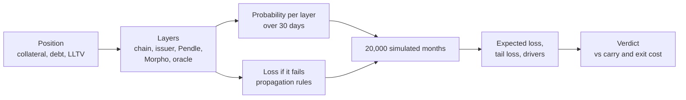

# How the risk of a position is computed

This document explains how `python3 -m riskdep analyze` turns one position into a verdict: **STAY**, **REDUCE** or **EXIT**. It follows the code (`riskdep/discover.py`, `priors.py`, `propagate.py`, `simulate.py`, `decide.py`) and uses the offline demo as a worked example: the largest borrower of the Morpho Blue market PT-sUSDE-26NOV2026 / USDC, with data as of 2026-10-10 10:30 UTC.

The other command, `watch`, does not compute a risk score: it turns blockchain events into alerts. It is described in `docs/watch/how-a-block-is-analysed.md`.

## Contents

- [The idea in one paragraph](#the-idea-in-one-paragraph)
- [1. Describe the position](#1-describe-the-position)
- [2. Discover what it depends on](#2-discover-what-it-depends-on)
- [3. How likely is an incident on each layer](#3-how-likely-is-an-incident-on-each-layer)
- [4. How an incident reaches the position](#4-how-an-incident-reaches-the-position)
- [5. Simulate many possible months](#5-simulate-many-possible-months)
- [6. Decide: stay, reduce or exit](#6-decide-stay-reduce-or-exit)
- [7. How sure is the result](#7-how-sure-is-the-result)
- [Limits](#limits)
- [Where it is in the code](#where-it-is-in-the-code)

## The idea in one paragraph

A position depends on several systems, which the code calls *layers*: the chain, the yield source behind the collateral, the Pendle market the PT trades on, the lending market and its oracle. Each layer can fail with some probability, and each failure costs the position a different amount depending on *how* it reaches it: a markdown of the collateral, a liquidation, a theft. The tool estimates the probability of each failure over the next 30 days, computes the loss each would cause to this exact position, and runs 20,000 simulated months in which failures happen at random. The average loss across those months (the expected loss) is compared with what the position earns over the same period (its carry) and with what it would cost to leave it now (the exit cost). That comparison gives the verdict.

## 1. Describe the position

The tool reads the position from the Morpho API and the chain:

| Quantity | Demo value | Source |
|---|---|---|
| Collateral | 3,961,491 PT-sUSDE-26NOV2026 | Morpho API position |
| PT price | 0.9931 USD | Morpho API |
| Collateral value $V$ | 3,934,214 USD | units × price |
| Debt $D$ | 3,413,978 USD | Morpho API position |
| Equity $E = V - D$ | 520,236 USD | — |
| LLTV | 91.5 % | market parameters |
| Health factor | 1.053 | Morpho API |
| PT implied yield | 5.01 % a year | Pendle API |
| Borrow rate | 3.74 % a year | Morpho API |
| Days to maturity | 46.6 | Pendle market expiry, counted from the data's date |

Two derived numbers matter throughout.

**The liquidation distance** is how far the collateral's price can fall before the position is liquidated:

$$
d = 1 - \frac{D}{V \cdot \text{LLTV}}
$$

For the demo, $d = 1 - 3{,}413{,}978 / (3{,}934{,}214 \times 0.915) = 5.16\%$. A 5.2 % fall in the price the lending market sees, and the position is liquidated.

**The liquidation incentive (LIF)** is the bonus a liquidator gets, set by Morpho from the LLTV:

$$
\text{LIF} = \min\left(1.15,\ \frac{1}{0.3 \cdot \text{LLTV} + 0.7}\right)
$$

For LLTV 91.5 %, LIF = 1.026: a liquidator repaying 100 of debt seizes 102.6 of collateral.

## 2. Discover what it depends on

The tool builds the list of layers from the data, not by hand:

| Layer | For the demo | How it is found |
|---|---|---|
| Settlement chain | Ethereum | always |
| Yield source (issuer) | sUSDe, issued by Ethena, with its off-chain dependencies (exchanges holding hedges, custodians) | the Pendle market's underlying asset, looked up in `registry.json` |
| Pendle market | the PT/SY pool and the SY adapter | the Pendle market whose PT is the collateral |
| Lending market | Morpho Blue market, LLTV 91.5 % | the position itself |
| Oracle | `0xF8b2…1b08`, an EIP-1167 clone of `MetaOracleDeviationTimelock`, source verified on Etherscan | the market parameters, then its code read on-chain, then Etherscan `getsourcecode` |
| Loan asset | USDC | the market parameters |

**The oracle's behaviour is inferred**, because it decides whether a temporary price drop can liquidate the position. The tool compares the price the oracle returns with the PT's market price:

- within 0.5 % of each other → **market-tracking**: the oracle follows the market, so a market dip can trigger a liquidation;
- further apart → **fundamental**: the oracle does not follow the market (for example a fixed or slowly accruing price), so a market dip does not liquidate, but a real loss of backing still does.

This test cannot decide when the PT itself trades within 1 % of its redemption value, near maturity, because every kind of oracle then reads about the same price. The demo PT is 0.62 % below par, so the price test is **ambiguous**.

Since D96 (plan `2026-10-10-incident-mode`), the oracle's structure decides first when it can. The demo oracle is a `MetaOracleDeviationTimelock`: its live source is a Pendle linear discount, which does not follow the market, and its backup reads `USDe / USD`, which does, and takes over 16 h after a deviation above 0.75 % is challenged. Within the 30-day horizon a lasting depeg reaches the backup, so the simulation treats the oracle as market-tracking, now on that basis rather than as a guess. `analyze --shock` shows the 16 h delay that the simulation, which has no time axis, cannot.

## 3. How likely is an incident on each layer

Each layer gets a yearly probability of an incident, $p$, and a distribution for how bad the incident is, its severity $s$ between 0 and 1. The severity is a Beta distribution with parameters $(a, b)$, whose mean is $a/(a+b)$.

### Exploits: from the DefiLlama hack record

For the issuer, Pendle and Morpho, the probability of an exploit comes from the record of hacks published by DefiLlama, over the last 5 years:

$$
p = \min\left(15\%,\ \max\left(0.5\%,\ r_{\text{tier}} \times m_{\text{category}} \times f_{\text{age}}\right)\right)
$$

- $r_{\text{tier}}$ is the hack rate of protocols of the same size today: hacks of protocols in that size band, divided by the number of protocols in it and by 5 years. The bands are under 10M, 10M to 100M, and over 100M USD of deposits. All three demo protocols are in the top band, where the rate is 34 hacks / 256 protocols / 5 years = **2.66 % a year**.
- $m_{\text{category}}$ adjusts for the kind of protocol: the category's own hack rate divided by the rate across all categories, kept between 0.5 and 2. Lending protocols get 1.89, "Basis Trading" (Ethena) 0.50, "Yield" (Pendle) 0.65.
- $f_{\text{age}}$ is 2 for a protocol listed less than a year ago, 1 between one and three years, 0.7 beyond.

Sizing the base rate by protocol size matters. An earlier version used the category rate alone and gave Morpho Blue 15 % a year, because the lending category is dominated by small forks that are hacked often.

The **oracle** is handled separately. Only misconfigured, stale or predictable-oracle exploits are counted (24 over 5 years, across 179 lending and CDP protocols), because manipulating the spot price of a thin token does not apply to a PT oracle. That gives 2.68 % a year. The prior is doubled (`oracle.unverified_factor`) when the oracle's source is not verified on Etherscan, or when that cannot be checked (no key): the demo oracle's implementation, `MetaOracleDeviationTimelock` by Steakhouse Financial, is verified, so it stays at 2.68 %.

### Market events: from `registry.json`

A depeg of the yield source is not an exploit and is not in the hack record. Its probability, severity and recovery are set in `riskdep/registry.json`, each with a written basis. For sUSDe: a 12 % chance a year of a depeg averaging 8 %, three quarters of which is recovered by the horizon. The basis cites the 2025-10-10 cascade, when USDe briefly traded near 0.65 on one exchange's order book while on-chain pools held near peg.

### The demo's priors

| Event | $p$ per year | Severity mean | Over 30 days |
|---|---|---|---|
| sUSDe depeg | 12.0 % | 8.2 % (75 % recovered) | 1.05 % |
| Morpho Blue exploit | 5.03 % | 9.1 % | 0.42 % |
| Oracle misprice | 2.68 % | 10.0 % | 0.22 % |
| Ethena exploit / loss of backing | 1.33 % | 28.6 % | 0.11 % |
| Pendle market / SY exploit | 1.21 % | 13.8 % | 0.10 % |
| Ethereum incident | 1.00 % | 0.5 % | 0.08 % |

A yearly probability becomes a horizon probability as $p_h = 1 - (1-p)^{h/365}$. For the depeg over 30 days: $1 - 0.88^{30/365} = 1.05\%$.

## 4. How an incident reaches the position

This is the core of the model (`propagate.py`). The same 10 % shock costs very different amounts depending on the layer it hits and on whether it triggers a liquidation. The code tracks two values of the collateral:

- the **true value**: what the collateral is actually worth, and what the borrower keeps or loses in the end;
- the **oracle value**: what the lending market sees, which alone decides liquidation.

Each kind of shock moves them differently:

| Shock | True value | Oracle value |
|---|---|---|
| Ethereum incident, issuer exploit, Pendle exploit | falls by $s$ | falls by $s$ |
| Issuer depeg | falls by $s \times (1 - \text{recovery})$, the part that does not come back | market-tracking oracle: falls by $1.5 \times s$, because during a depeg the PT trades below its own backing as liquidity leaves the pool; fundamental oracle: unchanged |
| Oracle misprice | unchanged | falls by $s$ |
| Morpho exploit | falls by $s$, collateral stolen | unchanged |

Then:

- **If** oracle value × LLTV < debt, the position is **liquidated**. The liquidator repays the debt and seizes debt × LIF worth of collateral, valued at the oracle price. The borrower keeps the rest of the collateral, at its true value.
- **Otherwise** the borrower keeps the true value minus the debt, or nothing if that is negative: the borrower walks away, and the lenders take the bad debt.

The loss is the equity before minus the equity after.

**Why the oracle matters so much.** Take the average sUSDe depeg, 8.2 %, three quarters of which recovers: in the end the collateral is worth about 2 % less. With a market-tracking oracle, the lending market sees a 12.3 % fall, beyond the 5.2 % liquidation distance. The liquidator seizes all the collateral at the depressed price, and the borrower loses the whole equity, 520,236 USD. With a fundamental oracle, nothing is liquidated, and the loss is the part of the depeg that does not recover: 80,651 USD, 15.5 % of the equity. Averaged over all depeg sizes, from small ones that liquidate nothing to large ones, the demo's figures per event are:

| Event | Loss if it happens | Liquidates |
|---|---|---|
| Ethena exploit | 465,241 USD | 90 % of cases |
| sUSDe depeg | 359,761 USD | 76 % |
| Pendle exploit | 354,155 USD | 68 % |
| Oracle misprice | 334,829 USD | 74 % |
| Morpho exploit | 251,746 USD | never: stolen collateral is not liquidated |
| Ethereum incident | 19,912 USD | never |

## 5. Simulate many possible months

`simulate.py` draws 20,000 months. In each, every layer fails or not according to its 30-day probability, and a failing layer draws a severity from its Beta distribution. The losses are then summed through the rules of section 4, with all the month's shocks applied together. One dependency is built in: an exploit of the issuer always comes with a depeg at least as deep.

From the 20,000 losses:

| Measure | Demo | Meaning |
|---|---|---|
| Expected loss | 6,265 USD | the average month |
| P(any loss) | 1.91 % | months in which something happened |
| P(liquidation) | 1.07 % | months ending in a liquidation |
| VaR 95 % | 0 USD | 95 % of months lose nothing at all |
| CVaR 95 % | 125,294 USD | average loss of the worst 5 % of months |
| VaR 99 % | 386,890 USD | the loss exceeded in 1 % of months |
| CVaR 99 % | 510,184 USD | average of the worst 1 %: 98 % of the equity |

The tail is measured at 99 % because incidents happen in only about 2 % of months, so the 95 % level falls among the months with no loss and VaR 95 % reads zero.

**Attribution.** Each layer's share of the expected loss is its 30-day probability times its average loss when it alone fails, estimated with 4,000 draws per layer. For the demo: depeg 3,760 USD, Morpho 1,066, oracle 747, Ethena 511, Pendle 353, Ethereum 16. The remainder, −189 USD, comes from months in which two failures overlap, where the second adds less because the equity is already gone.

## 6. Decide: stay, reduce or exit

Three amounts over the horizon $h$ (30 days, or less if the PT matures sooner):

$$
\text{carry} = V \cdot y_{\text{PT}} \cdot \tfrac{h}{365} - D \cdot y_{\text{borrow}} \cdot \tfrac{h}{365}
$$

$$
\text{exit cost} = V \cdot \text{price impact} + \text{fees} + \text{gas}
$$

- **Carry**: what the position earns, the PT's fixed yield on the collateral minus the interest on the debt. Demo: 16,203 − 10,506 = **5,697 USD**.
- **Exit cost**: what leaving costs today, from a real quote by Pendle's API for selling all the collateral. Demo: 1.99 % price impact, 490 USD of fees and 25 USD of gas, so **78,946 USD**.
- **Expected loss** from section 5: **6,265 USD**.

The rules, in order:

1. **EXIT** if the expected loss exceeds carry + exit cost. Leaving costs less than staying.
2. **REDUCE** if any of these holds:
   - the carry does not cover the expected loss;
   - the average loss of the worst 1 % of months (CVaR 99 %) exceeds half the equity;
   - the liquidation distance is smaller than the **stress drop**, the larger of twice the yield source's worst one-year drawdown and the average depeg as the oracle would see it.
3. **STAY** otherwise.

The demo gives **REDUCE**, and all three reasons apply:

- the carry, 5,697 USD, is less than the expected loss of 6,265 USD;
- CVaR 99 % is 98 % of the equity;
- the 5.2 % liquidation distance is below the 12.2 % stress drop.

Exiting is still not worth it: the expected loss would have to be 13.5 times larger to cover carry plus exit cost.

**The de-lever suggestion.** For REDUCE, the tool solves for the amount of collateral to sell, with the proceeds repaying debt, that brings the liquidation distance up to the stress drop. Selling $x$ USD of collateral to repay $x$ of debt gives $d = t$ when

$$
x = \frac{D - k V}{1 - k}, \qquad k = (1 - t) \cdot \text{LLTV}
$$

where $t$ is the target distance. It then gets a real quote for that smaller sale and re-runs the whole simulation on the reduced position. For the demo: sell 1.29M USD (33 %), at a quoted cost of 1,023 USD. That raises the health factor to 1.14, pushes liquidation out to a 12.2 % drop, lowers the expected loss from 6,265 to 4,308 USD and CVaR 99 % from 510,184 to 410,778 USD, and lowers the carry from 5,697 to 4,350 USD.

## 7. How sure is the result

**Oracle sensitivity.** The tool re-runs the simulation with the other oracle behaviour, so the reader sees how much the verdict rests on it:

| | Market-tracking (used) | Fundamental |
|---|---|---|
| Expected loss | 6,265 USD | 3,363 USD |
| P(liquidation) | 1.07 % | 0.28 % |
| Verdict | REDUCE | REDUCE |

The verdict does not depend on the oracle here; the report says so, or warns when it does.

**Data cross-checks.** Before deciding, the tool compares the Morpho API's collateral and debt with the chain's `position(id, user)` (0.018 % apart for the demo, the interest accrued since the last update). It also compares the RPC's block hash with an independent node. A failed check is printed at the top of the reasons.

**Sources of every assumption.** Every probability and severity carries its basis: the counts behind it, or the registry entry and its justification. The report shows them under "Assumptions and their basis".

## Limits

- **Probabilities are base rates.** They come from hack counts by size and category, not from an assessment of these particular protocols; the registry entries for market events are judgements with a stated basis.
- **Layers fail independently,** except an issuer exploit, which always comes with a depeg. In reality a depeg, a Pendle pool draining and an oracle lagging tend to happen together.
- **The starting collateral value is the PT market price,** for the liquidation distance and as the oracle's starting point. The demo oracle reads 0.08 % lower, so the true distance is slightly smaller than shown.
- **Carry assumes today's rates hold** over the horizon, and the exit quote is valid only at the time of the run.
- **Only Pendle PT collateral is supported** by `analyze`; other collateral is refused.
- **One position at a time;** two positions of the same address that share a layer are not combined.

## Where it is in the code

| Step | Code |
|---|---|
| 1–2 | `riskdep/discover.py`: `discover_morpho_position`, `infer_oracle`, `exit_quote` |
| 3 | `riskdep/priors.py`: `hack_stats`, `exploit_p_year`, `layer_priors`; parameters in `riskdep/registry.json` |
| 4 | `riskdep/propagate.py`: `loss` |
| 5 | `riskdep/simulate.py`: `run` |
| 6 | `riskdep/decide.py`: `verdict`, `sale_to_reach` |
| 7 | `riskdep/cli.py` (oracle sensitivity), `riskdep/crosscheck.py` |
