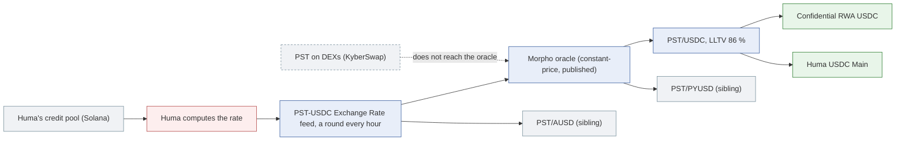

# Huma (PST): its oracle, and why a fall in its market price liquidates nobody

PST is Huma's PayFi Strategy Token: a share of a credit pool financing cross-border payments, issued on Solana and bridged to Ethereum through Chainlink CCIP. In the RockawayX book it is the collateral of the largest market: **PST/USDC**, LLTV 86 %, about 91 % utilised, 38.0M USD, supplied by two vaults, **RockawayX Confidential RWA USDC** (21.86M) and **Huma USDC Main** (12.84M). PST is 35 % of the book.

This document explains how that market prices PST, why riskdep classes its oracle as constant-price, and what follows for an incident. The figures come from the offline recordings: the graph of Confidential RWA USDC at block 26,165,477 and the incident of Huma USDC Main at block 26,165,063.

| Question | Answer | Where |
|---|---|---|
| What prices PST in the market? | A Morpho `ChainlinkOracleV2` (`0xa565…8ac0`) with one base feed, "PST-USDC Exchange Rate (Calculated)" (`0x4be5…65e6`), about 1.138 USDC per PST | `graph.py` |
| Is it a market price? | No: Huma's exchange rate, the value of one PST as its accounting computes it | `oracle_class.py` (D82–D84) |
| Class | **constant-price**: "fell 0 times in 24 changes over 24 rounds, an accrual rate" | `classify_input` |
| Kind | **published**: each round is pushed by a transaction, about once an hour | `constant_kind` (D205) |
| Is the feed fresh? | Updated about once an hour (25 rounds); not stale | `feeds.py` (D155) |
| Who reads it? | 3 markets: PST/USDC, and the siblings PST/PYUSD and PST/AUSD | `siblings.py` |

## 1. Why constant-price

riskdep asks one question of every oracle: does a fall of the collateral's market price reach the oracle? If it does, the oracle is **price-tracking**: borrowers are liquidated as the price falls. If it does not, the oracle is **constant-price**: nobody is liquidated on a depeg, and the loss lands on the lenders when the issuer finally lowers its value.

The answer comes from the feed's own round history, not from its name. A market price moves both ways: it falls about as often as it rises. Huma's feed has risen at each of its last 24 changes and never fallen. That is the signature of a rate that accrues yield: it follows the pool's accounting, not trades on an exchange. So the oracle is constant-price, whatever PST trades at.

Within constant-price, the **kind** says how fast an issuer's loss reaches the oracle (D205):

| Kind | Moves when the issuer loses value | Example |
|---|---|---|
| exchange rate | at once, when the accounting records the loss | an ERC-4626 vault's `convertToAssets`, ETH+ |
| **published** | **at its next round, by a transaction** | **PST's feed (hourly)**, Midas's NAV (rarely) |
| linear discount | never: it follows a schedule to maturity | some PT oracles |
| fixed | never: its value is fixed | the dummy 1.0 feed of the siUSD market |

PST's feed is **published**: its rounds are pushed by a transaction, so a loss reaches the oracle only when someone pushes a lower round.

## 2. What follows for an incident

**A market depeg liquidates nobody.** If PST trades at 0.90 on DEXs, the oracle still reads about 1.138: no position becomes liquidatable, and the market sees nothing.

**A real loss lands at once.** When Huma's pool loses value (defaults, or a run that drains its stablecoin buffer), the loss reaches the market only when a lower round is pushed, within about an hour. Then every position the lower price makes liquidatable is liquidatable in the same block. No falling market price warns before it.

`analyze --vault 0x8aC9…475c --shock token=PST:0.2`, Huma USDC Main, offline:

| | Figure |
|---|---|
| Debt liquidatable in PST/USDC | 31.9M of 34.4M USDC (12 borrowers; the largest holds 48 % of the debt, the three largest 88 %) |
| Bad debt in the market | 1.86M USDC |
| The vault's loss (it supplies 34 %) | 628,563 USDC, 4.89 % of the vault; about 2.45M at its caps, which an allocator can reach at once |
| Exit liquidity | thin: the aggregator routes at most 20M of PST, and selling the 33.3M seized costs nearly all of it against the oracle |
| If nobody liquidates | the loss is 230,717 and the market's liquidity stays locked |
| Verdict | EXIT: withdraw the 3.59M that can leave now; the 6.60M that cannot carries the rest |

Liquidating PST needs a buyer of PST. With thin exit liquidity, liquidators may not act: the bad debt then stays unrealised, the share price stays at par, and those who leave first leave the loss to those who stay.

**The gap invites a drain.** While PST trades below the published rate, anyone can buy it cheaply, post it at the oracle's price and borrow USDC. That pays once the discount exceeds about 1 − LLTV, so 14 % here, less the cost of buying at size (`drain.py`, D69–D74). The arbitrage then borrows every unit of free liquidity in one block, and the lenders keep the collateral worth less than the debt.

**One feed, three markets.** The same feed prices PST/USDC and two sibling markets. A wrong round, or a lower one, hits all three at once. At −20 % the siblings' lenders lose 831,136 PYUSD and 141,615 AUSD (`siblings.py`, D141).

## 3. The rest of PST's dependencies

- **The bridge.** PST on Ethereum is minted by Chainlink CCIP from Solana. Its open lane allows 7.7M at once, refilled at 6,112 a second; a forged message within an hour mints 29.7M PST that, posted at the oracle's price, borrow the PST markets' free liquidity (`bridge.py`, `--shock bridge=PST`, D250–D252).
- **Off the chain.** RockawayX's Kamino Huma PST vault (42.5M) holds PST itself: a 20 % markdown costs it 8.5M, not read on-chain (`registry.json` `offchain`, D256).

## 4. What is not computed

- Huma's pool itself: its loans, its stablecoin buffer and its defaults are off-chain and on Solana. The markdown size is the user's (`token=PST:<fall>`) or drawn by `--conditional`.
- Who pushes the feed's rounds, and whether a round can fall by more than some bound: the feed's code is not read.
- The pace at which a lower rate would be published: riskdep assumes the next round, about an hour.
