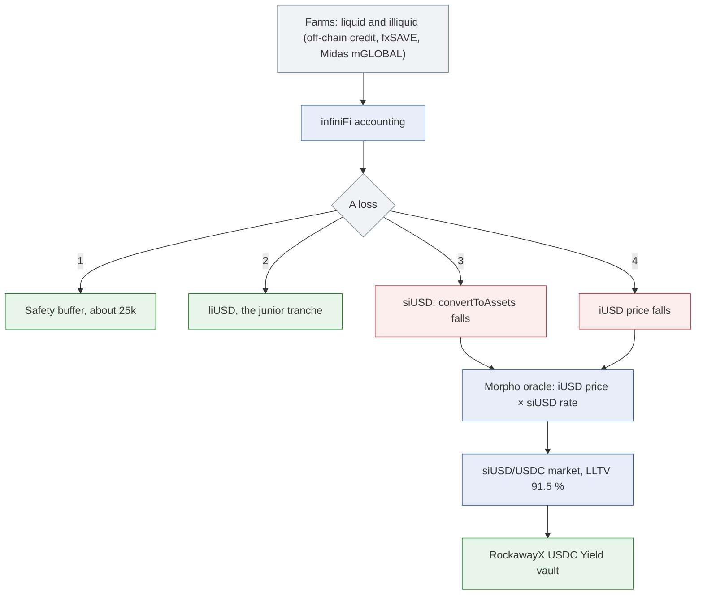

# infiniFi (iUSD, siUSD): how riskdep computes its risk

infiniFi issues iUSD, a fractional-reserve stablecoin: deposits are spread over liquid farms (instant withdrawal) and illiquid ones (principal locked until maturity, mostly off-chain credit). Two tokens sit on top of iUSD: **siUSD**, an ERC-4626 vault of staked iUSD, and **liUSD**, locked iUSD that takes losses first. In riskdep's recordings, siUSD is the collateral of the siUSD/USDC market of the **RockawayX USDC Yield** vault (`0xE018…1965`), LLTV 91.5 %.

As for Midas and f(x), there is no infiniFi module: the risk comes from the generic oracle classification, the incident engine, the feeds and the outside providers. This document says what they give for siUSD, what the protocol's own contracts say should happen (cited from the pinned sources in `docs/external/infini-protocol/`, whose `README.md` gives `file:line`), and what is not computed. Figures: the vault incident at block 26,165,061, the graph at block 26,164,907.

| Question | Answer | Where |
|---|---|---|
| How is siUSD priced? | iUSD's admin-set price (1.0) × siUSD's `convertToAssets`: no market price | `oracle_class`; the graph's `converts through` edge |
| When does a loss reach the oracle? | Only once infiniFi books it, and only after liUSD (the junior tranche) is used up | infiniFi's `YieldSharingV3` (not modelled) |
| What does a markdown cost? | −30 %: the vault loses 408,332 USDC (2.21 %); 1,196,445 left insolvent, nobody liquidated | `vault_incident`, shock engine |
| Who else is hit? | The sibling siUSD/msUSD market: 451,329 msUSD | `siblings`, shock engine |
| Should the depositor leave? | EXIT: its loss falls from 158,341 to 34,538; leaving pays above a 29.81 % chance over 30 days | `vault_incident` |
| How likely is it? | No prior; Pharos grades iUSD D 49; Nexus covers infiniFi | `pharos.py`, `nexus.py` |

## 1. How siUSD loses value

From the pinned contracts:

- **The oracle.** The market's `BASE_FEED_1` is infiniFi's `ChainlinkRTOracle`, whose `price()` returns `Accounting.price(iUSD)`: an admin-set `FixedPriceOracle`, 1.0. `BASE_VAULT` is siUSD's `convertToAssets`. So the Morpho price is iUSD's booked price × siUSD's share rate, and it moves only when infiniFi books a loss.
- **The loss waterfall** (`YieldSharingV3.sol:343-376`). A loss is applied in this order:
  1. the safety buffer (about 25,000 USD of iUSD), if it covers the whole loss;
  2. the locking users: liUSD and unwinding positions (`LockingController.applyLosses`);
  3. siUSD holders (`StakedToken.applyLosses`): next epoch's rewards, then this epoch's, then principal, which lowers `convertToAssets`;
  4. only then the iUSD price, `price × (supply − loss) / supply`.
- **A pending loss is visible before it is booked.** `unaccruedYield() = totalAssetsValue / price(iUSD) − iUSD supply` (`YieldSharingV3.sol:178-187`) goes negative as soon as the farms are worth less than the iUSD issued.
- **Exits.** Direct ERC-4626 withdrawals of siUSD revert unless they come through the Gateway, which can be paused. `maxRedeem` and `maxWithdraw` return 0 while siUSD is paused or while `unaccruedYield() < 0`, so exits are blocked while a loss is pending. iUSD then redeems for USDC up to the controller's liquidity; the rest joins a FIFO queue served as illiquid farms mature.
- **What backs iUSD.** Pharos records iUSD as backed by fxSAVE, Midas's mGLOBAL and USDC. infiniFi's own farm list includes f(x) fxSAVE and Fasanara funds through Midas.

What riskdep draws in `graph`: the market's oracle `reads` the RT oracle and `converts through` siUSD; siUSD `wraps` iUSD; iUSD `backed by (Pharos)` fxSAVE, mGLOBAL and USDC; both tokens `issued by` infiniFi. The RT oracle is shared with the sibling siUSD/msUSD market. The waterfall, the farms and the redemption queue are not drawn.

## 2. The incident

`analyze --vault 0xE018…1965 --shock token=siUSD:0.30`, offline:

| Quantity | Value |
|---|---|
| Market | siUSD/USDC, 7,194,692 USDC of debt, 12 borrowers |
| Concentration | the largest borrower holds 94 % of the debt, the three largest 100 % |
| Liquidatable | 0 (the shock engine keeps the oracle at × 1.000) |
| Bad debt | 1,385,685 USDC; 1,196,445 left insolvent |
| Vault's share | 29 % → loss 408,332 USDC, 2.21 % of 18,445,040 |
| Contagion | the sibling siUSD/msUSD market's lenders lose 451,329 msUSD |
| Depositor followed | 0x16f2…8bbf, 7,152,530 USDC, 38.78 % of the vault |
| Verdict | **EXIT**: withdrawing now cuts the loss from 158,341 to 34,538 |
| Breakeven | leaving forgoes 36,900 USDC of yield over 30 days (6.28 %/yr) and pays above a 29.81 % chance over 30 days |

The incident's timing line says the loss lands "at once, when the issuer's accounting records the loss", while the engine's own line keeps the oracle unchanged. Section 5 comes back to that.

The same vault also holds 0.8 % confidentially through Zama; the incident adds the two confidential exits (`docs/model/zama-confidential-vaults.md`).

## 3. Probabilities and outside views

- **No prior**: `registry.json` `issuers` has no iUSD or siUSD entry.
- **Pharos** grades iUSD **D 49** and gives its backing (fxSAVE, mGLOBAL, USDC). A token shock on fxSAVE or on a Midas token therefore reaches siUSD markets through that backing, in proportion to it (`vault_incident`, Pharos-reached markets).
- **Nexus Mutual**: product 308 covers infiniFi at 1.90 %–2.77 %/yr, capacity 11,229,413 USDC, implying 1.3 %–4.6 %/yr for an exploit at this severity. It pays on an exploit, not on a markdown.
- **DefiLlama**: infiniFi holds 58M USD, 0.01 % of DeFi, 1.2 % of its category (Yield, #13). DefiLlama's adapter books `Accounting.totalAssetsValue()`, infiniFi's own oracle-priced total, so it is not an independent check. 10.92M siUSD is posted in Morpho.

## 4. What is watched

| Signal | In riskdep |
|---|---|
| The RT oracle shared by two markets | `shared: true` in the graph; the incident's feed line |
| An oracle move on the market | `OracleImpact` from a 2 % fall |
| Bad debt once liquidations run | the unrealised bad debt alert |
| A pending loss (`unaccruedYield() < 0`) | not read |
| A loss booked (`VaultLoss` on siUSD), a price set (`PriceSet`), an oracle repointed (`OracleSet`, `SetAccounting`), a pause | not decoded |

## 5. What is not computed

| Gap | Effect |
|---|---|
| **The siUSD markdown and the oracle** | The oracle `converts through` siUSD's rate, and a booked loss lowers that rate. The incident's engine nevertheless keeps the oracle at × 1.000 and treats the 30 % as a fall of the collateral's market price only: nobody is liquidated and the loss is counted as hidden. If the markdown is a booked loss, the oracle should fall too and liquidations follow. The `token=` shock does not say which of the two it means, and the engine's transmission through `converts through` should be checked |
| **The loss waterfall** | The size of liUSD and of the safety buffer in front of siUSD is not read, so the incident cannot say how large a farm loss must be before siUSD loses anything, nor turn a farm default into the siUSD markdown it causes |
| **The pending-loss early warning** | `unaccruedYield() < 0` is public and precedes the booking; the watch does not read it, though it is also the moment siUSD exits close |
| **infiniFi's admin events** | `PriceSet` (the iUSD price), `OracleSet`, `SetAccounting` (the GOVERNOR repointing the RT oracle's source), `VaultLoss` and the pauses of `InfiniFiCore` modules are not in `admin.ADMIN_EVENTS`; the roles live in `InfiniFiCore`, not on the contracts the admin surface reads |
| **The exits** | The Gateway-only unstake, exits blocked while a loss is pending, and the FIFO redemption queue are not in the exit; there is no DEX entry for siUSD in `exit_liquidity` |
| **Freshness** | The RT oracle returns `updatedAt = block.timestamp`, so "updated 2 min ago" carries no information |
| **The farms** | Liquid against illiquid backing (`Accounting.totalAssetsValueOf(type)`) and the farm list are not read |
| An issuer prior | Only the generic default would apply |

## 6. In the code

| File | Role |
|---|---|
| `riskdep/registry.json` | `pharos.ids` (iUSD), `nexus.products` (308 for iUSD and siUSD), `tvl.tokens` (`infinifi`) |
| `riskdep/oracle_class.py`, `riskdep/graph.py` | The constant-price class; the `reads` and `converts through` edges; the shared RT oracle |
| `riskdep/vault_incident.py`, `riskdep/engine.py` | The markdown, the hidden loss, the sibling market, the verdict |
| `riskdep/pharos.py` | iUSD's grade and backing |
| `docs/external/infini-protocol/README.md` | The protocol's mechanics with `file:line` at the pinned commit |
