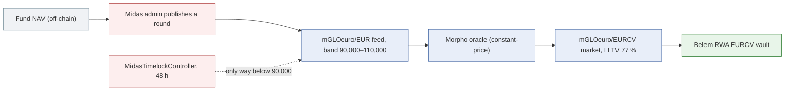

# Midas (mGLOeuro): how riskdep computes its risk

Midas issues tokenised fund shares (mTokens). mGLOeuro is a share of a euro private-credit fund (Fasanara), worth about 100,000 EUR each. Its price on-chain is a NAV that Midas's admin publishes by transaction on a custom feed. In riskdep's recordings, mGLOeuro is the collateral of the only market of the **Belem RWA EURCV** vault (`0xD6d4…48Ec`): mGLOeuro/EURCV, LLTV 77 %. It is also the subject of the fork crisis demo (`scripts/fork/`).

Unlike Ethena (`ethena.py`) or Zama (`zama.py`), Midas has no module of its own. What riskdep computes for it comes from the generic parts: oracle classification, feed quality, the admin surface, the incident engine and the outside providers. This document says what each of them gives for mGLOeuro, and what is not computed. The figures come from the offline recordings: the vault incident at block 26,165,064, the graph at block 26,164,854.

| Question | Answer | Where |
|---|---|---|
| How is mGLOeuro priced? | A constant-price oracle reading Midas's custom NAV feed, published by the issuer's admin | `oracle_class` (`graph.oracle_patterns`: `CustomAggregator`) |
| Is the feed fresh? | 17.5 days old, only 2 rounds: stale | `feeds.py` (D156) |
| How far can the feed fall? | Not below 90,000 EUR (−10 %) without an upgrade behind a 48 h timelock | `admin._read_bands`, `FeedBand` (D183), `Admin.CallScheduled` (D182) |
| What does a markdown cost? | −30 %: bad debt 251,761 EURCV, the vault loses 5.34 % | `vault_incident`, shock engine |
| Can liquidators act? | No DEX route: issuer redemption only | `registry.json` `exit_liquidity` |
| Should the depositor leave? | STAY: it holds 99.46 % of the vault, so the loss falls on it either way | `vault_incident` verdict |
| How likely is it? | No prior; an outside view from Nexus Mutual only | `nexus.py` |

## 1. The oracle and the feed

The market's oracle reads `mGLOeuro/EUR`, a `MGloEuroCustomAggregatorFeed` behind an upgradeable proxy. riskdep classifies it as **constant-price, published**: the price does not follow a market, it changes when Midas's admin writes a new round (`graph.oracle_patterns`, basis: 100,000 EUR on 2026-08-04 and 2026-09-23, its only two rounds).

Three consequences are computed:

- **Timing.** A markdown lands "at its next published round, by a transaction": no market move announces it, and liquidations can start in the same block.
- **Staleness.** The feed was last updated 17.5 days before the recording. With two rounds, its own rhythm cannot be learned, so the fallback limit applies: stale past 7 days (`feeds.no_history_max_days`). The incident notes that the starting price may already be out of date.
- **The band.** The feed stores a fixed `minAnswer` and `maxAnswer`, 90,000–110,000 EUR around 100,000, with no setter (D183). Below 90,000 it cannot report without new code. That code goes in through the `MidasTimelockController` (48 h), whose proposer is a Safe. `watch` reports the band at start-up (`FeedBand`, when the floor is within `watch.feed_band_report_floor` = 50 % below the answer) and the timelock's queue as it moves (`Admin.CallScheduled` warn, `Admin.CallExecuted`, D182).

## 2. The incident

`analyze --vault 0xD6d4…48Ec --shock token=mGLOeuro:0.30`, offline:

| Quantity | Value |
|---|---|
| Debt liquidatable | 3,426,767 of 3,678,530 EURCV, 2 borrowers |
| Concentration | the largest borrower holds 100 % of the debt |
| Bad debt | 251,761 EURCV, all borne by the vault (it supplies 100 % of the market) |
| Vault loss | 5.34 % of 4,710,697 EURCV |
| Depositor followed | 0x4f87…0545, 4,685,217 EURCV, 99.46 % of the vault |
| Staying loses | 250,399 EURCV |
| Leaving first | recovers 1,031,701 at par, 3,653,515 stays, loss 250,017 |
| Verdict | **STAY**: leaving first saves 382 EURCV (0.2 % of the loss) |
| Breakeven | leaving forgoes 2,229 EURCV of yield over 30 days (2.63 %/yr), more than it saves: stay even if the incident is certain |

The verdict is STAY because the depositor is almost the whole vault: whatever it leaves behind, it bears. Withdrawing what can leave still cuts its exposure to a further markdown by 1,031,701 EURCV.

**Liquidators.** There is no DEX route for mGLOeuro (`exit_liquidity.tokens`: "issuer redemption only"). A liquidator would seize a token it can only redeem with Midas. If nobody liquidates, the loss stays unrealised (0 written off) and the market's liquidity stays locked. The incident says so in its notes.

**The fork demo** replays this on a mainnet fork: the issuer's −10 % (within the band), then an upgrade through the real timelock, then 70,000 EUR. The 30 % prediction (251,761 EURCV) matched the observed bad debt (252,914) within 0.5 % (`scripts/fork/DEMO-EXPLAINED.md`).

## 3. Probabilities and outside views

- **No prior.** `registry.json` `issuers` has no mGLOeuro entry. The vault incident does not need one: it assumes the incident and states the breakeven p\*. An `analyze` run on an mGLOeuro position would fall back to `unknown_issuer` (a 15 %/yr depeg, Beta(1.5, 10), 60 % recovered), which is not Midas's.
- **Nexus Mutual.** Product 356 covers Midas: 1.48 %/yr, capacity 29,856 USDC. With the registry's loading of 2 to 5, that implies 1.0 %–2.5 %/yr for an exploit of the protocol at this severity. It pays on an exploit, not on a NAV markdown, and the incident says so.
- **Pharos.** No grade: Pharos covers stablecoins, and mGLOeuro is a fund share.
- **DefiLlama.** The `midas-rwa` slug reports no TVL, so the graph's concentration line reads "no TVL reported".

## 4. Contagion

The Belem vault has one market, so a markdown does not spread inside the vault. No other Morpho market takes mGLOeuro or reads its feed: the graph marks both the oracle and the feed `shared: false`. The concentration runs the other way: 52.58 of the 59.19 mGLOeuro tokens in existence are posted in this one market (89 %), so the market is most of the token, and two borrowers are all of the market. The wider exposure to Midas is mROX (RockawayX's own strategy, about 3.4M USD), which is not a Morpho position and is not modelled (`docs/analysis/ROCK-VAULT.md` §3).

## 5. What is watched

| Signal | Alert |
|---|---|
| The band's floor near the answer | `FeedBand` at start-up |
| A queued upgrade of the feed, 48 h ahead | `Admin.CallScheduled` (warn), then `Admin.CallExecuted` |
| The feed stale | `FeedStale` |
| A published markdown within the band | `OracleImpact` from a 2 % fall: what becomes liquidatable, the verdict |
| Bad debt once liquidations run | the unrealised bad debt alert (critical) |
| Exit gates | `ExitGate`: abdicated on this vault, so withdrawals cannot be gated |

## 6. What is not computed

| Gap | Effect |
|---|---|
| **The band in the incident and in `OracleImpact`** | The band is reported at start-up only. The incident, the shock engine and `OracleImpact` apply a −30 % markdown to the oracle at once, while the feed cannot go below −10 % without the 48 h upgrade. A −30 % NAV loss would show −10 % first (no bad debt), then −30 % after the upgrade, or never if no upgrade is made. The time to impact is understated, and a loss hidden behind the floor is not stated as hidden |
| An issuer prior for mGLOeuro | Only the generic default would apply in `analyze`; no ex-ante probability for the vault |
| Midas's redemption | Its delay, fees and gating are not modelled; the exit for a liquidator is only "issuer redemption" |
| The fund itself | The NAV's inputs (the loan book) are off-chain; no transparency source is read, unlike Ethena's dashboard |
| mROX and other Midas tokens | Not Morpho positions; not in a graph |
| TVL | DefiLlama reports none for Midas RWA |

## 7. In the code

| File | Role |
|---|---|
| `riskdep/registry.json` | `graph.oracle_patterns` (`CustomAggregator` → constant-price, published), `watch.feed_band_*` (D183), `feeds` (stale rules), `exit_liquidity.tokens` (mGLOeuro: none), `nexus.products` (356), `tvl.tokens` (`midas-rwa`) |
| `riskdep/oracle_class.py`, `riskdep/feeds.py` | The class and the staleness |
| `riskdep/admin.py` | `_read_bands`, `band_findings`, the timelock discovery and its queue alerts |
| `riskdep/vault_incident.py`, `riskdep/engine.py` | The markdown, liquidations, the verdict |
| `scripts/fork/` | The crisis demo on this vault |
