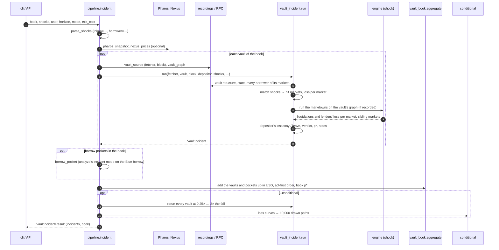
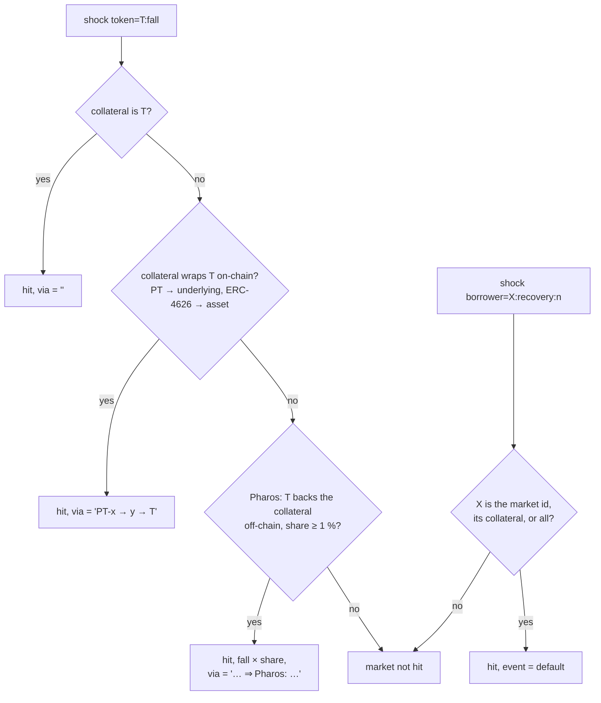
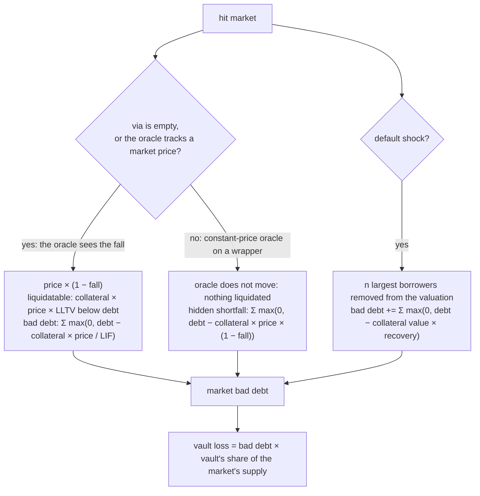
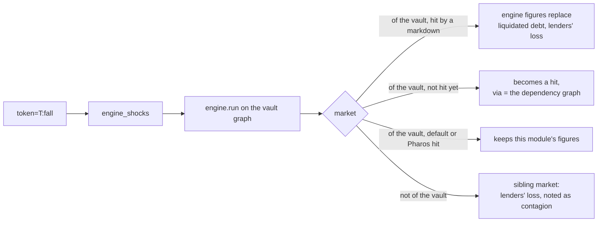
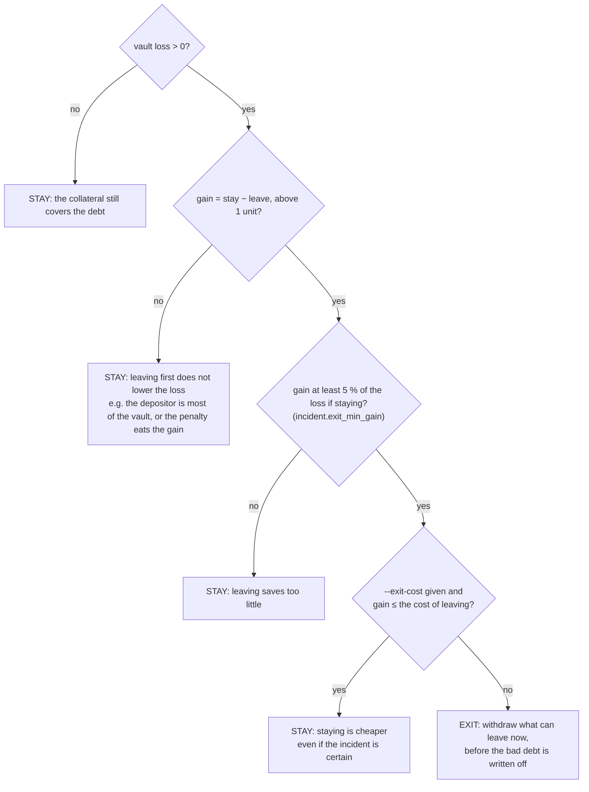
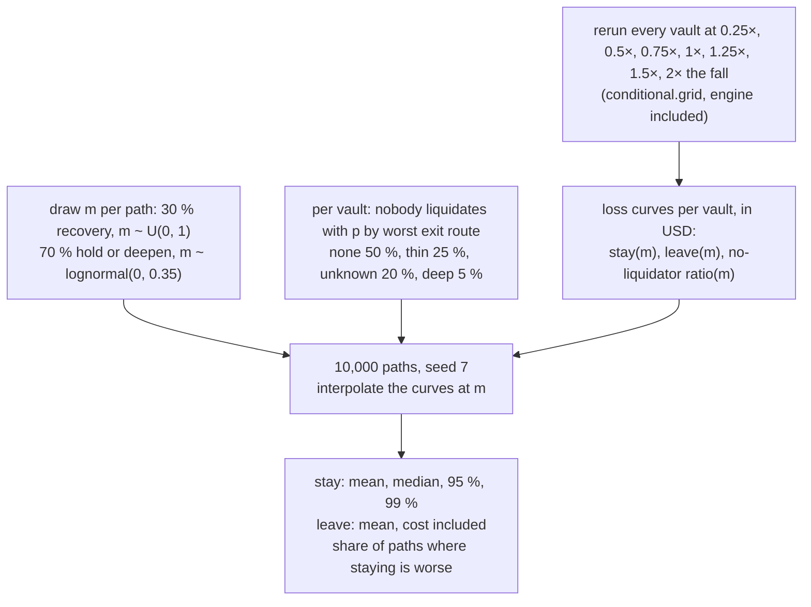

# Incident mode for a vault depositor, end to end

This document explains how `analyze --vault` and `analyze --book` (and `POST /api/incident`, the same run) take a known incident (a collateral marked down by x %, or borrowers defaulting) and turn it into a loss per market, a loss per vault, a depositor's loss if it stays or leaves first, a verdict, a breakeven probability and, optionally, the distribution of the loss given the incident. It is the path that answers the brief's question: stay or exit, given an incident, against what exiting costs.

The plans behind it are `plan/2026-10-11-vault-incident` (D98–D103, D121, D126–D131), `vault-book` (D120–D125, D152–D153), `wrapped-collateral`, `pharos` (D133–D138), `one-number` (D139–D141), `breakeven` (D142–D146, D151), `conditional` (D165–D168) and `incident-api`. Module docstrings cite the same decision numbers.

Every number below comes from the offline recordings, and can be reproduced with the commands given.

## Contents

- [1. The question and the command](#1-the-question-and-the-command)
- [2. The pipeline at a glance](#2-the-pipeline-at-a-glance)
- [3. Where each vault is read](#3-where-each-vault-is-read)
- [4. From a shock to the hit markets](#4-from-a-shock-to-the-hit-markets)
- [5. The loss of each hit market](#5-the-loss-of-each-hit-market)
- [6. The shock engine on the vault's graph](#6-the-shock-engine-on-the-vaults-graph)
- [7. From the vault's loss to the depositor's](#7-from-the-vaults-loss-to-the-depositors)
- [8. The verdict given the incident](#8-the-verdict-given-the-incident)
- [9. If the incident is not certain: p\*](#9-if-the-incident-is-not-certain-p)
- [10. The conditional distribution (`--conditional`)](#10-the-conditional-distribution---conditional)
- [11. A book of vaults](#11-a-book-of-vaults)
- [12. Outside views and notes](#12-outside-views-and-notes)
- [13. Output: CLI, JSON, API](#13-output-cli-json-api)
- [14. Worked example: f(x) vault, fxSAVE −30 %](#14-worked-example-fx-vault-fxsave-30-)
- [15. Assumptions and limits](#15-assumptions-and-limits)
- [16. Code map](#16-code-map)

## 1. The question and the command

A depositor in a Morpho Vault V2 holds shares of a pool lent across several Blue markets. When the collateral of one market loses value, the depositor wants to know:

1. how much the vault loses, and when;
2. how much **they** lose if they stay, and if they withdraw now;
3. whether withdrawing is worth what it costs (the yield given up, or an unwind cost);
4. how bad it can get if the incident deepens or nobody liquidates.

```bash
# one vault, the depositor being its largest holder unless --user is given
uv run python -m riskdep analyze --vault 0x2cA22cb25558fa2018ecb1CE4eD8AF92Ee7ea423 --shock token=fxSAVE:0.30
# a book of vaults, the conditional distribution
uv run python -m riskdep analyze --book examples/rockawayx-ethereum.json --shock token=PST:0.30 --conditional
# the brief's ten pockets, with a flat 11 % cost of leaving
uv run python -m riskdep analyze --book examples/brief-ten-pockets.json --shock token=PST:0.30 --exit-cost 0.11
```

Two shock kinds, repeatable:

| Shock | Meaning |
|---|---|
| `token=<collateral address or symbol>:<fall>` | the collateral's oracle price falls by `fall` (0.30 for 30 %): an issuer's NAV markdown, a depeg |
| `borrower=<collateral, market id or all>:<recovery>[:<n>]` | the `n` largest borrowers (default 1) of each matching market stop repaying; their collateral is recovered at `recovery` of its oracle value |

Options: `--user` (the depositor), `--horizon` (days, default 30), `--exit-cost` (a flat cost of leaving as a share of what leaves), `--conditional`, and the data mode `--record` / `--refresh` / `--live` (offline by default).

## 2. The pipeline at a glance

`cli._vault_incident` and the API route both call `pipeline.incident(book, shocks, user, horizon, mode, exit_cost, conditional)`. A single `--vault` is a book of one.



Nothing in this path writes to disk except the CLI's final JSON (`out/vault-incident-<vault>.json` for one vault, `out/book-incident.json` for a book) and, with `--record`, the recording itself.

## 3. Where each vault is read

`pipeline.vault_source(vault, mode)` decides where a vault's data comes from and at which block (D121):

| Mode | Source | Block |
|---|---|---|
| offline (default) | `fixtures/replay/incident-<vault>/` if it exists, else the watch recording `fixtures/replay/<vault>/` | the incident recording's block, or the watch recording's state block (head − confirmations − state window) |
| `--record` | live, every response saved under `incident-<vault>/`, with every market's oracle read so any later shock replays | head − confirmations |
| `--live`, `--refresh` | live, nothing saved | head − confirmations |

A vault with no recording, offline, is an error (`FileNotFoundError`, HTTP 404 from the API). `pipeline.vault_graph(vault)` also loads the vault's recorded dependency graph (`graph --vault … --record`) if there is one, for the shock engine (§6). Pharos and Nexus are read once for the whole book, from `fixtures/replay/pharos/` and `nexus/` offline.

Each vault is read at its own block, so the vaults of a book can be minutes apart; the book says so in a note.

## 4. From a shock to the hit markets

`vault_incident.run` first reads the vault (`discover_vault`, `read_state`), the depositor (the one given, else `largest_depositor`), and every borrower of every market the vault supplies (`market_risk.VaultRisk`). Then it matches each shock to the vault's markets.



- **The collateral itself.** The token is matched by address or by symbol (`match_token`).
- **What it wraps (D126).** `collateral_chains` walks each collateral down: a Pendle PT to its underlying, an ERC-4626 share to its `asset()`, up to four levels, stopping at the loan stablecoins. A shock on trUSD therefore reaches a PT-trUSD market, and a shock on fxSAVE a PT-fxSAVE market.
- **Off-chain backing (D135).** Only when no on-chain match exists: Pharos's backing graph gives the share of the collateral's reserve that is the shocked token, and the market's fall is `fall × share`. Detail in `docs/risk-assessment/pharos.md`.
- **Defaults (D130).** `borrower=…` matches a market id, a collateral, or every market (`all`).

When several shocks reach one market, the largest fall wins, and the harshest default (lowest recovery, largest `n`). A market where the vault holds less than one whole token is not followed (D47).

## 5. The loss of each hit market

For each hit market, `market_hit` values every borrower position at the shocked price, with the same functions the watches use (`market_risk.value`). Which formula applies depends on whether the market's **oracle sees** the fall.



- **Seen (D99).** The oracle reports the lower price at once. Positions past the LLTV become liquidatable; a position whose collateral, divided by the liquidation incentive factor, no longer covers its debt leaves bad debt.
- **Hidden (D127).** When the market is reached only through what its collateral wraps, and the oracle is a constant-price one (an issuer's rate, a NAV, a linear PT discount), the oracle does not move. No one is liquidated; the loss counted is what lenders would lose if the markdown persisted and the collateral were repriced or sold.
- **Default (D130).** The defaulters leave the normal valuation: their debt is lost minus the recovered value of their collateral. Morpho Blue has no due date, so the debt keeps accruing until the collateral is seized.
- **No liquidator (D131).** When the collateral's exit liquidity in `registry.json` `exit_liquidity` is `none` or `thin`, liquidators may not act. The market's loss if nobody liquidates is kept apart (`no_liquidator_shortfall`); the conditional distribution uses it (§10).

Each hit also records:

| Field | What it tells |
|---|---|
| `oracle_class`, `timing` | constant-price, price-tracking or meta-oracle (`oracle_class.py`), and how fast the fall reaches the market (D100) |
| `top1_share`, `top3_share` | borrower concentration before the incident (D128) |
| `exit_route` | the collateral's exit liquidity: none, thin, deep, or not measured |
| `feeds`, `stale_feed` | each base feed's freshness against its own rhythm, from the graph (D157) |
| `grade` | the Pharos grade of the collateral (D136) |

## 6. The shock engine on the vault's graph

When the vault's graph is recorded, the token markdowns also run through the propagation engine (`engine.py`, D139–D141; `docs/model/shock-engine.md`). `engine_shocks` translates a markdown of T by f into the engine's terms: T's market price falls by f, and every constant-price input of the oracles of markets taking T as collateral reads f low. Price-tracking inputs follow by themselves through the graph's `tracks` edges.



What the engine adds over §5 is the second-order effect: liquidation sales push the collateral's market price down further (`collateral market × 0.695` in the example of §14), and a position with more collateral than its market can absorb is left insolvent. It also reports the loss in markets outside the vault that take the same collateral. Without a recorded graph, a note says sibling markets were not seen.

## 7. From the vault's loss to the depositor's

The vault's loss is the sum of its hit markets' losses. It reaches the depositor only when the bad debt is written off, which on Morpho Blue happens when the positions are liquidated. Until then the share price stays at par, so whoever withdraws first gets par and leaves the loss to those who stay. `exit_queue.py` models that run (D62–D67; `docs/watch/exit-queue.md`).

With A the depositor's assets, T the vault's total, W what can leave now (plain liquidity plus what `forceDeallocate` can pull, at the adapter's penalty), and L the vault's loss:

| Case | Formula |
|---|---|
| staying (loss shared pro rata) | A × L / T |
| leaving first: recovered at par | min(A, W) |
| leaving first: stuck | A − min(A, W) |
| leaving first: loss | stuck × min(1, L / (T − W)) + forceDeallocate penalty |

The run drains W before the write-off, so the loss per unit left behind is L / (T − W), not L / T. Leaving first is therefore worth the most to a small depositor of a liquid vault, and worth nothing to a depositor who is most of the vault.

## 8. The verdict given the incident

`vault_incident.decide` (D101) compares the two losses, assuming the incident happens:



Every verdict carries its reason in one clause, printed after it.

## 9. If the incident is not certain: p\*

The verdict above assumes the incident is certain. `breakeven` (D142–D143) answers the other half without claiming a probability: how likely must the incident be for leaving now to pay?

```
cost of leaving = A_leaving × vault APY × horizon / 365      (yield given up, Morpho API avgNetApy)
               or A_leaving × --exit-cost                    (a flat unwind cost, D151)
saving         = loss if staying − loss if leaving first
p*             = cost / saving                               over the horizon
p* per year    = 1 − (1 − p*)^(365 / horizon)
```

p\* ≥ 1 means stay even if the incident is certain; no p\* means leaving saves nothing. Nexus Mutual's cover prices, when they cover the hit collateral's protocol, are printed next to it as an outside probability, never compared by the tool (`docs/risk-assessment/nexus.md`).

## 10. The conditional distribution (`--conditional`)

The verdict and p\* use one fall. `--conditional` (D165–D168, `conditional.py`) asks how the incident may evolve once it has happened, and draws the depositor's loss of staying against the certain cost of leaving.



The losses at each multiple come from real incident runs, not from a separate model. In a book, all vaults share each path's multiple: one incident reaches them together. The parameters, and their stated basis, are in `registry.json` `conditional`; they are judgements to calibrate before relying on the tails.

## 11. A book of vaults

A book is a JSON file (`examples/rockawayx-ethereum.json`, `examples/brief-ten-pockets.json`), or the `--vault` flags given on the command line. `vault_book.aggregate` (D120–D125) turns the per-vault incidents into one view in USD (each vault's asset priced by DefiLlama; 1 assumed and flagged when unavailable).

| Weighting | Each vault counts as | For |
|---|---|---|
| `vault` | its total assets; loss = the vault's loss | a curator's book |
| `depositor` | the depositor's position; loss = their loss if staying | one depositor across vaults (`--user` with several `--vault`) |
| `pocket` | a stated USD amount, placed first in the exit queue (D152) | the brief's ten 1M pockets |

The headline names the largest loss and the vault to **act on first**: the one with the lowest p\*, where leaving buys the most saving per unit of cost. The book's own p\* is Σ cost ÷ Σ saving over the vaults reached. Notes say when vaults are hit together (their losses add up), list sibling markets outside the book, and the Pharos grades and common-mode groups across the book.

A book can also hold a Morpho Blue borrow pocket (`kind: "borrow"`, D177–D178, plan `2026-10-11-mixed-book`), such as the brief's PT loop. When a token shock names the position's collateral or its underlying, `pipeline.borrow_pocket` runs the incident mode of `analyze --shock` on it (a loss of backing every oracle sees, at the fall given), offline from the analyze snapshot, and `vault_book.borrow_line` values it by the same rule as a vault pocket: EXIT when the loss avoided exceeds the certain cost of leaving, with p\* = cost / loss avoided. `--conditional` draws a borrow pocket too (D203): its loss at each multiple of the fall comes from the same incident run, leaving avoids it at the exit's cost, and it shares each path's multiple with the vault pockets. With a 10 % sUSDe markdown and an 11 % exit, the PT loop's 1M pocket loses 731k on average if it stays (median 829k), against 110k to leave: staying is worse in 96 % of paths. Example: `examples/brief-mixed-book.json`.

## 12. Outside views and notes

Optional providers add context without changing the verdict, except Pharos's off-chain backing, which adds hits (§4):

| Source | Adds | Doc |
|---|---|---|
| Pharos | grades, off-chain backing hits, common-mode notes | `docs/risk-assessment/pharos.md` |
| Nexus Mutual | an outside probability next to p\* | `docs/risk-assessment/nexus.md` |
| shock engine | second-order liquidations, sibling markets | `docs/model/shock-engine.md` |
| Zama registry | a confidential depositor's two exits (D174) | `docs/analysis/ZAMA-VAULT.md` |

Each `VaultIncident` also carries notes that qualify the numbers: the share price stays at par until the write-off; a stale feed; a default accrues with no due date; issuer-priced collateral needs a buyer; exit liquidity not measured; the hit market is the vault's liquidity market; the depositor's share of the vault.

## 13. Output: CLI, JSON, API

| Output | Content |
|---|---|
| CLI, one vault | `VaultIncident.lines()`: one block per hit, then the vault loss, the depositor, the verdict, p\*, the drawn distribution, the outside view and the notes |
| CLI, a book | `BookIncident.text()`: the headline, one line per vault (value, exposure, loss, p\*/yr, verdict and reason), the book total, the notes |
| JSON | `out/vault-incident-<vault>.json` (`VaultIncident.to_json`) or `out/book-incident.json` (`BookIncident.to_json`) |
| API | `GET /api/books` lists the example books; `POST /api/incident` takes exactly one of `vaults`, `book` or `example`, plus `shocks`, `user`, `horizon`, `exit_cost`, `conditional`, `live`, and returns `{book, vaults}`; nothing is written to `out/` (`riskdep/api/routes/incident.py`, schema in `openapi.json`) |

API errors: 422 for a bad request or shock, 404 for a vault with no recording offline, 503 for an incomplete recording, 502 for a source error.

## 14. Worked example: f(x) vault, fxSAVE −30 %

```bash
uv run python -m riskdep analyze --vault 0x2cA22cb25558fa2018ecb1CE4eD8AF92Ee7ea423 --shock token=fxSAVE:0.30 --conditional
```

| Step | What the run shows |
|---|---|
| hits (§4) | fxSAVE/USDC (the collateral itself) and PT-fxSAVE-29OCT2026/USDC (wraps fxSAVE) |
| fxSAVE/USDC (§5–6) | constant-price oracle, so it moves at once: 1,494,648 of 25,324,668 USDC liquidatable; the engine's sales push fxSAVE's market × 0.695; bad debt 2,284,812; the vault supplies 71 % → 1,618,951 |
| PT-fxSAVE/USDC (§5–6) | constant-price (linear-discount) oracle on a wrapper: it does not move, nothing is liquidated; the engine puts the lenders' loss at 208,452; the vault supplies 90 % → 187,170 |
| vault | loss 1,806,122 USDC, 8.61 % of 20,979,234 |
| depositor (§7) | largest holder, 11.92 % of the vault, 2,500,571 USDC; staying loses 0.1192 × 1,806,122 = 215,276; all of it can leave now, so leaving first loses 0 |
| verdict (§8) | EXIT: the gain (215,276) is well above 5 % of the loss |
| p\* (§9) | leaving forgoes 17,042 USDC of yield over 30 days (8.29 %/yr); p\* = 17,042 / 215,276 = 7.92 % over 30 days, 63.3 %/yr |
| conditional (§10) | staying loses 221,923 USD on average (median 130,328, 95 % 795,159, 99 % 1,089,050); leaving costs 17,038 on average; staying is worse in 81 % of paths |
| outside view (§12) | Nexus f(x) cover implies 1.2–13.7 %/yr for an exploit |

The same incident at book level, PST −30 % on `examples/rockawayx-ethereum.json`, reaches two vaults at once and loses 5,195,130 USD (5.24 % of 99.1M). It acts first on the vault with the lowest p\* (6.64 % over 30 days), and notes 5.1M of losses in two sibling PST markets outside the book.

## 15. Assumptions and limits

- **One incident, applied at once.** The fall is instantaneous; the timing column says how fast the oracle passes it on, but the loss is computed at the shocked state, not along a path. The conditional distribution varies the size, not the timing.
- **The write-off is the trigger.** Losses reach depositors when positions are liquidated; a vault curator who deallocates first, or a market that stays unliquidated for weeks, changes who pays.
- **First in the queue.** "Leaving first" assumes the depositor acts before the others (queue position 0). The watches report other queue positions (`docs/watch/exit-queue.md`).
- **Liquidity is read at the vault's block.** A run by others between that block and the depositor's withdrawal reduces what can leave.
- **Pharos's pass-through is pro rata**, an upper bound for a token protected by a junior tranche.
- **The engine runs only with a recorded graph**, at the graph's block, which can differ from the vault's.
- **Vaults in a book are read at different blocks.**
- **The conditional parameters are judgements** (recovery probability, deepening σ, no-liquidator probabilities), stated in the registry with their basis, not calibrated yet.
- **Morpho Vault V2 deposits and Blue borrows only.** Vault V1 (MetaMorpho) deposits are not run by this path, and a borrow pocket has no conditional distribution.

## 16. Code map

| Step | Function | Module |
|---|---|---|
| entry points | `_vault_incident`; `post_incident` | `cli.py`; `api/routes/incident.py` |
| orchestration | `incident`, `vault_source`, `vault_graph`, `conditional_distribution` | `pipeline.py` |
| shock syntax | `parse_shocks`, `describe` | `vault_incident.py` |
| matching | `match_token`, `collateral_chains`, `pharos_reach` | `vault_incident.py` |
| market loss | `market_hit`, `hidden_shortfall`, `borrower_default`; `value` | `vault_incident.py`; `market_risk.py` |
| engine | `engine_shocks`, `apply_engine`; `run` | `vault_incident.py`; `engine.py` |
| depositor | `liquidity`, `exit_at`, `depositor_loss`, `pro_rata_loss` | `exit_queue.py` |
| verdict, p\* | `decide`, `breakeven`, `vault_apy` | `vault_incident.py` |
| book | `parse`, `line`, `pocket`, `borrow_line`, `aggregate`; `borrow_pocket` | `vault_book.py`; `pipeline.py` |
| distribution | `simulate`, `draw_multiples`, `worst_route` | `conditional.py` |
| outside | `load`, `resolve`, `exposure`; `covers`, `implied` | `pharos.py`; `nexus.py` |
| thresholds | `incident`, `conditional`, `exit_liquidity`, `pharos`, `nexus` | `registry.json` (`docs/reference/registry-reference.md`) |

Tests: `tests/test_vault_incident.py`, `test_vault_book.py`, `test_breakeven.py`, `test_conditional.py`, `test_pharos.py`, `test_api.py`.
