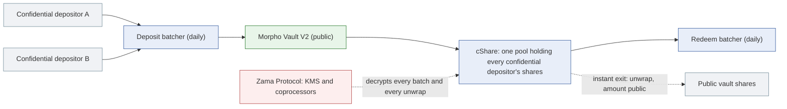

# Zama confidential vaults: what riskdep computes for them

A Zama confidential vault is an ordinary Morpho Vault V2 that some depositors enter through Zama's Confidential Vault protocol. The vault, its markets and their collateral stay public, so risk and contagion through the markets are computed exactly as for any vault. What changes is **who holds the shares** and **how they get out**. This document says what the code does with that, and what it does not do yet. The design note, written before the build, is `docs/analysis/ZAMA-VAULT.md`. The decisions are D171–D176 (plan `2026-10-11-zama`) and D190–D192 (plan `2026-10-11-alerts-and-verdict`).

| Question | Answer in riskdep | Where |
|---|---|---|
| Is this vault confidential? | A lookup in `registry.json` `zama`: 16 mainnet vaults, each checked on-chain | `zama.entry` |
| What does it depend on? | The vault's usual graph, plus the cShare, the cAsset, two batchers, Zama's decryption and the wrapper registry | `graph.annotate_zama` (D175) |
| How much is confidential? | The cShare's balance of vault shares ÷ the vault's supply | `zama.read` (D173) |
| Who loses in an incident? | Every share pro rata, confidential or not: the vault's loss is computed as usual | `vault_incident.run` |
| Who is first out in a run? | The cShare is a pool, never a fast holder ahead of others | `exit_queue` (D172) |
| How fast can a confidential depositor leave? | Two exits: the daily batch, or the instant exit that reveals the amount | `zama.exits` (D174) |
| What is watched? | The day's confidential outflow, instant exits, canceled batches, pauses, upgrades, owner changes | `zama.assess_events` (D190–D192) |
| Is a failure of Zama itself propagated or priced? | **No**: stated in words only (sections 6 and 7) | — |

## 1. How the money is held



On-chain, the vault sees one holder: the cShare wrapper. Each depositor's amount inside it is encrypted. On RockawayX Confidential RWA USDC (`0xc207…Da36`), the cShare holds 99.1 % of the vault.

## 2. Discovery

`registry.json` `zama` lists every vault of Zama's mainnet address list. Each entry holds:

- the vault's deposit and redeem batchers;
- the cShare and the cAsset (the confidential underlying);
- the underlying, the deposit gate when there is one, and the deploy block.

All 16 entries were checked on-chain on 2026-10-11: each batcher's `vault()`, `fromToken()` and `toToken()` match the vault (D171). A vault is recognised by its address. There is no on-chain detection of a Zama vault outside this list.

## 3. The dependency graph (D175)

`graph` (the command, and so its HTML and `out/graph.json`) adds, for each Zama vault of the graph:

| Node | Kind | Edges |
|---|---|---|
| cShare | Asset, `pool: true` | `wraps` the vault; `decrypted by` Zama; `can be paused by` the registry |
| cAsset | Asset | `wraps` the underlying; `decrypted by` Zama; `can be paused by` the registry |
| Redeem batcher | Pool | `redeems from` the vault; `takes` the cShare; `decrypted by` Zama |
| Deposit batcher | Pool | `deposits into` the vault; `takes` the cAsset; `decrypted by` Zama; the vault `accepts deposits only from` it when gated |
| Zama Protocol (KMS, coprocessors) | External | one node, `zama:protocol` |
| Zama token wrapper registry | Admin | its governance can pause a wrapper |

The nodes come from the registry, with no extra read. Only the `graph` command adds them: the graph that `shock`, `POST /api/shock` and the vault incident's engine run on is built without them, so the engine never sees a Zama node. Zama Protocol is a **single node shared by every Zama vault of the graph**. A graph with several confidential vaults therefore shows their common dependency: one decryption service that every confidential exit needs.

## 4. Risk: who loses, and how much

A loss in the vault's markets (a collateral markdown, a borrower default, an oracle fault) lowers the share price for every share. The cShare's shares lose like any others. The vault's loss is computed by the usual incident run: `vault_incident`, through the shock engine when the vault's graph is recorded (`docs/model/vault-incident.md`).

What is specific to a Zama vault:

- **The default depositor skips the cShare (D172).** When no depositor is given, the incident weighs the largest holder that is *not* a cShare. The cShare is many people, so its "position" is not anyone's.
- **A confidential depositor's own loss is not computed.** Their amount is encrypted. Their loss is the vault's loss rate times what they hold, which only they know. Entering a confidential position by hand (Z6 in `ZAMA-VAULT.md`) is not built.

Example: `analyze --vault 0xc207d3f66537D7F66456808379A0E560cF20Da36 --shock token=PST:0.30`, offline.

```text
vault loss 3,273,881 USDC (12.38% of 26,446,445)
depositor 0xcf46bbab…: 235,890 USDC; staying loses 29,201; leaving first recovers 235,890 at par, 0 stays, loss 0
confidential (Zama): 99.1% of the vault is held confidentially through Zama (cShare 0xb1b18ad1…, one pool of depositors, not one holder)
```

The depositor shown holds 0.89 % of the vault: the largest public holder, because the 99.1 % in the cShare is skipped.

## 5. Exits and the verdict (D172–D174)

**Exit queue.** In a run, the exit queue asks how much of the position would be stuck if every *contract* holder withdrew first (`docs/watch/exit-queue.md`). The cShare is a contract, but it is counted as **not** a fast holder (D172). It is many people who exit through a daily batch, not a fund that withdraws in one transaction. Counting it as one would put 99 % of the vault ahead of everyone on the RWA vault.

**The two exits.** For a Zama vault, the incident reads at its block:

- the confidential share;
- the redeem batcher's current batch and when it can be dispatched (`batchCreatedAt + batchMinBatchAge`);
- whether the batcher is paused.

It then states the two exits next to the verdict:

| Exit | How | Time | Cost |
|---|---|---|---|
| Batch | Join the redeem batcher; the batch is dispatched once it reaches its minimum age (about daily), then settled after a Zama decryption at the share price of that moment | The time to the next dispatch (12.4 h in the example), then the decryption | No slippage bound; settles at whatever the price is then |
| Instant | Unwrap the cShare to public vault shares, then redeem them | About 15 min (`zama.instant_exit_minutes`, a stated estimate) | The amount becomes public |

When the incident hits a **constant-price** oracle with a loss (an issuer's NAV or rate, which can land in one transaction), the batch exit is marked "does not beat an incident that lands at once". Only the instant exit can.

```text
confidential (Zama): the confidential exit joins redeem batch 28, dispatched in 12.4 h at the earliest, then settled after a Zama decryption at the share price of that moment: it does not beat an incident that lands at once
confidential (Zama): the instant exit unwraps the cShare to public vault shares and redeems them (about 15 min, one Zama decryption); it is first in line, but the amount becomes public
confidential (Zama): both exits need Zama's decryption: if it halts, neither works until it resumes
```

**The verdict itself does not change.** STAY / REDUCE / EXIT and the breakeven p\* are computed for the depositor weighed: a public holder, unless one is given. The Zama lines are context for a confidential holder: if the answer is EXIT, their fast route is the instant exit, at the price of revealing the amount. They also share the vault's plain-withdrawal capacity with everyone else.

## 6. Contagion

- **Through the markets: computed, as for any vault.** The shock engine propagates the incident through the vault's markets and on to the sibling markets that share a collateral, a feed or an oracle. In the example, the same PST markdown also costs the lenders of PST/PYUSD 4,455,716 PYUSD and of PST/AUSD 632,835 AUSD. Confidentiality changes nothing here.
- **Through Zama: drawn, not propagated.** The engine propagates *losses* through markets. A Zama failure causes no loss: a halt in decryption freezes both exits, and a pause blocks the batch. The engine has no rule for it (Z5, left out on purpose). The `graph` output shows the dependency, with one Zama node shared across vaults, and the incident says "if it halts, neither works". The cost of a freeze is time, and no figure is put on it.

## 7. Probabilities

There is **no prior for the Zama layer** (Z7, open). It would cover the FHE stack, the decryption service and the wrappers, a young protocol with no incident history. So nothing in riskdep puts a probability on a Zama failure. The Monte Carlo of `analyze` covers borrow and PT positions, not vault deposits. A vault incident's breakeven p\* is the probability of the *market* incident above which leaving pays. The probabilities themselves are explained in `docs/model/how-probabilities-are-computed.md`.

## 8. Detection (D190–D192)

`watch --vault` on a Zama vault adds its four Zama contracts (both batchers, the cShare, the cAsset) to one optional log filter. A refusal is a warning, not a gap. Their events become alerts:

| Event | Alert | Level |
|---|---|---|
| cShare unwrap to the redeem batcher (the day's batch, its total public once decrypted) | `Zama.Unwrap` "X % of the vault leaving confidentially today" | info; warn from 2 %; critical from 10 % (a confidential run forming) |
| cShare unwrap to anyone else | `Zama.Unwrap` "instant exit: X % unwrapped" | info; warn from 1 % (an informed holder leaving fast) |
| Batch canceled with money in it | `Zama.BatchCanceled` | warn |
| Batch canceled after a zero total (an empty day) | none | silent |
| Batcher or wrapper paused / upgraded | `Zama.Paused` / `Zama.Upgraded` | critical |
| Owner changed | `Zama.OwnershipTransferred` | warn |
| Unpaused, user blocked | `Zama.Unpaused` / `Zama.UserBlocked` | info |

The shares are converted with the cShare's `rate()` (vault-share units per cShare unit). When it cannot be read, the share-of-vault figures read 0 rather than a guess. The thresholds are in `registry.json` `watch` (`zama_redeem_warn`, `zama_redeem_critical`, `zama_instant_warn`). What to do on each alert is in `docs/reference/alert-runbook.md`.

## 9. What is not computed

| Gap | Effect | Step in `ZAMA-VAULT.md` |
|---|---|---|
| A confidential depositor's own position | Their loss and verdict are not stated; the weighed depositor is a public holder | Z6 |
| A prior for the Zama layer | No probability of a decryption halt, a wrapper bug or a KMS failure | Z7 |
| A Zama failure in the shock engine | A halt or a pause freezes exits; it is stated, not propagated or timed | Z5 (left out) |
| Measured decryption delays | The 15 min instant exit is an estimate; the batch time adds an unmeasured decryption | §5 open questions |
| Vaults outside the registry | A new Zama vault is treated as an ordinary vault until it is added | Z1 |

## 10. In the code

| File | Role |
|---|---|
| `riskdep/zama.py` | The registry entry, `is_pool`, `read` (the confidential share and the batchers' state), `exits` (the two exits), and the watch's contracts, filters and `assess_events` |
| `riskdep/graph.py` `annotate_zama` | The hidden layer in the graph |
| `riskdep/exit_queue.py` | The cShare as a pool in the holder list |
| `riskdep/vault_incident.py` | The default depositor skipping the cShare; the `zama` lines of the incident |
| `riskdep/watch.py`, `riskdep/abi.py` | The Zama events in the watch |
| `riskdep/registry.json` | `zama` (the 16 vaults, the router, the wrapper registry, the instant-exit estimate) and `watch.zama_*` |
| `tests/test_zama.py` | The registry, the pool, the exits and the alerts, offline |
