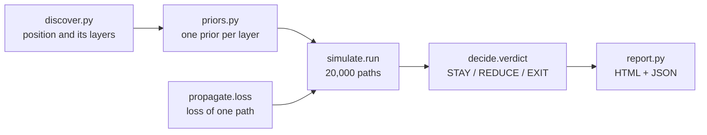
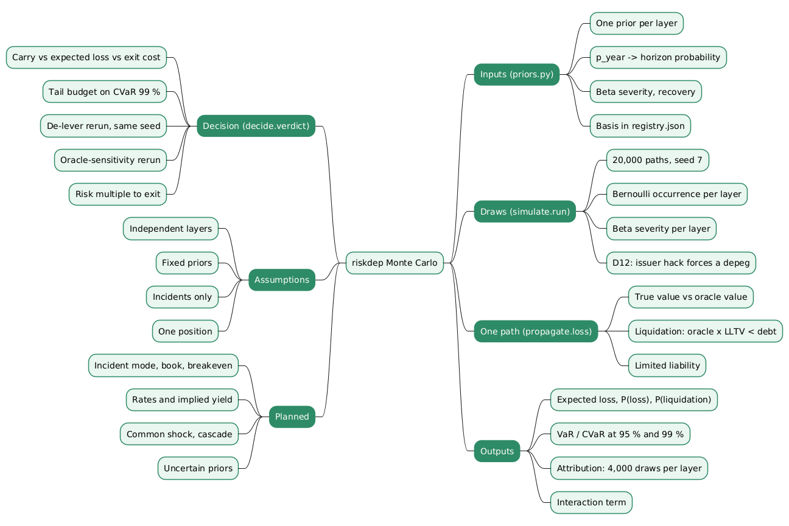

# Monte Carlo simulation in riskdep

`riskdep analyze` turns one DeFi position into a STAY / REDUCE / EXIT verdict. The step between the dependency graph and the verdict is a Monte Carlo simulation: it draws 20,000 possible months, decides in each which layers of the position fail and how badly, computes the loss of each month with a deterministic propagation rule, and reads the expected loss, the tail and an attribution per layer from the 20,000 results.

This document explains how that simulation works in the code, file by file and with the demo position's numbers, how its outputs feed the decision, what it assumes, and what is planned for it. It follows the structure of the site article "Monte Carlo Simulation for DeFi Risk Analysis", which explains the method in general terms; this one is specific to `riskdep`. The broader model (priors, propagation, decision) is in `docs/how-risk-is-computed.md`.

> Written with the help of [Claude Code](https://claude.com/product/claude-code) and several custom skills.

## Contents

- [1. Where the simulation sits](#1-where-the-simulation-sits)
- [2. How Monte Carlo works, briefly](#2-how-monte-carlo-works-briefly)
- [3. The inputs: one prior per layer](#3-the-inputs-one-prior-per-layer)
- [4. The draws](#4-the-draws)
- [5. The loss of one path](#5-the-loss-of-one-path)
- [6. The outputs](#6-the-outputs)
- [7. Attribution per layer](#7-attribution-per-layer)
- [8. How the decision uses the simulation](#8-how-the-decision-uses-the-simulation)
- [9. Accuracy and reproducibility](#9-accuracy-and-reproducibility)
- [10. What the simulation assumes](#10-what-the-simulation-assumes)
- [11. Where the simulation is used, and where it is not](#11-where-the-simulation-is-used-and-where-it-is-not)
- [12. Planned changes](#12-planned-changes)
- [Conclusion](#conclusion)
- [Annex](#annex)
- [Frequently asked questions](#frequently-asked-questions)
- [References](#references)

## 1. Where the simulation sits

`analyze` runs five steps, and the simulation is the fourth:



| Step | Module | What it produces |
|---|---|---|
| Discovery | `riskdep/discover.py` | a `Position`: collateral, debt, LLTV, LIF, oracle mode, and a graph of typed layers |
| Priors | `riskdep/priors.py` | a `Prior` per layer: yearly probability, Beta severity, recovery, basis |
| Propagation | `riskdep/propagate.py` | `loss(...)`: the loss of the position for a given set of shocks (pure function) |
| **Simulation** | `riskdep/simulate.py` | `run(pos, priors, horizon_days, n=20000, seed=7) -> SimResult` |
| Decision | `riskdep/decide.py` | `verdict(pos, sim, quote, ...) -> Decision` |

The call is in `riskdep/cli.py`:

```python
prs = priors.layer_priors(f, pos)
horizon = max(1.0, min(args.horizon, pos.days_to_maturity or args.horizon))
sim = simulate.run(pos, prs, horizon, n=args.paths)
```

The horizon is `--horizon` (30 days by default), capped at the PT's maturity. `--paths` sets the number of paths (20,000 by default).

## 2. How Monte Carlo works, briefly

Monte Carlo estimates the expectation of a quantity that depends on random inputs by drawing many independent samples of the inputs and averaging. With $L_i$ the loss of path $i$:

$$
\widehat{\mathbb E[L]} = \frac{1}{N}\sum_{i=1}^{N} L_i
$$

The law of large numbers makes this converge to the true expectation of the model; the central limit theorem gives its error, $\sigma/\sqrt N$, independent of how many layers the model has. The sorted sample is also an empirical distribution, so quantiles, tail averages and probabilities of a loss are read from the same 20,000 numbers. The method needs no formula for the loss: `propagate.loss`, with its liquidation threshold and its limited liability, is used as it is.

The site article covers the method in general terms: pseudo-random numbers, the inverse transform, variance reduction. The rest of this document is about what `riskdep` does with it.

## 3. The inputs: one prior per layer

`priors.layer_priors` returns one `Prior` per layer of the position's graph. Each has an event id, a yearly probability `p_year`, the two shape parameters `a` and `b` of a Beta severity, a recovery (for the depeg only) and a written basis.

| Event id | Layer | Where its numbers come from |
|---|---|---|
| `chain` | Ethereum | `registry.json`: 1 %/yr, severity Beta(1, 199), mean 0.5 % |
| `issuer_depeg` | the yield source's issuer, depeg | `registry.json` per issuer; sUSDe: 12 %/yr, Beta(1.6, 18), mean 8.2 %, 75 % recovered by the horizon |
| `issuer_hack` | the issuer, loss of backing | frequency from DefiLlama's hack record (tier, category, age); severity from `registry.json` (sUSDe: Beta(1.2, 3), mean 29 %) |
| `amm` | Pendle market / SY | hack record for Pendle |
| `lending` | Morpho Blue | hack record for Morpho Blue |
| `oracle` | the market's oracle | oracle-technique hacks over lending and CDP protocols; ×2 unless the source is verified on Etherscan (D68); severity Beta(2, 18), mean 10 % |

A yearly probability becomes a probability over the horizon $h$ in days with `simulate._p_horizon`, assuming a constant rate:

$$
p_h = 1 - (1 - p_{\text{year}})^{h/365}
$$

On the demo position (PT-sUSDE-26NOV2026 against USDC on Morpho Blue, 30 days):

| Event | $p$ per year | Mean severity | $p_h$ over 30 days |
|---|---|---|---|
| sUSDe depeg | 12.0 % | 8.2 % (75 % recovered) | 1.05 % |
| Morpho Blue exploit | 5.03 % | 9.1 % | 0.42 % |
| Oracle misprice | 2.68 % | 10.0 % | 0.22 % |
| Ethena exploit / loss of backing | 1.33 % | 28.6 % | 0.11 % |
| Pendle market / SY exploit | 1.21 % | 13.8 % | 0.10 % |
| Ethereum incident | 1.00 % | 0.5 % | 0.08 % |

## 4. The draws

`simulate.run` draws everything up front, as NumPy arrays of length $N$, from one seeded generator:

```python
rng = np.random.default_rng(seed)  # seed = 7
ph = {p.event: _p_horizon(p.p_year, horizon_days) for p in priors}
hits = {p.event: rng.random(n) < ph[p.event] for p in priors}  # did the layer fail in this path?
sev = {p.event: rng.beta(p.a, p.b, n) for p in priors}  # how badly, if it did
```

- **Occurrence:** one Bernoulli draw per layer and per path. A uniform number below $p_h$ means the layer fails in that path. At most one incident per layer per horizon.
- **Severity:** one Beta draw per layer and per path, used only where the layer failed.
- **The one dependence, D12:** an exploit of the issuer comes with a depeg at least as deep. Where `issuer_hack` hits, `issuer_depeg` is forced to hit too, with a severity of at least the hack's:

  ```python
  both = hits["issuer_hack"]
  hits["issuer_depeg"] = hits["issuer_depeg"] | both
  sev["issuer_depeg"] = np.where(both, np.maximum(sev["issuer_depeg"], sev["issuer_hack"]), sev["issuer_depeg"])
  ```

Every other layer is drawn independently of the others.

**Only paths with an incident are computed.** Most paths have no incident at all (about 98 % on the demo), and their loss is zero. The loop calls `propagate.loss` only on the paths where at least one layer hit:

```python
for i in np.flatnonzero(any_hit):
    shocks = {e: float(sev[e][i]) for e in hits if hits[e][i]}
    r = _loss(pos, shocks, recovery)
    losses[i], liq[i] = r.loss_usd, r.liquidated
```

## 5. The loss of one path

`propagate.loss` applies the path's shocks to two values of the collateral, the **true value** (what it is worth) and the **oracle value** (what Morpho believes), then applies Morpho's liquidation rule:

| Event | True value | Oracle value |
|---|---|---|
| `chain`, `issuer_hack`, `amm` | × (1 − s) | × (1 − s) |
| `issuer_depeg` | × (1 − s × (1 − recovery)) | market-tracking oracle: × (1 − min(0.99, s × 1.5)); otherwise unchanged |
| `oracle` | unchanged | × (1 − s) |
| `lending` | × (1 − s) | unchanged |

The factor 1.5 is `pt_stress_extra_discount` (0.5): during a depeg the PT trades below its underlying as liquidity providers leave the pool, so a market-tracking oracle sees a deeper fall than the underlying.

Then, with $V^{o}$ the oracle value, $V^{t}$ the true value, $D$ the debt, $\lambda$ the LLTV and $\phi$ the liquidation incentive factor:

- **Liquidated** if $V^{o}\lambda < D$. The liquidator seizes a share $\min(1, D\phi / V^{o})$ of the collateral, and the borrower keeps the rest at its true value.
- **Not liquidated** otherwise. The borrower keeps $\max(0, V^{t} - D)$: limited liability.

The loss is the equity before minus the equity after, never negative. `propagate.loss` also returns a `path`, a list of plain sentences that the report shows as the typical path of each layer, for example:

- "depeg −6.7 %, PT market trough −10.0 % seen by the oracle, 75 % recovers";
- "liquidated: 98.9 % of collateral seized at the oracle price".

## 6. The outputs

`SimResult` holds:

| Field | How it is computed | Demo |
|---|---|---|
| `expected_loss_usd` | mean of the 20,000 losses | 6,265 USD |
| `p_any_loss` | share of paths with a loss above zero | 1.91 % |
| `p_liquidation` | share of paths ending in a liquidation | 1.07 % |
| `var95_usd`, `cvar95_usd` | `_tail(losses, 0.95)` | 0 USD, 125,294 USD |
| `var99_usd`, `cvar99_usd` | `_tail(losses, 0.99)` | 386,890 USD, 510,184 USD |
| `layers` | one `LayerResult` per prior, section 7 | — |
| `interaction_usd` | expected loss − Σ layer contributions | −189 USD |
| `loss_samples` | the 20,000 losses, for the report's histogram | — |

`_tail` computes VaR with `np.quantile` and CVaR as the mean of the worst $\text{round}(N(1-q))$ losses:

```python
k = max(1, int(round(len(losses) * (1 - q))))
worst = np.sort(losses)[-k:]
return float(np.quantile(losses, q)), float(worst.mean())
```

At $N = 20{,}000$, CVaR 99 % is the mean of the worst 200 paths and CVaR 95 % of the worst 1,000.

**Why the report reads the tail at 99 %.** Something happens in only 1.91 % of the demo's paths, so more than 95 % of them lose nothing, and VaR 95 % is 0 whatever the size of the bad months. The 99 % level falls inside the paths with an incident. The tail budget of the verdict (section 8) is therefore set on CVaR 99 %.

The report draws `loss_samples` as a histogram (`report.histogram_svg`), with the equity marked, and writes every field except the samples to `report.json`.

## 7. Attribution per layer

The decision-maker needs to know which layer drives the expected loss. `simulate.run` estimates it with a second, smaller simulation per layer, from the same generator, after the main draws:

```python
m = 4000
for p in priors:
    s = rng.beta(p.a, p.b, m)  # 4,000 severities of this layer alone
    rs = [_loss(pos, {p.event: float(x)}, recovery) for x in s]
    standalone = float(np.mean([r.loss_usd for r in rs]))  # E[loss | only this layer hits]
```

| Field of `LayerResult` | Meaning |
|---|---|
| `standalone_loss_usd` | the mean loss when only this layer fails: "Loss if it happens" in the report |
| `contribution_usd` | $p_h$ × standalone: the layer's share of the expected loss |
| `liquidation_rate` | the share of those 4,000 draws that end in a liquidation |
| `example_path` | the propagation path of the median draw (or of the worst one if the median loses nothing) |

On the demo: depeg 3,760 USD, Morpho Blue 1,066, oracle 747, Ethena 511, Pendle 353, Ethereum 16, a sum of 6,453 USD.

**The interaction term** is the full expected loss minus that sum: 6,265 − 6,453 = −189 USD. It is negative because, in the few paths where two layers fail together, the second one finds less equity left to destroy. `tests/test_demo_snapshot.py` checks that the decomposition holds: the interaction must stay under 25 % of the expected loss. A large interaction would mean the per-layer table no longer explains the total.

## 8. How the decision uses the simulation

`decide.verdict` compares three amounts over the same horizon:

| Amount | Source | Demo |
|---|---|---|
| Carry | `decide.carry_usd`: PT yield on the collateral minus interest on the debt | 5,697 USD |
| Exit cost | `decide.exit_cost_usd`: a real Pendle swap quote for the whole PT, plus gas | 78,946 USD |
| Expected loss | the simulation | 6,265 USD |

The rules, in order:

1. **EXIT** if expected loss > carry + exit cost.
2. **REDUCE** if the carry does not cover the expected loss, **or** CVaR 99 % exceeds `tail_budget` × equity (50 %), **or** the liquidation distance is below the stress drop.
3. **STAY** otherwise.

The demo is REDUCE, for all three reasons: carry 5,697 < expected loss 6,265; CVaR 99 % is 98 % of the 520,236 USD equity; a 5.16 % oracle drop liquidates it, below the 12.2 % stress.

The simulation is then **run again** twice, with the same priors and the same seed:

- **De-lever sizing.** For REDUCE, `decide.sale_to_reach` sizes the sale that puts liquidation at the stress drop, and `resimulate` runs `simulate.run` on the smaller position. Demo: sell 1.29M USD (33 %); expected loss 6,265 → 4,308 USD; CVaR 99 % 510,184 → 410,778 USD.
- **Oracle sensitivity.** `cli.py` reruns the simulation with the other oracle mode (`fundamental` instead of `market-tracking`) and reports whether the verdict changes. Demo: expected loss 3,363 USD, P(liquidation) 0.28 %, verdict REDUCE in both cases.

Because both reruns use seed 7, they draw the same random numbers as the main run. The differences between the runs come from the change of position or oracle mode, not from sampling noise: this is the "common random numbers" technique.

**The risk multiple.** The last line of the verdict, "a full exit would only pay if incident probabilities were 13.5× the estimates", is (carry + exit cost) / expected loss = 84,643 / 6,265. It is the simulation's answer to "how wrong would the probabilities have to be?".

## 9. Accuracy and reproducibility

- **Seed.** `seed=7` is fixed, so the same snapshot gives the same numbers on any machine and any day (the offline demo also fixes "now", `clock.py`). The demo's tests can compare figures exactly.
- **Sampling error of the expected loss.** The standard error is $\hat\sigma/\sqrt N$. The losses are mostly zero with a few large values, so $\hat\sigma$ is large compared with the mean. On the demo, the standard error is 380 USD on an expected loss of 6,265 USD, about 6 %: a 95 % interval of roughly 5,500 to 7,000 USD. The verdict's comparison of carry (5,697) with expected loss sits inside that interval, which is one more reason the verdict also rests on the tail and the stress drop. `--paths` raises $N$; the error falls as $1/\sqrt N$.
- **The tail rests on few paths.** CVaR 99 % is the mean of 200 paths. A rare event, such as a 0.1 % layer, appears in about 20 paths out of 20,000; its relative error is about $\sqrt{(1-p)/(Np)}$, around 22 %. The attribution's 4,000 draws per layer are independent of that, because each draw forces the layer to fail.
- **What the error does not cover.** These are sampling errors around the model's own expectation. They say nothing about whether the priors are right, which is the larger uncertainty (`docs/analysis/GAP.md` K14).

## 10. What the simulation assumes

| Assumption | In the code | Effect | Gap |
|---|---|---|---|
| One incident per layer per horizon | a Bernoulli draw per layer | clustered events (several in a month) are not drawn | K14 |
| Layers independent, except issuer hack → depeg | separate `rng.random` per layer; D12 the only link | joint failures (contagion between issuers, depeg + pool drain) are rarer than in reality, so the tail is thinner | K6 |
| Fixed priors | `p_year`, `a`, `b` are numbers, not distributions | the result has no range | K14 |
| Losses come from incidents only | `propagate.loss` takes shocks from the six events | borrow-rate spikes and PT implied-yield moves, which cost loops without any incident, are absent | K10, K11 |
| Liquidation at the oracle price, once | `propagate.loss` seizes $D\phi$ at the oracle value | no slippage, no cascade, no partial liquidation | K9 |
| Binary oracle mode | `market-tracking` or `fundamental` | composite and switching oracles are reduced to one of two | K7 |
| One position | `run` takes one `Position` | two positions sharing a layer are not combined | K21, M6 |
| One horizon, no timing | a loss per path, no time axis | how fast the loss arrives is not an output | K22 |

`docs/analysis/GAP.md` discusses each of these against incidents and outside methods. Most point the same way: more risk than reported.

## 11. Where the simulation is used, and where it is not

| Command | Uses the Monte Carlo? | What it uses instead |
|---|---|---|
| `analyze` | yes: the main run, the de-lever rerun, the oracle-sensitivity rerun | — |
| `watch --vault`, `watch --user` | no | deterministic computations at each block: health factors, liquidation curves at fixed drops (2, 5, 10, 20 %), unrealised bad debt, the exit queue, the drain threshold |
| `graph` | no | the structure, oracle classes and liquidation curves of every held and sibling market |

The watches answer "what is true now, and what would a given fall do?"; the simulation answers "what should we expect over the horizon, and how bad can it get?". Both use the same propagation idea, a shock applied to positions with Morpho's liquidation rule, but only `analyze` puts probabilities on the shocks.

## 12. Planned changes

From `docs/analysis/NEXT_STEP_V2.md` and `docs/analysis/NEXT_TASK.md`:

| Change | What it does to the simulation | Step |
|---|---|---|
| Incident mode, **done** | `analyze --shock` runs `propagate.loss` once with a given shock, before the simulation, to answer "this component is hit" without probabilities | A1, `docs/analysis/NEXT_TASK.md` task 1 |
| Conditional simulation | the observed incident forced in every path; its evolution and spread drawn (`docs/analysis/ANALYSIS_CURRENT.md` §6) | `docs/analysis/NEXT_TASK.md` task 3 |
| The book | `simulate.run_book`: several positions in one simulation, each shared (event, node) drawn **once** per path for every position that holds it | A3, task 2 |
| Breakeven probability | $p^\star = (E + K)/L_s$ per scenario, the probability at which the decision flips, reported next to the simulated verdict | A3, task 2 |
| Borrow rate and implied yield | new random paths per simulated month: utilisation through the AdaptiveCurveIRM, and an implied-yield move priced into the PT | B1, B2 |
| Common shock and named scenarios | a latent stress month that raises every layer's probability together; scenarios run through the same propagation | C1 |
| Cascade | liquidated collateral sold into the pool, with its price impact, until the drop stabilises | C2 |
| Uncertainty on the priors | an outer loop drawing each `p_year` from a Beta fitted to its counts; expected loss and CVaR as ranges; a second tail budget for EXIT | C3 |

## Conclusion

`riskdep analyze` uses Monte Carlo simulation to turn a position's dependency layers into an expected loss, a tail and an attribution, which the verdict compares with carry and exit cost.

- **The inputs** are one prior per layer: a yearly probability converted to the horizon, and a Beta severity, each with a written basis in `registry.json` or from the hack record.
- **The draws** are 20,000 Bernoulli occurrences and Beta severities per layer, from one generator seeded at 7, with one dependence: an issuer exploit forces a depeg at least as deep.
- **The loss of a path** comes from `propagate.loss`, which applies the shocks to the true and oracle values and Morpho's liquidation rule; only the paths with an incident are computed.
- **The outputs** are expected loss, P(loss), P(liquidation), VaR and CVaR at 95 % and 99 %, a per-layer attribution from 4,000 forced draws per layer, and the interaction term that the tests keep small.
- **The decision** uses the expected loss and CVaR 99 %, reruns the simulation with the same seed to size a de-lever and to test the oracle mode, and states the risk multiple at which exiting would pay.
- **The limits** are those of the model rather than the sampling: independent layers, fixed priors, incidents only, and one position at a time, each with a planned change.



## Annex

### Key terms

| Term | Definition |
|---|---|
| **Path** | One simulated horizon: whether each layer fails, how badly, and the position's resulting loss. |
| **Prior** | A layer's yearly probability of failure and Beta severity, with a written basis (`riskdep/priors.py`). |
| **Horizon probability** | The probability that a layer fails within the horizon, $1-(1-p)^{h/365}$. |
| **Severity** | The fraction of value lost when a layer fails, drawn from a Beta distribution. |
| **Recovery** | The share of a depeg that has recovered by the end of the horizon (75 % for sUSDe). |
| **True value** | What the collateral is worth after the shocks. |
| **Oracle value** | What Morpho's oracle reports after the shocks; liquidation is decided on it. |
| **LLTV** | The liquidation loan-to-value of the Morpho market: liquidation when oracle value × LLTV < debt. |
| **LIF** | The liquidation incentive factor: the liquidator seizes debt × LIF worth of collateral. |
| **Limited liability** | The borrower's loss stops at the equity; any shortfall is the lenders' bad debt. |
| **Expected loss** | The mean of the simulated losses. |
| **VaR** | The loss exceeded in a fraction $1-q$ of paths. |
| **CVaR** | The mean loss of the worst $1-q$ fraction of paths. |
| **Standalone loss** | The mean loss when only one layer fails, at its drawn severities ("Loss if it happens"). |
| **Contribution** | A layer's share of the expected loss: its horizon probability × its standalone loss. |
| **Interaction** | The expected loss minus the sum of the contributions: the effect of layers failing together. |
| **Common random numbers** | Rerunning variants of a model with the same seed, so their differences come from the variant and not from sampling. |
| **Risk multiple to exit** | (carry + exit cost) / expected loss: how many times the probabilities would have to be multiplied for exiting to pay. |

### Invariants

| Invariant | Enforced by | Breaks if |
|---|---|---|
| The same snapshot gives the same numbers | `seed=7` in `simulate.run`; the snapshot's as-of date in `clock.py` | a call draws from an unseeded generator, or the draw order changes |
| A path without any incident loses nothing | the loop runs `propagate.loss` only on `any_hit` paths; `losses` starts at zero | `propagate.loss` returns a loss for empty shocks |
| A loss never exceeds the equity, and is never negative | `max(0, equity0 − equity1)` in `propagate.loss`, limited liability | a new loss channel subtracts value outside that formula |
| An issuer exploit always comes with a depeg at least as deep | D12 in `simulate.run` | the hack and the depeg are drawn without the `np.maximum` link |
| The per-layer contributions explain the expected loss | `interaction_usd` reported; `tests/test_demo_snapshot.py` asserts it stays under 25 % of the expected loss | layers become strongly dependent without the attribution being revised |
| The de-lever and oracle reruns compare like with like | they call `simulate.run` with the same priors, horizon, paths and seed | a rerun changes `n` or the seed |

## Frequently asked questions

**Q: Why does `simulate.run` draw a severity for every path, even where the layer did not fail?**

Drawing whole arrays is how NumPy is fast: `rng.beta(a, b, n)` produces 20,000 values in one call, and the paths without a hit simply ignore theirs. It also keeps the random stream aligned: path $i$ always takes the $i$-th severity of each layer, so a change in one layer's probability does not shift the draws of the others.

**Q: The demo's VaR 95 % is zero. Is something wrong?**

No. Something happens in only 1.91 % of the paths, so more than 95 % of them lose nothing and the 95 % quantile is zero. The tail of this position lives beyond the 98th percentile, which is why the verdict uses CVaR 99 %: the mean of the worst 200 paths, 510,184 USD, 98 % of the equity.

**Q: How is "Loss if it happens" in the report computed, and why is it not just the severity times the collateral?**

It is the standalone loss of section 7: the mean of `propagate.loss` over 4,000 severities of that layer alone. The loss is not proportional to the severity, because of the liquidation threshold and limited liability:

- a small depeg may cost little;
- a slightly larger one can cross the liquidation threshold and cost the liquidation bonus plus the seized collateral;
- a very large one is capped at the equity.

Averaging the propagation over the severity distribution captures that non-linearity.

**Q: Why is the interaction term negative on the demo, and when would it be positive?**

It is negative because, in a path where two layers fail, the first already destroys most of the 7.6× loop's equity, and limited liability caps what the second can add.

It would turn positive if one failure made another worse, for example a small oracle error that liquidates a position only because a depeg had already brought it near its threshold. The current model has few such links, so the term stays small; a strongly positive one would mean the per-layer table misses the main driver.

**Q: Why do the de-lever and oracle-sensitivity reruns use the same seed as the main run?**

So that the comparison measures the change and not noise. With the same seed, path $i$ has the same incidents and severities in all three runs; only the position or the oracle mode differs. The drop from 6,265 to 4,308 USD after the de-lever is then due to the smaller position, not to a different set of random months.

**Q: The watches compute liquidation curves without any simulation. Why does `analyze` need one?**

The watches answer conditional questions at fixed drops: "if the collateral fell 5 %, how much debt would be liquidatable?". `analyze` answers an unconditional one: "over the next 30 days, what loss should we expect, and how bad is the worst 1 %?". That requires a probability for each shock and a way to combine several layers failing or not in the same month, which is what the simulation adds on top of the same propagation rule.

**Q: What would the planned book simulation change compared with running `analyze` on each position?**

Two positions backed by the same issuer, or priced by the same feed, fail together. Run separately, each draws its own depeg, so their joint failure looks as rare as the product of two probabilities.

`simulate.run_book` (`docs/analysis/NEXT_TASK.md` task 2) draws each shared (event, node) once per path and applies it to every position that holds it. The book's tail then includes the months where the shared layer fails, and the expected loss can be read as a share of the book.

## References

### Code

- `riskdep/simulate.py`: `run`, `_p_horizon`, `_tail`, `LayerResult`, `SimResult`.
- `riskdep/propagate.py`: `loss`, the loss of one path.
- `riskdep/priors.py`: `layer_priors`, `oracle_prior`.
- `riskdep/decide.py`: `verdict`, `carry_usd`, `exit_cost_usd`, `sale_to_reach`.
- `riskdep/cli.py`: the `analyze` flow, `--horizon`, `--paths`, the oracle-sensitivity rerun.
- `riskdep/report.py`: `histogram_svg`, the layer table.
- `riskdep/registry.json`: priors, `pt_stress_extra_discount`, `tail_budget`.
- `tests/test_demo_snapshot.py`: the attribution check.

### Project documents

- `docs/how-risk-is-computed.md`: the whole model, with the demo's numbers.
- `docs/scenarios-and-breakeven.md`: the breakeven probability, scenarios against base rates.
- `docs/analysis/GAP.md`: the model's gaps K1–K25, many of them about the simulation's assumptions.
- `docs/analysis/NEXT_STEP_V2.md`, `docs/analysis/NEXT_TASK.md`: the planned changes.
- `plan/2026-10-10-defi-risk-dependency.plan.md`: decisions D1–D17 (D12: issuer hack → depeg) and D68.

### Method

- N. Metropolis and S. Ulam, ["The Monte Carlo Method"](https://doi.org/10.1080/01621459.1949.10483310), *Journal of the American Statistical Association* 44(247), 1949.
- Paul Glasserman, *Monte Carlo Methods in Financial Engineering*, Springer, 2003.
- P. Artzner, F. Delbaen, J.-M. Eber and D. Heath, ["Coherent Measures of Risk"](https://doi.org/10.1111/1467-9965.00068), *Mathematical Finance* 9(3), 1999.
- [NumPy random `Generator`](https://numpy.org/doc/stable/reference/random/generator.html).
- Site article: "Monte Carlo Simulation for DeFi Risk Analysis - From Random Sampling to a Stay-or-Exit Decision" (access-denied, 2026-10-10), the general version of this document.
