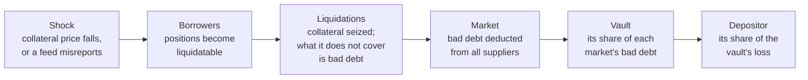

# A vault depositor's loss under a scenario

This document details point 4.3 of `docs/analysis/comparison_team.md`: today no mode of the tool answers "how much do I lose if X happens?" for someone who **deposits** in a Morpho vault, which is the track's actual use case. It explains how such a loss arises, computes it on a real vault from data the tool already collects, and describes the `analyze --vault` mode that would report it. A [learn section](#learn-what-you-need-to-understand) at the end explains the concepts used.

Every number comes from **Sentora RLUSD Main**, the largest Morpho Vault V2 on Ethereum, rebuilt offline from the recorded replay at block 26,162,932 (2026-10-10). The depositor is the vault's largest holder (`0xb03d…babc`). The computation uses the tool's own function `market_risk.value()` on the 154 borrowers of the vault's 7 active markets.

## Contents

- [1. The question](#1-the-question)
- [2. What the tool does today](#2-what-the-tool-does-today)
- [3. How a depositor loses money](#3-how-a-depositor-loses-money)
- [4. Leaving: what can be withdrawn, and when](#4-leaving-what-can-be-withdrawn-and-when)
- [5. Worked example: Sentora RLUSD Main](#5-worked-example-sentora-rlusd-main)
- [6. What could be implemented](#6-what-could-be-implemented)
- [7. Limits](#7-limits)
- [Learn: what you need to understand](#learn-what-you-need-to-understand)

## 1. The question

A fund deposits in a Morpho vault. The vault lends the deposit to borrowers in several markets, each secured by a different collateral. The fund wants to know, for a given shock (BTC falls 30 %, USDe depegs, a price feed misreports):

- how much the vault would lose, and how much of it falls on the fund;
- how much the fund could withdraw today, and at what cost;
- whether withdrawing now is worth the yield it gives up.

## 2. What the tool does today

| Need | Covered by | Status |
|---|---|---|
| Where the money is, market by market | `watch --vault`, `watch --user` | done |
| Exit capacity now: plain withdrawal, `forceDeallocate`, penalty | both watches | done |
| Unrealised bad debt now (borrowers already underwater) | both watches, `UnrealisedBadDebt` | done |
| Each market's liquidation curve: debt liquidatable after a 2, 5, 10, 20 % fall | both watches, `LiquidationCurve` | done |
| **The loss under a named shock, for the vault and for the depositor** | — | **missing** |
| **Whether leaving before the shock pays** | — | **missing** |

`analyze` covers only one Pendle PT borrower. The missing piece combines things that already exist: the borrower positions, the curve computation, the vault's share of each market, and the exit capacity.

## 3. How a depositor loses money

A loss travels five steps, from a collateral price to the depositor's shares:

**Borrowers.** A position is liquidatable when its collateral, valued at the oracle price, times the market's LLTV, falls below its debt. For one position with collateral value v and debt D, after an oracle fall d:

$$
\text{liquidatable if } v(1-d)\cdot\text{LLTV} < D, \qquad \text{bad debt} = \max\!\left(0,\; D - \frac{v(1-d)}{\text{LIF}}\right)
$$

LIF is the liquidation incentive factor: a liquidator repays debt and receives collateral worth LIF times what it repaid, so the collateral covers at most v(1 − d) ÷ LIF of debt.

**Market and vault.** Morpho Blue deducts a market's bad debt from its supply, so every supplier loses in proportion to its share. The vault's loss is the sum over its markets of its share of supply times the market's bad debt. A Vault V2 passes it to every holder at its next accrual.

**Depositor.** With f the depositor's share of the vault's shares:

$$
L_{\text{depositor}} = f \times \sum_{m} s_m \times \text{BD}_m(\text{shock})
$$

**Why a fall does not always create bad debt.** If the price falls slowly, liquidators act as each position crosses its threshold, while the collateral still covers the debt: there is no bad debt, only liquidated borrowers. Bad debt appears when the price **gaps** past that zone faster than liquidators act, or when they cannot sell the collateral. The computation below assumes the gap: every position is valued directly at the shocked price, with no liquidation on the way. That is the worst case for a given fall, and the right one for a stress test.

## 4. Leaving: what can be withdrawn, and when

A depositor leaves by withdrawing from the vault, not by selling on a market. What can leave now comes in three tiers, as Morpho's documentation describes:

| Tier | Source | Cost | Sentora, now |
|---|---|---|---|
| Plain withdrawal | the vault's idle assets, plus its liquidity market | none | 39.2M RLUSD (no liquidity adapter: idle only) |
| `forceDeallocate` | the unborrowed part of the other markets | the adapter's penalty | 46.4M RLUSD more, at 0.01 % |
| Stuck | the borrowed part of the markets | in-kind redemption only (the depositor receives the market positions instead of the token) | the rest |

The largest depositor holds 149.4M RLUSD (32.6 % of the vault): at most 85.6M of it can leave now, and **63.9M is stuck** until borrowers repay or lenders return.

Liquidity is **first come, first served**: whoever withdraws first takes it. In a crisis, other depositors compete for the same 85.6M, and each withdrawal leaves less for the next. Liquidations in the meantime repay debt and free liquidity, while positions with bad debt never repay.

**What leaving avoids.** Withdrawing W shrinks both the depositor's holding and the vault, so the depositor's share falls from f to f′ = (A − W) ÷ (T − W), with A the depositor's assets and T the vault's total. The loss avoided in a scenario is (f − f′) × L_vault, and the cost of leaving is the yield given up on W plus the penalty on its forced part. As in `docs/scenarios-and-breakeven.md`, the breakeven probability is:

$$
p^\star = \frac{\text{yield given up} + \text{penalty}}{(f - f')\, L_{\text{vault}}}
$$

## 5. Worked example: Sentora RLUSD Main

### The vault

Total assets 458.1M RLUSD; net yield 6.84 % a year (Morpho API). Sentora is the **only supplier** of each of its active markets, so it bears 100 % of any bad debt in them. The first two columns of the last part come from applying growing falls to each market's real borrowers:

| Market | Allocation | Borrowers | Utilisation | First liquidation at | First bad debt at |
|---|---|---|---|---|---|
| kBTC/RLUSD (LLTV 86 %) | 235.1M | 21 | 90.5 % | −14 % | −23 % |
| weETH/RLUSD (LLTV 86 %) | 105.5M | 16 | 84.3 % | −9 % | −19 % |
| USDe/RLUSD (LLTV 91.5 %) | 50.0M | 10 | 91.4 % | −1 % | −7 % |
| cbBTC/RLUSD (LLTV 86 %) | 13.1M | 27 | 88.6 % | −15 % | −24 % |
| FXRP/RLUSD (LLTV 77 %) | 8.9M | 51 | 89.2 % | −7 % | −23 % |
| syrupUSDC/RLUSD (LLTV 91.5 %) | 4.7M | 12 | 88.4 % | −3 % | −9 % |
| wstETH/RLUSD (LLTV 86 %) | 1.4M | 17 | 91.5 % | −2 % | −12 % |

### The scenarios

Each shock applies to every market using the affected collateral. The feed scenarios use the structure of Morpho's standard oracle: price = base feeds ÷ quote feeds, and all 7 markets use `RLUSD / USD` as their quote feed, so that feed reading 10 % high lowers every oracle price by 1 − 1/1.1 = 9.1 % at once.

The breakeven assumes the depositor withdraws everything it can now (85.6M), which costs 485,617 RLUSD over 30 days: 480,981 of yield given up and 4,635 of penalty. Its share of the vault then falls from 32.6 % to 17.1 %.

| Scenario (price gap) | Debt liquidatable | Vault bad debt | Share of the vault | Depositor's loss | p\* to leave (30 days) |
|---|---|---|---|---|---|
| BTC −10 % | 0 | 0 | 0 % | 0 | — |
| BTC −20 % | 2.2M | 0 | 0 % | 0 | — |
| BTC −30 % | 213.8M | 1.04M | 0.23 % | 0.34M | over 100 % |
| BTC −50 % | 215.3M | 60.95M | 13.3 % | **19.88M** | **5.1 %** |
| ETH −20 % | 3.8M | 0.03M | 0.01 % | 0.01M | over 100 % |
| ETH −40 % | 89.0M | 8.57M | 1.87 % | 2.79M | 36.6 % |
| USDe −5 % | 31.5M | 0 | 0 % | 0 | — |
| USDe −10 % | 43.6M | 0.51M | 0.11 % | 0.17M | over 100 % |
| USDe −20 % | 45.7M | 5.19M | 1.13 % | 1.69M | 60.4 % |
| BTC, ETH and XRP −30 % together | 285.2M | 1.50M | 0.33 % | 0.49M | over 100 % |
| `RLUSD / USD` feed reads 10 % high | 48.8M | 0.26M | 0.06 % | 0.09M | over 100 % |
| `RLUSD / USD` feed reads 20 % high | 55.5M | 3.82M | 0.83 % | 1.25M | 82.2 % |

"—" means no loss; "over 100 %" means leaving costs more than even a certain loss.

### What the table says

- **The vault is robust to moderate falls.** BTC −30 % liquidates 214M of debt but leaves only 1.04M of bad debt (0.23 % of the vault): the 86 % LLTV markets have a wide buffer between liquidation and insolvency.
- **The risk is concentrated in one crash.** BTC −50 % in a gap leaves 61M of bad debt, 13.3 % of the vault, because kBTC holds 51 % of it. That single scenario is the only one where leaving is worth a small belief: about 5 % over 30 days.
- **Liquidation starts very close for the stablecoin-like collateral.** USDe borrowers are liquidated from a 1 % fall and wstETH and syrupUSDC from 2 to 3 %: these positions run near their LLTV, so the curve is steep there (the `LiquidationCurve` alert).
- **The shared feed is a real but small channel.** A `RLUSD / USD` misreport hits all 7 markets at once; at 20 % it costs 0.83 % of the vault. Point 4.4 covers this kind of shared dependency.
- **Leaving fully is not possible.** Even the decision to leave recovers only 85.6M of 149.4M; the rest waits for liquidity. In a run, other depositors would take part of those 85.6M first.

## 6. What could be implemented

**`analyze --vault <address> [--user <address>]`**, size M, built on code that exists:

1. **Scenarios** in `registry.json`: a fall per collateral group (BTC, ETH, stablecoins, …), combined crashes, and feed misreports on a quote feed. Each with a basis, for example a historical move.
2. **Loss per scenario**: for each market, `market_risk.value()` at the shocked oracle price gives the bad debt; multiplied by the vault's share of supply (`market_risk.vault_supply_shares`) and summed, then by the depositor's share.
3. **Exit**: the three tiers from `VaultState` (`withdrawable`, `force_withdrawable`, the penalty), the vault's yield from the Morpho API, and p\* per scenario as in section 4.
4. **Output**: the two tables of section 5 in `report.html` and `report.json`, and a verdict: STAY, REDUCE (withdraw the plain and forced capacity), or EXIT AS FAR AS POSSIBLE, from the scenarios the depositor flags as plausible or from the Monte Carlo once priors exist per collateral.
5. **Tests**: the formulas on synthetic positions, and the Sentora numbers on the recorded replay.

**Extensions**, once the basic mode exists:
- **The run model** proposed by Team 2: the exit capacity left for the depositor as a function of how many other depositors leave first, using the vault's holder concentration (the Morpho API lists holders). **Built** in both watches, with the unrealised bad debt and uniform falls as loss cases: see `docs/exit-queue.md`. `analyze --vault` would feed it the named scenarios of section 5.
- **Realistic liquidations**: discount the collateral liquidators sell with a slippage curve (point 4.5), and loop the price impact into more liquidations (the cascade).
- **The same table in the what-if page** of point 4.7.

## 7. Limits

- **Gap assumption.** Valuing every position at the shocked price is the worst case for a given fall; a slow decline creates less bad debt.
- **No slippage, no cascade.** Liquidators are assumed to take the collateral at the oracle price; in a crash they sell into a falling market, which can deepen both the fall and the bad debt.
- **One snapshot.** The borrowers and their positions are those of the recorded block; positions change every day.
- **Collateral correlation is set by hand.** Combined scenarios (BTC, ETH and XRP together) are listed explicitly rather than drawn from a joint distribution.
- **The yield is today's.** The breakeven uses the current net yield over the horizon.
- **The run is not modelled here.** Exit capacity is today's; in a crisis it is shared with other depositors. The watches now model it (`docs/exit-queue.md`).

## Learn: what you need to understand

### Lending is selling insurance on the collateral

A lender earns interest and, in exchange, bears the risk that the collateral falls below the debt. Financially it is like selling a put option on the collateral: a steady small income, and a large loss in a crash. The interest rate is the premium. This is why a vault's yield and its tail risk come together.

### LLTV, liquidation and bad debt

- **LLTV** (liquidation loan-to-value) is how much can be borrowed against the collateral's value before liquidation: at 86 %, 100 of collateral supports up to 86 of debt.
- **Liquidation** lets anyone repay a borrower's debt and take collateral with a bonus, which keeps the market solvent while the collateral still covers the debt.
- **Bad debt** is what is left when it no longer does: when the collateral, divided by the liquidation incentive, is worth less than the debt. The market's buffer is the distance between the two thresholds, liquidation (collateral × LLTV < debt) and insolvency (collateral ÷ LIF < debt).

*In the project:* `market_risk.value`, `docs/glossary.md`.

### Gap risk

A **gap** is a price move that skips the levels in between, because the market moves faster than participants can act (a crash, an exchange outage, a stablecoin losing its peg overnight). Protections that work in continuous markets, such as liquidations at a threshold, fail in a gap. Stress tests therefore apply moves as gaps.

### Liquidation curve

The amount of debt that becomes liquidatable for each size of fall. A steep curve means many positions sit just above their threshold: a small fall liquidates a lot of collateral at once, and the selling can push the price further. *In the project:* the curve table of both watches, the `LiquidationCurve` alert.

### Share accounting and loss socialisation

A vault issues shares. A loss lowers the value of every share equally, so every holder loses in proportion to their share. A Vault V2 records the loss at its next accrual; until a market writes the bad debt off, the loss is invisible in the share price. A depositor who withdraws before that write-off escapes it, at the expense of those who stay. *In the project:* `docs/how-a-block-is-analysed.md`, the `UnrealisedBadDebt` alert.

### Concentration

When one market holds half the vault (kBTC here), the vault's risk is mostly that market's risk, whatever its diversification elsewhere. Concentration turns a vault with seven markets into a bet on one collateral.

### Liquidity tiers and runs

What a depositor can withdraw depends on what the vault has not lent out. When more depositors want to leave than the liquidity allows, the first ones out are paid in full and the others wait: this is a **run**, the mechanism of bank runs analysed by Diamond and Dybvig (1983). In DeFi, liquidations and borrower repayments refill liquidity over time, while bad debt never does.

### Correlation in a crisis

Crypto assets that move somewhat independently in normal times tend to fall together in a crash. A stress test therefore includes combined scenarios (BTC, ETH and XRP −30 % together) rather than only one asset at a time.

### Historical stress references

Real moves give a basis for scenario sizes. Each is the kind of figure a `registry.json` scenario's basis would cite:
- Bitcoin fell about 50 % in two days in March 2020, and MakerDAO's liquidation auctions then left a deficit of several million DAI.
- stETH traded near 0.94 ETH in June 2022.
- USDC fell to about 0.88 USD in March 2023.
- USDe printed about 0.65 on one exchange's order book in October 2025, while on-chain pools held near peg.

### Check your understanding

1. **Why does BTC −30 % liquidate 214M of debt but create only 1.04M of bad debt?** The kBTC and cbBTC markets have an 86 % LLTV: liquidation starts at about −14 %, but the collateral still covers the debt until about −23 %. At −30 %, most positions are still covered after the liquidation bonus.
2. **Why does BTC −50 % cost the depositor 19.9M?** The vault's bad debt is 61M, and the depositor holds 32.6 % of the vault.
3. **Why can the depositor not leave with all 149.4M?** Only 39.2M is idle and 46.4M can be forced out of the markets; the rest is lent to borrowers.
4. **Why does leaving avoid only about half of the depositor's loss in the BTC −50 % case?** The depositor can withdraw 85.6M; its share falls from 32.6 % to 17.1 %, so it still bears 17.1 % of the loss.
5. **Why is the `RLUSD / USD` feed a single point of failure?** All 7 market oracles divide by it, so one misreport moves every oracle price at once.

### Further reading

- Douglas W. Diamond and Philip H. Dybvig, "Bank Runs, Deposit Insurance, and Liquidity", *Journal of Political Economy* 91(3), 1983.
- John C. Hull, *Risk Management and Financial Institutions* (Wiley): stress testing and scenario analysis.
- Morpho's documentation: [liquidation](https://docs.morpho.org/developers/borrow/concepts/liquidation) and [assets flow, with the withdrawal limits](https://docs.morpho.org/developers/earn/tutorials/assets-flow).
- In this repository: `docs/scenarios-and-breakeven.md` (breakeven probabilities), `docs/alert-runbook.md` (exit routes), `docs/glossary.md`.
