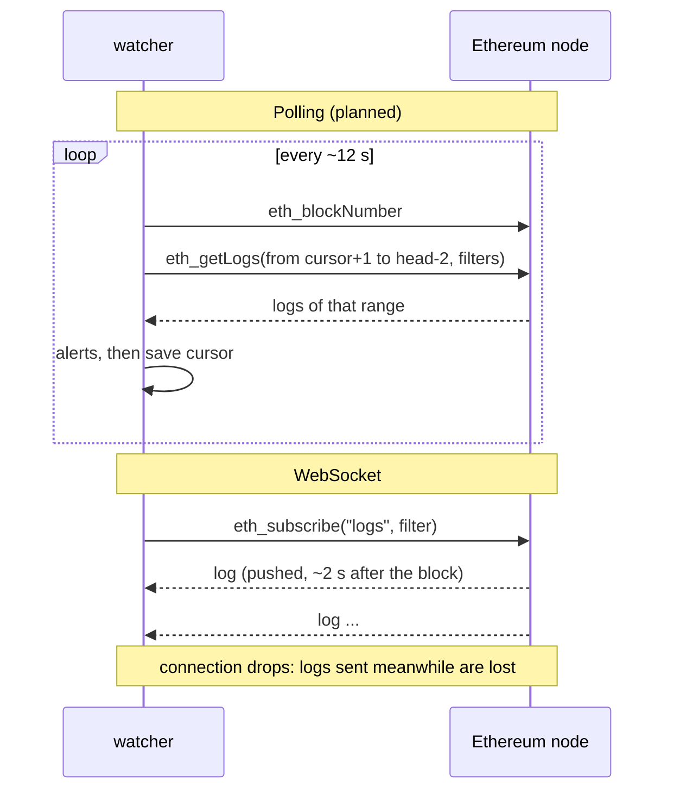

# Following the chain: WebSocket subscription vs polling

This note compares two ways for the Morpho Vault V2 watcher to learn about new transactions: subscribing over a WebSocket, and polling over HTTP. The plan (`plan/2026-10-10-morpho-vault-v2-watcher.plan.md`, decision D21) chooses **polling**. That plan is waiting for approval and the watcher is **not implemented yet**: everything said here about "our solution" describes the planned design. The measurements below are real, taken on 2026-10-10 against the free node `ethereum-rpc.publicnode.com` (HTTPS) and `wss://ethereum-rpc.publicnode.com` (WebSocket).

## Contents

- [The two approaches](#the-two-approaches)
- [What was measured](#what-was-measured)
- [Side by side](#side-by-side)
- [Why polling for this increment](#why-polling-for-this-increment)
- [Where a WebSocket wins](#where-a-websocket-wins)
- [The pending transactions (mempool)](#the-pending-transactions-mempool)
- [Recommended path: a hybrid](#recommended-path-a-hybrid)

## The two approaches

**Polling (pull).** Every ~12 s the watcher asks the node: "what is the latest block?" (`eth_blockNumber`), then: "give me the logs between the block I stopped at and that block, for these addresses and market ids" (`eth_getLogs`). It saves the last processed block (the *cursor*) to a file. Each question is an ordinary, independent HTTP request.

**WebSocket (push).** The watcher opens one long-lived connection and subscribes once (`eth_subscribe` with `newHeads`, `logs` or `newPendingTransactions`). The node then pushes each new block header, each matching log, or each pending transaction hash as soon as it has it.

## What was measured

| Test (2026-10-10, free publicnode endpoint) | Result |
|---|---|
| WebSocket connect | 0.16 s |
| `eth_subscribe` `newHeads`, `logs` (Morpho Blue), `newPendingTransactions` | all three accepted |
| 100 s of subscription | 8 block headers, 7 Morpho Blue logs, 948 pending transaction hashes |
| Header arrival delay after the block timestamp | 1.7 s to 3.4 s (typically ~2 s) |
| `eth_getTransactionByHash` on pending hashes | 15 / 15 readable |
| `eth_simulateV1` (simulate a transaction against the latest state, `validation: false`) | works, returns status, gas and logs |
| `debug_traceCall` | not available |
| `trace_call` | refused: "Archive requests require a personal token" |
| `eth_getLogs` over 1 000 recent blocks (HTTP) | works (68 vault logs, 30 Blue logs for Sentora RLUSD Main) |
| `eth_getLogs` over 50 000 blocks (HTTP) | refused, same archive message |

The polling latency was not measured, since the poller isn't written yet. It follows from the design: up to 12 s of poll period, plus 2 confirmation blocks (~24 s), plus ~2 s of propagation, so **~25 to 40 s** after the transaction is mined.

## Side by side

| Criterion | Polling (planned) | WebSocket |
|---|---|---|
| **Latency** | ~25–40 s with 2 confirmations; ~2–14 s without | ~2 s; the same +24 s if you also wait for 2 confirmations |
| **Missed events** | None by construction: the next query covers every block since the cursor, so a crash, a restart or a network cut only delays the alerts | Anything pushed while the connection is down is lost. Detecting the gap and refetching it needs `eth_getLogs` anyway |
| **Restart** | Resumes from the cursor file | A new subscription starts at "now"; the gap must be filled by hand |
| **Reorgs** (a block replaced by another) | Avoided by staying 2 blocks behind the head; a deeper reorg is not handled | The node re-sends affected logs with `removed: true`; the watcher must undo the alerts it already raised |
| **Exactly once** | Natural: a block range is processed once, then the cursor moves | Needs de-duplication (resent logs after reconnect, `removed` flags) |
| **Free-node limits** | A few small requests per poll; fine for recent blocks, no old history | Connections are dropped from time to time and must be reopened; same history limit |
| **Mempool** | Not possible: pending transactions are not in `eth_getLogs` | Possible: `newPendingTransactions` (see below) |
| **Code** | A loop, a cursor file, retries with backoff | An async client, reconnect with backoff, heartbeats, gap fill, `removed` handling |
| **Tests** | Easy: record the logs of a block range, replay offline | Harder: needs a fake stream, and gap/reconnect cases |
| **Infrastructure** | Plain HTTPS, works through any proxy or firewall | Needs a persistent outbound WebSocket, sometimes blocked by corporate proxies |
| **Debugging** | Each request can be re-run by hand with `curl` | State lives in the connection; harder to reproduce |

## Why polling for this increment

The watcher's job here is to protect a **Vault V2 depositor**, and the signals that matter for a depositor have long lead times:

- **Timelocked curator changes** (`Submit` → `executableAt`): new adapter, raised caps, fees, gates. The warning comes hours to days before the change can be executed, so 30 s of latency is irrelevant.
- **Bad debt** (`Liquidate` with `badDebtAssets > 0`) and a **share-price fall** (`AccrueInterest`) are already final once mined. The alert reports a loss and can't prevent it, so its value lies in being complete and correct, not in a few seconds saved.
- **Exit liquidity** (utilisation, idle assets) changes over minutes to hours.

For these signals the important property is **never missing an event and never counting one twice**, and polling with a cursor gives exactly that with the least code. It also makes the offline replay tests of slice S4 straightforward.

## Where a WebSocket wins

A WebSocket is the better tool when seconds matter:

- **A Blue borrower** close to liquidation (the position analysed by `riskdep analyze`, HF 1.053, liquidated by a 5.2% oracle drop). Liquidators react within the block, so a 30-second-old alert can arrive after the liquidation.
- **Reacting to pending transactions**, e.g. seeing a large withdrawal or an oracle update before it is mined.
- **Many vaults or markets at once**, where one subscription is cheaper than many polls.

## The pending transactions (mempool)

**Correction:** earlier I said free public nodes usually don't expose the mempool. The free publicnode endpoint does, through `newPendingTransactions`. With it, the watcher could:

1. receive pending hashes (~10 per second on mainnet, 948 in 100 s measured);
2. fetch each one (`eth_getTransactionByHash`) and keep only those sent to the vault, its adapters, Morpho Blue or the Morpho bundler;
3. simulate the kept ones (`eth_simulateV1` against the latest state) and run the same impact rules on the logs the simulation returns, to warn before the transaction is mined.

Limits to keep in mind:

- Transactions sent through private relays (Flashbots and other block builders) never appear in the public mempool. Liquidations and MEV transactions often go that way, so the mempool view is **incomplete by nature**.
- The simulation runs against the latest block, not the exact state the transaction will meet, so other transactions in the same block can change the outcome.
- Filtering ~10 hashes per second means ~10 extra requests per second on a free node, which is likely to hit its rate limits.
- `debug_traceCall` is not available, so internal calls can't be traced, only the emitted logs and the status.

## Recommended path: a hybrid

The robust long-term design uses both, each for what it does well:

- **WebSocket `newHeads` as the trigger:** "a new block exists" arrives in ~2 s, instead of waiting for the next 12 s poll.
- **`eth_getLogs` by block range as the source of truth:** on each trigger, and on every reconnect, fetch the logs from the cursor to the head. A dropped connection then only delays the alerts, exactly as with polling.
- **Fallback:** if the WebSocket is down, keep polling every 12 s.
- **Optional mempool layer** for the borrower case: `newPendingTransactions` + filter + `eth_simulateV1`, labelled as *pending, not final*.

The planned poller is meant to make that later step cheap. Its interface is `next_batch()`, which returns the logs since the cursor, so a WebSocket trigger can be added later without changing the rules, the alerts or the tests.
