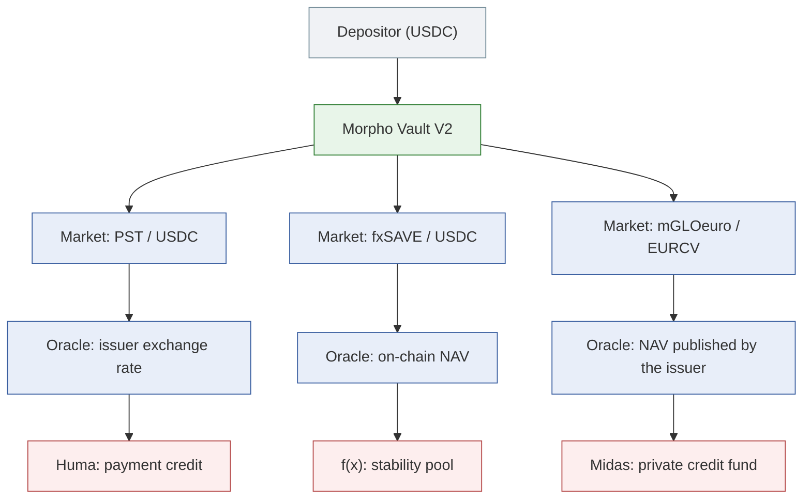
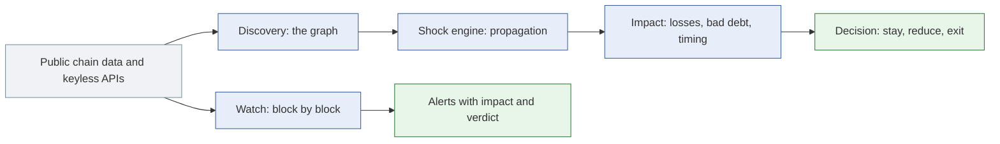

# riskdep: dependency risk for DeFi positions, applied to the RockawayX vaults

*Whitepaper, 11 October 2026*

## Abstract

A deposit in a DeFi vault looks like one position, but it rests on a stack of protocols that the depositor does not see: the lending markets the vault supplies, the collateral those markets accept, the issuers behind that collateral, the oracles that price it, the feeds those oracles read, and the people who can change any of these. When one layer fails, the loss travels up the stack in ways that depend on how each layer is built.

riskdep is a risk system for positions on Ethereum, centred on Morpho. It discovers a position's dependency stack from public on-chain data and keyless APIs, propagates a failure through it with explicit rules, prices the result, and answers the question a portfolio manager actually has: given what could happen, should I stay, reduce or exit, and how fast must I act? It also follows a vault block by block and raises an alert when something in the stack moves.

This paper describes how the system works and applies it to the seven Morpho vaults that RockawayX curates on Ethereum, about 99 million USD. On those vaults, a 30 % markdown of one issuer's token (Huma's PST) costs the book 5.2 million USD, spread over two vaults and two markets outside the book, and the tool says which vault to leave first and at what probability leaving pays.

## Contents

1. [The problem](#1-the-problem)
2. [The RockawayX vaults](#2-the-rockawayx-vaults)
3. [Approach](#3-approach)
4. [Discovering the dependencies](#4-discovering-the-dependencies)
5. [Estimating the impact of a failure](#5-estimating-the-impact-of-a-failure)
6. [Probabilities](#6-probabilities)
7. [From impact to a decision](#7-from-impact-to-a-decision)
8. [Detection and monitoring](#8-detection-and-monitoring)
9. [Results on the RockawayX book](#9-results-on-the-rockawayx-book)
10. [Validation](#10-validation)
11. [Data and trust](#11-data-and-trust)
12. [Limitations](#12-limitations)
13. [Conclusion](#13-conclusion)
14. [Glossary](#14-glossary)

## 1. The problem

A Morpho Vault V2 takes deposits in one asset, USDC for example, and lends them across several isolated lending markets. Each market accepts one collateral token and prices it with one oracle. A curator chooses the markets and their caps; allocators move the money between them; an owner chooses the curator.

The depositor's money is therefore exposed to every collateral the vault accepts, and through each collateral to its issuer: a fund, a credit originator, a synthetic dollar, a stability pool. The oracle decides when a fall in that collateral shows in the market. If it follows a market price, a depeg leads to liquidations within minutes. If it reports the issuer's own rate or NAV, nothing happens until the issuer publishes a lower number, and then the loss arrives in one transaction. Behind the oracle sits a feed, and behind the feed someone who can change it, sometimes with notice and sometimes without.

The Belem Capital challenge that this project answers asks for a working system that finds these layers automatically, estimates what a failure in one of them costs, and turns that into a stay-or-exit decision that accounts for slippage and execution costs. It is judged on dependency discovery (30 %), impact estimation (30 %), decision usefulness (25 %) and a working demonstration on real data (15 %).

## 2. The RockawayX vaults

RockawayX curates 33 vaults holding about 293.6 million USD across nine venues and eight chains. The largest venues are Kamino on Solana (122.1 million USD) and Morpho on Ethereum and Base (96.9 million USD). Eight vaults are Morpho Vault V2; seven of them are on Ethereum, and those seven are the book this paper analyses.

| Vault | Size (USD) | Main collateral (issuer) |
|---|---|---|
| RockawayX Confidential RWA USDC | 26.4M | PST (Huma), PT-reUSD (Re), AUTO (Hastra) |
| RockawayX f(x) Protocol Ecosystem USDC | 21.0M | fxSAVE and PT-fxSAVE (f(x) Protocol) |
| RockawayX USDC Yield | 18.4M | PT-reUSD (Re), strUSD (Tori), siUSD (infiniFi), PRIME (Hastra) |
| RockawayX Tori Ecosystem | 13.6M | strUSD, etrUSD, PT-trUSD (Tori) |
| Huma USDC Main | 12.8M | PST (Huma) |
| Belem RWA EURCV | 5.3M | mGLOeuro (Midas, Fasanara fund) |
| RockawayX NUVA Ecosystem | 1.5M | nvPRIME (Nuva on Hastra) |

Four features of this book shape the analysis.

- **The risk sits in the issuers, not in Morpho.** About 98 % of the Morpho book lends against tokens from young issuers: Huma, f(x), Tori, Re, Midas, Hastra, infiniFi and Nuva. Huma alone accounts for 35 % of the Morpho book, and with its Kamino exposure for about 82 million USD across all RockawayX vaults, 28 % of the firm's total, above the curator's own published 25 % single-protocol limit.
- **Almost every oracle reports an issuer's rate or NAV.** A market depeg of these tokens triggers no liquidation. A loss hits the vault when the issuer marks its token down, and then it lands as bad debt.
- **The markets are nearly full.** Utilisation is 86 % to 91 % in every market, so a depositor who wants to leave depends on borrowers repaying.
- **Some depositors are hidden.** Two vaults can be entered through Zama's Confidential Vault protocol, which encrypts each depositor's amount. On the Confidential RWA vault, 99.1 % of the shares sit in one confidential pool.

## 3. Approach

riskdep answers four questions in sequence, each with its own output.

| Question | What the system produces |
|---|---|
| What does the position depend on? | A dependency graph: vaults, markets, borrowers, collateral, issuers, oracles, feeds, admins, outside venues, each edge typed |
| What does a failure cost? | A propagation of a named incident through that graph, with liquidations, bad debt and who bears it |
| How likely is it, and is it worth acting on? | Yearly probabilities per layer where history exists, and a breakeven probability above which leaving pays |
| Is it happening now? | A block-by-block watch that alerts on the events and readings that precede or mark a loss |

Two principles hold throughout. First, rules and data are separated: every threshold, prior and propagation rule sits in a registry with its stated basis, so a reader can check where a number comes from, and a new behaviour is a new rule rather than new code. Second, everything is reproducible: every run can be replayed offline from recorded mainnet responses, so a figure in this paper can be recomputed on any later day with no network access.

## 4. Discovering the dependencies

Discovery starts from an address, a vault or a borrower, and reads outward.

**The vault and its markets.** For a Vault V2, the system reads the adapters, the markets each adapter supplies, the vault's allocation and caps in each, and the vault's admin roles: owner, curator, allocators and sentinels. For each market it reads every borrower, their debt and collateral, and the market's totals.

**Oracles, and what kind each one is.** Each market's oracle is decomposed into its inputs: the feeds it multiplies and divides, and the ERC-4626 vaults whose exchange rate it applies. Each input is classified:

- **price-tracking**, when it follows a market price;
- **constant-price**, when it does not, with a kind that says when a loss shows in it: an *exchange rate* computed on-chain (the loss arrives at once), a *published* NAV (at the issuer's next transaction), a *linear discount* to maturity for a principal token (never), or a *fixed* value.

The class decides whether a depeg causes liquidations and how fast an issuer's markdown lands. Meta-oracles that read one source and switch to another after a sustained divergence are detected, with their switch delay.

**Feed quality.** Each feed's freshness is measured against its own update rhythm, learned from its past rounds. Feeds read by several markets are marked as shared, because a fault there hits all of them at once. A custom feed whose answer is bounded by a fixed band is reported with how far it can fall before it needs new code.

**Who can change what.** For every contract in the stack, the system reads whether it is upgradeable, who administers it, who owns it, and whether a timelock stands in front of that admin, with its delay. On the vault itself it reads which risk-increasing functions are timelocked, which are abdicated (permanently disabled), and whether the exit gates can lock depositors in.

**Siblings.** Other Morpho markets that take the same collateral or read the same price are drawn as siblings. They are not in the vault, but they sell into the same market when liquidations start, and their lenders lose from the same incident.

**Outside views.** Three keyless providers add what the chain does not say. Pharos grades stablecoin issuers and records what backs each token, which links issuers to one another. Nexus Mutual's cover prices give an outside estimate of an exploit's probability. DefiLlama gives each protocol's TVL and its share of its category, which flags concentration.

**Issuer layers.** Where an issuer publishes its backing, the system reads it. For Ethena, the venues holding USDe's backing and the reserve fund are drawn behind USDe. For a Zama confidential vault, the confidential share pool, the daily batchers and the decryption service every exit needs are drawn behind the vault.

On the RockawayX USDC Yield vault, the graph holds the issuers' tokens, their oracles and feeds, the admin of each feed, the sibling markets on the same collateral, the Pharos backing of each stablecoin, and the protocols' TVL: 84 nodes, from one address.

## 5. Estimating the impact of a failure

**Named incidents, not distributions.** The impact model starts from a named incident: an issuer marks its token down by a given fraction; a borrower defaults; an oracle reads low, reads high or freezes; an exchange holding part of a synthetic dollar's backing loses it. The incident is stated, and its consequences are computed. Whether it is likely is a separate question (section 6).

**The shock engine.** The incident is applied to a node of the dependency graph and propagated along its edges by rules kept in the registry. Each rule says which effect an edge carries (a price, a value, a loss) and how it transforms it. The engine iterates until nothing changes. At each lending market it runs the market model:

- the oracle's reading after the shock decides which borrowers become liquidatable;
- liquidators repay debt and seize collateral at the oracle price plus an incentive;
- the seized collateral is sold into the market, which can push its price down further (the squeeze);
- what the collateral cannot cover becomes bad debt, borne by the market's lenders in proportion to their supply;
- where the oracle keeps reading a price the market no longer pays, the market can be drained before anyone is liquidated.

The result is, for every market, vault and depositor hit: the debt liquidated, the bad debt, the share each lender bears, and the path the loss took. The full propagation is also available as data, step by step, for a front end to draw.

**Hidden losses.** When the oracle does not follow the incident, nobody is liquidated, but the collateral is worth less than the debt it secures. The system counts that shortfall as a hidden loss: it is real for the lenders, but it does not show in the vault's share price until the positions are liquidated or written off. Those who leave before then leave the loss to those who stay.

**Time to impact.** The oracle's kind gives the timing. An exchange rate passes a loss at once; a published NAV at the issuer's next transaction; a meta-oracle after its switch delay; a linear discount never. A feed bounded by a band passes a larger loss only after an upgrade, through whatever timelock controls it.

**Exit liquidity.** Whether liquidators act depends on whether they can sell what they seize. For each collateral, the system measures the route available through a DEX aggregator at the incident's size, or records that only the issuer's redemption remains. A collateral with no route means liquidations may not happen, and the bad debt stays unrealised while the market's liquidity stays locked.

**Books of vaults.** A book is a list of vaults, or of borrow positions, with a weighting: the vaults whole, a given depositor's share, or a fixed amount per pocket. One incident is run on every vault of the book, and the losses are added in USD. Losses in different vaults from the same incident add up; they do not offset.

## 6. Probabilities

**Layer priors.** For a leveraged position, each layer gets a yearly probability, a severity distribution and a recovery:

- exploits come from a hack base rate: hacks per protocol per year for protocols of the same size, adjusted by the protocol's category and its age;
- an issuer depeg comes from that issuer's own history where there is one (Ethena's USDe, for instance), stated with its basis;
- oracle failures come from the record of misconfigured and stale-oracle exploits on lending protocols.

A Monte Carlo simulation draws incidents from these priors over the chosen horizon, propagates each draw through the position, and gives the expected loss, the probability of liquidation, each layer's contribution, and the tail: value at risk and expected shortfall at 95 % and 99 %.

**The breakeven probability.** For most RockawayX collateral there is no history to base a prior on: the issuers are young and none has failed yet. Rather than invent a number, the system turns the question around. Leaving costs something for sure: the yield given up, or an explicit unwind cost. It saves something only if the incident happens: the loss avoided. The ratio of the two is the probability above which leaving pays:

> p\* = cost of leaving ÷ loss avoided

The portfolio manager compares p\* with their own view of the issuer. A p\* of 2 % over 30 days says "leave if you think this has more than a 2 % chance this month"; a p\* above 100 % says that leaving never pays, whatever happens.

**Outside views.** Next to p\*, the system shows what the market charges for the same risk where it can. A Nexus Mutual cover price, divided by a loading for capital cost and margin, implies a yearly probability of an exploit. It is shown, never used in the verdict, because cover pays on an exploit, not on an issuer's markdown.

## 7. From impact to a decision

**Given the incident.** For a vault depositor, the system compares two outcomes:

- staying: the depositor bears its share of the vault's loss;
- leaving first: it withdraws what the vault can pay out now before the bad debt is written off, and bears the loss only on what cannot leave. What can leave comes from idle funds first, then the markets' free liquidity, then forced deallocation at a penalty.

The verdict is EXIT when leaving first saves more than it costs, STAY when it does not, and REDUCE for a leveraged position when de-levering moves the liquidation point beyond the stress at a cost below what it saves. Each verdict carries its reason in one sentence.

**The run.** Leaving first assumes others have not left already. The exit queue measures what a depositor recovers if every contract holder of the vault (other vaults, funds, multisigs) withdraws before it, since those can act in the same block as the news. A confidential share pool is counted as many slow depositors, not one fast holder.

**Value at risk.** Each incident ends with one block a manager can read in a minute: the money in the markets the incident hits, the loss if it happens, the cost of leaving now against what it saves, the liquidity that liquidations would return, and the losses beyond the book in sibling markets.

**For a leveraged position**, the verdict weighs the expected loss over the horizon against the carry earned by staying and the cost of exiting, priced by a live quote. On the challenge's own example, a leveraged Pendle principal-token position on sUSDe, the expected loss over 30 days is 6,265 USD against 5,697 USD of carry; the two are too close to call, a 5.16 % fall in the oracle liquidates the position, and the verdict is REDUCE, with the size of the de-levering that moves the liquidation point beyond the stress.

## 8. Detection and monitoring

The watch follows a vault, or every Morpho position of an address, block by block. It reads the logs of every contract in the stack, decodes them, re-reads the state that changed, and runs rules that compare the state before and after. It saves its position last, so a restart never skips a block.

What it alerts on, by family:

| Family | Examples |
|---|---|
| Losses | unrealised bad debt in a market; bad debt written off; a depositor's position falling |
| Oracles and feeds | an oracle falling, with what becomes liquidatable and the verdict; a feed turning stale; a feed near the floor of its band; an oracle diverging from market prices |
| Admin changes | a timelocked change submitted, with its decoded content and execution date; a change accepted; caps raised; adapters added; fees changed; an upgrade scheduled on a timelock above a dependency, 48 hours before it can execute |
| Liquidity and exit | a depositor no longer able to exit in full with a plain withdrawal; a market close to its drain threshold; at least half of a position stuck in a run |
| Concentration | one borrower holding most of a market's debt; a market crossing a quarter of the vault |
| Confidential vaults | the day's confidential outflow, an instant exit, a canceled batch, a pause |

Each alert has a level (info, warn, critical) set by a threshold in the registry, and a runbook entry: what it means, what to check, what to do. Alerts can be posted to a Telegram channel, and the HTTP API serves them to the browser interface with a block cursor.

The early warnings matter most for issuer-priced collateral, where the loss itself arrives in one transaction. On the Belem vault, the feed that prices mGLOeuro cannot report below 90 % of its value without new code, and that code goes in through a 48-hour timelock. The watch reports the band at start-up and the upgrade as soon as it is scheduled, two days before the price can move.

## 9. Results on the RockawayX book

**One issuer, two vaults, two outside markets.** A 30 % markdown of Huma's PST, run on the seven-vault book:

| Vault | Size (USD) | Loss (USD) | Loss | Leaving pays above (over 30 days) | Verdict |
|---|---|---|---|---|---|
| Confidential RWA USDC | 26.4M | 3,273,024 | 12.38 % | 6.6 % | EXIT |
| Huma USDC Main | 12.8M | 1,922,106 | 14.97 % | 14.1 % | EXIT |
| Five other vaults | 59.8M | 0 | 0 % | — | — |
| **Book** | **99.1M** | **5,195,130** | **5.24 %** | **12.9 %** | |

The system names the vault to leave first, the Confidential RWA vault, because leaving it pays at the lowest probability. Beyond the book, the same markdown costs the lenders of two sibling markets on PST 4.46 million PYUSD and 0.63 million AUSD. Once liquidators have repaid, 22.3 million USD of liquidity returns to the hit markets; if nobody liquidates, none does.

**One issuer per vault.** The same method gives a different answer on each vault, because each issuer, oracle and depositor base is different:

| Vault | Incident | Vault loss | Verdict | Why |
|---|---|---|---|---|
| Belem RWA EURCV | mGLOeuro −30 % | 251,761 EURCV, 5.34 % | STAY | The depositor holds 99.46 % of the vault: it bears the loss whether it leaves first or not. The collateral has no DEX route, so liquidators may not act at all |
| f(x) Protocol Ecosystem | fxSAVE −30 % | 1,806,122 USDC, 8.61 % | EXIT, above a 7.9 % chance | The fxSAVE market liquidates into a thin exit (a 34.5 % discount); the principal-token market's oracle does not move, so its loss is hidden |
| USDC Yield | siUSD −30 % | 408,332 USDC, 2.21 % | EXIT, above a 29.8 % chance | One borrower holds 94 % of the market's debt; a sibling siUSD market loses 451,329 msUSD |

**Concentration.** Huma's 35 % share of the Morpho book, and 28 % of RockawayX's total once Kamino is counted, is the single largest dependency, and the PST incident shows its cost. The same issuers recur across venues: Huma on Morpho and Kamino, Tori on Morpho and Upshift. One issuer incident therefore hits several RockawayX vaults at once.

## 10. Validation

**Backtest on a real incident.** On 25 August 2026, trading in Pendle's reUSD yield token pushed the principal token's implied yield from about 11 % to over 20 % in nine minutes, the oracle fell, and 33 positions were liquidated on Morpho with no bad debt. Replaying the markets' state 60 blocks before the first liquidation and applying the oracle's lowest price:

| Market | Positions predicted / liquidated | Debt liquidatable / repaid (USD) | Bad debt predicted / realised |
|---|---|---|---|
| PT-reUSD / USDC | 13 / 13 | 35.46M / 35.19M | 0 / 0 |
| PT-reUSD / USDT | 7 / 7 | 1.89M / 0.96M | 0 / 0 |

Every liquidated position was predicted and none was predicted in error. On the USDT market, liquidators repaid part of each position, which is why less debt was repaid than became liquidatable. A second episode, the market crash of 10 October 2025, is replayed the same way across six markets.

**A crisis on a mainnet fork.** The Belem vault was copied into a local fork of Ethereum, and the accounts that hold the real roles were used to play a crisis: the issuer publishes a 10 % markdown (within the feed's band), then installs an upgrade through the real 48-hour timelock, then publishes 70,000 EUR for a share worth 100,000. The watch reported the band and the exit gates at start-up, warned when the upgrade was scheduled, raised the oracle move with what it made liquidatable, and reported the bad debt. The bad debt predicted for a 30 % markdown before the crisis, 251,761 EURCV, matched the 252,914 observed after it within 0.5 %.

**Cross-checks.** Every run compares its block against a second, independent RPC node, and the vault's totals against the Morpho API, with a tolerance; a check that cannot run says so rather than passing silently. The full test suite runs offline from recorded mainnet responses.

## 11. Data and trust

All data comes from public sources: an Ethereum RPC node, the Morpho and Pendle APIs, DefiLlama, Pharos, Nexus Mutual, a DEX aggregator, and the issuers' own transparency endpoints where they exist. None needs a key. An Etherscan key, optional, adds the check that each oracle's source code is verified.

The chain is the source of truth for state: positions, prices, caps, roles and timelocks are read on-chain at a fixed block, and the APIs are used to find things (a vault's depositors, a protocol's TVL), then confirmed on-chain where possible. Every response is cached under a hash of the request, and a run can be recorded and replayed, so the results in this paper do not depend on the day they are read. The system never holds a key that can move funds, and never sends a transaction.

## 12. Limitations

The system is explicit about what it does not compute.

- **Young issuers have no prior.** For most RockawayX collateral, the probability of a markdown is not estimated; the breakeven probability and the outside views stand in for it.
- **Some timing is approximated.** A feed bounded by a band is reported by the watch, but the incident model still applies a large markdown at once; an issuer's own redemption path (cooldowns, queues, fees) is not yet part of the exit.
- **Issuer internals are partly drawn.** Ethena's backing venues are read; f(x)'s stability pool, infiniFi's loss waterfall and Midas's fund are not decomposed, so a loss inside them is entered as a markdown of the token rather than derived.
- **Worst-case allocation is not yet stated.** Exposure follows the current allocation, while allocators can move money up to the caps at once.
- **Scope.** Morpho Vault V2 on Ethereum is covered. Vault V1, other chains, and RockawayX's non-Morpho venues (Kamino on Solana, Upshift, Ember, Midas) are not.
- **Confidential positions.** An individual confidential depositor's amount is encrypted; the system applies the vault's loss rate to an amount the depositor supplies, and does not find the position itself.

Each of these has a planned extension, ordered by how much it changes the figures on the recorded vaults.

## 13. Conclusion

A vault's risk is the risk of its stack, and on the RockawayX book that stack ends in young issuers whose tokens are priced by their own reports. riskdep makes that stack visible from an address, names who can change each part of it and with how much notice, propagates a failure through it with stated rules, and gives a decision with its reason: which vault to leave first, what leaving costs, and the probability above which it pays.

- **Discovery** maps the issuers, oracles, feeds, admins and sibling markets of every RockawayX vault from public data.
- **Impact** is computed for named incidents, with liquidations, bad debt, hidden losses and timing, and checked against a real liquidation episode and a replayed crisis.
- **Decisions** come with a breakeven probability where no honest prior exists, and with outside market views beside it.
- **Monitoring** alerts on the changes that precede a loss, such as an upgrade scheduled behind a timelock, not only on the loss itself.

## 14. Glossary

| Term | Meaning |
|---|---|
| **Vault V2** | Morpho's vault: it takes deposits in one asset and lends them across markets through adapters, under caps set by a curator |
| **Market** | An isolated Morpho lending market: one loan asset, one collateral, one oracle, one liquidation threshold (LLTV) |
| **LLTV** | The loan-to-value at which a borrower can be liquidated |
| **Curator, allocator, owner, sentinel** | The vault's roles: who sets risk limits (with timelocks), who moves money within them (at once), who appoints the curator, who can only reduce risk |
| **Oracle, feed** | The contract a market reads its price from, and the data sources the oracle combines |
| **Constant-price oracle** | An oracle that reports an issuer's rate or NAV rather than a market price: a depeg does not move it, a markdown does |
| **Bad debt** | Debt that the collateral cannot cover after liquidation; the market's lenders bear it |
| **Hidden loss** | A shortfall that exists because the collateral is worth less than the debt, but that no liquidation has yet turned into bad debt |
| **Sibling market** | A market outside the vault that takes the same collateral or reads the same price |
| **Breakeven probability (p\*)** | The probability of an incident above which leaving now costs less than staying |
| **Timelock** | A delay between scheduling a change and executing it, which gives depositors time to react |
| **Principal token (PT)** | A Pendle token that redeems one unit of the underlying at maturity, bought at a discount |
