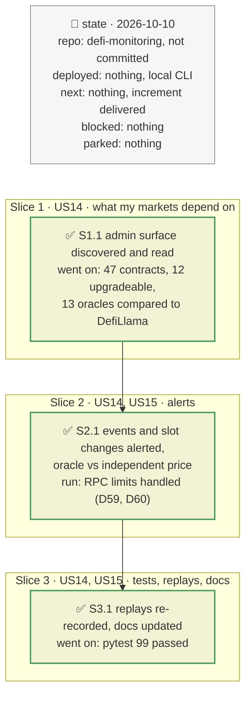

# Admin surface: oracles, Morpho Blue and collateral issuers, plan

> **Status**: approved: the person, 2026-10-10, "Implement 3. Watch the admins of oracles, Morpho Blue and collateral issuers" (step 3 of `docs/analysis/NEXT_STEP.md`). No interview: the decisions below are the agent's defaults.
> **Delivers**: both watches discover, for every watched market, the contracts it depends on beyond Morpho: the oracle and the feeds or vault shares it reads, the collateral and loan tokens, and for a PT the Pendle SY and the yield token. For each, they read whether it is upgradeable (EIP-1967 and ZeppelinOS proxy slots, EIP-1167 clones), its admin and owner, and for a Chainlink proxy its current aggregator. They alert on upgrades, admin and ownership transfers, feed changes, pauses, admin-role grants and outsized collateral mints, on Morpho Blue owner actions, and on an oracle diverging from DefiLlama's price (gaps G3 and G4). Proof: the startup table on the demo markets; each rule fires in a test.
> **Hard rule**: no API key, no contract source needed: only standard events and storage slots; the agent never commits.
> **Read against**: `defi-monitoring` working tree; EIP-1967 (proxy storage slots), OpenZeppelin `Ownable`, `Pausable`, `AccessControl` events; Chainlink `EACAggregatorProxy` (`aggregator()`, `AggregatorProposed`, `AggregatorConfirmed`); morpho-blue `8e26ca6a` (`SetOwner`, `EnableIrm`, `EnableLltv`, `SetFeeRecipient`).
> **Left out**: §4 Flows and §5 State: those of the watcher plans, with the additions of §3.

## The tracker

Phasing diagram: the slices in order, and what each has to show before the next one starts.

mandate: mode classic · no git, the person commits · inline · tests at the slice end · verify off

# Design

## 1. Why, and why not

A position can be broken by people who are neither its vault curator nor Morpho: whoever can upgrade the collateral token, change an oracle's feed, pause a token, or mint collateral without backing. In March 2026, Resolv's USR was minted without backing and left bad debt in Morpho markets that accepted it.

**Stories**
- **US14**, depositor or borrower: see which contracts my markets depend on, which of them someone can change, and who; be told when they change.
- **US15**, depositor or borrower: be told when a market's oracle diverges from an independent price.

**Non-goals**: decoding custom admin functions that emit no standard event (they are caught only when they change a proxy slot, an owner or an aggregator, at the next refresh); verifying contract sources.

## 3. Modules, after

**`admin.py`**, new:
- `AdminWatch(f, markets, block)`: discovers the admin surface of the watched markets and reads its state:
  - storage slots: EIP-1967 implementation, admin and beacon, and the ZeppelinOS implementation and admin slots;
  - EIP-1167 clones;
  - `owner()`, and `aggregator()` for a Chainlink proxy.
- `filters()` and `kinds()`: what the poller must add.
- `step(...)`: re-reads the state every 300 blocks and returns the alerts.
- Pure rules: `assess_events`, `assess_changes`, `assess_divergence`.

**`abi.py`** gains the standard events (contract kind `admin`) and the Blue owner events. **`poller.py`** fetches the general log filter only for vaults and adapters, so admin contracts are fetched only through their own topic-restricted filters. **`sources.py`** gains `rpc_batch_methods` for `eth_getStorageAt` and `eth_getCode` in batches.

## 8. Decisions

| id | Kind | Decision | Status | Source | Slice |
|---|---|---|---|---|---|
| D52 | purpose | Admin surface per watched market: oracle; its `BASE_FEED_1/2`, `QUOTE_FEED_1/2`, `BASE_VAULT`, `QUOTE_VAULT` (Morpho `ChainlinkOracleV2`); collateral token; loan token; for a PT collateral, the Pendle SY and the yield token | agreed, agent's default | — | S1 |
| D53 | module | Upgradeability read from EIP-1967 slots (implementation, admin, beacon) and the ZeppelinOS slots (used by USDC); an EIP-1167 clone is immutable; owner from `owner()`; feed from `aggregator()` | agreed, agent's default | EIP-1967 | S1 |
| D54 | contract | Events, by topic on the admin-surface addresses: `Upgraded`, `BeaconUpgraded` → critical; `AdminChanged`, `OwnershipTransferred`, `AggregatorProposed`, `AggregatorConfirmed` → warn; `Paused` of a collateral token → critical (liquidations need the transfer), of another contract → warn; `Unpaused` → info; `RoleGranted` of the default admin role → warn, other roles and `RoleRevoked` → info | agreed, agent's default | OpenZeppelin, Chainlink | S2 |
| D55 | contract | Mint watch on collateral and yield tokens only (loan stablecoins mint daily): one transaction minting ≥ 5 % of the total supply → critical | agreed, agent's default | registry `watch.mint_share_critical` | S2 |
| D56 | contract | Slot changes found at a refresh that no event explained → same level as the event they stand for | agreed, agent's default | — | S2 |
| D57 | contract | Morpho Blue owner events (`SetOwner`, `EnableIrm`, `EnableLltv`, `SetFeeRecipient`) → info, `SetOwner` → warn; Blue itself is immutable and these do not change existing markets | agreed, agent's default | morpho-blue `8e26ca6a` | S2 |
| D59 | module | The free RPC answers "Request blocked" above 9 addresses in one `eth_getLogs` filter (measured: 9 accepted, 10 refused, with or without topics); the poller splits longer address lists into chunks of 9, for every filter | agreed, found in S2 | probes 2026-10-10 | S2 |
| D60 | module | The free RPC intermittently refuses a recent range as "archive" (the same query alternates between success and refusal); the poller retries such a refusal twice before treating the range as a gap, and the admin-surface filters are optional: a refusal there prints a warning and the batch goes on, the state refresh catching what was missed | agreed, found in S2 | probes 2026-10-10 | S2 |
| D58 | contract | Oracle vs DefiLlama price of collateral ÷ loan token, at start and every 300 blocks: warn from a 3 % gap, on crossing; tokens DefiLlama does not price are "not checked" | agreed, agent's default | registry `watch.oracle_divergence_warn` | S2 |

# Execution

## 9. The slices

**S1, what my markets depend on** · US14 · check: the startup table lists the admin surface of the 16 demo markets.
**S2, alerts** · US14, US15 · check: each rule fires in a test.
**S3, tests, replays, docs** · check: replays re-recorded, runbook, registry reference, architecture and next steps updated; `pytest` exits 0.

## Interview log

No interview: the person asked to implement step 3 directly.
