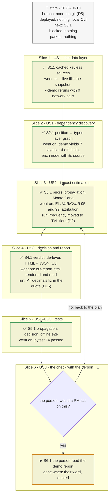
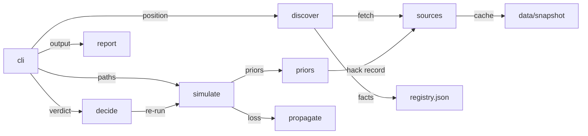
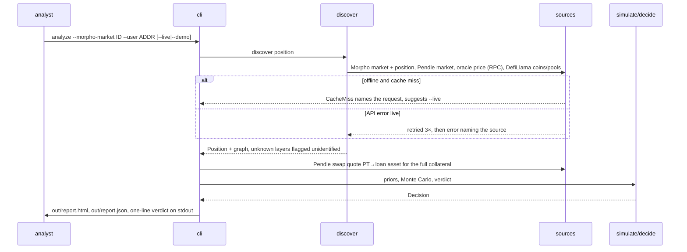

# DeFi risk dependency engine, plan

> **Status**: approved: the person, 2026-10-10, "use this project charette to build PROJECT.md. Don't commit anythink. Put all files you create in the directory projet", and the four decisions D1 to D4 answered in the interview
> **Delivers**: a Python CLI that takes a real Pendle-PT position on Ethereum (a Morpho Blue borrower or a plain PT holder), discovers its dependency stack from live keyless data, simulates incidents on each layer, and writes a self-contained HTML report plus JSON ending in a **stay / exit** verdict and its reasons. Proof: `python -m riskdep analyze --demo` produces the report from a cached real snapshot, and the same command runs against live data with `--live`.
> **Hard rule**: nothing is committed (D5); every file lives under `projet/` (D6).
> **Read against**: no repository (`projet/` is not under version control); live APIs probed 2026-10-10.
> **Libraries read from source**: Python 3.10.12, `networkx` 2.8.8, `numpy` 2.1.1, `requests`, `eth_utils` (keccak only), `jinja2`; Pendle API v2 (`api-v2.pendle.finance/core`), Morpho Blue API (`blue-api.morpho.org/graphql`), DefiLlama (`api.llama.fi`, `coins.llama.fi`, `yields.llama.fi`), RPC `ethereum-rpc.publicnode.com`, all probed 2026-10-10.
> **Left out**: §7 *What ran* (no experiments asked; the probes are in the interview log).

## The tracker

Phasing diagram: the slices in order, and what each has to show before the next one starts.



mandate: mode classic · no git, nothing committed (D5) · inline · tests at the slice end · verify off

# Design

## 1. Why, and why not

A portfolio manager holding a Pendle PT, often looped on Morpho, is exposed to five or more
stacked systems: the settlement chain, the yield source behind the SY (for example Ethena
for sUSDe), the oracle the lending market prices PT with, the Pendle AMM they would exit
through, and the lending market itself. An incident in any one of them reaches the position
through a different path (a markdown, a liquidation, a frozen exit, bad debt), and today
nobody turns that into one number they can act on.

**Goals**
- Discover the dependency stack of a real position automatically, from public data.
- Estimate, per layer, how likely an incident is and what it costs this position.
- Say **stay or exit**, comparing expected loss with carry and with the actual quoted cost of leaving.

**Non-goals (this increment)**
- Other chains (Solana, Canton, Tempo), other position types (LP, YT, Aave e-mode). Next increments.
- Real-time monitoring and alerting. The CLI is run on demand.
- Executing the exit.

**Stories**
- **US1**, risk analyst: give a Morpho market + borrower address (or a Pendle market + PT amount) and see every layer the position depends on, each with its source. *Acceptance*: the demo graph shows chain, underlying, issuer, oracle, AMM, lending market and loan asset, with no hand-entered data.
- **US2**, risk analyst: see, per layer, the probability of an incident over the horizon, the loss it causes to this position, and how it propagates. *Acceptance*: the report table has one row per layer with p(incident), conditional loss, contribution to expected loss and the propagation path in words.
- **US3**, portfolio manager: read one verdict, stay or exit, with the numbers that decide it. *Acceptance*: the report opens with the verdict, expected loss vs carry vs exit cost, and the top two drivers.

## 2. Before and after

New work. After: `projet/` holds the plan, the `riskdep` package, a cached real snapshot,
tests, and a generated `out/report.html` + `out/report.json`.

## 3. Modules, after

Module map: who imports whom, answering which module may reach the network. `sources` is imported only by `discover` and `cli`; nothing
imports `report` but `cli`.



**`sources`**: one `Fetcher(mode="live"|"offline"|"refresh")` with `get_json(url)` and `post_json(url, body)`, keyed by a hash of the request into `data/snapshot/`. Offline mode never touches the network and fails clearly on a miss. Hides retries, timeouts, the cache format. Thin clients `pendle`, `morpho`, `llama`, `rpc` on top.

**`discover`**: `discover_morpho_position(f, market_id, user) -> Position` and `discover_pt_holding(f, pendle_market, pt_amount) -> Position`. A `Position` carries the numbers (collateral, debt, LLTV, prices, implied APY, borrow APY, health factor) and a `networkx.DiGraph` whose nodes are typed layers (`chain`, `asset`, `issuer`, `oracle`, `amm`, `lending`, `stable`) with `source` and `evidence` attributes. Hides the API shapes and the oracle-inference rule (D11).

**`priors`**: `layer_priors(f, graph) -> {node: Prior(p_year, severity Beta(a,b), basis)}`. Frequencies from the DefiLlama hack record (D9); severities and the non-hack market events from `registry.json` assumptions, each named in the report.

**`propagate`**: pure function `loss(position, shocks) -> LossBreakdown`: given a vector of per-layer shocks, the position's loss in USD and the path taken (markdown, liquidation, frozen exit, theft). No I/O; the only place the economics lives.

**`simulate`**: `run(position, priors, horizon_days, n) -> SimResult` Monte Carlo over independent layer incidents plus a correlated issuer→AMM channel (D12). EL, VaR95, CVaR95, per-layer attribution.

**`decide`**: `verdict(position, sim, exit_quote) -> Decision` (D13).

**`report`**: `write(position, sim, decision, out_dir)` → `report.html` (Mermaid from jsDelivr, the rest inline) and `report.json`.

## 4. Flows

Sequence diagram: one `analyze` run, with its failure branches.



## 5. State and its writers

| State | Where | Writer |
|---|---|---|
| HTTP response cache | `projet/data/snapshot/*.json` | `sources.Fetcher` in live/refresh mode only |
| Registry of issuers and assumptions | `projet/riskdep/registry.json` | a person, by hand |
| Reports | `projet/out/` | `report.write` |

## 6. Failure modes

| What breaks | What the person sees |
|---|---|
| API down, live mode | error naming the source and URL, no partial report |
| Offline cache miss | `CacheMiss` naming the request and `--live` |
| Underlying not in the registry | the node is drawn, marked *unidentified issuer*, given the registry's default prior, and the report says so |
| Oracle unverified / not Chainlink-shaped | behaviour inferred from price vs market (D11), marked *inferred* |
| Pendle quote fails | exit cost falls back to the AMM-depth estimate (D13), marked *estimated* |

## 8. Decisions

| id | Kind | Decision | Status | Source | Slice |
|---|---|---|---|---|---|
| D1 | purpose | First position type: a Pendle PT on Ethereum, held or used as Morpho Blue collateral | agreed | the person, interview Q1 | S2 |
| D2 | architecture | Python CLI writing a self-contained HTML report + JSON | agreed | the person, Q2 | S4 |
| D3 | architecture | Keyless public APIs only, with a cached real snapshot for the offline demo | agreed | the person, Q3 | S1 |
| D4 | purpose | Mode classic | agreed | the person, Q4 | — |
| D5 | clarification | No git, nothing committed; the charrette rule that documents go to the aiview data home is overridden: everything lives in `projet/` | agreed | the person's request | all |
| D6 | clarification | `projet/` holds the plan, code, data, outputs | agreed | the person's request | all |
| D7 | contract | Position input: `--morpho-market <uniqueKey> --user <addr>` or `--pendle-market <addr> --pt-amount <n>` | agreed, agent's default | — | S4 |
| D8 | module | Discovery reads PT/SY/underlying from the Pendle market, collateral/oracle/LLTV/position from Morpho, prices from DefiLlama coins, the oracle price from RPC `price()` | agreed, verified by probe 2026-10-10 | probes | S2 |
| D9 | module | Exploit frequency = hacks of protocols in the same current-TVL tier (< $10M, $10M–$100M, ≥ $100M), all categories pooled, ÷ (protocols in the tier × 5 y), × the category's relative rate clipped to 0.5–2, × an age factor; floor 0.5 %, cap 15 %. Oracle: misconfigured/stale-oracle hacks only ÷ Lending+CDP protocols, × 2 if unverified. Revised in S3: the first estimator (per category only) gave Morpho Blue 15 %/yr, driven by small forks | agreed, agent's default, revised in S3 | `api.llama.fi/hacks`, `/protocols` | S3 |
| D10 | module | Severity per layer = Beta distribution from the registry, each with a stated basis (e.g. sUSDe Apr-2024 drawdown, USDC Mar-2023 depeg) | agreed, agent's default | registry | S3 |
| D11 | module | Oracle behaviour inferred: Chainlink-v2 shape probed (`BASE_FEED_1()`); otherwise compare oracle price with PT market price and with the linear accrual to par. Within 0.5% of market → *market-tracking* (a depeg liquidates); else *fundamental/fixed* (a depeg creates bad debt, no liquidation, equity still marked down) | agreed, agent's default | probe: the demo oracle is an unverified EIP-1167 clone | S2 |
| D12 | module | Incidents independent per layer, except an issuer incident also drains the AMM (liquidity × (1 − severity)), since LPs flee a depeg | agreed, agent's default | — | S3 |
| D13 | contract | Verdict: **exit** when EL(horizon) > carry(horizon) + exit cost; **reduce** when CVaR95 > equity × the registry's tail budget; else **stay**. Exit cost = real Pendle `swap` quote of the whole collateral (price impact + fee) + gas, debt repaid at par | agreed, agent's default | Pendle `/core/v2/sdk/1/markets/{m}/swap`, probed | S4 |
| D14 | module | Demo position: the largest borrower of Morpho market PT-sUSDE-26NOV2026 / USDC (`0x5613…cb05`), found live, cached | agreed, agent's default | Morpho API probe | S1 |
| D16 | contract | The exit quote sends the PT amount in the token's own decimals (a Morpho market PT had non-18 decimals and the quote overflowed Pendle's $100M cap) | agreed, found in S4 | Pendle API 400 "input valuation is too high" | S4 |
| D17 | contract | Verdict refined in S3/S4: REDUCE also when carry < expected loss, CVaR99 > 50 % of equity, or the liquidation distance is shorter than the stress drop; the de-lever size is solved for the stress drop, quoted for real and re-simulated. Tail measured at 99 %, since incidents hit only ~2 % of paths and VaR95 is 0 | agreed, agent's default | S3 run | S4 |
| D18a | contract | Offline runs use the snapshot's date (`data/snapshot/as_of.json`) as "now" through `clock.py`. Was a bug: the DefiLlama chart URL and days-to-maturity used today's date, so the offline demo failed from the day after the snapshot | agreed, fixed 2026-10-10 in defi-monitoring | the person: "Fix the bug" | S1 |
| D18b | module | Oracle inference flags itself *ambiguous* when the PT trades within 2 × 0.5 % of par; the report then shows the verdict under the other oracle mode (sensitivity) | agreed, fixed 2026-10-10 | the person: "implementation gap" | S2 |
| D18c | module | `analyze` cross-checks the Morpho API position against `position(id, user)` on-chain, and the RPC against a second one; a failure heads the reasons | agreed, 2026-10-10 | — | S2 |
| D15 | clarification | Slice documents folded into §9 (plan of six small slices, one session); departure from write-slice owed: none further | agreed, agent's default | — | — |

# Execution

## 9. The slices

**S1, the data layer** · US1 · blocked by nothing · check: `--refresh` then `--demo` with network off works · slice doc: this section.
**S2, dependency discovery** · US1 · blocked by S1 · check: demo graph has ≥ 5 typed layers, each with `source`.
**S3, impact estimation** · US2 · blocked by S2 · check: EL, VaR95, CVaR95 and per-layer attribution sum to EL within MC error.
**S4, decision and report** · US3 · blocked by S3 · check: `out/report.html` and `out/report.json` written; verdict on stdout.
**S5, tests** · US1–US3 · blocked by S4 · check: `pytest` exits 0.
**S6, the check with the person** · 👤 · US3 · done when the person has read the report.

## 10. The mandate

```
mode: classic
pace: run through (no pull requests: no git, D5)
pull requests: none (D5)
steps: inline
tests: at the slice end
verify: off (no verify skill in the project)
```

## Interview log

**Q1. Which position should the prototype analyse first?** Options: Pendle PT on Ethereum (recommended: the brief's own five-layer example, rich public data) · Generic EVM lending position · Solana position. **Answer**: "Pendle PT on Ethereum (Recommended)".

**Q2. Which language and stack?** Options: Python CLI + HTML report (recommended) · Node/TypeScript CLI + HTML · Python + Streamlit. **Answer**: "Python CLI + HTML report (Recommended)".

**Q3. Which data sources?** Options: keyless public APIs (recommended) · allow API keys. **Answer**: "Keyless public APIs (Recommended)".

**Q4. Execution mode?** Options: classic (recommended) · swarm. **Answer**: "classic (Recommended)".

Probes run before the plan, 2026-10-10: Pendle `/core/v1/1/markets/active` (47 markets) and `/core/v2/1/markets/{m}/data`; Pendle `/core/v2/sdk/1/markets/{m}/swap` returns `amountOut`, `priceImpact`, fee; Morpho GraphQL `markets`, `marketPositions` (largest PT-sUSDe borrower: HF 1.05), `oracleByAddress` (type `Unknown`); RPC: oracle `0xF8b2…1b08` is an EIP-1167 clone of an unverified implementation exposing `price()`; DefiLlama `/hacks`, `/protocols`, `yields.llama.fi/pools` all keyless.
