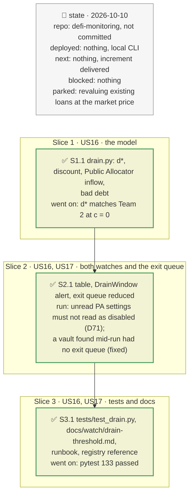

# Drain threshold: when a depeg empties a market, plan

> **Status**: approved: the person, 2026-10-10, "Go" (item 2 of `docs/analysis/comparison_team.md` §5, proposed as the step after the exit queue). No interview: the decisions below are the agent's defaults.
> **Delivers**: for every market of every Vault V2 a watch follows: the collateral's discount to its oracle, the drain threshold d\* = 1 − LLTV / (1 + c), the amount that can be drained (free liquidity plus the vault's Public Allocator inflow), and the vault's share of it. A `DrainWindow` alert warns within 2 points of d\* and turns critical at d\*; an open drain removes its liquidity from the exit queue. Proof: the start-up table on the recorded Sentora range; a simulated USDe depeg as a test.
> **Hard rule**: no new provider; the existing alerts keep their meaning; the agent never commits.
> **Read against**: `defi-monitoring` working tree; `teammate/team2.md` §3 "Fixed oracles"; vault-v2 `d992cb84` (`VaultV2.sol` caps and `isAllocator`, `src/periphery/blue-public-allocator/BluePublicAllocator.sol`: `absoluteCap`, `canPullFromMarket`, `isActiveAdapter`, `vaultData`); Morpho docs `contracts/blue-public-allocator.md` and `contracts/addresses.md` (Ethereum `0x00b8…1e27`); live probe 2026-10-10: the Public Allocator has no role on Sentora RLUSD Main.
> **Left out**: §4 Flows and §5 State: those of the watcher plans, with the additions of §3.

## The tracker

Phasing diagram: the slices in order, and what each has to show before the next one starts.

mandate: mode classic · no git, the person commits · inline · tests at the slice end · verify off

# Design

## 1. Why, and why not

With an oracle that does not follow the market, a depeg liquidates nobody: borrowers stop repaying, the loss is not recorded, and past a computable depeg anyone can borrow the market's whole free liquidity against cheap collateral in one block (Team 2). The exit queue says how much of a deposit gets out in a run; this says when the window closes.

**Stories**
- **US16**, vault depositor: see, for each market of the vault, how far the collateral is from the depeg at which the market can be drained, and how much would go. *Acceptance*: the start-up table shows d\*, the discount, the margin and the drainable amount per market; d\* matches Team 2's 8.5 % and 14 % at c = 0.
- **US17**, vault depositor: be told before the drain pays, and see my exit capacity without the drainable liquidity once it does. *Acceptance*: a rule test fires warn then critical, once each; an open drain reduces the exit queue's liquidity by the market's withdrawable part.

**Non-goals**: classifying oracles from their feeds; revaluing existing loans at the market price; other vaults' Public Allocators; a slippage curve per token; competing arbitrageurs and curator reaction.

## 3. Modules, after

**`drain.py`**, new. Pure: `d_star`, `discount`, `headroom`, `pa_inflow`, `MarketDrain` (`drainable`, `margin`, `open`, `bad_debt`), `drains`, `assess`, `table`, `drained_vault_liquidity`. I/O: `read_pa`. `VaultDrain` holds the Public Allocator settings and the alert state for one vault.

**`admin.py`**: `read_divergence` is split into `fresh_prices` (DefiLlama, at a cadence) and the pure `divergence_at`, which the drain uses with the oracle prices of each state read.

**`exit_queue.py`**: `liquidity(st, drained)`, and `VaultExit.startup`/`step` take `drained`.

**`watch.py`** and **`watch_user.py`**: one `VaultDrain` per vault, its table before the exit queue, `step` every batch; the admin watch is built before the vault tables in `watch_user.py`.

## 8. Decisions

| id | Kind | Decision | Status | Source | Slice |
|---|---|---|---|---|---|
| D69 | module | A new module `drain.py`, applied to every market of every watched Vault V2 (the markets of `market_risk.vault_markets`); not to a borrower's markets, where a drain does not harm the borrower | agreed, agent's default | — | S1 |
| D70 | contract | d\* = 1 − LLTV / (1 + c), c = `drain_buy_cost` (0.5 %, low on purpose). The discount δ = 1 − market ÷ oracle is measured for every oracle, market price from DefiLlama; the oracle is not classified: a market-tracking oracle keeps δ near 0, and a stuck one is drainable the same way | agreed, agent's default; departs from the proposal, which planned to classify oracles from `MorphoChainlinkOracleV2`'s feeds | Team 2 §3 | S1 |
| D71 | module | Drainable = the market's free liquidity + the watched vault's `BluePublicAllocator` inflow: min(the allocator's cap − allocation, the vault's three cap ids' headroom, its sources: idle if allowed + the withdrawable part of markets it may pull from). Settings unreadable → no inflow, and the table says "not read", not "not enabled" | agreed, found in S2: replays are older than the free RPC's state window | probe: no role on Sentora | S1, S2 |
| D72 | contract | `DrainWindow`: warn when δ is within `drain_margin` (2 points) of d\*, critical at d\*, on crossing per market; `depositor_impact` = the vault's share of the drainable amount | agreed, agent's default | registry `watch.drain_margin` | S2 |
| D73 | contract | An open drain removes, from the exit queue's liquidity, the market's withdrawable part plus the Public Allocator inflow into it, from the forced tier first, then the plain | agreed, agent's default | — | S2 |
| D74 | module | DefiLlama prices re-read every `drain_check_every_blocks` (25, about 5 min); oracle prices come with every state read, so a replay needs no new cached call | agreed, agent's default | — | S2 |

# Execution

## 9. The slices

| Slice | Done when | Went on |
|---|---|---|
| S1 | d\* and the inflow pass their tests | — |
| S2 | the table appears in both replays; the exit queue reads the drained amount | the unread Public Allocator settings were shown as "not enabled" (D71); a Vault V2 deposit found mid-run had no exit queue and would have crashed the next batch (fixed with the drain target) |
| S3 | 133 tests pass; docs written | — |

## Interview log

No interview: the person answered "Go" to the proposal after the exit queue and the oracle-verification fix.
