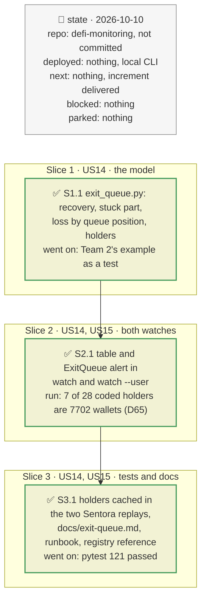

# Exit queue: a depositor's place in a run on a vault, plan

> **Status**: approved: the person, 2026-10-10, "Implement 1 now, don't forget to write documentation which explain what you build" (item 1 of the recommendation after the M3 discussion: the run / queue model of `comparison_team.md` §5). No interview: the decisions below are the agent's defaults.
> **Delivers**: for every Vault V2 deposit a watch follows, the depositor sees what it recovers at par and what stays stuck at four queue positions (first out, behind the contract holders, behind a share φ of the others, last), and its loss at each position for the unrealised bad debt now and for every collateral falling 2, 5, 10 or 20 % at once, against the pro-rata loss and a last-out bound. An `ExitQueue` alert fires when half the position would be stuck behind the contract holders. Proof: the start-up table on the recorded Sentora range; Team 2's worked example as a test.
> **Hard rule**: no new provider (the Morpho API and the RPC already used); the existing alerts keep their meaning; the agent never commits.
> **Read against**: `defi-monitoring` working tree; `teammate/team2.md` "Run / queue model" and "Breaking down exit cost"; `teammate/team1.md` (exit-liquidity model in the 7 necessary components); vault-v2 `d992cb84` (`forceDeallocate`, `MAX_FORCE_DEALLOCATE_PENALTY` = 2 %); Morpho API `vaultV2ByAddress.positions` probed 2026-10-10: 342 holders, the first 100 hold 99.4 % of Sentora's shares; EIP-7702 (delegated wallets return `0xef0100…` code).
> **Left out**: §4 Flows and §5 State: those of the watcher plans, with the additions of §3.

## The tracker

Phasing diagram: the slices in order, and what each has to show before the next one starts.

mandate: mode classic · no git, the person commits · inline · tests at the slice end · verify off

# Design

## 1. Why, and why not

For a lending vault, exiting is a withdrawal at par while liquidity lasts; the cost in a crisis is the race for that liquidity (Team 2). Bad debt is in the share price only once Blue writes it off, so exiting early is rational, and the loss lands on whoever is still in the vault. The watches showed the exit capacity and the unrealised bad debt, but not what happens when other depositors compete for the same liquidity.

**Stories**
- **US14**, vault depositor: see how much of my position gets out at par, and what I lose, depending on how many others leave before me. *Acceptance*: the start-up table shows four queue positions and five loss cases; Team 2's example (pro rata 4.5 %, first out 0 %, behind the first 20M 5.6 %, last out 30 %) passes as a test.
- **US15**, vault depositor: be told when most of my position would be stuck behind the fast holders. *Acceptance*: a rule test fires warn, then critical once unrealised bad debt appears, each once.

**Non-goals**: liquidity added during the run (repayments, reallocations, new deposits); the Public Allocator; the fixed-oracle drain threshold d\*; MEV ordering; Vault V1.

## 3. Modules, after

**`exit_queue.py`**, new. Pure: `exit_at`, `loss_rate`, `depositor_loss`, `pro_rata_loss`, `last_out_loss`, `queue_points`, `loss_cases`, `vault_cases`, `alert_point`, `assess`, `table`. I/O: `holders(f, vault, total_assets, total_supply)` (Morpho API, then `eth_getCode` in one batch). `VaultExit` holds the holders and the alert state for one vault and depositor.

With A the depositor's assets, T the vault's total, W = W_plain + W_forced and q the other depositors' assets ahead:
- recovered at par $R(q) = \min(A, \max(0, W - q))$, plain liquidity first, the forced part paying the penalty;
- stuck $S(q) = A - R(q)$;
- loss $S(q) \cdot \min(1, L / (T - W))$ + penalty; pro rata $A L / T$; last out later $\min(A, X) \cdot L / X$.

**`watch.py`** and **`watch_user.py`** build one `VaultExit` per vault after the curve table, print its table at start, and call `step` every batch (holders re-read on the 300-block refresh).

## 8. Decisions

| id | Kind | Decision | Status | Source | Slice |
|---|---|---|---|---|---|
| D62 | module | A new module `exit_queue.py`, pure model plus one I/O function, wired into both watches like `market_risk` | agreed, agent's default | — | S1 |
| D63 | contract | The run drains everything that can leave (W) before the write-off: the loss falls on T − W. Worst case for a holder who stays; liquidity added during the run is only in the "last out, later" bound | agreed, agent's default | Team 2, "Run / queue model" | S1 |
| D64 | contract | Queue positions: first out; behind every contract holder except the depositor; behind φ × the others (`exit_queue_phi`, 0.5); last. Holders from the Morpho API's first page of 100 (99.4 % of Sentora); the unlisted rest counts as slow | agreed, agent's default | probe: 342 holders, first 100 = 99.4 % of shares | S1 |
| D65 | module | Contract = `eth_getCode` non-empty and not an EIP-7702 delegation (`0xef0100…`); read at `latest`, since code rarely changes and the free RPC serves no old state | agreed, found in S2: 7 of the 28 coded Sentora holders are delegated wallets | live run | S2 |
| D66 | contract | `ExitQueue`: warn when ≥ `exit_queue_stuck_warn` (50 %) of the position is stuck behind the contract holders (behind φ of the others when holders are unknown); critical when, in addition, the vault carries unrealised bad debt; on crossing | agreed, agent's default | registry `watch.exit_queue_stuck_warn` | S2 |
| D67 | contract | Loss cases: the unrealised bad debt now, and every collateral falling by each curve step (2, 5, 10, 20 %) at once, from `market_risk` (D50); named scenarios stay with `analyze --vault` (comparison §4.3) | agreed, agent's default | — | S1 |

# Execution

## 9. The slices

| Slice | Done when | Went on |
|---|---|---|
| S1 | the model passes Team 2's example | — |
| S2 | the table and the alert appear in both replays | the depositor was counted among the contracts in the coverage line; EIP-7702 wallets were counted as contracts (D65) |
| S3 | holders cached in the vault replay and `user-0xb03d…`, 121 tests pass, docs written | — |

## Interview log

No interview: the person asked for implementation after the M3 discussion (Kyber, slippage) in which this item was recommended first, because both teams' feedback points to the queue, not slippage, as a depositor's main exit cost.
