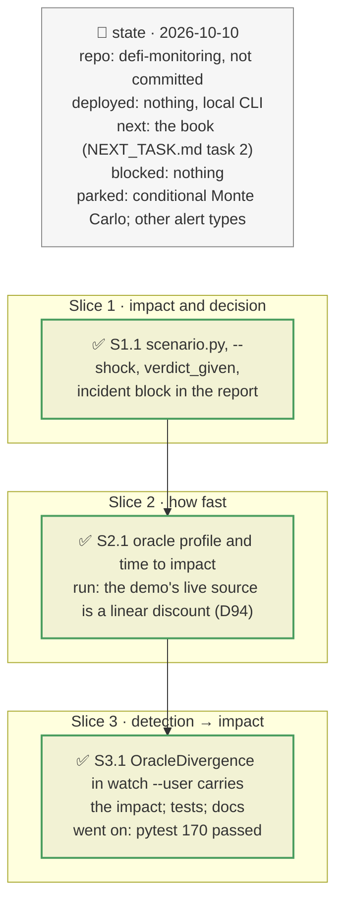

# Incident mode: a known incident, its impact, how fast, and what to do, plan

> **Status**: approved: the person, 2026-10-10, "Yes implement it (update the next task file and implement)", for steps 1–3 of `ANALYSIS_CURRENT.md` §7. No interview: the decisions below are the agent's defaults.
> **Delivers**: `analyze --shock EVENT=SEVERITY` computes, for a given incident, the position's loss, whether it is liquidated, how long before the oracle passes the shock on, and a verdict with the incident certain (STAY / REDUCE / EXIT), next to the ex-ante Monte Carlo. A meta-oracle's two sources are classified, and the impact after its switch is shown. In `watch --user`, an `OracleDivergence` alert on a borrowed market carries the impact on that borrow and the time to impact. Proof: the demo with `--shock oracle=0.10` and `--shock issuer_depeg=0.08`; tests on synthetic alerts.
> **Hard rule**: no new provider (the RPC and the optional Etherscan key already used); the ex-ante analysis keeps its behaviour; the agent never commits.
> **Read against**: `defi-monitoring` after the merge of plan `2026-10-10-sibling-markets`; `ANALYSIS_CURRENT.md` (the brief as detect → impact → how fast → decide); `oracle_class.py` (D82–D84); the demo oracle's verified source, `MetaOracleDeviationTimelock` (D68).
> **Left out**: §4 Flows and §5 State: incident mode is a one-shot computation; the watches keep their state as before.

## The tracker

mandate: mode classic · no git, the person commits · inline · tests at the slice end · verify off

# Design

## 1. Why, and why not

The brief asks what a known incident does to a position, how fast, and whether to exit. `analyze` answered only an unconditional question (an expected loss over 30 days from yearly probabilities), and the watches' alerts said what happened but not what it costs (`ANALYSIS_CURRENT.md`, `GAP.md` K20, K22).

**Non-goals**: the conditional Monte Carlo around an incident; the book; alert types other than `OracleDivergence`; vault deposits (the vault watch's `DrainWindow` and `ExitQueue` already carry their own impact).

## 3. Modules, after

- **`scenario.py`**, new. Pure: `parse_shocks`, `time_to_impact`, `oracle_mode_for`, `alert_impact`, `alert_sentence`, `enrich_divergence`. I/O: `oracle_profile`. `assess` combines them for an `analyze` position.
- **`decide.py`**: pure `verdict_given(loss, exit_cost, reduction_cost, loss_after_reduction)`.
- **`oracle_class.py`**: `classify_market_oracle(f, oracle, block)`, the market-oracle classification moved out of `graph._oracle` unchanged, so `scenario` can reuse it; `graph.py` calls it.
- **`cli.py`**: `--shock`, repeatable; the incident block printed before the ex-ante verdict.
- **`report.py`**: an "Incident" section above the ex-ante one; an `incident` key in `report.json`.
- **`watch_user.py`**: profiles of the borrowed markets' oracles at start; `enrich_divergence` on the admin alerts at start and every batch.

## 8. Decisions

| id | Kind | Decision | Status | Source | Slice |
|---|---|---|---|---|---|
| D89 | contract | `--shock EVENT=SEVERITY`, repeatable, with the six events `propagate.loss` handles; the impact is `propagate.loss` with those shocks, the rule the Monte Carlo applies to each path. The ex-ante analysis still runs and is shown after the incident | agreed, agent's default | `ANALYSIS_CURRENT.md` §7 | S1 |
| D90 | contract | Verdict with the incident certain, no probability: REDUCE if a partial sale plus the loss it leaves costs less than both staying and exiting; else EXIT if staying loses more than exiting costs; else STAY. The sale puts liquidation `incident.reduce_margin` (1 point) beyond the incident's oracle drop | agreed, agent's default | registry `incident.reduce_margin` | S1 |
| D91 | contract | Time to impact by oracle type: an oracle shock, an exploit of the issuer or the Pendle SY, or a lending exploit act now; a depeg reaches a feed at its next update, a Pendle TWAP after about its window, a constant-price oracle never; a meta-oracle through its live source, and its other source only after the challenge timelock | agreed, agent's default | `oracle_class.py`, meta-oracle getters | S2 |
| D92 | contract | The propagation mode of an incident comes from the oracle's class when it decides (price-tracking → market-tracking, constant-price → fundamental), a meta-oracle through its live source; otherwise `analyze`'s price inference | agreed, agent's default | `GAP.md` K7 | S2 |
| D93 | contract | Detection → impact: an `OracleDivergence` alert on a market the user borrows from carries the impact on that borrow (`alert_impact`): oracle above the market, the collateral's value at the market price with no liquidation until the oracle follows; oracle below, a liquidation at the oracle's price. `depositor_impact` is minus the loss; the detail gives the time to impact | agreed, agent's default | — | S3 |
| S4 | the demo's oracle mode comes from its structure; divergence checked every batch; 173 tests pass | the demo's numbers did not change: the meta-oracle's switch falls within the horizon |
| D94 | contract | A meta-oracle whose live source does not follow the market and whose other source does: a depeg above its deviation threshold also gets an "after the switch" impact, and the verdict counts that one, with the timelock as the time left to act | agreed, found in S2: the demo's live source is a Pendle linear-discount oracle and its backup reads `USDe / USD`, so a depeg liquidates nothing for 16 h and everything after | live read 2026-10-10 | S2 |
| D95 | module | A partial-sale quote that cannot be fetched (offline, or the API down) falls back to the full quote scaled to the sale, and says so | agreed, agent's default | — | S1 |
| D96 | contract | The ex-ante simulation takes the oracle mode from the oracle's structure when it decides (`scenario.ex_ante_mode`): price-tracking and constant-price inputs directly; a meta-oracle through its live source, or market-tracking when its other source follows the market and its switch falls within the horizon. Otherwise the price inference stays. The demo keeps market-tracking, now on that basis, and loses its *ambiguous* flag | agreed, found after S2 | `ANALYSIS_CURRENT.md`, the demo oracle's structure | S4 |
| D97 | contract | `OracleDivergence` is also checked every batch, from the oracle prices the watch already read and DefiLlama prices at most `divergence_check_every_blocks` (25) old, shared with the drain check; it was only at the 300-block refresh | agreed, agent's default | registry `watch.divergence_check_every_blocks`; USR fell 97 % in 17 min | S4 |

# Execution

## 9. The slices

| Slice | Done when | Went on |
|---|---|---|
| S1 | `--shock oracle=0.10` gives the impact and a verdict on the demo, offline | — |
| S2 | the time to impact appears for the demo oracle | the demo oracle's live source is a linear discount, while `analyze`'s inference reads it as market-tracking (ambiguous); D94 added |
| S3 | an `OracleDivergence` alert on a borrowed market carries the impact; 170 tests pass | the meta-oracle getters and the incident quotes were recorded into `fixtures/snapshot/` with one `--live` run |

## Interview log

No interview: the person approved implementing steps 1–3 of `ANALYSIS_CURRENT.md` §7 after the discussion on whether the Monte Carlo answers the brief.
