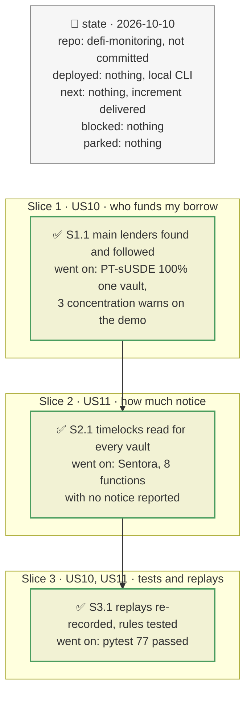

# Lender concentration and timelock lengths, plan

> **Status**: approved: the person, 2026-10-10, "Implement wacht user", after the proposal of R4 + G1 as the next increment of `watch --user`
> **Delivers**: `watch --user` knows who funds each borrowed market and alerts when a main lender withdraws or when one lender dominates (gap R4 of `docs/analysis/ANALYSIS_MONITORING.md`); every vault watched, by `watch --vault` or `watch --user`, has its timelocks read at start, flags the risk-increasing functions that can change with no notice, and raises a pending change with no notice to critical (gap G1). Proof: on the demo borrower, the PT-sUSDE market is reported as 100 % funded by one vault; on Sentora RLUSD Main, the 8 risk-increasing functions with a zero timelock (including `setPerformanceFee`, `setIsAllocator` and `setForceDeallocatePenalty`) are reported; each new rule fires in a test.
> **Hard rule**: the existing alerts keep their meaning; the agent never commits.
> **Read against**: `defi-monitoring` working tree, vault-v2 `d992cb84` (`timelock(bytes4)`, `abdicated(bytes4)`, `submit` reads `timelock[selector]`), probes of 2026-10-10.
> **Left out**: §4 Flows and §5 State are those of `2026-10-10-morpho-user-watcher.plan.md`, unchanged except as stated in §3.

## The tracker

Phasing diagram: the slices in order, and what each has to show before the next one starts.

mandate: mode classic · no git, the person commits · inline · tests at the slice end · verify off

# Design

## 1. Why, and why not

A borrow is only as stable as the liquidity under it. When one vault funds most of a market and its allocator moves that liquidity elsewhere, which needs no timelock, utilisation jumps and the borrow rate climbs towards four times its target. On the demo borrower, the PT-sUSDE market (3.41M USDC of debt) is funded 100 % by one Vault V2. Separately, a vault's `Submit` is a warning only as long as the function's timelock, and on Sentora RLUSD Main three functions have none.

**Stories**
- **US10**, borrower: see who funds each of my markets and be told when a main lender withdraws. *Acceptance*: the startup table names each market's main lenders and their share; a Blue `Withdraw` by a main lender of ≥ 5 % of the market's supply raises a warn with the new utilisation; a market with one lender at ≥ 50 % raises a warn at start.
- **US11**, depositor: know how much notice each kind of change gives, and be told when a change is pending with none. *Acceptance*: the timelocks are printed at start; risk-increasing functions with a zero timelock that are not abdicated raise a warn; a `Submit` for such a function is critical.

**Non-goals**: following the main lenders' own vaults (their allocations, their curators); lender concentration for direct Blue supply positions.

## 3. Modules, after

- **`borrower.top_suppliers(f, market, block) -> list[Supplier]`**: the market's main suppliers, moved here from `graph.py`, which now calls it. Top 5 by supply shares from the Morpho API, amounts on-chain, an adapter resolved to its vault with `parentVault()`, a Vault V1 identified with `MORPHO()` and `withdrawQueueLength()`. Keeps suppliers with ≥ 5 % of supply.
- **`borrower_rules`**: `lenders_startup(...)` (concentration) and a `Withdraw` rule in `assess_events` for the tracked lenders.
- **`vault.discover_vault`** reads `timelock(bytes4)` and `abdicated(bytes4)` for every timelocked selector of the vault and of each market adapter, into `VaultView.timelocks`.
- **`rules.startup_findings`** reports the zero timelocks; the `Submit` rule looks up the selector's timelock.
- **`watch_user`** finds the lenders at start and every 300 blocks; **`watch`** prints the timelocks in the exposure table.

## 8. Decisions

| id | Kind | Decision | Status | Source | Slice |
|---|---|---|---|---|---|
| D41 | contract | A main lender is a supplier with ≥ 5 % of a market's supply, up to 5 per market, refreshed every 300 blocks | agreed, agent's default (same rule as the graph) | — | S1 |
| D42 | contract | Concentration: warn at start when one lender holds ≥ 50 % of a borrowed market | agreed, agent's default | registry `watch.lender_concentration_warn` | S1 |
| D43 | contract | Withdrawal: warn on a Blue `Withdraw` whose `onBehalf` is a main lender and whose amount is ≥ 5 % of the market's supply before it | agreed, agent's default | registry `watch.lender_withdraw_min_share` | S1 |
| D44 | contract | Risk-increasing timelocked functions: `addAdapter`, `increaseAbsoluteCap`, `increaseRelativeCap`, the four gate setters, `setAdapterRegistry`, `setPerformanceFee`, `setManagementFee`, `setPerformanceFeeRecipient`, `setManagementFeeRecipient`, `setIsAllocator`, `setForceDeallocatePenalty`, and the adapter's `burnShares` and `setSkimRecipient`. A zero timelock on one that is not abdicated is a warn at start; a `Submit` for it is critical. `decreaseTimelock` is excluded: its delay is the timelock of the function it decreases | agreed, agent's default | vault-v2 `d992cb84` | S2 |

# Execution

## 9. The slices

**S1, who funds my borrow** · US10 · check: demo PT-sUSDE shown 100 % funded by one vault; withdrawal and concentration rules tested.
**S2, how much notice** · US11 · check: Sentora's zero timelocks reported; `Submit` with no notice is critical in a test.
**S3, tests and replays** · US10, US11 · check: replays re-recorded with the new reads; `pytest` exits 0.

## Interview log

No new question: the increment was proposed as R4 + G1 and the person answered "Implement wacht user".
