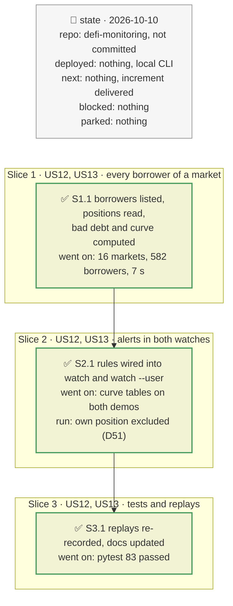

# Every borrower of the watched markets: unrealised bad debt and liquidation curves, plan

> **Status**: approved: the person, 2026-10-10, "Implement C1 and G2". The interview was skipped at the person's request; every decision below is the agent's recommended default and can be revisited.
> **Delivers**: for every market a watch follows (a vault's markets, a user's borrowed markets), the tool knows every borrower, computes on each batch the debt that is underwater but not yet written off (gap C1) and the market's liquidation curve, i.e. how much debt a 2, 5, 10 or 20 % oracle fall would make liquidatable (gap G2), and alerts on both. Proof: on the recorded ranges, the startup table shows the curve of each of the 16 demo markets; each rule fires in a test.
> **Hard rule**: the existing alerts keep their meaning; the agent never commits.
> **Read against**: `defi-monitoring` working tree; morpho-blue `8e26ca6a` (liquidation, `LIF`, shares maths); Morpho API `marketPositions` probed 2026-10-10: 582 borrowers across the 16 demo markets, at most 231 in one market, all in one page each.
> **Left out**: §4 Flows and §5 State are those of the watcher plans, with the additions of §3.

## The tracker

Phasing diagram: the slices in order, and what each has to show before the next one starts.

mandate: mode classic · no git, the person commits · inline · tests at the slice end · verify off

# Design

## 1. Why, and why not

A vault depositor's loss starts when a borrower in one of the vault's markets goes underwater, but Blue records it only when the liquidation writes off the bad debt. Depositors who exit in between leave the loss to those who stay. A borrower's risk, for its part, depends on what the other borrowers of its market will sell if the price falls: many positions liquidatable at a 5 % fall means a cascade.

**Stories**
- **US12**, vault depositor: be told when a market the vault supplies holds unrealised bad debt, with the vault's share and mine. *Acceptance*: a rule test fires warn and critical at the thresholds; the startup table shows each market's unrealised bad debt.
- **US13**, depositor or borrower: see each watched market's liquidation curve and be told when it becomes steep. *Acceptance*: the startup table shows the debt liquidatable at −2, −5, −10 and −20 %; a market where a 5 % fall makes ≥ 25 % of its debt liquidatable raises a warn.

**Non-goals**: simulating the cascade's price impact on the collateral; markets the watch does not follow; pre-liquidation contracts.

## 3. Modules, after

**`market_risk.py`**, new:
- `list_borrowers(f, market_id)`: the market's borrowers from the Morpho API (`marketPositions`, `borrowShares_gte: 1`, pages of 1,000).
- `class Tracker`: holds the borrowers' positions per market, read on-chain (`position`, `market`) in chunks of 200 calls. `refresh(f, block)` re-reads everything; `update(f, events, block)` re-reads only the positions a batch's Blue events touched (`Borrow`, `Repay`, `SupplyCollateral`, `WithdrawCollateral`, `Liquidate`); `compute(prices) -> dict[id, MarketRisk]` values every position at the batch's oracle prices.
- `MarketRisk`: borrower count, debt liquidatable now, unrealised bad debt, and the curve.
- Pure rules `assess_vault_bad_debt(...)` and `assess_curves(...)`.

For one position with collateral value $v$ at the oracle price and debt $D$, at an oracle fall $d$:
- liquidatable when $v (1 - d) \cdot \text{LLTV} < D$;
- bad debt $\max(0, D - v (1 - d) / \text{LIF})$, since a liquidator repays at most the collateral's value divided by the incentive factor.

**`watch.py`** and **`watch_user.py`** build one tracker over their markets, refresh it at start and every 300 blocks, update it each batch, print the curve table at start, and apply the rules.

## 8. Decisions

| id | Kind | Decision | Status | Source | Slice |
|---|---|---|---|---|---|
| D45 | module | Borrowers listed by the Morpho API (`marketPositions`, `borrowShares_gte: 1`), positions and market totals read on-chain. The chain alone would need log scans the free RPC refuses beyond recent blocks | agreed, agent's default | probe: 582 borrowers, ≤ 1 page per market | S1 |
| D46 | module | Full refresh at start and every 300 blocks; between refreshes, positions touched by a batch's Blue events are re-read, and every position is revalued each batch at the oracle price the watch already reads | agreed, agent's default | — | S1 |
| D47 | purpose | Markets: every market of a watched vault with a non-zero allocation, and every market the user borrows from | agreed, agent's default | — | S1 |
| D48 | contract | Unrealised bad debt, vault side: the vault's share (its share of the market's supply × the market's unrealised bad debt) as a fraction of the vault's total assets; warn from 0.01 %, critical from 0.1 %, on crossing; the depositor's share in `depositor_impact` | agreed, agent's default | registry `watch.unrealised_bad_debt_warn` / `_critical` | S2 |
| D49 | contract | Steep curve: warn when the debt liquidatable at a 5 % oracle fall is ≥ 25 % of the market's borrows, on crossing; for vault markets only above `utilization_min_share` of the vault | agreed, agent's default | registry `watch.curve_drop`, `watch.curve_warn_share` | S2 |
| D51 | module | A borrower's own position is excluded from the curves of its borrowed markets, which show the other borrowers only; markets where a vault holds less than one whole token are not followed | agreed, found in S2: the demo borrower otherwise dominated its own market's curve | live run | S2 |
| D50 | contract | Curve points −2, −5, −10, −20 %; amounts in the loan token | agreed, agent's default | — | S1 |

# Execution

## 9. The slices

**S1, every borrower of a market** · US12, US13 · check: all 16 demo markets listed, read and computed.
**S2, alerts in both watches** · US12, US13 · check: the startup curve table is printed by `watch` and `watch --user`; each rule fires in a test.
**S3, tests and replays** · check: replays re-recorded, runbook and registry reference updated, `pytest` exits 0.

## Interview log

No interview: the person asked to implement directly ("Implement C1 and G2"). The four questions that would have been asked are answered by D45 to D49 with the recommended option.
