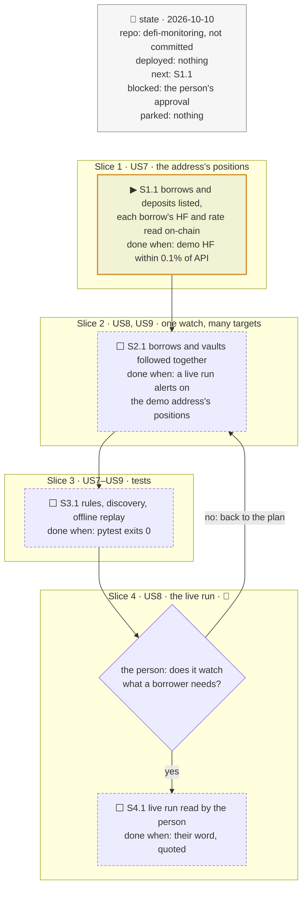
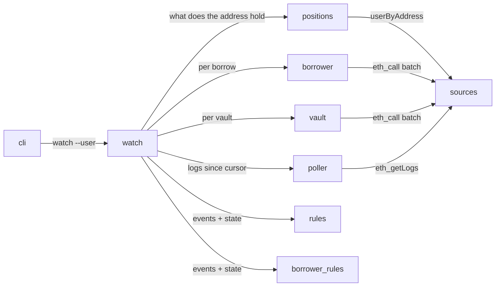
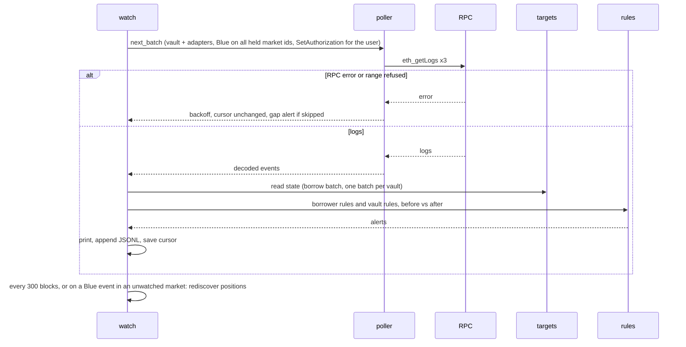

# Watch an address: Morpho borrows and Vault V2 deposits, plan

> **Status**: draft, waiting for the person's approval
> **Delivers**: `python -m riskdep watch --user <address> [--hf 1.10,1.05,1.02]` finds every Morpho Blue borrow and every Vault V2 deposit of the address, then follows them block by block. For each borrow it alerts on the health factor crossing the chosen levels, a liquidation of the address, actions taken on its behalf, new authorisations, borrow-rate jumps and oracle moves; each V2 deposit is watched with the existing vault rules. Proof: on the demo borrower `0xdf81…2730` (6 borrows, 1 V2 deposit), the startup table shows each borrow's on-chain HF within 0.1 % of the Morpho API's, every rule fires on a synthetic event, and a recorded range replays offline.
> **Hard rule**: `watch --vault` and `analyze` behave as before; the agent never commits.
> **Read against**: `defi-monitoring` working tree (no commit yet), Morpho docs `charrette/lib/docs.morpho.org-developers-docs` (borrow/concepts/liquidation, contracts/irm), morpho-blue `8e26ca6a` and vault-v2 `d992cb84`; probes of 2026-10-10.
> **Libraries read from source**: none new.
> **Left out**: §7 *What ran* (the probes are in the interview log).

## The tracker

Phasing diagram: the slices in order, and what each has to show before the next one starts.



mandate: mode classic · no git, the person commits · inline · tests at the slice end · verify off

# Design

## 1. Why, and why not

A borrower on Morpho Blue loses money in ways a vault depositor does not: liquidation when the health factor reaches 1, a liquidation penalty of up to 15 % of the repaid debt, a borrow rate that can climb to four times its target when the market is fully used, and anyone the borrower authorised acting on the position. The same address often holds several borrows and a vault deposit, and checking each by hand is how a position gets liquidated unnoticed.

**Goals**
- The user gives one address; the tool finds what to watch.
- Every borrow is watched for liquidation distance, rate and actions on the position.
- Vault V2 deposits of the same address are watched with the existing vault rules, in the same run.

**Non-goals (this increment)**
- Direct Blue supply positions and Vault V1 deposits (D31).
- Exit quotes for collateral other than a Pendle PT (D34).
- Morpho's opt-in pre-liquidation contracts: their thresholds are not read. Authorising one emits `SetAuthorization`, which this increment does alert on.
- Acting on the position (repaying, adding collateral). The tool only alerts.

**Stories**
- **US7**, borrower: give my address and see every borrow (market, collateral, debt, HF, the oracle drop that liquidates me, borrow APY, utilisation) and every Vault V2 deposit, without looking up a market id. *Acceptance*: on `0xdf81…2730`, the startup table lists the 6 borrows and the Sentora vault deposit, and each HF matches the API within 0.1 %.
- **US8**, borrower: be told when my HF crosses 1.10, 1.05 and 1.02 (or my own levels), when I am liquidated, and when the rate jumps. *Acceptance*: each rule has a test that makes it fire, and a recovery above a level is reported once.
- **US9**, borrower: be told when someone else acts on my position or when I authorise a new address. *Acceptance*: a `Borrow`, `Repay`, `SupplyCollateral` or `WithdrawCollateral` with `onBehalf` = me and `caller` ≠ me raises a warn; a `SetAuthorization` with me as authorizer raises a warn.

## 2. Before and after

Before: `watch --vault` follows one vault for one depositor (`riskdep/watch.py`, `vault.py`, `rules.py`, `poller.py`). After:

| Existing | After |
|---|---|
| `watch --vault <v> [--user <a>]` | unchanged |
| — | `watch --user <a>` without `--vault`: discovery, then borrows and vaults watched together |
| `Poller(kinds, market_ids)`, two `eth_getLogs` filters | a third filter: Blue `SetAuthorization` with `topics[2]` = the address |
| `rules.assess_batch` for a vault | unchanged; a borrower rule set beside it |
| `watch.run` loop for one vault | the loop takes a list of targets, each with its view, state reader and rules |

## 3. Modules, after

Module map: who calls whom, answering where each kind of position is read.



**`positions`**: `discover_user(f, address) -> UserPositions` with `borrows: list[str]` (market ids with debt > 0) and `vaults: list[str]` (V2 vault addresses with shares > 0), from the Morpho API `userByAddress(address, chainId: 1)` (`marketPositions`, `vaultV2Positions`). The API is used only to find the positions (D32); everything monitored is read on-chain. Run again every 300 blocks, and at once when a Blue event with `onBehalf` = the address hits a market not yet watched.

**`borrower`**: `read_borrows(f, markets, user, block) -> dict[id, BorrowState]` in one JSON-RPC batch. Per market: `idToMarketParams` (once), `position(id, user)`, `market(id)`, oracle `price()`, and the IRM's `borrowRateView(marketParams, market)`. `BorrowState` gives:
- debt = borrowShares × (totalBorrowAssets + 1) / (totalBorrowShares + 10⁶);
- HF = collateral × price / 10³⁶ × LLTV / debt;
- liquidation drop = 1 − 1 / HF, the oracle fall that brings HF to 1;
- borrow APY = e^(rate × seconds per year) − 1;
- utilisation, and the PT exit quote where the collateral is a Pendle PT (D34).

**`borrower_rules`**: `assess_borrows(events, before, after, user, levels) -> list[Alert]`, pure. The rules are in §8 (D33, D35).

**`watch`**: `run_user(opts)` builds the targets (one `BorrowTarget` holding every borrow market, one `VaultTarget` per vault), merges their filters into one poller, reads every target's state once per batch, applies each target's rules, prints and appends alerts to `out/watch-user-<address>.jsonl`, and saves `out/watch-user-<address>.cursor` last.

## 4. Flows

Sequence diagram: one poll for `watch --user`, with its failure branches.



## 5. State and its writers

| State | Where | Writer |
|---|---|---|
| cursor | `out/watch-user-<address>.cursor` | `watch.run_user`, after the batch's alerts |
| alerts | `out/watch-user-<address>.jsonl` | `watch.run_user` |
| positions, last states, HF level reached per market | memory | `positions`, `borrower`, `vault` |
| replay fixtures | `data/replay/user-<address>/` | `watch --user --record` |

## 6. Failure modes

| What breaks | What the person sees |
|---|---|
| Morpho API down at start | the run stops: no positions can be found; `--market <id>` (repeatable) lists borrows by hand instead |
| Morpho API down at a rediscovery | a warning; the positions already found keep being watched |
| oracle `price()` reverts | that borrow's HF is shown as unknown and a warn alert is raised: Blue cannot liquidate or let the borrower withdraw collateral either |
| `borrowRateView` reverts (non-standard IRM) | the rate is shown as unknown, the rate rules are skipped for that market |
| the address has no borrow and no V2 deposit | a message saying so, exit code 0 |

## 8. Decisions

| id | Kind | Decision | Status | Source | Slice |
|---|---|---|---|---|---|
| D31 | purpose | `watch --user` covers every Blue borrow (debt > 0) and every Vault V2 deposit of the address; direct Blue supply and V1 deposits are later increments | agreed | the person, Q8 | S1 |
| D32 | module | Positions found through the Morpho API `userByAddress` (`marketPositions`, `vaultV2Positions`), probed 2026-10-10; all monitored values read on-chain. Discovering positions from the chain alone would need archive log scans the free RPC refuses | agreed, agent's default | probes | S1 |
| D33 | contract | HF levels default to 1.10 (info), 1.05 (warn), 1.02 (critical), overridable with `--hf a,b,c`; an alert fires when the HF crosses a level downwards, and once when it recovers above the first level. 1.10 is the alert level Morpho's liquidation guide suggests; liquidation starts at HF ≤ 1 | agreed | the person, Q9; docs borrow/concepts/liquidation | S2 |
| D34 | purpose | Exit cost is quoted only for Pendle PT collateral (existing Pendle quote, at start and every 300 blocks); other collateral shows "not quoted" | agreed | the person, Q11 | S1 |
| D35 | contract | Rate rules: the IRM's `borrowRateView` is read every batch; warn when the borrow APY is 50 % above its value at the start of the run, or when utilisation reaches 99 % (the AdaptiveCurveIRM rate reaches 4 × its target at 100 %, per the docs) | agreed | the person, Q10; docs contracts/irm | S2 |
| D36 | contract | Events on the position: `Liquidate` with `borrower` = the address → critical, with repaid and seized amounts and any bad debt; `Borrow`, `Repay`, `SupplyCollateral`, `WithdrawCollateral` with `onBehalf` = the address and `caller` ≠ it → warn; `SetAuthorization` with `authorizer` = the address → warn (a third `eth_getLogs` filter on `topics[2]`) | agreed, agent's default | morpho-blue `EventsLib.sol` at `8e26ca6a` | S2 |
| D37 | module | The HF is computed on-chain from `position`, `market`, the oracle `price()` (scale 10³⁶) and the LLTV, the way Blue does; probed on the demo borrower: 1.0535 on-chain vs 1.0533 API, borrow APY 3.7447 % vs 3.7446 % | agreed, verified 2026-10-10 | probe | S1 |
| D38 | clarification | Mode classic, as the two earlier plans | agreed, carried over from Q4 | — | — |

# Execution

## 9. The slices

**S1, the address's positions** · US7 · blocked by approval · check: on `0xdf81…2730`, 6 borrows and 1 V2 vault listed, each HF within 0.1 % of the API's.
**S2, one watch, many targets** · US8, US9 · blocked by S1 · check: a live run on the demo address prints the startup table and polls; each borrower rule fires on a synthetic event.
**S3, tests** · US7–US9 · blocked by S2 · check: `pytest` exits 0, including an offline replay of a recorded range for the demo address.
**S4, the live run** · 👤 · US8 · done when the person has read a live run on their address.

## 10. The mandate

```
mode: classic
pace: run through (no pull requests: the person commits)
steps: inline
tests: at the slice end
verify: off
```

## Interview log

**Q8. Which of the address's positions should `watch --user` cover?** Options: borrows + V2 deposits (recommended) · everything (adds direct Blue supply and V1) · Blue borrows only. **Answer**: "Borrows + V2 deposits (Recommended)".

**Q9. How should health-factor alerts be set?** Options: 1.10 / 1.05 / 1.02, overridable (recommended) · one threshold 1.10 · price-distance based. **Answer**: "1.10 / 1.05 / 1.02, overridable (Recommended)".

**Q10. How should the borrow rate be watched?** Options: jumps + utilisation (recommended) · absolute APY threshold · not in this increment. **Answer**: "Jumps + utilisation (Recommended)".

**Q11. Exit cost for collateral that is not a Pendle PT?** Options: PT only, others not quoted (recommended) · keyless aggregator quote. **Answer**: "PT only, others not quoted (Recommended)".

Probes, 2026-10-10: Morpho API `userByAddress` exposes `marketPositions`, `vaultPositions` and `vaultV2Positions`; `0xdf81…2730` has 12 market positions, 6 with debt (PST, PT-reUSD ×2, sUSDS, PT-sUSDE, PT-fxSAVE collateral), and 1 V2 position; `0xb03d…babc` has only the Sentora RLUSD Main deposit. On-chain HF of `0xdf81…2730` on the PT-sUSDE-26NOV2026/USDC market: 1.0535 (API 1.0533); `borrowRateView` on the AdaptiveCurveIRM `0x870a…00bc`: 3.7447 % APY (API 3.7446 %). Morpho liquidation guide: liquidation at HF ≤ 1, suggested alert below 1.1. IRM doc: target utilisation 90 %, rate 4 × target at 100 %.
