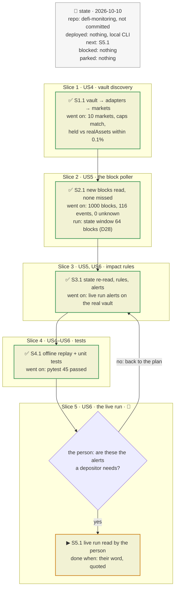
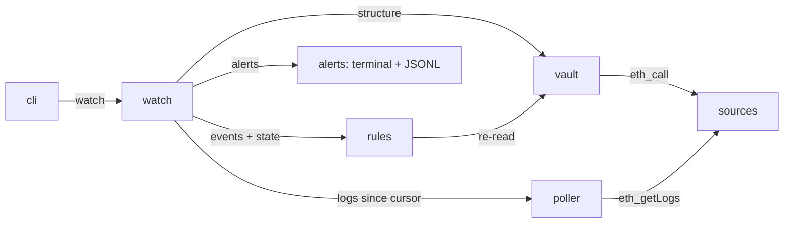
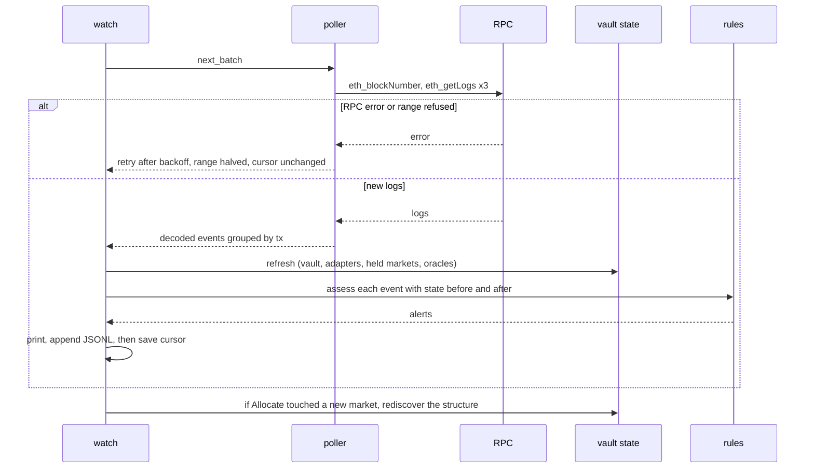

# Morpho Vault V2 watcher, plan

> **Status**: approved: the person, 2026-10-10, "Now start the implement part in defi-monitoring. I will perform myseulf the commit"; D23 taken as proposed
> **Delivers**: `python -m riskdep watch --vault <V2 address> [--user <addr>]` polls the free Ethereum RPC every block, keeps only the transactions that touch the vault, its adapters or the Blue markets it holds, re-reads the state they changed, and prints one alert line per relevant transaction (also appended to `out/watch-<vault>.jsonl`) saying what changed for the depositor. Proof: a replay of a recorded block range gives the expected alerts offline, and a live run on Sentora RLUSD Main prints its alerts.
> **Hard rule**: the batch report (`analyze`, plan `2026-10-10-defi-risk-dependency`) stays as it is; the code lives in the `defi-monitoring` repository (D27); the person commits, the agent never does.
> **Read against**: Morpho docs `charrette/lib/docs.morpho.org-developers-docs` (contracts/morpho-vaults-v2, morpho-market-v1-adapter-v2, morpho-vault-v1-adapter, blue); event signatures from `EventsLib.sol` on the GitHub `main` branch of `morpho-blue`, `vault-v2` and `metamorpho-v1.1`, read 2026-10-10.
> **Libraries read from source**: as the first plan; no new dependency.
> **Left out**: §7 *What ran* (probes are in the interview log).

## The tracker

Phasing diagram: the slices in order, and what each has to show before the next one starts.



mandate: mode classic · no git, nothing committed · inline · tests at the slice end · verify off

# Design

## 1. Why, and why not

A Vault V2 depositor holds shares of a vault whose curator and allocators move the money
across adapters and, through them, across Blue markets with different collateral, oracles
and LLTVs. A loss reaches the depositor through bad debt in one of those markets, a fall
in the share price, a fee change, or a timelocked change of the vault itself. Exiting
depends on idle liquidity in the vault and in the markets. Today the depositor learns of
any of these after the fact.

**Goals**: see, block by block, each transaction that changes the depositor's exposure,
loss or exit, with what it changed. Use the timelock (`Submit` → `executableAt`) as an
early warning.

**Non-goals (this increment)**: Blue borrowers and suppliers outside a vault, Vault V1.1
depositors (a V1 vault held *through* a V2 adapter is shown as one opaque layer, D23), the
mempool, history older than what the free RPC serves, webhooks, a live HTML page.

**Stories**
- **US4**, depositor: give a V2 vault address and see its adapters, the markets each one holds (collateral, oracle, LLTV, utilisation), the vault's share in each, the caps, and the timelocks. *Acceptance*: for Sentora RLUSD Main, the 10 markets read on-chain with their allocation summing to the adapter's `realAssets`.
- **US5**, depositor: the watcher keeps up with the chain and never misses or double-counts a block. *Acceptance*: stopped and restarted, it resumes from its cursor; a range is processed once.
- **US6**, depositor: one alert line per relevant transaction, ranked info / warn / critical, saying what changed for me in assets. *Acceptance*: each rule of §3 has a test that makes it fire.

## 2. Before and after

Before: `riskdep` analyses one Blue borrower in batch (`analyze`). After: a second command,
`watch`, and four new modules. `sources` gains `get_logs` and a non-cached mode for the
poller; `analyze` is unchanged.

| Existing | Reused for |
|---|---|
| `sources.rpc`, `rpc_call` | every on-chain read; the poller bypasses the snapshot cache (live data) except in replay |
| `discover.REGISTRY`, issuer entries | labelling the collateral of each held market |
| `discover.infer_oracle` | oracle shape of each held market |

## 3. Modules, after

Module map: who calls whom, answering which module reaches the chain.



**`vault`**: `discover_vault(f, address) -> VaultView`, `refresh(f, view) -> VaultState`.
Reads `adaptersLength`/`adapters(i)`, `liquidityAdapter`, `totalAssets`, `totalSupply`,
fees, `maxRate`. For a `MorphoMarketV1AdapterV2`: `marketIds(i)`, `realAssets`,
`idToMarketParams`, Blue `market(id)` and `position(id, adapter)`, so each market gives the
vault's supplied assets, utilisation and withdrawable liquidity. Caps read for the 3 ids the
adapter registers (adapter, `collateralToken`, `this/marketParams`). The adapter type is
told apart on-chain (`marketIdsLength()` answers → market adapter; `morphoVaultV1()` answers
→ V1 adapter); the Morpho API's `adapters{type}` is a cross-check, not the source.

**`poller`**: `Poller(f, filters, cursor_path, confirmations=2, max_range=500)`,
`next_batch() -> list[Log]`. One `eth_getLogs` per filter per batch: the vault address; the
adapters; Morpho Blue with `topics[1]` = the held market ids. The cursor (last processed
block) lives in `out/watch-<vault>.cursor`; it stays `confirmations` blocks behind the head
so a one-block reorg is not seen. The free node refuses old ranges ("archive requests
require a token"): the first run starts at the head minus one batch. Decodes with the event
signatures of §8 D19.

**`rules`**: `assess(event, before, after, depositor) -> Alert | None`. Pure: given the
decoded event and the state before and after, it returns the alert. The rules:

| Event (contract) | Rule | Level |
|---|---|---|
| `Liquidate` with `badDebtAssets > 0` (Blue, held market) | the vault's share of the bad debt = badDebt × adapter supply shares / market supply shares; the depositor's share via their vault shares | critical |
| `AccrueInterest` (vault) with `newTotalAssets < previousTotalAssets` | share price fell: loss in assets for the depositor | critical |
| `Submit` (vault or adapter) | decode the selector (table in D20) → what will change and when (`executableAt`); `addAdapter`, `increase*Cap`, `setAdapterRegistry`, gates, fees, `decreaseTimelock` | warn |
| `Accept` / direct execution of a timelocked call | the change is now live | warn |
| `Revoke` | a pending change was cancelled | info |
| `Allocate` / `Deallocate` | exposure moved: new share per market and per collateral | info, warn if a market's share passes 25 % |
| `ForceDeallocate` | someone pulled liquidity, with the penalty | warn |
| `SetLiquidityAdapterAndData` | where deposits/withdrawals now go | warn |
| `Withdraw`/`Borrow` (Blue, held market) | utilisation ≥ 99 % on a market with ≥ 10 % of the vault, or the depositor's assets exceed the withdrawable total | warn |
| `Decrease*Cap`, `RemoveAdapter` | exposure reduced | info |
| every poll | the oracle `price()` of each held market moved more than 5 % since the last poll | warn |

**`watch`**: the loop. Startup: discover, read state, print the exposure table. Each poll:
the batch of logs grouped by transaction; state re-read once per batch if any log is
relevant; rules per log; alerts printed and appended to the JSONL; cursor saved last, so a
crash replays the batch rather than skipping it.

## 4. Flows

Sequence diagram: one poll, with its failure branches.



## 5. State and its writers

| State | Where | Writer |
|---|---|---|
| cursor | `out/watch-<vault>.cursor` | `watch`, after the batch's alerts are written |
| alerts | `out/watch-<vault>.jsonl` | `watch` |
| vault structure and last state | memory | `vault.discover_vault`, `vault.refresh` |
| replay fixtures | `data/replay/` | the `--record` flag of `watch` |

## 6. Failure modes

| What breaks | What the person sees |
|---|---|
| RPC down | one warning line per failed poll, backoff to 60 s, no cursor move |
| range too large / archive refused | range halved; at the start, the watch begins from the head |
| unknown adapter type | the adapter is listed as *opaque*, its events still alerted, no per-market view |
| V1 vault held through `MorphoVaultV1Adapter` | one opaque layer with its `lostAssets`, as the docs say V1.1 does not realise bad debt (D23) |
| reorg deeper than 2 blocks | not handled: an alert may refer to a dropped transaction (stated in the README) |

## 8. Decisions

| id | Kind | Decision | Status | Source | Slice |
|---|---|---|---|---|---|
| D18 | purpose | Increment 2 covers the Vault V2 depositor only; Blue borrower/supplier and V1.1 depositors are later increments | agreed | the person, Q5 | all |
| D19 | contract | Events decoded from `EventsLib.sol` (`main`) of morpho-blue, vault-v2, metamorpho-v1.1, not from the docs (which list none) | agreed, agent's default | GitHub, 2026-10-10 | S2 |
| D20 | contract | Timelock selectors decoded with the table of `contracts/morpho-vaults-v2.md` and the adapter's (`setSkimRecipient`, `burnShares`) | agreed, agent's default | local docs | S3 |
| D21 | architecture | Poll the free RPC (`eth_blockNumber` + `eth_getLogs`), 2 confirmations, 12 s period, ≤ 500 blocks a batch | agreed | the person, Q6 | S2 |
| D22 | architecture | Alerts: terminal + `out/watch-<vault>.jsonl`, one line per relevant transaction | agreed | the person, Q7 | S3 |
| D23 | clarification | A V1 vault held through `MorphoVaultV1Adapter` is one opaque layer this increment (its markets not expanded) | agreed, approved with the plan | docs: V1.1 does not realise bad debt | S1 |
| D24 | module | The structure comes from on-chain reads; the Morpho API only cross-checks it and finds a default depositor (largest holder) when `--user` is not given | agreed, agent's default | probe: all reads answered on the free RPC | S1 |
| D25 | module | The depositor's exposure = their shares × `totalAssets / totalSupply`, split per market by the adapter's supplied assets; the V2 `max*` functions are not used (they return 0, per the docs) | agreed, agent's default | docs, morpho-vaults-v2 | S1 |
| D27 | clarification | Implementation in `charrette/defi-monitoring` (git repo, remote `rya-sge/defi-monitoring`), which receives a copy of the `riskdep` package, its tests, snapshot, docs and plans; `projet/` is left untouched; the person commits | agreed | the person, 2026-10-10 | all |
| D28 | module | State is read at the batch's last block, or at most 64 blocks behind the head: the free node's state window was measured at 126, then ~90 blocks, on 2026-10-10. Older batches use the oldest servable state; rules carried by the event's own data stay exact | agreed | probes | S2 |
| D29 | contract | Adapter getters and events from `IMorphoMarketV1AdapterV2.sol` / `IMorphoVaultV1Adapter.sol` (`main`): `supplyShares(id)`, `marketIds(i)`, `realAssets()`, adapter-side `Allocate(marketId, newAllocation, mintedShares)`, `BurnShares(marketId, supplyShares)` (a write-off: critical) | agreed | GitHub sources | S1 |
| D30 | module | Data cross-checks (`crosscheck.py`): block hash of the main RPC vs `eth.drpc.org` (fallback `1rpc.io`) → critical on difference; Morpho API vault total assets vs chain → warn beyond 0.5 %; at start and every 300 blocks; a check that cannot run says "not checked" | agreed, the person asked to close the implementation gaps, 2026-10-10 | probe: drpc and 1rpc answer keyless, llamarpc/cloudflare/ankr do not | S3 |
| D61 | module | A live batch with no event, no undecoded log, no gap and no refresh reads only what moves without an event: `totalAssets()`, asset `balanceOf(vault)`, each adapter's `realAssets()`, each oracle `price()`, the depositor's gates (`vault.read_light`); borrows re-read oracle prices only (`borrower.read_prices`). The full read of D28 runs on any event and at least every `full_state_every_blocks` (25). Replays and `--blocks` runs read in full, as recorded. Also applies to `watch --user` | agreed, the person, 2026-10-10 | measured: Sentora 104 → 15 calls per quiet batch, 13 → ~2 calls/s | — |
| D26 | module | Thresholds: market share warn 25 %, utilisation warn 99 % on a market ≥ 10 % of the vault, oracle move warn 5 % per poll; in `registry.json` | agreed, agent's default | — | S3 |

# Execution

## 9. The slices

**S1, vault discovery** · US4 · blocked by approval · check: Sentora RLUSD Main lists 10 markets, allocations sum to `realAssets`.
**S2, the block poller** · US5 · blocked by S1 · check: 1000 recent blocks decode, restart resumes from the cursor.
**S3, impact rules** · US5, US6 · blocked by S2 · check: every rule of §3 fires on a recorded or synthetic event.
**S4, tests** · US4–US6 · blocked by S3 · check: `pytest` exits 0, offline replay included.
**S5, the live run** · 👤 · US6 · done when the person has read a live run's alerts.

## 10. The mandate

```
mode: classic
pace: run through (no pull requests: no git)
steps: inline
tests: at the slice end
verify: off
```

## Interview log

**Q5. Which positions should the watcher cover?** Options: Vault V2 depositor (recommended) · Blue borrower · Blue supplier · Vault V1.1 depositor. **Answer**: "Vault V2 depositor (Recommended)".

**Q6. How should the watcher receive new blocks?** Options: poll keyless RPC (recommended) · WebSocket subscribe · paid RPC token. **Answer**: "Poll keyless RPC (Recommended)".

**Q7. Where should alerts go?** Options: terminal + JSONL log (recommended) · terminal + live HTML page · webhook. **Answer**: "Terminal + JSONL log (Recommended)".

Probes, 2026-10-10: Morpho API `vaultV2s` → largest on Ethereum Sentora RLUSD Main `0x6dC5…E6bf` ($458M, one `MorphoMarketV1` adapter `0x3C6E…DFFF`, no liquidity adapter). Free RPC: `adaptersLength` 1, `marketIdsLength` 10, `realAssets` 419.0M vs `totalAssets` 458.1M, `idToMarketParams`/`market`/`position` read for all 10 markets; `eth_getLogs` over 1000 blocks: 68 vault logs, 30 Blue logs on its markets; ranges of 50 000 blocks refused ("archive requests require a personal token").
