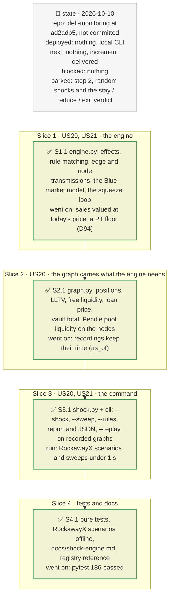

# Propagation engine: a deterministic shock through the graph, driven by rules, plan

> **Status**: approved: the person, 2026-10-10, "let's try this step 1, what we want ideally is to propagate in such a way that we can define rules also later on such that we propagate differently depending on some criteria eventually" (step 1 of the proposal after the sibling-markets increment: a deterministic what-if; step 2, the random version with a verdict, comes later). No interview: the decisions below are the agent's defaults.
> **Delivers**: `riskdep shock --vault <addr> --shock <node>:<mode>[:<size>]` (repeatable) applies one or several shocks to nodes of the dependency graph (an oracle or feed that reads low, reads high or freezes; a collateral whose market price falls) and propagates them: feed → oracle → every market it prices, held or sibling; collateral → markets that take it, through wrappers and Pendle pools; liquidations → collateral sold into a pool of known depth → lower price → more liquidations (the squeeze); market loss → the vault's share → the depositor's share. It prints the consequences per market and for the vault and depositor, and the path each loss took. `--sweep <mode>[:<size>]` applies the same failure to every oracle and feed in turn and ranks them by the vault's loss. How a shock crosses an edge, and how a node reacts, is chosen by an ordered list of rules in `registry.json` (criteria on the edge, its two nodes and the effect), each naming a transmission function; `--rules <file>` puts more rules in front. Proof: pure tests per rule and per transmission; scenarios on the recorded RockawayX USDC Yield graph.
> **Hard rule**: no new provider; the engine is pure (it reads the graph, nothing else); `graph`, `watch` and `analyze` keep their behaviour; the agent never commits.
> **Read against**: `defi-monitoring` at `ad2adb5`; `docs/graph-propagation.md` §4–§8 (transmission functions, DebtRank, failure modes, what the engine needs); `market_risk.value` (Blue's liquidation and bad-debt maths); `drain.py` (d\* = 1 − LLTV / (1 + c), the drained loss); morpho-blue `8e26ca6a` (`liquidate`: seized = repaid × LIF / price, bad debt written off when the collateral is gone); Pendle market lists (`details.liquidity`, read already).
> **Left out**: §4 Flows and §5 State: a one-shot computation, no state.

## The tracker



mandate: mode classic · no git, the person commits · inline · tests at the slice end · verify off

# Design

## 1. Why, and why not

The graph now holds every market that can hurt a vault, with oracle classes and borrower positions, but nothing turns "this feed reads 10 % too high" into "the vault loses X". `docs/graph-propagation.md` designed that engine; this builds its deterministic core. The person wants the propagation itself to be configurable: how a shock crosses an edge should depend on criteria (the edge, the nodes, the effect) that can be changed later without touching the engine.

**Stories**
- **US20**, vault owner: apply a failure to any node (a feed that reads high, a frozen oracle, a collateral that falls) and see what each market, the vault and a depositor lose, and through which path. *Acceptance*: on the recorded RockawayX graph, the PRIME / WYLDS feed frozen while PRIME falls 30 % liquidates nobody in PRIME/USDC (constant-price) and leaves the vault a loss equal to its share of the market's insolvent debt plus the drained liquidity; the Ojo PT feed reading 10 % low liquidates positions in both PT-reUSD-10DEC2026 markets; `--sweep` ranks every oracle and feed by the vault's loss.
- **US21**, risk analyst: change how a shock propagates without changing code. *Acceptance*: a rules file passed with `--rules` overrides a default rule (for example, treat `not classified` oracles as price-tracking, or stop a shock at a given node) and the result changes accordingly; pure tests cover each criterion operator.

**Non-goals**: probabilities and the stay / reduce / exit verdict (step 2); the depositor's place in a run (`exit_queue`, step 2); borrow-rate effects; a depth curve for collateral other than PTs (a rule parameter, empty by default); the Public Allocator's inflow into a drained market; other venues; `watch` and `analyze` using the engine.

## 2. The model and its rules

**Effects** a node can carry, with how several inputs combine:

| Effect | Carried by | Meaning | Combine |
|---|---|---|---|
| `misreport` (factor m) | oracles and feeds | the reading is m × what it should be: m < 1 reads low, m > 1 reads high | product |
| `frozen` | oracles and feeds | the reading no longer moves | any |
| `price` (factor f) | assets, Pendle pools | the market value is f × today's | product, then × the squeeze impact |
| `sale` (USD) | assets | collateral sold into the asset's pool by liquidations | sum |
| `loss` (amount, unit) | markets, vaults, addresses | what lenders, a vault or a depositor lose | sum |

Each input is stored by (effect, source node, rule), so a later round replaces an input instead of adding it twice; a node's effective value is recomputed from its inputs. Propagation runs against the graph's edges (from a dependency to what depends on it), except effects a rule sends the other way (a market's `sale` to its collateral).

**A Blue market** (the `blue_market` node model). From its oracle: m and frozen; from its collateral: f and whether the oracle follows the collateral's market (the rule on that edge decides). Oracle factor fo = m × (f if it follows and is not frozen, else 1); market factor fm = f. For each borrower with collateral value V and debt D at today's oracle price (LIF = 1 / (0.3 LLTV + 0.7), capped at 1.15):

| Case | Condition | Lenders lose | Collateral sold |
|---|---|---|---|
| liquidated | fo V × LLTV < D and liquidating pays: fm / fo ≥ 1 / LIF | Blue's written-off bad debt, max(0, D − fo V / LIF) | the seized collateral, at market: min(D, fo V / LIF) × LIF × fm / fo |
| liquidatable but not worth liquidating | fo V × LLTV < D, fm / fo < 1 / LIF | the insolvent part, max(0, D − fm V) | none |
| healthy by the oracle | fo V × LLTV ≥ D | the insolvent part, max(0, D − fm V), zero unless the market value fell under a stuck or high oracle | none |

Plus a **drain** when the collateral trades δ = 1 − fm / fo below its oracle and δ > d\* = 1 − LLTV / (1 + c) (`drain.py`): the free liquidity is borrowed against cheap collateral, and lenders lose drained × max(0, 1 − (1 − δ) / LLTV).

The four failure modes fall out of fo and fm: a feed reading low liquidates healthy borrowers and, past the LIF, writes off debt the collateral really covered; a feed reading high opens the drain; a frozen or constant-price oracle under a falling market liquidates nobody and leaves the insolvent debt and the drain; a price-tracking oracle under a falling market liquidates, and writes off what the collateral no longer covers.

**The squeeze.** Liquidations sell their collateral into its pool. For an asset with a known depth (a PT: its Pendle pool's liquidity), the asset's price factor is multiplied by the impact of the total sold, with reserves R = depth / 2 on each side of a constant-product pool: (R / (R + S))². The lower price reaches every market taking that collateral, held or sibling; the engine repeats until nothing moves by more than ε (10⁻⁶) or 20 rounds. Without a depth, sales are reported and the price stays.

**Losses up the graph.** A market's loss reaches a vault by its share of the market's supply (vault assets ÷ total supply), and a depositor by its share of the vault.

### Rules

An ordered list in `registry.json` (`engine.edge_rules`, `engine.node_rules`); `--rules <file.json>` puts its own lists first. For each edge, effect and direction, the first rule that matches decides; no match means the effect stops there.

```json
{"id": "collateral-tracking", "effect": "price", "rel": "takes as collateral",
 "when": {"to.oracle_class": "price-tracking"},
 "apply": "collateral_price", "params": {"follows": true},
 "basis": "a price-tracking oracle follows its collateral's market"}
```

- **`effect`** the effect type the rule carries; **`direction`** `dependents` (default: against the edge, from a dependency to what depends on it) or `dependencies` (along it).
- **`when`** criteria, all required: `rel`, `edge.<field>`, `from.<field>` (the node carrying the effect), `to.<field>` (the node receiving it), `value` (the effect's value). A node field is `id`, `kind`, `label` or any of its details (`oracle_class`, `role_in_oracle`, `sibling`, …). Operators by suffix: `__in`, `__not_in`, `__ne`, `__gt`, `__gte`, `__lt`, `__lte`, `__contains`, `__exists`; none means equality.
- **`apply`** a transmission function of `engine.py`: `stop`, `pass` (with `exponent`: −1 for a quote feed), `collateral_price` (with `follows`), `liquidation_sale`, `supplier_loss`, `depositor_loss`; node models `blue_market`, `asset_price` (with `depth`), `combine`.
- **`basis`** why, shown in the trace.

New behaviour that a rule cannot express needs a new transmission function in `engine.py`; everything else is data.

## 3. Modules, after

**`engine.py`**, new, pure: `Shock`, `Rule`, `match`, the transmission and node functions, `run(graph, shocks, rules) → Result` (per-node effects, per-market outcome, vault and depositor losses, trace), `sweep(graph, mode, size, rules)`.

**`shock.py`**, new: parses `--shock` specs, loads rules, builds or replays the graph (`graph.build_all`), runs the engine, prints the report and writes JSON.

**`graph.py`**: market nodes gain `_positions` (collateral value and debt per borrower, in loan units, not shown in the page), `lltv_value`, `free_liquidity`, `loan_usd`; the vault node `total_assets_value`; the Pendle pool node `liquidity_usd` (from the market list already read).

**`cli.py`**: the `shock` subcommand.

## 8. Decisions

| id | Kind | Decision | Status | Source | Slice |
|---|---|---|---|---|---|
| D89 | module | A pure `engine.py` reading only the graph, and `shock.py` for I/O and the report; the command is `shock`, so as not to clash with `simulate.py` (the Monte Carlo of `analyze`) | agreed, agent's default | — | S1, S3 |
| D90 | contract | Five effects (`misreport`, `frozen`, `price`, `sale`, `loss`), each stored per (effect, source, rule) and combined by product, any or sum; propagation against the edges except where a rule says otherwise | agreed, agent's default | `docs/graph-propagation.md` §4, §8 (simultaneous shocks) | S1 |
| D91 | contract | Rules are data: ordered edge and node rules in `registry.json`, first match wins, criteria on the edge, both nodes and the effect value with suffix operators; `--rules` prepends a file's rules; no match stops the effect | agreed, the person: "define rules also later on such that we propagate differently depending on some criteria" | — | S1 |
| D92 | contract | The Blue market model of §2: liquidation when the oracle says so and liquidating pays at the market price, Blue's write-off when the collateral is gone, the insolvent debt otherwise, plus the drain past d\*; full liquidation of each liquidatable position | agreed, agent's default | morpho-blue `liquidate`; `market_risk.value`; `drain.py` | S1 |
| D93 | contract | `not classified` oracles do not follow their collateral by default (the lender's worse case: no liquidation, a silent loss); one rule, overridable | agreed, agent's default | GAP.md K7: "conservative" depends on the actor | S1 |
| D94 | contract | The squeeze prices only assets with a known depth: a PT's Pendle pool liquidity, or `engine.depth_usd[<asset>]`; constant-product impact with R = depth / 2 on the collateral sold, valued at today's price; a PT does not fall below the price where a buyer to maturity earns `stress_yield` (50 %); ε = 10⁻⁶ and an evaluation budget, with a warning when it runs out. Sales of a market lending something other than a registry stablecoin are not converted to USD and do not move a price | agreed, agent's default; valuation at today's price and the PT floor found in S1 | GAP.md K9 (no slippage or cascade in `analyze`) | S1 |
| D95 | contract | Baseline: today's market value equals today's oracle value (fm = fo = 1 before the shock); the depositor's loss is pro rata | agreed, agent's default; the run order comes with step 2 | — | S1 |
| D96 | module | The graph carries the engine's inputs (positions, LLTV, free liquidity, loan price, vault total, pool liquidity), read during the build with no new request, so a recorded graph replays the engine offline | agreed, agent's default | — | S2 |

# Execution

## 9. The slices

| Slice | Done when | Went on |
|---|---|---|
| S1 | every transmission and every criterion operator has a pure test; the squeeze converges | the first squeeze valued sales at the price after impact: a lower price meant fewer dollars sold, the price rebounded, and the loop oscillated until the budget ran out (the vault's loss and its path disagreed). Sales are now valued at today's price, a quantity, so the loop only deepens and settles in about 10 evaluations. Without a floor, $100M of PT into a $12M pool sent the price to zero; a PT floor at a 50 % APY to maturity was added (D94). A position already liquidatable before the shock counts Blue's write-off as its baseline |
| S2 | the RockawayX recording replays with the new fields, no new request | days to a PT's maturity depend on "now": a recording keeps `as_of` in its `meta.json` and a replay uses it (the RockawayX fixture's was set from its responses' fetch time) |
| S3 | `shock --replay` prints the US20 scenarios on RockawayX; `--sweep` ranks the oracles | PRIME / WYLDS frozen + PRIME −30 %: the vault loses 122.8k (0.67 %), its PRIME/PYUSD sibling 21.2M; Ojo reads 10 % low: 157 positions liquidated, the vault loses 235.8k; sweep reads-high 20 %: the PT-reUSD oracle and feed first (94.0k each) |
| S4 | tests pass offline, `docs/shock-engine.md` written, registry and docs updated | the documented example rules file runs as written; 186 tests pass |

## Interview log

No interview. The person chose step 1 of the proposal (a deterministic what-if before probabilities) and asked that propagation be rule-driven so it can depend on criteria later.
