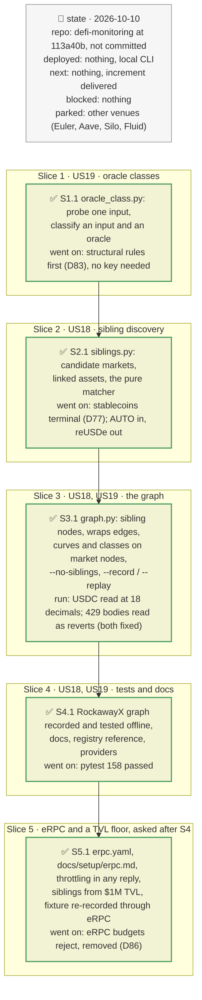

# Sibling markets and oracle classes in the dependency graph, plan

> **Status**: approved: the person, 2026-10-10, "let's do it", after reviewing the decisions below (agent's defaults). The request: "let's implement the thorough discovery by looking for sibling markets. Ideally we want to add those as nodes in the graph and make the relevant edges, that way we can implement a correct propagation using the propagation engine. Classifying Oracles would be great, at first we can limit it to either price-tracking or constant-price ? Covering other venues we'll keep for later".
> **Delivers**: `graph` finds, for every Blue market an actor of the graph holds, the other Blue markets that can move its collateral's price or share its price inputs (same collateral, same underlying, a shared base feed, or lending that collateral), and adds them as nodes joined through the shared asset, oracle and feed nodes. Every market node carries what the propagation engine needs to spread a squeeze: supply, borrow, collateral held, the liquidation curve with the collateral it would sell, and its oracle class, `price-tracking` or `constant-price`, with the evidence. Proof: an offline test builds the RockawayX USDC Yield graph and finds its 10 sibling markets and its 6 oracle classes.
> **Hard rule**: no new provider (Morpho API, Pendle API, RPC, and the optional Etherscan key already used); `watch` and `analyze` keep their behaviour; the agent never commits. *S5, at the person's request*: eRPC and its free upstreams added as an optional local proxy, listed in `docs/analysis/PROVIDERS.md`.
> **Read against**: `defi-monitoring` at `113a40b`; `docs/model/graph-propagation.md` §4–§8 (transmission functions, DebtRank, what the engine needs); `docs/analysis/GAP.md` K7 (read the oracle's structure) and K8 (min(TWAP, linear) on PT-reUSD); `drain.py` D70 (oracles left unclassified on purpose); morpho-blue-oracles `9d2a0b66` (`MorphoChainlinkOracleV2`: price = base vault × base feeds ÷ quote vault × quote feeds); live probes on 2026-10-10, recorded in §1.
> **Left out**: §4 Flows and §5 State: `graph` is a one-shot read, it keeps no state.

## The tracker

Phasing diagram: the slices in order, and what each has to show before the next one starts.

mandate: mode classic · no git, the person commits · inline · tests at the slice end · verify off

# Design

## 1. Why, and why not

The tool is first-order: it reads the markets a vault holds, their borrowers, oracles and admins, and nothing around them. Three ways a vault owner loses money pass through markets it does not hold:

- **another market's oracle** prices the same collateral or reads the same feed;
- **a liquidation squeeze** in another market sells the same collateral, or its underlying, into the pool our oracle reads;
- **another collateral is exploited** and the attacker borrows and dumps an asset our collateral depends on.

The propagation engine of `docs/model/graph-propagation.md` can only follow these if the markets are in the graph, joined to ours through shared nodes, with the data each edge's transmission function needs. Whether a price fall liquidates borrowers (and can cascade) or leaves bad debt unrecorded depends on the oracle class, which the graph does not have today.

**Probes, 2026-10-10** (RockawayX USDC Yield, `0xE018…1965`, $18.5M):
- The Morpho API lists 290 Ethereum markets with ≥ $1k borrowed. **10 markets with ≥ $100k borrowed are siblings of the vault's 6 markets, $217.9M borrowed in all**, none of them read by the tool. The PRIME/WYLDS feed under the vault's liquidity market (PRIME/USDC, $1.5M) also prices PRIME/PYUSD ($189M). The Ojo feed under PT-reUSD/USDC also prices PT-reUSD/USDT ($8.4M).
- A shared quote feed is noise: `USDC / USD` is the quote feed of most USDC oracles, and a 12-decimal `DummyFeed` is shared by unrelated oracles (it put weETH/USDC among siUSD's "siblings" until excluded).
- **Round history separates the two classes where it exists.** Over the last 24 rounds, the market feeds `USDC / USD`, `USDS / USD` and `ETH / USD` fell 10, 14 and 9 times. The rate feeds `PRIME / WYLDS Exchange Rate`, `PST-USDC Exchange Rate` and `mF-ONE/USD Discounted` never fell.
- **7 of 15 feeds have no history** (`roundId` 0 or 1): RedStone `*_FUNDAMENTAL` feeds, Pendle's linear discount, a NAV adapter, Idle's tranche rate, infiniFi's RT oracle, the dummy feed and the Ojo PT feed. Three of them answer exactly 1.0.
- **The Ojo PT feed is a composite**: `latestRoundData` returns the minimum of `FEED_1` (`PendleChainlinkOracle`, the Pendle AMM TWAP) and `FEED_2` (`ChainlinkCurrentTimestampAdapter`, 0.990 today); the TWAP is the active one. That is the min(TWAP, linear) of `docs/analysis/GAP.md` K8.

**Stories**
- **US18**, vault owner: see every market outside my vault that can move the price of a collateral I lend against, or that shares its price inputs, with why it is linked, its size and its liquidation curve. *Acceptance*: the offline RockawayX graph holds PRIME/PYUSD, PRIME/AUSD and nvPRIME/USDC (PRIME/WYLDS feed), PT-reUSD/USDT (same collateral, Ojo feed), reUSD/USDC and reUSD/USDT (underlying of PT-reUSD), PT-trUSD-26NOV2026/USDC (trUSD feeds of PT-strUSD, and strUSD's underlying), siUSD/msUSD and PT-siUSD-7JAN2027/USDC (siUSD), and AUTO/USDC (same underlying as PRIME, wYLDS), each joined to the vault's market through the shared node, with a curve. *Corrected in S2*: reUSDe/USDC, first listed from its symbol, is not a sibling (reUSDe is a separate token, not a wrapper of reUSD); AUTO/USDC is.
- **US19**, vault owner: know for each market whether its oracle follows the collateral's market price. *Acceptance*: PT-reUSD-10DEC2026/USDC reads `price-tracking`; strUSD, etrUSD, siUSD, PRIME and PT-strUSD-26NOV2026 read `constant-price`; each with its evidence; pure tests cover every rule; an input no rule decides is shown `not classified` (PT-siUSD-7JAN2027's `LossAdjustedPTFeed` without the Etherscan key).

**Non-goals**: other venues (Euler, Aave, Silo, Fluid, Pendle on Aave); siblings of siblings; the lenders of sibling markets; the vault's capped markets with no allocation; the propagation engine itself (next increment); slippage and pool depth; alerts on sibling markets in `watch`; finer classes (TWAP, NAV, linear discount); switching `analyze`'s price inference and `drain.py` (D70) to the class.

## 2. The graph, after

New and changed elements; everything else is as today.

| Element | What | Read from |
|---|---|---|
| Pool (sibling Blue market) | a market no actor of the graph holds, linked to a seed market; `sibling: true`, `linked_by`: the relations and the seed | Morpho API `markets` (finds), `idToMarketParams` on-chain (decides) |
| Pool (every Blue market) | supply, borrow, utilisation, collateral held, oracle class, liquidation curve at −2/−5/−10/−20 %: debt liquidatable, positions, bad debt, collateral seized | `market_risk` over every borrower (D45) |
| Oracle (market oracle and each input) | `class`: price-tracking / constant-price / not classified, `class_basis` | `oracle_class.py` |
| edge market → collateral, *takes as collateral* | now carries the collateral held, in collateral units | sum of the borrowers' collateral |
| edge asset → asset, *wraps* | an ERC-4626 share → its asset ("redeems into") | `asset()` on-chain |

Siblings get the existing edges (`lends`, `takes as collateral`, `priced by`, `reads`, `converts through`, the Pendle pool). There is no market → market edge: a sibling reaches a seed through the asset, oracle or feed node they share, which is the path the engine walks.

## 3. Modules, after

**`oracle_class.py`**, new. I/O: `probe(f, address, block)` reads one input in one batch (`decimals`, `description`, `latestRoundData`, `getRoundData` for the last k rounds, `FEED_1`, `FEED_2`), plus the verified contract name when Etherscan answers. Pure: `classify_input(probe, patterns) → (class, basis)` and `classify_oracle(inputs) → (class, basis)`.

**`siblings.py`**, new. I/O: `candidates(f, min_borrow_usd)` (the paged Morpho API `markets` query with collateral, loan and oracle input addresses), `linked_assets(f, tokens, block)` (Pendle `underlyingAsset` for PTs, from the market lists `discover` already reads; `asset()` for ERC-4626 shares, one batch). Pure: `match(seeds, candidates, links, floors) → [Sibling(market_id, seed_id, relations, borrow_usd)]`.

**`market_risk.py`**: `CurvePoint` gains `collateral` (raw collateral units of the positions liquidatable at that fall), default 0; `value` fills it.

**`graph.py`**: `build(..., siblings=True)` collects the seed markets, adds the siblings through `_market`, adds `wraps` edges, classifies every oracle in `_oracle`, and puts the curve on every market node.

**`cli.py`**: `graph --no-siblings`, `graph --record` / `--replay` (responses under `fixtures/replay/graph-<target>/`).

## 8. Decisions

| id | Kind | Decision | Status | Source | Slice |
|---|---|---|---|---|---|
| D75 | module | Two new modules, `oracle_class.py` and `siblings.py`, each a pure core plus thin I/O; `graph.py` wires them; `watch` and `analyze` untouched | agreed, agent's default | — | S1, S2 |
| D76 | contract | Seeds are the Blue markets an actor of the graph holds (a vault's adapter markets, the user's borrows). Siblings are found one hop from a seed, never from another sibling; a sibling gets no lenders and no siblings | agreed, agent's default | — | S2 |
| D77 | contract | Four relations make a sibling: **same collateral**; **same underlying** (PT → Pendle `underlyingAsset`, ERC-4626 share → `asset()`, either way round); **shared base input** (the sibling's oracle is the seed's oracle, or reads on its base side a feed or vault the seed's oracle reads on its base side); **lends a linked asset** (its loan token is the seed's collateral or that collateral's underlying). Quote-side feeds never make a sibling. The registry's stablecoins (USDC, USDT) are terminal: they never link by token, and a terminal underlying is not followed | agreed, agent's default; terminal rule found in S2: every USDC vault share would otherwise be family of syrupUSDC | probe: `USDC / USD` and a `DummyFeed` are shared quote feeds | S2 |
| D78 | contract | Discovery: one paged Morpho API `markets` query (Ethereum, borrow ≥ the floor) with collateral, loan and oracle input addresses, matched locally. A retained sibling's parameters are re-read with `idToMarketParams` and its oracle decomposed on-chain as today, so a shared feed node exists only if the chain agrees with the API | agreed, agent's default | docs/analysis/PROVIDERS.md trust model | S2 |
| D79 | contract | Floors: `graph.sibling_min_tvl_usd` = 1,000,000 (supplied, Morpho API `supplyAssetsUsd`) and at most `graph.sibling_max_per_seed` = 10 per seed, largest borrow first; held markets never filtered | agreed; revised in S5 at the person's request ("filter out small markets (below a certain TVL)"), from a $100k borrow floor | probe: 10 RockawayX siblings at ≥ $100k borrowed, 8 at ≥ $1M TVL; the example graph had 65 siblings and took 8 to 12 min | S2, S5 |
| D80 | contract | No market → market edge; a new `wraps` edge (ERC-4626 share → asset) for every graph asset that answers `asset()`; `takes as collateral` carries the collateral held | agreed, agent's default | `docs/model/graph-propagation.md` §4 | S3 |
| D81 | contract | Every market node, seed or sibling, carries supply, borrow, utilisation, collateral held, oracle class and the liquidation curve (D50 steps) with the collateral seized, from all its borrowers (D45). The engine needs it to turn liquidations into sale pressure | agreed, agent's default | `docs/model/graph-propagation.md` §7–§8 | S3 |
| D82 | contract | Two oracle classes: `price-tracking` (a market move of the collateral reaches the price) and `constant-price` (it does not: fixed, exchange rate, NAV, linear discount); `not classified` when no rule decides, shown and never guessed. An oracle is price-tracking if any base-side input is, constant-price if all are; quote-side inputs price the loan token and are ignored. Same meaning as `analyze`'s market-tracking / fundamental (the glossary maps them) | agreed, agent's default | the person: "price-tracking or constant-price"; docs/analysis/GAP.md K7 | S1 |
| D83 | contract | Rules for one input, the first that applies wins: (1) a base vault → constant-price (ERC-4626 rate); (2) a composite or wrapper (`graph.oracle_children_getters`: `FEED_1()`, `FEED_2()`, `innerOracle()`) → from its children, price-tracking if one is (a min follows the lower); (3) a structural getter of `graph.oracle_getters`: `twapDuration()` nonzero → price-tracking, `baseDiscountPerYear()` → constant-price; (4) at least `graph.oracle_history_min` (6) past rounds readable → price-tracking if falls are at least `graph.oracle_fall_share` (20 %) of the changes over the last `graph.oracle_history_rounds` (24), else constant-price; (5) no history and the answer is exactly 1.0 → constant-price; (6) a pattern of `graph.oracle_patterns` matches `description()` or the verified contract name (asked of Etherscan only when nothing before decided) → its class; (7) not classified. A custom oracle without the standard getters is one input | agreed, agent's default; rules 2 (wrapper) and 3 found in S1: the Ojo feed's second input is a `ChainlinkCurrentTimestampAdapter` wrapping a `PTDiscountOracle` (`innerOracle`), and Pendle's oracles expose their kind through getters, so no key is needed | probe: market feeds fell 9–14 times in 24 rounds, rate feeds 0; 7 feeds without history; Ojo = min(TWAP, schedule); the 15 probed feeds classify without Etherscan | S1 |
| D84 | contract | `graph.oracle_patterns` in the registry, each with a class and a basis: `PendleChainlinkOracle` → price-tracking (Pendle AMM TWAP); `PendleSparkLinearDiscountOracle`, `NetAssetValueChainlinkAdapter`, `TranchesChainlinkOracle`, `LossAdjustedPTFeed` → constant-price; a description containing `FUNDAMENTAL`, `Exchange Rate`, `Net Asset Value` or `Discount` → constant-price. Contract names need the optional Etherscan key; without it only descriptions match | agreed, agent's default; `LossAdjustedPTFeed` added in S3 (the PT-siUSD-7JAN2027 feed: a discount lowered only by the SY's own losses) | Etherscan sources read 2026-10-10 | S1, S3 |
| D85 | module | Siblings are on by default; `graph --no-siblings` leaves them out, while oracle classes, curves and `wraps` edges stay. `graph --record` / `--replay` use `fixtures/replay/graph-<target>/` with a `meta.json` (targets, block). `docs/examples/graph-example.*` stays the documented example at block 26,162,421, built without siblings, and is not regenerated | agreed, agent's default; `--no-siblings` scope made precise in S3 | — | S3 |
| D86 | module | An optional local eRPC proxy: `erpc.yaml` committed (eRPC 0.3.0, six free upstreams tested with riskdep's call patterns, listening on 127.0.0.1, no key, no rate budget), reached through the existing `RISKDEP_RPC_URL`; dRPC never an upstream, so the cross-check stays independent. Without it riskdep calls publicnode as before | agreed, the person: "let's use the eRPC to counter that issue" | probe 2026-10-10 of about 20 free endpoints; eRPC docs | S5 |
| D87 | contract | A throttled answer, HTTP 429 or a rate-limit message in any batch item, is waited out (2 … 12 s) and resent up to 6 times, then the request fails; it is never cached. A bare `-32005` is not throttling (some nodes use it for too many log results) | agreed, found in S3 and S5: publicnode's 429 body and eRPC's 200 body both read as reverted calls | burst probe: 15 of 36 parallel batches throttled | S3, S5 |
| D88 | contract | A routed request that fails names `RISKDEP_RPC_URL` and `docs/setup/erpc.md` in its error, and keeps only the kind of failure, never the routed URL or its pieces | agreed, agent's default: a colleague whose proxy is down would otherwise read a publicnode failure; found in S5 that `requests` prints a routed URL's host and path apart, so a key in the path leaked past the whole-URL replacement | live run against a closed port | S5 |

# Execution

## 9. The slices

| Slice | Done when | Went on |
|---|---|---|
| S1 | every rule of D83 has a pure test; the 15 probed feeds classify as in §1 | the Ojo feed nests a wrapper (`innerOracle`) and Pendle's oracles have telling getters: two structural rules added before the history rule (D83) |
| S2 | the matcher's pure tests cover the four relations, the floors and depth 1 | stablecoins made terminal (D77); the live run found AUTO/USDC and not reUSDe/USDC, acceptance corrected |
| S3 | a live `graph --vault 0xE018…` shows the 10 siblings, curves and classes | the vault path built its markets with 18 loan decimals, which would have scaled USDC curves by 10¹²: markets now read with `discover_markets`; a raw newline in the page's JavaScript broke the whole page (caught with `node --check`, regression assertion added); PT-siUSD-7JAN2027's feed is a `LossAdjustedPTFeed`, `not classified` without the key, pattern added (D84); a live `graph --example` (8 min, 80 markets) left 36 oracles `not classified`, `ETH / USD` among them: publicnode throttles bursts with HTTP 429 and a `-32005` error per batch item, and `sources.Fetcher` passed that body on as reverted calls. It now waits and resends a 429 (2 … 12 s, 6 times), then fails; a test proves the errors are never recorded |
| S4 | the RockawayX graph recorded under `fixtures/replay/graph-0xe018…`, the acceptance test passes offline, docs updated | 148 responses and a `meta.json`, 1.6 MB, no key and no throttled reply in any of them; 158 tests pass |
| S5 | eRPC validated and run with `erpc.yaml`, a recording made through it replays offline, siblings filtered at $1M TVL | eRPC 0.3.0 ignores `waitTime`: its rate budgets rejected a 200-call batch with HTTP 200 errors, which the 429 retry missed and the recording kept; budgets removed (D86), throttling detected inside any reply (D87). 1RPC, the cross-check's fallback, answers 410 "discontinued" (reported, not replaced). RockawayX: 43 s direct, 20 s through eRPC; `--example`: 8 to 12 min direct, 178 s through eRPC with the $1M floor (65 → 52 siblings); 8 RockawayX siblings at $1M; a routed failure printed the routed host and path (a key in the path would have leaked), now only the failure's kind (D88); 161 tests pass |

## Interview log

No interview. The person asked for the increment after the tool review of 2026-10-10 (three indirect scenarios: another market's oracle, a liquidation squeeze elsewhere, an exploit of another collateral), chose sibling markets as graph nodes and a two-class oracle classification, and kept other venues for later.
