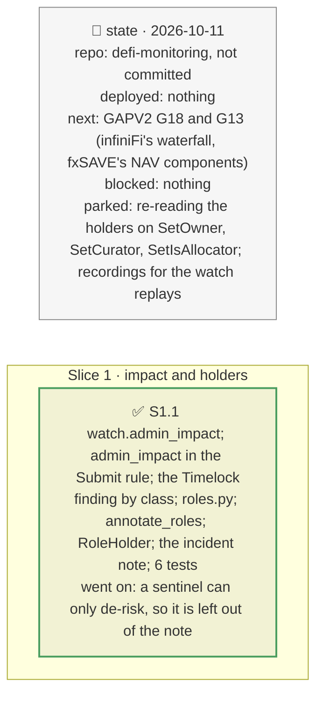

# Admin changes by impact; who holds each role, plan

> **Status**: approved: the person, 2026-10-11, "Do G10 with G2" (GAPV2). No interview: the decisions below are the agent's defaults.
> **Delivers**: G10: every risk-increasing admin function classified from the pinned Vault V2 source (retroactive: reaches money already deposited; enabler: lets another role move existing money; future only), in the registry; a `Submit` alert states the class, the amount it can reach and the source line, and its level follows the class; the start-up `Timelock` finding groups the no-notice functions by class. G2: each role holder read on-chain (one key, a Safe n/m, a timelock, a contract), on the graph's admin nodes, as `RoleHolder` findings at the watch's start, and as a note in vault incidents when an owner, curator or allocator is one key.
> **Hard rule**: offline from recordings (the holders' code, threshold, owners and delay recorded for the eight graphs through the archive route); `web/` untouched; the agent never commits.
> **Read against**: `docs/analysis/GAPV2.md` G10, G2; `docs/external/morpho/lib/vault-v2/src` (`VaultV2.sol`, `MorphoMarketV1AdapterV2.sol`); plans `2026-10-11-alerts-and-verdict` (D184), `2026-10-11-fork-demo` (D182).
> **Left out**: §4 Flows and §5 State.

## The tracker

mandate: mode classic · no git, the person commits · inline · tests at the slice end · verify off

# Design

## 1. Why, and why not

A depositor's question on a `Submit` is "can this cost me what I already have, and before I can leave?"; a performance-fee change and a `burnShares` were the same warn. And a role held by one key can change the vault with no notice. **Non-goals**: a call-graph tracer (the contract family is known and pinned: the classification is done once, in the registry); Vault V1.

## 8. Decisions

| id | Kind | Decision | Status | Source | Slice |
|---|---|---|---|---|---|
| D244 | contract | `watch.admin_impact`, keyed by signature: `class` (retroactive, future, enabler), `reach` (all, market, forced_exit, future_interest, caps, none), `basis` (the source line). `rules.admin_impact` gives the amount: `all` the vault's assets, `market` its allocation to the market written off, `forced_exit` the new penalty on what would leave by forceDeallocate, `caps` the new limit above today's allocation. The `Submit` level follows the class (retroactive: critical with no notice, warn with one; enabler: warn with no notice, info with one; future: info); `depositor_impact` is the depositor's part of a retroactive amount; the `Timelock` finding groups by class | agreed, agent's default | GAPV2 G10, D44, D184 | S1 |
| D245 | contract | `roles.py`: each holder's code (none or an EIP-7702 delegation: one key), `getMinDelay()` (a timelock), `getThreshold()` and `getOwners()` (a Safe n/m), else a contract; `RoleHolder` findings (owner held by one key: critical; allocator: warn; else info) at the watch's start, "not checked" when the recording lacks the reads; `graph.annotate_roles` labels the admin nodes; vault incidents note an owner, curator or allocator held by one key (a sentinel can only de-risk) | agreed, agent's default | GAPV2 G2, D182 | S1 |

# Execution

## 9. The slices

| Slice | Done when | Went on |
|---|---|---|
| S1 | the rule and the holders replay offline; 399 tests pass | the recorded Sentora vault: 8 no-notice changes, 1 retroactive (the force-deallocate penalty), 1 enabler (`setIsAllocator`); Belem: owner and curator a Safe 4/8, its two allocators one key each (an EOA, a Safe 1/1) |

## Interview log

No interview: the person asked for G10 with G2.
