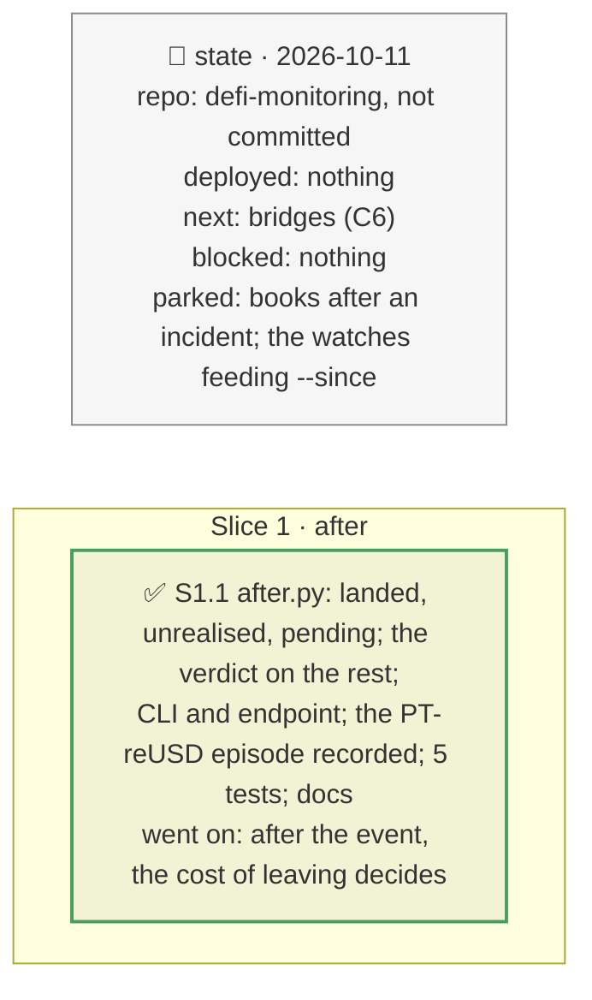

# After the incident, plan

> **Status**: approved: the person, 2026-10-11, "Yes implement it too and add an endpoint if possible" (with the wording of the value-at-risk block). No interview: the decisions below are the agent's defaults.
> **Delivers**: `analyze --vault V --since BLOCK [--at BLOCK] --shock token=…` and `POST /api/incident/after`: a vault after an incident that began at `since`: what has landed (the share price's fall, the liquidations meanwhile), what is still at risk (unrealised bad debt now, and the part the oracle has not passed on yet), and the verdict on that part only, against the certain cost of leaving now. The value-at-risk block of the before-mode names its incident and says "loss if it happens".
> **Hard rule**: offline from recordings (`fixtures/replay/after-<vault>-<since>-<at>/`, read once through the archive route and Etherscan, cached under the public URLs, no key); `web/` untouched (`openapi.json` regenerated); the agent never commits.
> **Read against**: `docs/hackaton_instruction/GOAL.md` (decision 25 %); plans `2026-10-11-vault-incident` (D98–D101), `2026-10-11-value-at-risk` (D227), `2026-10-11-backtest` (the liquidation events).
> **Left out**: §4 Flows and §5 State.

## The tracker

mandate: mode classic · no git, the person commits · inline · tests at the slice end · verify off

# Design

## 1. Why, and why not

Every answer was "if it happens". Once it has happened, part of the loss is sunk and the decision must rest on the rest; and re-running the incident on a live state would apply a fall the oracle already took a second time. **Non-goals**: books after an incident (one vault at a time); detecting the start block (the watches' alerts give it).

## 8. Decisions

| id | Kind | Decision | Status | Source | Slice |
|---|---|---|---|---|---|
| D228 | contract | Landed: the vault read at `since` and at `at`; the depositor's loss on the shares it holds at `at` is shares × the share price's fall (none when it rose); the liquidations in each of its markets in between (Etherscan logs: count, repaid, written off), whose write-offs are already in that fall, so counted once | agreed, agent's default | D161 | S1 |
| D229 | contract | Still at risk, per market of the vault: the incident's price is the oracle's price at `since` × (1 − fall); only the gap between it and the oracle's price at `at` is applied (`remaining_drop`), through the incident's market model (`market_hit`); unrealised is the bad debt at the oracle's price now, pending the rest; a price-tracking oracle that already fell leaves nothing pending, a NAV feed not yet updated leaves all of it | agreed, agent's default | D99, D127 | S1 |
| D230 | contract | `pipeline.after_incident` and `analyze --vault V --since BLOCK [--at BLOCK]`: offline from `after-<vault>-<since>-<at>/`, or from the vault's incident recording when `at` is `since`; `--record` reads through the archive route; `POST /api/incident/after` serves the same | agreed, the person asked for an endpoint | D121 | S1 |
| D231 | contract | The verdict weighs only what is still at risk: the exit queue's loss if the depositor stays against leaving first; and, the incident having happened, EXIT only when what leaving still saves exceeds its certain cost (the yield given up, or `--exit-cost`) | agreed, agent's default; found: without it a saving below the cost read EXIT | D101, D142 | S1 |

# Execution

## 9. The slices

| Slice | Done when | Went on |
|---|---|---|
| S1 | Belem at its incident block gives the before-mode loss as pending (251,761 EURCV); the PT-reUSD episode on RockawayX USDC Yield replays offline; 381 tests pass | 2026-08-25, blocks 25,829,808 → 25,829,940: 16 liquidations repaid 35.19M USDC, nothing written off; the oracle fell 2.79 %: with the 2.45 % incident nothing is pending; had it been 10 %, 7.42 % would still be to come, 9,818 pending for the vault, and leaving would save its depositor 1,169 against 11,145 of cost: STAY |

## Interview log

No interview: the person asked for it.
