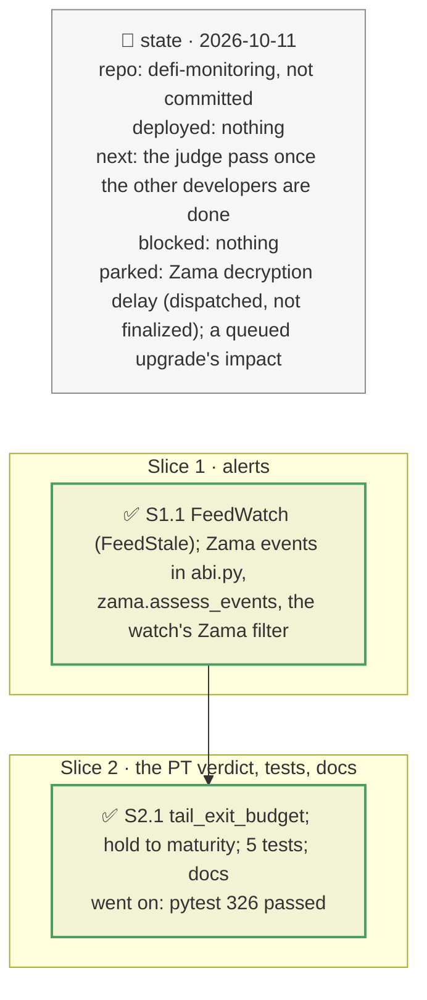

# FeedStale, the Zama alerts, and the PT verdict's horizon and tail, plan

> **Status**: approved: the person, 2026-10-11, "Implement 2 and 3 for the moment" (`FeedStale` and the Zama batcher alerts, Z4 of `ZAMA-VAULT.md`; the PT verdict's K12 and K13). No interview: the decisions below are the agent's defaults.
> **Delivers**: `watch --vault` warns when a feed of its markets' oracles turns stale (`FeedStale`), and, for a Zama confidential vault, alerts on the day's confidential outflow, instant exits, canceled batches, pauses, upgrades and owner changes of its batchers and wrappers; the PT verdict states the hold-to-maturity path and EXITs when de-levering leaves the tail unsurvivable. Proof: the mGLOeuro NAV feed flagged at Belem's recorded block (17.5 days); on Confidential RWA's real history, the two days with 5.6 % and 3.0 % of the vault leaving confidentially and three instant exits above 1 % warn, the 19 empty days stay silent; the demo stays REDUCE and gains "held to maturity (47 days) … holding to maturity is the cheaper path".
> **Hard rule**: no new provider; the demo's verdict and numbers unchanged; optional reads print "not checked" when absent; `web/` untouched; the agent never commits.
> **Read against**: plans `2026-10-11-feed-quality` (D155–D157), `2026-10-11-zama` (D171–D176), `2026-10-11-detect` (D187–D189), `2026-10-10-defi-risk-dependency` (the PT verdict); `GAP.md` K12, K13, K23.
> **Left out**: §4 Flows and §5 State.

## The tracker

mandate: mode classic · no git, the person commits · inline · tests at the slice end · verify off

# Design

## 1. Why, and why not

Detection is the first link of the brief's chain: a stale issuer feed is the warning before a markdown lands, and a Zama vault's confidential outflow is only visible in its batchers' public aggregates. The PT verdict, the brief's own example, kept two biases toward STAY (`GAP.md` K12, K13).

**Non-goals**: a Zama batch dispatched and not finalized (decryption delayed: it needs the batch's state over time); a recording of the watch across a daily batch (the rules are tested on the vault's real events, fetched once through Etherscan); a re-recorded fork run for `FeedStale`.

## 3. Modules, after

- **`feeds.py`**: `FeedWatch` (startup, refresh), from `admin.AdminWatch`'s feeds and `oracle_class.probe`.
- **`abi.py`**: the `zama` events. **`zama.py`**: `contracts`, `kinds`, `filters`, `share_rate`, `assess_events`. **`sources.py`**: `etherscan_logs` takes an optional topic1.
- **`watch.py`**: the Zama contracts and filter for a Zama vault; `FeedWatch`.
- **`decide.py`**: the tail exit. **`pipeline.py`**: the hold-to-maturity line. **`registry.json`**: `watch.zama_*`, `tail_exit_budget`.
- **`fixtures/replay/zama-events/`**: the RockawayX vaults' real Zama events; the Belem graph recording's block header.

## 8. Decisions

| id | Kind | Decision | Status | Source | Slice |
|---|---|---|---|---|---|
| D190 | module | A Zama vault's batchers, cShare and cAsset join the watch as `zama` contracts, through one optional log filter on their events (ABI of the verified contracts) | agreed, agent's default | Etherscan ABI | S1 |
| D191 | contract | A cShare unwrap to the redeem batcher is the day's confidential redemption, in public: info, warn from `watch.zama_redeem_warn` (2 %) of the vault, critical from `zama_redeem_critical` (10 %); to anyone else, an instant exit with its amount revealed: warn from `zama_instant_warn` (1 %) | agreed, agent's default | `ZAMA-VAULT.md` §2.5 | S1 |
| D192 | contract | A zero aggregate and the cancel that follows are an empty day: silent. A cancel with no empty unwrap (a deadline, a take-back) warns; a pause or an upgrade of a batcher or wrapper is critical; an owner change warns | agreed, found: 19 of 27 batches canceled empty on Confidential RWA | the recorded events | S1 |
| D193 | contract | `FeedStale` (warn) at start for every stale feed of the watched markets' oracles, by the freshness rule (D156); "not checked" when the feeds' rounds cannot be read | agreed, agent's default | D156 | S1 |
| D194 | contract | On each refresh, `FeedStale` only for the feeds that turned stale since the last check | agreed, agent's default | — | S1 |
| D195 | contract | K13: EXIT when the proposed de-lever still leaves the worst 1 % of outcomes at or above `tail_exit_budget` (90 %) of equity; otherwise the REDUCE rule stands | agreed, the demo's de-lever leaves 79 %: REDUCE unchanged | `GAP.md` K13 | S2 |
| D196 | contract | K12: when the PT matures beyond the horizon, the verdict adds the hold-to-maturity path: the expected loss and the carry to maturity, against the one-off cost of leaving now, and which is cheaper | agreed, agent's default: a line, so the demo's verdict and numbers stay | `GAP.md` K12 | S2 |

# Execution

## 9. The slices

| Slice | Done when | Went on |
|---|---|---|
| S1 | the Belem NAV feed flagged; the RockawayX history's alerts as expected | every canceled batch on the RWA vault followed an empty day: D192 silences them |
| S2 | the demo unchanged with the maturity line; 326 tests pass | — |

## Interview log

No interview: the person chose items 2 and 3 and left the judge pass for later.
