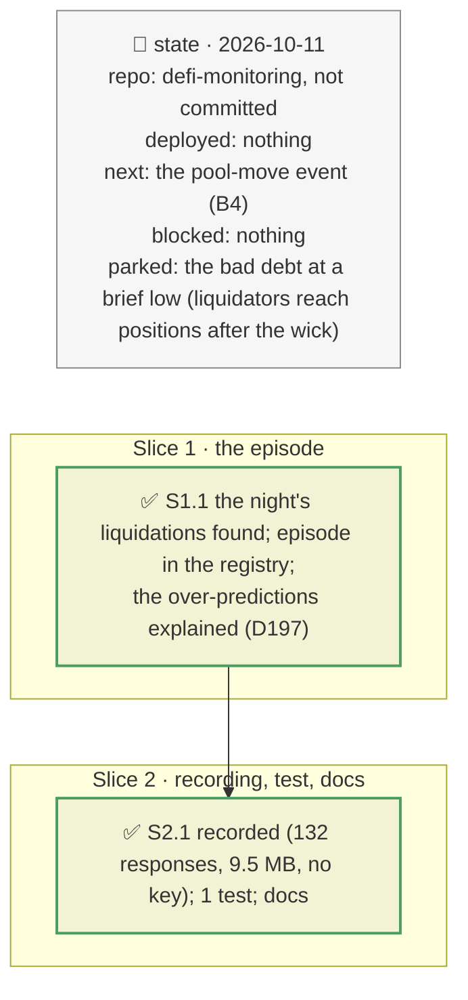

# A second backtest: the 2025-10-10 crash, plan

> **Status**: approved: the person, 2026-10-11, "Implement that" (`NEXT_STEP.md` B9+, a second backtest episode). No interview: the decisions below are the agent's defaults.
> **Delivers**: `backtest --episode crash-2025-10-10` replays the main wave of the 2025-10-10 market crash on the six Morpho markets with the most liquidations (Mog, PEPE, SPX on USDS; WBTC on USDT and USDC; wstETH on USDC), and accounts for every borrower predicted but not liquidated in the wave: liquidated later that night, defended by its borrower, or left liquidatable, with its debt and how many are dust. Result: no liquidated borrower missed in any market; WBTC/USDC's debt and incentive within 2 %; what no liquidator took is under 3 % of the debt repaid.
> **Hard rule**: an episode is registry data; recorded through the archive RPC and Etherscan, keyless in the files; the agent never commits.
> **Read against**: plan `2026-10-11-backtest` (D161–D164); `GAP.md` K8, K9.
> **Left out**: §4 Flows and §5 State.

## The tracker

mandate: mode classic · no git, the person commits · inline · tests at the slice end · verify off

# Design

## 1. Why, and why not

One backtest is an anecdote. The first (PT-reUSD, 2026-08-25) tested a yield spike through a min(TWAP, linear) oracle; this one tests price-tracking oracles in a market-wide crash. The episode first proposed, USDe at −8 %, barely reached Morpho: 2 liquidations in sUSDe/USDT that night, its −35 % print being on a centralized exchange. The crash did: 258 liquidations in 29 markets.

**Non-goals**: predicting the crash; the timing of liquidators (who reaches which position at the low); positions opened during the wave.

## 8. Decisions

| id | Kind | Decision | Status | Source | Slice |
|---|---|---|---|---|---|
| D197 | contract | Every borrower predicted but not liquidated in the window is classified: liquidated later (the episode's `followup_to`), defended (its position at the window's last liquidation block is safe at the low: it repaid or added collateral), or left liquidatable, with their debt and how many owe under `backtest.dust_debt` (1,000) | agreed, found: a fast crash over-predicts by count, mostly through later liquidations and dust | the recorded events | S1 |
| D198 | contract | The episode is the crash's main wave (blocks 23,549,800–23,550,200, 20:50–22:00 UTC), the six markets with the most liquidations that night, with a follow-up to 2025-10-11 12:00 UTC | agreed, agent's default | Etherscan logs | S1 |

# Execution

## 9. The slices

| Slice | Done when | Went on |
|---|---|---|
| S1 | no missed borrower; every extra accounted for | USDe barely reached Morpho: the crash's main wave instead; Alchemy's free plan rate-limited a full re-record: only the new reads fetched |
| S2 | the test passes offline | the predicted bad debt at the low over-states the realised one where liquidators acted after the wick (Mog: 403k against 22.7k): stated |

## Interview log

No interview: the person approved the second episode.
