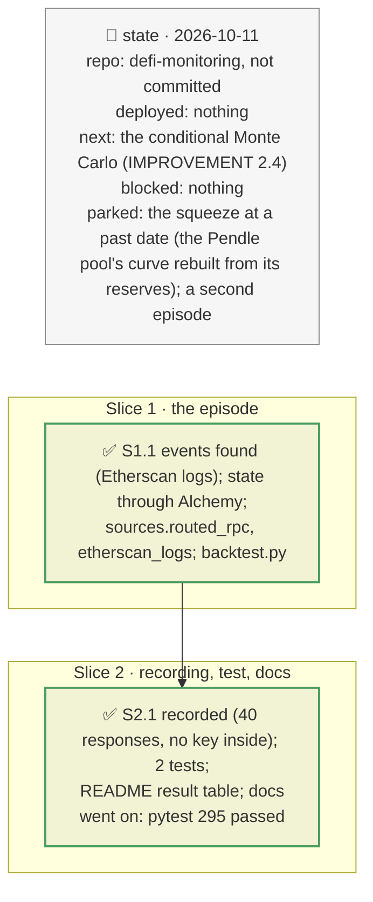

# Backtest on a real incident, plan

> **Status**: approved: the person, 2026-10-11, "Continue but I have added normally an alchemy key and ethereum endpoint in keys.ini" (`IMPROVEMENT.md` 2.3, `NEXT_STEP.md` B9). No interview: the decisions below are the agent's defaults.
> **Delivers**: `riskdep backtest` replays the PT-reUSD liquidations of 2026-08-25 from the state 60 blocks before them, predicts with the liquidation model behind vault incidents and the shock engine's Blue market, and compares with the 33 `Liquidate` events. Result: the same 13 and 7 borrowers predicted as liquidated, none missed, none extra; in the USDC market, debt and liquidation incentive within 0.8 %; no bad debt, as observed.
> **Hard rule**: the archive RPC (Alchemy) and the Etherscan key stay in `keys.ini`, are used as routes and request parameters only, and never reach a cache file or the output (checked on the recording); offline replay with no key; the agent never commits.
> **Read against**: `GAP.md` K8; `NEXT_STEP.md` B9; `docs/shock-engine.md` "Validation"; `market_risk.value` (D45–D50).
> **Left out**: §4 Flows and §5 State: a one-shot replay of recorded responses.

## The tracker

mandate: mode classic · no git, the person commits · inline · tests at the slice end · verify off

# Design

## 1. Why, and why not

"Is the number defensible" is weighed at 30 %, and nothing compared the tool's numbers with what actually happened. The repository named the case (K8): a thin Pendle pool's implied yield spiked, a min(TWAP, linear) oracle fell, and Morpho liquidated 33 positions with no bad debt. A measured error is more credible than an unmeasured one.

**Non-goals**: the squeeze at that date (the Pendle quote API answers for now only; the pool's curve would have to be rebuilt from its reserves at that block); predicting the oracle's fall itself (the shock is the observed fall: this tests impact given the incident, the brief's question).

## 3. Modules, after

- **`sources.py`**: `archive_url` (keys.ini `[rpc] url`, else `[alchemy] alchemy_ethereum_endpoint`), `routed_rpc` (requests through it, cache under the public URL), `etherscan_logs` (keyed, paged, slimmed).
- **`backtest.py`**, new: `decode_liquidation`, `compare` (pure); `run`.
- **`cli.py`**: `backtest [--episode] [--record]`.
- **`registry.json`**: `backtest` (`lead_blocks`, episodes). **`keys.example.ini`**: `[alchemy]`.
- **`fixtures/replay/backtest-pt-reusd-2026-08-25/`**.

## 8. Decisions

| id | Kind | Decision | Status | Source | Slice |
|---|---|---|---|---|---|
| D161 | module | Past state through an archive RPC from keys.ini, used as a route: responses cached under the public RPC's URL, so the key never reaches a file and the replay needs none. Events through Etherscan's logs API (the free archive plan limits `eth_getLogs` to 10 blocks) | agreed, found: Alchemy's free plan refuses wider log ranges | `sources.Fetcher` routing (`RISKDEP_RPC_URL`) | S1 |
| D162 | contract | An episode is data (`backtest.episodes`: markets, a block window, its source). The state before is read `backtest.lead_blocks` (60, 12 minutes) before the first liquidation; borrowers are every `onBehalf` of the markets' `Borrow` events up to that block | agreed, agent's default: the yield spike took nine minutes | `GAP.md` K8 | S1 |
| D163 | contract | The shock is the oracle's lowest price over the liquidation blocks; the prediction is `market_risk.value`'s liquidation test at that price (collateral value × LLTV ≤ debt), the debt that becomes liquidatable, its incentive (debt × (LIF − 1)) and bad debt; realised: the borrowers liquidated, the debt repaid, the incentive (seized × the oracle price of its block − repaid), the bad debt | agreed, agent's default | Morpho Blue `liquidate` | S1 |
| D164 | contract | A test pins the replay: the same borrowers, debt and incentive within 1 % where repaid in full, no bad debt; a model change that moves it away from the chain fails the suite | agreed, agent's default | — | S2 |

# Execution

## 9. The slices

| Slice | Done when | Went on |
|---|---|---|
| S1 | the episode's 33 events found and decoded (35.19M USDC and 0.96M USDT repaid; PT with 6 decimals) | Alchemy's free plan limits `eth_getLogs` to 10 blocks: events through Etherscan (D161) |
| S2 | the replay passes offline; no key in the 40 recorded files; 295 tests pass | in the USDT market liquidators repaid half the liquidatable debt: partial liquidations, stated |

## Interview log

No interview: the person provided the key and asked to continue.
