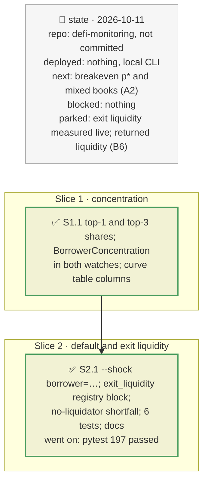

# Borrower concentration, borrower default and exit liquidity, plan

> **Status**: approved: the person, 2026-10-11, "Yes go for it, But don't forget that this should be also useful/can be used for other vault or situation" (the borrower concentration and exit-liquidity findings of `docs/analysis/ROCK-VAULT-DEP.md`). No interview: the decisions below are the agent's defaults.
> **Delivers**: the watches warn when a vault market depends on one borrower (`BorrowerConcentration`); `analyze --vault|--book --shock borrower=<collateral, market id or all>:<recovery>[:<n>]` prices the default of the n largest borrowers of every matching market, alone or with a token markdown; every hit market shows its concentration, its collateral's exit liquidity from the registry, and the loss if nobody liquidates. Proof: Belem (one borrower holds the mGLOeuro market), the f(x) vault (fxSAVE, thin exit liquidity), the RockawayX book under `borrower=all:0.5`.
> **Hard rule**: no new provider (the exit liquidity is measured once and recorded in the registry with its basis); nothing specific to one vault in code: targets are symbols, addresses, market ids or `all`; the agent never commits.
> **Read against**: `defi-monitoring` after plan `2026-10-11-wrapped-collateral`; `docs/analysis/ROCK-VAULT-DEP.md` §5 (borrowers), §7 (DEX depth), §11 (recommended changes); `GAP.md` K27.
> **Left out**: §4 Flows and §5 State: pure additions to an existing one-shot computation and to the watches' assess step.

## The tracker

mandate: mode classic · no git, the person commits · inline · tests at the slice end · verify off

# Design

## 1. Why, and why not

Most RWA markets of the RockawayX vaults are owed by one or two borrowers (`ROCK-VAULT-DEP.md` §5), and their collateral has little or no DEX route (§7). For such a market the risk is not many small liquidations but one borrower not repaying, and a liquidator who cannot sell the collateral. Both apply to any curated vault lending against issuer tokens, so the targets are data: a symbol, an address, a market id or `all`.

**Non-goals**: measuring exit liquidity live (a new provider; recorded in the registry instead); the liquidity liquidations would return (B6); a probability of default per borrower (A2's breakeven p\* answers it from the other side).

## 3. Modules, after

- **`market_risk.py`**: `MarketRisk.top1_share`, `top3_share`, `top_borrower`; `assess_concentration` (pure); `curve_table` columns.
- **`vault_incident.py`**: `parse_shocks`, `normalise`, `describe`, `exit_route`, `borrower_default` (pure); `MarketHit` gains `event`, `defaulters`, `defaulted_debt`, `exit_route`, `no_liquidator_shortfall`, `top1_share`, `top3_share`; `VaultIncident` gains `events`, `labels`.
- **`vault_book.py`**: the shocks in words, any kind; a neutral "reaches N vaults" note.
- **`cli.py`**: `--shock borrower=…` accepted with `--vault` and `--book`.
- **`registry.json`**: `watch.concentration_*`; `exit_liquidity` (basis, `thin_impact`, tokens by address).

## 8. Decisions

| id | Kind | Decision | Status | Source | Slice |
|---|---|---|---|---|---|
| D112 | contract | Each market's valuation carries the largest borrower's share of its debt, the three largest's share, and the largest borrower's address | agreed, agent's default | `ROCK-VAULT-DEP.md` §11 item 3 | S1 |
| D113 | contract | `BorrowerConcentration` (warn), on crossing, for vault markets above `utilization_min_share`: the largest borrower holds at least `watch.concentration_top1_warn` (50 %) of the debt, or the market has fewer than `watch.concentration_min_borrowers` (5) borrowers | agreed, agent's default | registry `watch.concentration_*` | S1 |
| D114 | contract | A vault incident also takes `borrower=<collateral symbol or address, market id, or all>:<recovery>[:<n>]` (n = 1 by default): in each matching market, the n largest borrowers default and their collateral is recovered at `recovery` × its oracle value: bad debt Σ max(0, debt − collateral value × recovery). Combined with a token markdown on the same market, the defaulters' collateral is valued at the marked-down price and they leave the market's normal valuation, so nothing is counted twice; several borrower shocks on one market keep the lowest recovery and the largest n. Collateral symbols match through wrappers as in D110 | agreed, the person asked for any vault or situation | — | S2 |
| D115 | contract | The collateral's exit liquidity is registry data per token address (`exit_liquidity.tokens`: `route` none, thin or deep, price impact by sale size, basis), starting from the 2026-10-11 KyberSwap measurements. A markdown hit with liquidatable debt reports the loss if nobody liquidates (Σ max(0, debt − collateral value), the vault's share), with the liquidity then locked; tokens without an entry are named in a note | agreed, agent's default | `ROCK-VAULT-DEP.md` §7; K27 | S2 |
| D116 | contract | A default has no due date on Morpho Blue: the hit says the oracle does not move, the loss lands when the collateral is seized and sold or redeemed, and the debt accrues until then | agreed, agent's default | Morpho Blue `liquidate` | S2 |

# Execution

## 9. The slices

| Slice | Done when | Went on |
|---|---|---|
| S1 | shares and the alert tested; 191 tests pass | — |
| S2 | Belem's single mGLOeuro borrower at 50 % recovery costs 1.05M EURCV (22 % of the vault); with a 30 % markdown 1.84M; the f(x) vault's fxSAVE market is `thin`; the book under `borrower=all:0.5` loses 12.8M USD; 197 tests pass | the borrow total was counted twice for a defaulted market (`MarketRisk.total_borrow` is the market's total, not the sum of the positions): fixed before the tests |

## Interview log

No interview: the person approved the step and asked that it serve any vault or situation.
