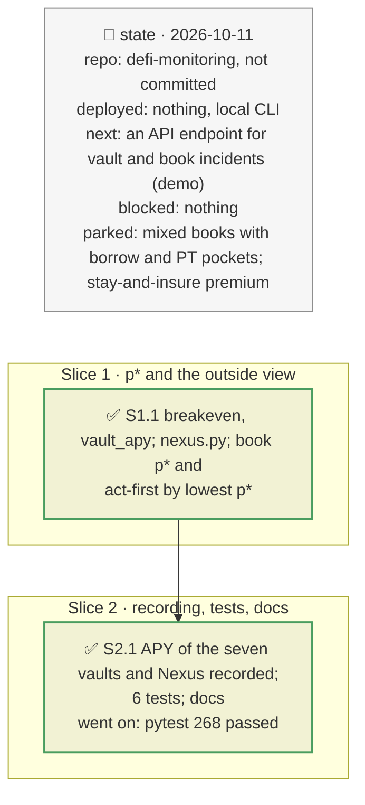

# Breakeven probability and the Nexus outside view, plan

> **Status**: approved: the person, 2026-10-11, "Implement what is the best for hackaton_instruction" (step A2 of `docs/analysis/NEXT_STEP.md`, after one verdict owned by `analyze --vault` / `--book` was recommended). No interview: the decisions below are the agent's defaults.
> **Delivers**: every vault and book incident states, next to its verdict given the incident, the probability above which leaving now pays (p\*, over `--horizon` days and per year), from the yield a depositor gives up and the loss leaving first saves; the book acts first on the vault with the lowest p\*; Nexus Mutual's cover prices on the hit collateral's protocols give an outside probability, with what the cover does and does not pay on. Proof: the f(x) vault under fxSAVE −30 % (p\* 7.9 % over 30 days; f(x) cover implies 1.2–13.7 %/yr for an exploit); Belem's dominant depositor stays whatever the odds; the RockawayX book under PST −30 % acts first on Huma.
> **Hard rule**: keyless; the verdict given the incident is unchanged; outside numbers are shown, never used in a verdict; the agent never commits.
> **Read against**: the brief's trade-off ("exiting is certain and costly, staying is cheap and uncertain"); plans `2026-10-11-vault-incident` (D101), `2026-10-11-vault-book`, `2026-10-11-one-number`; `docs/risk-assessment/outside-providers.md` §2; `docs/analysis/EXTERNAL_SOURCE.md` §4 and §7.
> **Left out**: §4 Flows and §5 State: pure arithmetic on an existing one-shot computation, and two cached reads.

## The tracker

mandate: mode classic · no git, the person commits · inline · tests at the slice end · verify off

# Design

## 1. Why, and why not

The brief's question is stay or exit given an incident, against what exiting costs. The verdict given the incident answered half of it: it assumes the incident is certain. p\* answers the other half without claiming a probability we cannot defend: it says how likely the incident must be for leaving to pay, and an outside price (Nexus) says what the market charges for a related event. One verdict, owned by the vault and book incident; the shock engine supplies the losses (plan `2026-10-11-one-number`).

**Non-goals**: a probability per issuer (B5); a stay-and-insure premium (Nexus's protocol cover does not pay on a NAV markdown or a default, so it would mislead); mixed books with borrow and PT pockets (kept in A2's remainder).

## 3. Modules, after

- **`vault_incident.py`**: `breakeven`, `VaultIncident.breakeven_text` (pure); `vault_apy` (Morpho API); `run(..., horizon_days=, nexus=)`; fields `apy`, `horizon_days`, `exit_cost`, `p_star`, `p_star_year`, `outside`.
- **`vault_book.py`**: per-vault p\*, the book's p\*, the headline's "act first on" by lowest p\*, a `p*/yr` column.
- **`nexus.py`**, new: `covers`, `implied`, `outside_line` (pure); `load` (cached fetcher).
- **`cli.py`**: `_nexus(args)`; `--horizon` reaches vault and book incidents.
- **`registry.json`**: `nexus` (product map, loading range, basis); `incident.breakeven_basis`.
- **`fixtures/replay/nexus/`**, and one APY response in each `incident-<vault>/`.

## 8. Decisions

| id | Kind | Decision | Status | Source | Slice |
|---|---|---|---|---|---|
| D142 | contract | Leaving now costs the vault's net yield (Morpho API `avgNetApy`, rewards included) on what can leave at par, over `--horizon` days (default 30): the brief's certain exit cost for a vault depositor, whose withdrawal has no slippage. Without the yield, no p\*, and the output says so | agreed, agent's default | Morpho API `vaultV2ByAddress` | S1 |
| D143 | contract | p\* = yield forgone ÷ (loss if staying − loss if leaving first), over the horizon; per year 1 − (1 − p\*)^(365/horizon). None when leaving first saves nothing; ≥ 1 when the yield exceeds the saving: stay even if the incident is certain | agreed, agent's default | the brief's trade-off | S1 |
| D144 | contract | The book: each vault's p\* in its depositor's terms; the book's p\* is Σ yield forgone ÷ Σ loss saved over the vaults reached; "act first on" is the vault with the lowest p\* (it replaces D123's "largest loss among the EXIT vaults") | agreed, agent's default | — | S1 |
| D145 | contract | Nexus Mutual, keyless: `/v2/products` and `/v2/capacity`, recorded under `fixtures/replay/nexus/`; `registry.json` `nexus.products` maps token addresses to the product covering their protocol (Tori, f(x), fxUSD depeg, infiniFi, Midas). Each line says what the cover pays on: protocol cover pays on an exploit, not on a NAV markdown or a default | agreed, agent's default | `outside-providers.md` §2 | S1 |
| D146 | contract | Implied probability = price ÷ (loading × severity), for the registry's loading range (2–5); severity is the shock's fall, or 1 − recovery for a default. Shown next to p\*, never used in the verdict | agreed, agent's default | `EXTERNAL_SOURCE.md` §7.5 | S1 |

# Execution

## 9. The slices

| Slice | Done when | Went on |
|---|---|---|
| S1 | p\* on the f(x) vault matches a hand computation; Belem stays whatever the odds; the book acts first on the lowest p\* | — |
| S2 | the seven APYs and Nexus recorded; 268 tests pass | the book's pure test built incidents without p\*: given one |

## Interview log

No interview: the person asked for what serves the brief best, after the recommendation of one verdict with p\*.
