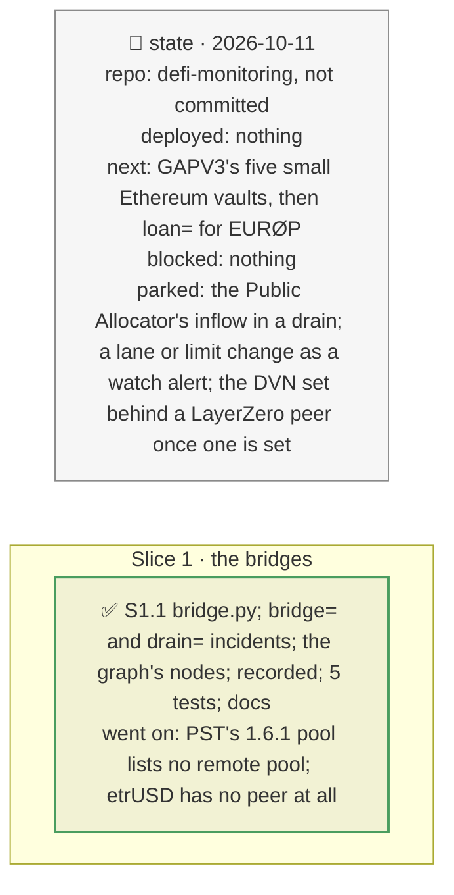

# Bridges: PST's CCIP lanes, etrUSD's LayerZero peers, and the drain a forged mint opens, plan

> **Status**: approved: the person, 2026-10-11, "Implement bridge" (GAP C6, `NEXT_STEP.md`). No interview: the decisions below are the agent's defaults.
> **Delivers**: each bridged collateral of the book read on-chain: PST's CCIP pools (their remote chains and pools, the inbound rate limit, the owner and the rate-limit admin), etrUSD's LayerZero peers and owner; `bridge=<token>[:<hours>]`, the most a forged message can mint within the time to stop the lane, posted at the oracle's price to borrow the PST markets' free liquidity (`drain=`, a new vault-incident kind); the bridge drawn behind the token in the graph.
> **Hard rule**: keyless reads, recorded under `fixtures/replay/bridge/` at one block; the pools and the token's minters were found once through Etherscan's logs and are pinned in `registry.json`; `web/` untouched (`openapi.json` regenerated); the agent never commits.
> **Read against**: `docs/external/chainlink-ccip/chainlink-ccip/chains/evm/contracts/pools/TokenPool.sol`, `libraries/RateLimiter.sol`; `docs/external/layzerzero/layerzero-v2` (`OAppCore.peers`); `docs/analysis/ROCK-VAULT-DEP.md` §4; plan `2026-10-10-drain-threshold` (the drain).
> **Left out**: §4 Flows and §5 State.

## The tracker

mandate: mode classic · no git, the person commits · inline · tests at the slice end · verify off

# Design

## 1. Why, and why not

PST is 35 % of the book's markets and exists on Ethereum only through a bridge: a forged mint is the 2026 hack class "Bridge & Cross-Chain" (`GAP.md`) applied to collateral the vaults lend against. **Non-goals**: the bridges' off-chain verification (CCIP's DON and risk network, LayerZero's DVNs) beyond what bounds a mint on Ethereum; other chains' supply.

## 8. Decisions

| id | Kind | Decision | Status | Source | Slice |
|---|---|---|---|---|---|
| D250 | contract | `bridge.load`: for a CCIP token, each pinned pool's `typeAndVersion`, `getSupportedChains`, `getRemotePools` (a lane is open only with a remote pool listed), the inbound bucket (`getCurrentInboundRateLimiterState` before 2.0, `getCurrentRateLimiterState(chain, false)` from 2.0), `owner` and the rate-limit admin, each classified by `roles.read`; for a LayerZero token, `peers(eid)` on eleven chains and `owner`. Pools found by PST's `RoleGranted(MINTER_ROLE)` logs, pinned | agreed, agent's default; found: PST's 1.6.1 pool is a minter with no remote pool, the 2.0.0 one is open from Solana, 7.7M at once and 6,112 a second; its limits are set by a Safe 4/5 at once, its owner is a 3 h timelock; etrUSD has no peer anywhere, and its owner, a Safe 4/6, can set one at once | `TokenPool.sol`, `RateLimiter.sol`, `OAppCore.sol` | S1 |
| D251 | contract | `bridge=<token>[:<hours>]`: the open lanes' bucket plus their refill over `hours` (default `response_hours`, 1, an assumption) is the most a forged message mints; unbounded when a lane has no limit; refused when no lane is open. The dilution if the issuer honoured the tokens, minted / (Ethereum supply + minted), is stated as the other outcome, an upper bound | agreed, agent's default | `registry.json` `bridge` | S1 |
| D252 | contract | a new vault-incident kind, `drain=<collateral>:<tokens>[:<decimals>]`: the tokens, posted at the oracle's price in each market taking the collateral itself (not a wrapper), borrow min(tokens × price × LLTV, the market's free liquidity), in market order until spent; refused by the issuer, they leave that as bad debt, the vault's share its loss. `bridge=` produces it | agreed, agent's default; the Public Allocator's inflow is not counted, so the drain is a lower bound for a vault that lets it pull | plan `drain-threshold` | S1 |

# Execution

## 9. The slices

| Slice | Done when | Went on |
|---|---|---|
| S1 | the lanes replay offline and drive the book's incident; 410 tests pass | `bridge=PST`: 29.7M unbacked PST within 1 h; the book loses 3.28M (3.31 %): Confidential RWA USDC 2.07M, Huma USDC Main 1.21M; honoured instead, PST would be diluted 12.19 % (upper bound) and no vault would lose. `bridge=etrUSD` is refused: no lane open |

## Interview log

No interview: the person asked for the bridges.
