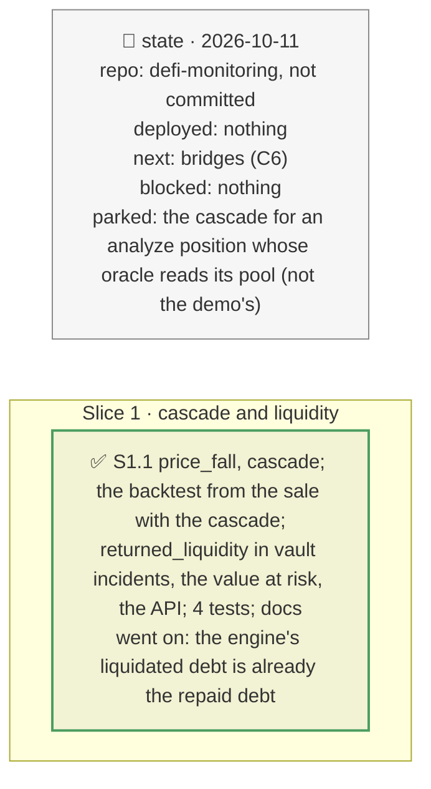

# The cascade and the liquidity liquidations return, plan

> **Status**: approved: the person, 2026-10-11, "Implement K9 and K27". No interview: the decisions below are the agent's defaults.
> **Delivers**: K9, the cascade: the PT the liquidations seize is sold into the Pendle pool the oracle's TWAP reads, which moves its price further and liquidates more, to a fixed point or the pool's cap; in the PT-reUSD backtest it predicts the fall from the sale alone and the liquidations at it. K27: in every vault incident, the debt liquidators repay becomes the market's free liquidity again: what the vault can withdraw more once they have, and that it stays locked when nobody liquidates; in the value-at-risk block and the API.
> **Hard rule**: offline from recordings; `web/` untouched (`openapi.json` regenerated); the agent never commits.
> **Read against**: `docs/analysis/GAP.md` K9, K27; plans `2026-10-11-pendle-pool` (D207–D211), `2026-10-11-borrower-concentration` (D131), `2026-10-11-one-number` (D139), `2026-10-11-value-at-risk`.
> **Left out**: §4 Flows and §5 State.

## The tracker

mandate: mode classic · no git, the person commits · inline · tests at the slice end · verify off

# Design

## 1. Why, and why not

K9: liquidations sell into the market they depend on; the shock engine ran that loop on quote ladders, the backtest did not. K27: liquidations also hand liquidity back, which decides what depositors stuck behind them can withdraw afterwards. **Non-goals**: the cascade for the demo's PT position, whose oracle (a meta-oracle over a constant-price primary and a Chainlink-style backup) does not read its pool; returned liquidity moving the verdict (it arrives with the write-off, so it frees what was stuck, it does not avoid the loss).

## 8. Decisions

| id | Kind | Decision | Status | Source | Slice |
|---|---|---|---|---|---|
| D238 | contract | `pendle_amm.price_fall` and `cascade`, pure: from a first sale, the liquidations at the fall it gives seize PT (`seized_at(fall)`, cumulative) that liquidators sell into the pool, re-priced, to a fixed point; sales beyond the pool's 96 % cap stay with the liquidators. In the backtest, `seized_at` is each market's predicted liquidatable debt × LIF at the oracle's price, from the pool as it stood before; each market is predicted again at the cascade's fall (`from_cascade`) | agreed, agent's default | D208, D210 | S1 |
| D239 | contract | `vault_incident.returned_liquidity`, pure, per hit: when liquidators can act (an exit route, a markdown), the debt they repay (the engine's liquidated debt, or the liquidatable debt less what its collateral does not cover) is the market's free liquidity again; the vault can withdraw more, up to what it still has there after its loss. Summed on the vault (`returned_liquidity`) and the book's value at risk (`returned_usd`); said to stay locked if nobody liquidates. The verdict is unchanged | agreed, agent's default; found: the engine's figure is already repaid debt | D131, D139 | S1 |

# Execution

## 9. The slices

| Slice | Done when | Went on |
|---|---|---|
| S1 | the backtest's cascade and the vault incidents replay offline; 389 tests pass | PT-reUSD: from the sale's 2.36 %, the liquidations seize 40.47M PT (realised 38.64M); the pool takes 98k before its cap, so the fall stops at 2.46 % (observed 2.45 % and 2.76 %), the same 13 and 7 borrowers, 40.37M PT left with the liquidators. fxSAVE −30 % on the f(x) vault: liquidators repay 1.49M, freed for the vault to withdraw once they have (2.95M now); Belem's mGLOeuro (no exit route) and the Tori vault's linear-discount PT market (nobody liquidated) free nothing |

## Interview log

No interview: the person asked for K9 and K27.
