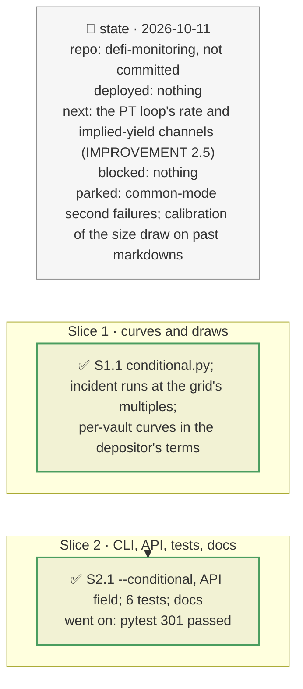

# The conditional Monte Carlo, plan

> **Status**: approved: the person, 2026-10-11, "Yes go for it" (`IMPROVEMENT.md` 2.4, `NEXT_STEP.md` A4). No interview: the decisions below are the agent's defaults.
> **Delivers**: `analyze --vault|--book … --conditional` (API `conditional: true`) draws, given the incident, how it evolves (its size recovering or deepening; liquidators failing to act where the collateral has no exit route) and gives the distribution of the loss of staying against the certain cost of leaving, per vault and for the book. Proof: the brief's ten pockets under mGLOeuro −30 % at an 11 % unwind: leaving costs 110,000 for sure; staying loses 52,067 on average but 246,211 at the 95th percentile, and is worse in 18 % of paths.
> **Hard rule**: losses come from real incident runs (engine included), not a second model; the parameters are a stated judgement in the registry; the verdict and p\* are unchanged; the agent never commits.
> **Read against**: `docs/analysis/ANALYSIS_CURRENT.md` §6 (why the Monte Carlo must be conditional); plans `2026-10-11-breakeven`, `2026-10-11-judge-path`, `2026-10-11-borrower-concentration` (exit liquidity, no-liquidator shortfall).
> **Left out**: §4 Flows and §5 State: one more pure step after the incident runs.

## The tracker

mandate: mode classic · no git, the person commits · inline · tests at the slice end · verify off

# Design

## 1. Why, and why not

The brief contrasts leaving, "expensive and certain", with staying, "cheap and uncertain". The verdict given the incident and p\* treat the incident's loss as one number; the uncertainty of staying once it has happened was not shown. `ANALYSIS_CURRENT.md` §6: the Monte Carlo should be conditional on the known incident, not draw incidents from yearly priors.

**Non-goals**: a second issuer failing with the first (Pharos common-mode groups: next, it needs the mates' addresses, not their names); calibrating the draw on past markdowns (the registry states the judgement); borrower defaults (only a markdown's size is drawn).

## 3. Modules, after

- **`conditional.py`**, new, pure: `Curve`, `Distribution`, `draw_multiples`, `simulate`, `worst_route`.
- **`pipeline.py`**: `incident(..., conditional=)` runs the incident at `conditional.grid` multiples of each token fall, once per vault source and graph; `conditional_distribution` builds the curves.
- **`vault_incident.py`**, **`vault_book.py`**: a `conditional` field and a line in the output.
- **`cli.py`** `--conditional`; **`api/`** `conditional` in the request, `Conditional` in the response; `openapi.json` regenerated.
- **`registry.json`**: `conditional`.

## 8. Decisions

| id | Kind | Decision | Status | Source | Slice |
|---|---|---|---|---|---|
| D165 | contract | Given the incident, the loss of staying is a distribution: mean, median, 95th and 99th percentiles, against the mean loss of leaving first plus the certain cost of leaving (the yield or `--exit-cost`), and the share of paths where staying is worse; per vault in its depositor's terms (the pocket in a pocket book), and for the book | agreed, the brief's trade-off | `GOAL.md` | S1 |
| D166 | contract | The size: a multiple m of the fall given; with `conditional.recover_prob` (0.3) partly reversed, m uniform on 0–1; otherwise lognormal, median 1, σ `conditional.deepen_sigma` (0.35); the fall capped below 100 %. A book's vaults share m | agreed, a stated judgement to calibrate | — | S1 |
| D167 | contract | Liquidators fail with `conditional.no_liquidator_prob` by the worst exit route of the vault's liquidatable hits (none 0.5, thin 0.25, unknown 0.2, deep 0.05); the vault's loss is then the no-liquidator shortfall, its ratio to the liquidated loss measured at each multiple | agreed, agent's default | `exit_liquidity`, D131 | S1 |
| D168 | module | Losses at m come from real incident runs at `conditional.grid` (0.25–2 × the fall, and 0 at no fall), interpolated; each vault's source and graph are read once; 10,000 paths, seed 7 | agreed, agent's default: about three seconds for the ten-pocket book offline | — | S1 |

# Execution

## 9. The slices

| Slice | Done when | Went on |
|---|---|---|
| S1 | the ten-pocket book's distribution: staying cheaper on average, its tail above the exit cost | — |
| S2 | the CLI and the API agree; 301 tests pass | the test's expected share of paths was wrong (0.35 for 0.83): the simulation was right |

## Interview log

No interview: the person approved the step.
