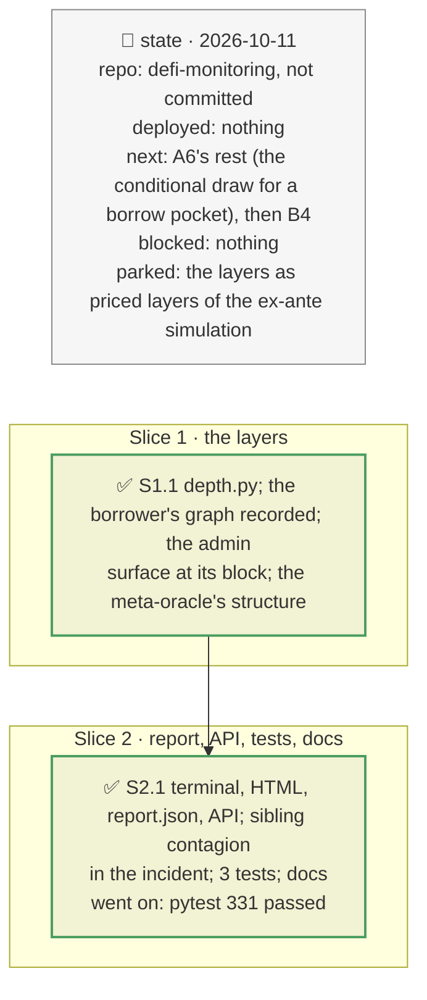

# Discovery depth for the brief's PT position, plan

> **Status**: approved: the person, 2026-10-11, "Implement C1" (`NEXT_STEP.md` C1; `IMPROVEMENT.md` priority 3, first row). No interview: the decisions below are the agent's defaults.
> **Delivers**: `analyze` (the brief's own worked example, a PT looped on Morpho) reports the layers its dependency graph knows beyond the five it had: the oracle's structure (a meta-oracle's two sources and its switch), who can change the oracle and the tokens and through which timelock, the sibling markets that sell the same collateral with what a 10 % fall liquidates there, the collateral's issuer grade and off-chain backing (Pharos), and the protocols' share of DeFi TVL; the position's incident names the sibling contagion. In the terminal, the HTML report, `report.json` and `POST /api/analyze`.
> **Hard rule**: offline from recordings (the borrower's graph, its market's admin surface at the graph's block); additions only to the report's JSON and the API (`openapi.json` regenerated); `web/` untouched; the agent never commits.
> **Read against**: `docs/hackaton_instruction/GOAL.md` (dependency discovery 30 %); plans `2026-10-10-sibling-markets`, `2026-10-10-admin-surface`, `2026-10-11-pharos`, `2026-10-11-feed-quality`.
> **Left out**: §4 Flows and §5 State.

## The tracker

mandate: mode classic · no git, the person commits · inline · tests at the slice end · verify off

# Design

## 1. Why, and why not

The brief weighs dependency discovery at 30 %, and its worked example is the PT position, whose report was the shallowest view in the tool: the graph, the vault incidents and the watches knew siblings, admins, backing, freshness and concentration; `analyze` knew five layers.

**Non-goals**: pricing the new layers in the ex-ante Monte Carlo (secondary view); a live graph for any position (a recording, with its block and date).

## 8. Decisions

| id | Kind | Decision | Status | Source | Slice |
|---|---|---|---|---|---|
| D199 | contract | `analyze` reads the borrower's recorded graph (`graph --user <borrower> --record`), annotated with Pharos and TVL as `graph` does; without one, the report is unchanged. The layers carry the graph's block | agreed, agent's default | — | S1 |
| D200 | contract | The oracle: each input the graph links (class, freshness); for a meta-oracle, which the graph cannot see into, the structure `scenario.oracle_profile` reads: its live source, the other one, the threshold and the switch's delay | agreed, found: the demo's meta-oracle had no input edges in the graph | `scenario.py` | S1 |
| D201 | contract | Who can change it: each upgradeable or owned contract behind the market (`admin.AdminWatch` at the graph's block), its admin, and the timelock above it or "no timelock seen" | agreed, agent's default | plan `2026-10-11-fork-demo` (D182) | S1 |
| D202 | contract | The sibling markets linked to the position's market, by what a 10 % fall liquidates there; the collateral's grade and backing (Pharos); the protocols' TVL share; the position's incident names the sibling contagion | agreed, agent's default | — | S2 |

# Execution

## 9. The slices

| Slice | Done when | Went on |
|---|---|---|
| S1 | the demo's layers read offline | the meta-oracle: D200; sUSDe was not mapped to Ethena in `tvl.tokens`: added |
| S2 | the report, the JSON and the API carry them; 331 tests pass | — |

## Interview log

No interview: the person asked for C1.
