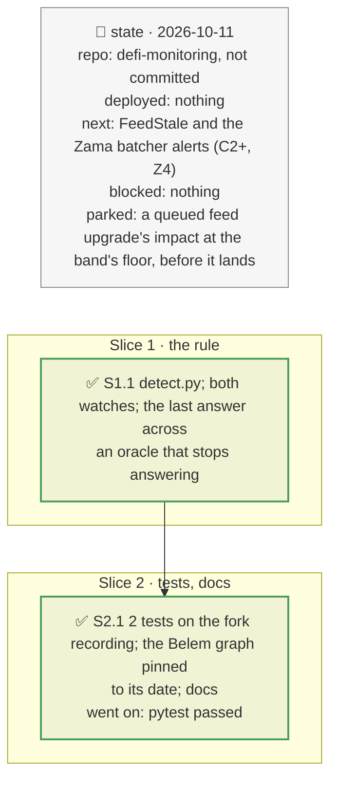

# Detection → impact for a vault, plan

> **Status**: approved: the person, 2026-10-11, "Yes go for A3" (`NEXT_STEP.md` A3; the fork demo's `admin.py` and `watch.py` work committed). No interview: the decisions below are the agent's defaults.
> **Delivers**: when a vault market's oracle falls in a batch, `watch --vault` (and a vault deposit in `watch --user`) raises `OracleImpact`: the vault's loss at the new prices, the debt now liquidatable, the depositor's loss if it stays or leaves first, and the verdict, by the rule of `analyze --vault`. Proof: the fork demo's recorded crisis: act 2 (the issuer's −10 %) warns that 3,679,003 EURCV is liquidatable with no loss yet (STAY); act 6 (the NAV at 70,000 after the timelocked upgrade, −22.2 %) states the vault's loss as 215,003 EURCV when the price lands, 1.1 % from the 217,286 realised by the liquidation four blocks later.
> **Hard rule**: pure, from what the watch already holds (no request, so the recordings test it); the existing alerts unchanged; the agent never commits.
> **Read against**: the brief's chain (detect → impact → how fast → decide); plans `2026-10-11-vault-incident` (`decide`, D101), `2026-10-11-fork-demo` (the recorded crisis), `2026-10-10-market-borrowers` (`VaultRisk`).
> **Left out**: §4 Flows and §5 State: one more rule in the existing loop.

## The tracker

mandate: mode classic · no git, the person commits · inline · tests at the slice end · verify off

# Design

## 1. Why, and why not

The brief's chain is detect, impact, how fast, decide. The watches detected an issuer's markdown (an oracle move, divergence from the market, later the bad debt) but no alert said what it costs the vault and the depositor, or what to do: that answer lived in `analyze --vault`. In a crisis the watch is what is running.

**Non-goals**: a queued feed upgrade's impact before it lands (the band's floor is known, the new price is not); `FeedStale` and the Zama batcher alerts (next); re-running the full vault incident in the watch (the engine and its graph stay in `analyze`).

## 3. Modules, after

- **`detect.py`**, new, pure: `last_prices`, `oracle_falls`, `impact_alerts`.
- **`watch.py`**, **`watch_user.py`**: call it after `VaultRisk.step`, with each oracle's last answer.
- **`registry.json`**: `watch.impact_oracle_fall`. **`fixtures/replay/graph-0xd6d4…48ec/meta.json`**: `as_of`, its block's timestamp (a replay measured feed ages from the wall clock).

## 8. Decisions

| id | Kind | Decision | Status | Source | Slice |
|---|---|---|---|---|---|
| D187 | contract | A vault market's oracle falling at least `watch.impact_oracle_fall` (2 %) since its last answer is an incident that has landed; an oracle that stops answering keeps its last answer, so a fall across the gap counts | agreed, found on the fork run: the feed answered nothing for one batch during its upgrade | the fork recording | S1 |
| D188 | contract | One `OracleImpact` per batch: the falls, the vault's loss at the new prices (unrealised bad debt × the vault's share of each market), the debt now liquidatable in the fallen markets, the depositor's loss if it stays or leaves first, and the verdict by `vault_incident.decide`; critical with a loss, warn otherwise; `depositor_impact` is the loss if it stays | agreed, agent's default | D101 | S1 |
| D189 | contract | The same rule for a vault deposit in `watch --user` | agreed, agent's default | — | S1 |

# Execution

## 9. The slices

| Slice | Done when | Went on |
|---|---|---|
| S1 | the fork replay raises act 2 and act 6 | act 6 was missed: the feed answered nothing for a batch during its upgrade: D187 measures from the last answer |
| S2 | the tests pass offline | `test_feeds` drifted with the wall clock: the Belem graph recording had no `as_of`; pinned to its block's timestamp (17.5 days, as `ROCK-VAULT-DEP.md` reads) |

## Interview log

No interview: the person approved A3.
