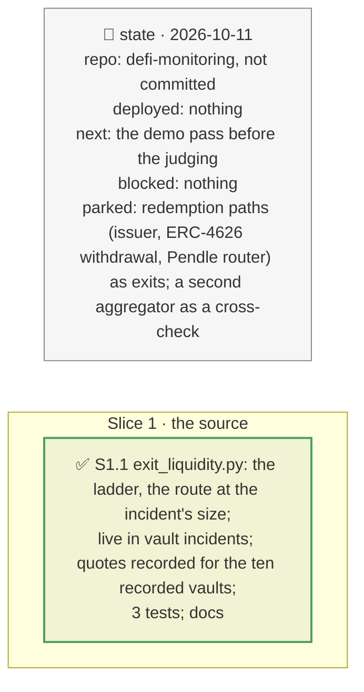

# Exit liquidity live from KyberSwap, plan

> **Status**: approved: the person, 2026-10-11, "Go for it" (KyberSwap as a source rather than a hand-made snapshot; GAP K27). No interview: the decisions below are the agent's defaults.
> **Delivers**: a vault incident quotes each hit market's collateral on KyberSwap's aggregator into its loan token, on a fixed ladder of sizes, and reads the route, the slippage against the oracle and the aggregator's capacity at the size the incident's liquidations seize; this replaces the registry's routes measured by hand on 2026-10-11, which stay as the fallback. The route feeds the no-liquidator branch and the conditional draw as before.
> **Hard rule**: keyless; through the cached fetcher (`--record` saves, offline replays); `web/` untouched (the API gains three optional fields, `openapi.json` regenerated); the agent never commits.
> **Read against**: `docs/hackaton_instruction/GOAL.md` (impact 30 %); `docs/analysis/GAP.md` K27; plans `2026-10-11-borrower-concentration` (D131), `2026-10-11-conditional` (D167).
> **Left out**: §4 Flows and §5 State.

## The tracker

mandate: mode classic · no git, the person commits · inline · tests at the slice end · verify off

# Design

## 1. Why, and why not

Whether a liquidator acts, and at what slippage, decided the no-liquidator branch from routes measured once by hand, for seven tokens. **Non-goals**: redemption paths (an issuer's redemption, an ERC-4626 withdrawal, Pendle's router), which the incident names when the aggregator's route is not deep; a second aggregator.

## 8. Decisions

| id | Kind | Decision | Status | Source | Slice |
|---|---|---|---|---|---|
| D212 | contract | `exit_liquidity.ladder`: KyberSwap `GET /ethereum/api/v1/routes` (keyless) selling the collateral into the market's loan token at `exit_liquidity.sizes` (0.1M, 1M, 5M, 20M loan units), the amount in from the oracle's price; the slippage is 1 − amount out ÷ size, against the oracle (the liquidation's settlement price); the ladder stops at the first size with no route. A refusal (HTTP 400 with a code and a message) is cached like an answer, so a replay tells no route from no recording | agreed, agent's default | D131 | S1 |
| D213 | contract | `exit_liquidity.at`: at the size the liquidations seize (debt liquidatable × LIF): `none` when the smallest size has no route; `thin` when the interpolated slippage exceeds `thin_impact` or the size is beyond the largest routed; `deep` otherwise; with the slippage and the capacity | agreed, agent's default | D131 | S1 |
| D214 | contract | Vault incidents quote every markdown hit with liquidatable debt after the shock engine ran; the quoted route replaces the registry's; with no quote (offline, no recording; the API down) the registry's stays, marked as such. A note says the aggregator is the DEX exit only when a route is not deep | agreed, agent's default | D131, D139 | S1 |

# Execution

## 9. The slices

| Slice | Done when | Went on |
|---|---|---|
| S1 | the recorded incidents replay with live quotes; 346 tests pass | the quotes agree with the hand measurements where both exist (etrUSD 55 % at 0.1M, fxSAVE, strUSD, PST, PRIME); mGLOeuro, oTFYe, AUTO and PT-reUSD have no route; the Tori PTs (77 % at 0.1M) and steakEURCV (86 %) were not measured before. The quotes were taken 2026-10-11, after the incidents' recorded blocks |

## Interview log

No interview: the person asked for KyberSwap as a source.
