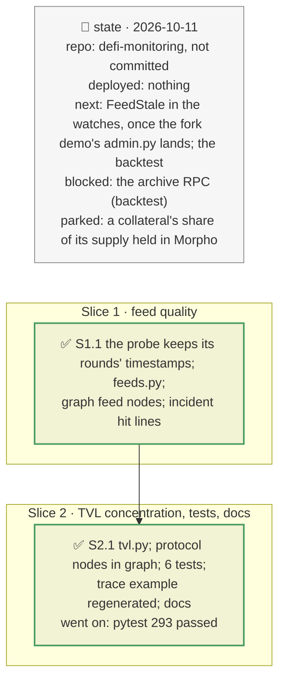

# Feed quality and TVL concentration, plan

> **Status**: approved: the person, 2026-10-11, "Implement this, check scripts/fork which implement FORK-PRESENTATION.md" (`IMPROVEMENT.md` priority 3, `NEXT_STEP.md` C2 and C3). No interview: the decisions below are the agent's defaults.
> **Delivers**: every base feed of a graph's oracles carries its freshness against its own update rhythm, a hit market of a vault incident lists its feeds and flags a stale one; every Blue market, PT and issuer token of a graph points to its DefiLlama protocol, with that protocol's share of DeFi and of its category. Proof: Belem's mGLOeuro NAV feed, 17.5 days old with two rounds, is STALE; Pendle V2 (25 % of Yield) and Lido (43 % of Liquid Staking) are concentrations, Tori Finance is not.
> **Hard rule**: no new request (both come from reads the recordings already hold: the oracle probe's rounds, DefiLlama's protocol list); the fork demo's files (`admin.py`, `watch.py`, `rules.py`, `scripts/fork/`, being edited in parallel) untouched; `web/` untouched; the agent never commits.
> **Read against**: `docs/analysis/FORK-PRESENTATION.md` and plan `2026-10-11-fork-demo` (D180–D186: the feed band, the timelock queue and the exit gates are there, in `admin.py`); `docs/analysis/ROCK-VAULT-DEP.md` §11 item 2; `IMPROVEMENT.md` §3.
> **Left out**: §4 Flows and §5 State: one-shot annotations of a built graph.

## The tracker

mandate: mode classic · no git, the person commits · inline · tests at the slice end · verify off

# Design

## 1. Why, and why not

The brief names two scope items the tool did not measure: "oracle dependency and feed-quality analysis" and "protocols concentrating a large share of on-chain TVL". The fork demo (plan `2026-10-11-fork-demo`) already reads a custom feed's band, the timelock above it and the exit gates, in `admin.py`; what it does not read is how old a feed is, and nothing measured TVL concentration.

**Non-goals**: a `FeedStale` watch alert (it belongs in `admin.py` / `watch.py`, which the fork demo is editing: next, once that lands); Chainlink's heartbeat and deviation threshold (off-chain configuration, not readable); a collateral's share of its supply held in Morpho (needs `totalSupply` at the recorded block, which the free RPC no longer serves).

## 3. Modules, after

- **`oracle_class.py`**: `Probe.updated_at`, `Probe.update_times`, from the responses `probe` already decodes; `_history` returns the timestamps too.
- **`feeds.py`**, new, pure: `freshness`.
- **`tvl.py`**, new, pure: `concentration`, `slug_of`.
- **`graph.py`**: base feed nodes get `updated_at`, `freshness`, `stale`; `annotate_tvl` adds protocol nodes.
- **`vault_incident.py`**: `market_feeds` (pure); `MarketHit.feeds`, `stale_feed`; a note when a hit feed is stale.
- **`pipeline.py`**: `llama_protocols(mode)`. **`cli.py`**: `graph` annotates TVL.
- **`registry.json`**: `feeds`, `tvl`. **`docs/shock-trace-example.json`**: regenerated (its graph carries the new details).

## 8. Decisions

| id | Kind | Decision | Status | Source | Slice |
|---|---|---|---|---|---|
| D155 | contract | A feed's freshness comes from the oracle probe's own reads: the latest round's `updatedAt` and the past rounds' (`graph.oracle_history_rounds`); no extra call, so every recorded graph has it. Age is measured from the run's clock (the recording's date in a replay) | agreed, agent's default | `oracle_class.probe` | S1 |
| D156 | contract | Cadence = the median gap between rounds, trusted from `graph.oracle_history_min` rounds (as the classification); stale when older than `feeds.stale_factor` (3) × cadence and `feeds.stale_min_hours` (25), or, without a trusted cadence, older than `feeds.no_history_max_days` (7) | agreed, found on Belem: two rounds 50 days apart hid a 17.5-day-old NAV | `ROCK-VAULT-DEP.md` §11 item 2 | S1 |
| D157 | contract | A vault incident's hit market lists its oracle's base feeds with their freshness when the vault's graph is recorded; a stale one adds a note | agreed, agent's default | — | S1 |
| D158 | contract | A graph node's protocol is data: every Blue market is `tvl.blue_markets` (Morpho Blue), every PT `tvl.pt_assets` (Pendle V2), an issuer token by `tvl.tokens` (address → DefiLlama slug) | agreed, agent's default | DefiLlama `/protocols` | S2 |
| D159 | contract | Concentration: the protocol's TVL against all of DeFi and against its DefiLlama category, with its rank; concentrated from `tvl.warn_share_defi` (2 %) of DeFi, or `tvl.warn_share_category` (25 %) of a category of at least `tvl.warn_category_min_usd` (1B). Shares of the all-chain total: the cached list has no per-chain split | agreed, found: fx Protocol is 57 % of a 220M category, not systemic | — | S2 |
| D160 | contract | `graph` draws each protocol once, as an External node carrying its TVL, shares, rank and flag, with `runs on` (markets) and `issued by` (tokens) edges; offline from the snapshot's list, live read and not saved | agreed, agent's default | — | S2 |

# Execution

## 9. The slices

| Slice | Done when | Went on |
|---|---|---|
| S1 | Belem's mGLOeuro feed flagged on the recorded graph and in the incident | a 2-round cadence hid the stale NAV: D156 requires the classification's minimum of rounds |
| S2 | the RockawayX USDC Yield graph has 7 protocol nodes; 293 tests pass | the committed trace example embeds feed details: regenerated as `docs/shock-trace.md` says; `web/src/mocks/shock-trace.json` (a copy of it) left to the front end |

## Interview log

No interview: the person asked for both items and to take the fork demo into account.
