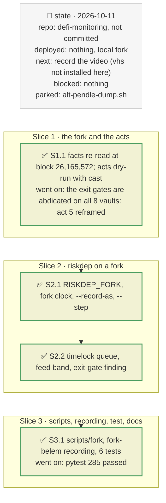

# Fork demo: a crisis played on a mainnet fork, plan

> **Status**: approved: the person, 2026-10-11, "Now implement it" (`docs/analysis/FORK-PRESENTATION.md`, after the plan and the reframing of act 5). No interview: the decisions below are the agent's defaults, except the scenario (the Belem vault, FORK-PRESENTATION.md §1), chosen with the person.
> **Delivers**: `scripts/fork/` plays the Belem RWA EURCV crisis on a local anvil fork of mainnet (issuer markdown, liquidation, run, abdicated gate, timelocked feed upgrade, realised bad debt) with an on-chain check per act. `riskdep watch` follows it live, its recording replays offline (`fixtures/replay/fork-belem/`) and a test pins the alert sequence. Proof: the act-6 upgrade is alerted at its scheduling, 48 h before it lands; the loss observed on-chain (217,286 EURCV) is set against the 251,761 predicted in act 1.
> **Hard rule**: every action on the fork uses a role the protocols grant (issuer, curator, timelock, CCIP pool), never an exploit; on-chain reads are never changed by the fork flag; keys only in `keys.ini`; tests offline; the agent never commits.
> **Read against**: `docs/analysis/FORK-PRESENTATION.md`; `docs/analysis/ROCK-VAULT-DEP.md` §2–§4; plans `2026-10-10-admin-surface` (D52–D58) and `2026-10-10-morpho-vault-v2-watcher` (D44); the brief's "working demo on real data" (15 %).
> **Left out**: §4 Flows and §5 State: scripts and three read-only additions to existing modules.

## The tracker

mandate: mode classic · no git, the person commits · inline · tests at the slice end · verify off

# Design

## 1. Why, and why not

The brief weighs "a working demo on real data". A recorded mainnet range shows what happened, not what the tool does in a crisis, and crises are rare. A fork keeps the real state (positions, oracles, roles) and lets the demo cause the crisis with the roles that could really cause it. The video then shows detection, impact and decision on the same numbers the tool predicted.

**Non-goals**: a general scenario engine on forks (the shock engine already prices scenarios off-chain); exploits; recording the video itself (no `vhs` here).

## 3. Modules, after

- **`sources.py`**: `FORK` from `RISKDEP_FORK`.
- **`crosscheck.py`**: the three checks read "not checked" on a fork.
- **`cli.py`**: the fork guard and clock; `watch --record-as NAME`, `watch --step N`.
- **`watch.py`**: `fork` and `step` stored in a recording's `start.json` and restored on replay.
- **`admin.py`**: `_discover_controllers` (proxy admins and timelocks one level up), `_read_bands`, `timelock_over`; rules `_timelock_alert`, `band_findings` (pure); a timelock-queue filter.
- **`abi.py`**: `CallScheduled`, `CallExecuted`, `Cancelled`.
- **`rules.py`**: the `ExitGate` startup finding; a `Submit` of an abdicated function is info.
- **`registry.json`**: `watch.feed_band_report_floor` and its basis.
- **`scripts/fork/`**, new: `start-fork.sh`, `crisis-belem.sh`, `alt-redstone.sh`, `alt-pst-mint.sh`, `alt-fxsave-expiry.sh`, `lib.sh`, `addresses.env`, `src/MGloEuroFeedV2.sol`, `src/FixedAnswerFeed.sol`, `tapes/`.
- **`fixtures/replay/fork-belem/`** and **`tests/test_fork_replay.py`**, new.

## 8. Decisions

| id | Kind | Decision | Status | Source | Slice |
|---|---|---|---|---|---|
| D180 | contract | `RISKDEP_FORK=1` marks the main RPC as a local fork: the block-hash check against dRPC/1rpc and the two Morpho-API-vs-chain checks read "not checked" (the fork's blocks exist nowhere else; the API still describes mainnet). Nothing else changes. It requires `RISKDEP_RPC_URL`, so it can never silence the checks on mainnet. A recording stores it and its replay restores it | agreed, agent's default | FORK-PRESENTATION.md §4 | S2.1 |
| D181 | contract | On a fork, "now" is the fork's latest block timestamp (`clock.set_as_of`), so days to a PT's maturity follow `anvil_increaseTime`. Replays keep their own clock | agreed, agent's default | — | S2.1 |
| D182 | contract | Above each watched contract, one level up: its proxy admin, the proxy admin's owner, and its own owner. Any of them answering `getMinDelay()` is an OpenZeppelin `TimelockController` whose queue is watched (`CallScheduled`, `CallExecuted`, `Cancelled`). An upgrade, `changeProxyAdmin` or `transferOwnership` of a watched contract is a warn when scheduled (the delay is the depositor's window), and a warn when executed (the contract's own `Upgraded` stays critical); any other queued call is info. Unreadable (a replay recorded before): skipped, "not checked" | agreed, agent's default | `ROCK-VAULT-DEP.md` §3; act 6 | S2.2 |
| D183 | contract | A feed exposing `minAnswer`/`maxAnswer` (Midas custom aggregators) has a band. When its floor is within `watch.feed_band_report_floor` (0.5) below the latest answer, a startup warn says how far the oracle can fall without new code, and through which timelock that code must pass | agreed, agent's default | mGLOeuro/EUR, band 90,000–110,000, no setter | S2.2 |
| D184 | contract | `ExitGate` at startup: warn when `setSendSharesGate` or `setReceiveAssetsGate` has a 0 timelock and is not abdicated (withdrawals can be gated with no notice); info when both are abdicated (only liquidity can stop an exit). A `Submit` of an abdicated function is info, not "pending change": it can never execute | agreed, agent's default | all 8 RockawayX vaults, read 2026-10-11: both abdicated | S2.2 |
| D185 | contract | `watch --record-as NAME` records under `fixtures/replay/NAME/` (a fork run must not overwrite the vault's real recording). `watch --step N` sets the blocks per batch; the recording stores it and its replay reuses it, or its requests would not match. `--step 1` sees a short crisis act by act | agreed, agent's default | — | S2.1 |
| D186 | contract | The scripts act only through granted roles (`--auto-impersonate`): the feed admin EOA, the timelock's proposer Safe, the curator Safe, a CCIP pool, depositors, a liquidator funded by writing EURCV's balance slot (140). Fork upstream: `keys.ini [rpc] url`, else keyless archive endpoints (Tenderly gateway, Blast, MEV Blocker), never dRPC (the cross-check's independent node). Demo contracts (`MGloEuroFeedV2`, `FixedAnswerFeed`) say they are not protocol code | agreed, agent's default | FORK-PRESENTATION.md §3, §7 | S3.1 |

# Execution

## 9. The slices

| Slice | Done when | Went on |
|---|---|---|
| S1.1 | every act runs with `cast` on a fork at 26,165,572 | `setReceiveAssetsGate` reverts `Abdicated`: on all 8 vaults both exit gates are abdicated, which `ROCK-VAULT-DEP.md` §2 had wrong (it read the Morpho API's durations, not its `abdicatedAt`). Act 5 now shows the curator cannot close the exit; `RedemptionWhitelistGate.sol` is dropped. EURCV and mGLOeuro have no transfer whitelist, so act 3 stays |
| S2.1 | a watch on the fork prints "not checked" for the cross-checks; a recording replays offline | a first recording ran the crisis as one batch and merged act 2 into act 6: `--step` |
| S2.2 | the startup shows the band, the timelock and the abdicated gates; act 6 is alerted at scheduling | act 5's `Submit` raised a false critical: D184 |
| S3.1 | `crisis-belem.sh` runs end to end with its checks; `test_fork_replay.py` passes offline | after act 6's 48 h warp, RedStone's push feeds revert as stale on the fork: `alt-redstone.sh` needs a fresh fork. Bash integer overflow on 18-decimal amounts: sums in python |

## Interview log

No interview: the person asked to implement the plan of `FORK-PRESENTATION.md` after reviewing it twice (the gate file, then its fit to the vaults).
