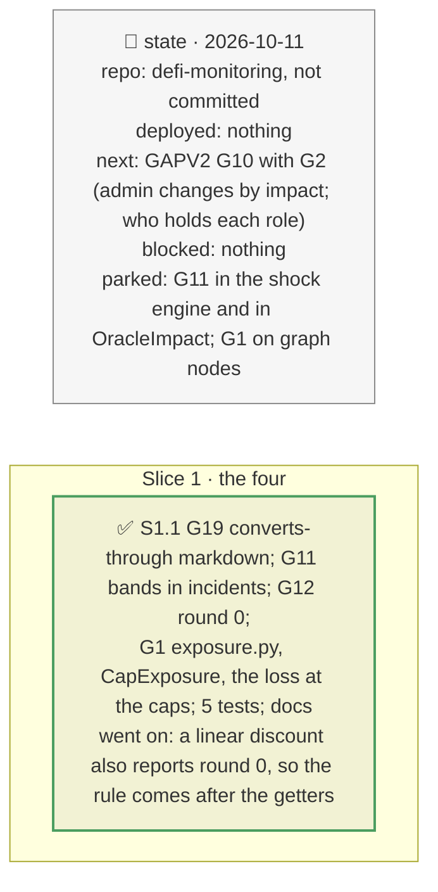

# GAPV2 fixes: ERC-4626 rates, the Midas band, values computed on read, exposure up to the caps, plan

> **Status**: approved: the person, 2026-10-11, "Go now in this case" (GAPV2 G19, G11, G12, G1, in that order). No interview: the decisions below are the agent's defaults.
> **Delivers**: G19: a markdown reaches an oracle that applies the token's own ERC-4626 rate (siUSD −30 % now liquidates). G11: a feed with a fixed band (Midas) holds the oracle at its floor; the incident shows the stage now and the full markdown after the feed's upgrade, with the timelock. G12: a feed that computes its value on read (round 0, f(x)'s NAV adapter) is an exchange rate, and its freshness says "computed on read". G1: the most the vault can hold within its caps: a `CapExposure` start-up finding per oracle, and each incident's loss at the caps.
> **Hard rule**: offline from recordings (Belem's band and timelock recorded once through the archive route); `web/` untouched (`openapi.json` regenerated); the agent never commits.
> **Read against**: `docs/analysis/GAPV2.md` G1, G11, G12, G19; plans `2026-10-11-oracle-kinds` (D205), `2026-10-11-one-number` (D139), `2026-10-11-fork-demo` (D183), `2026-10-11-feed-quality` (D155).
> **Left out**: §4 Flows and §5 State.

## The tracker

mandate: mode classic · no git, the person commits · inline · tests at the slice end · verify off

# Design

## 1. Why, and why not

GAPV2's own order: fix what a judge can show to be wrong first (G19, G11, G12), then the cheap gap that changes an impact figure on every recorded vault (G1). **Non-goals**: the band in the shock engine and in `OracleImpact` (the incident carries both stages); exposure on the graph's nodes.

## 8. Decisions

| id | Kind | Decision | Status | Source | Slice |
|---|---|---|---|---|---|
| D240 | contract | `engine_shocks`: a markdown of T also makes `reads-low` an oracle that `converts through` T itself (an ERC-4626 rate, BASE_VAULT), unless one of its feeds already reads it low (counted once). siUSD −30 % on RockawayX USDC Yield: oracle × 0.700, 5.85M liquidated (was × 1.000, nobody); fxSAVE unchanged | agreed, agent's default; found: the edge was never carried | GAPV2 G19, D139 | S1 |
| D241 | contract | `feed_bands`: each hit market's feed with a fixed band and the timelock above it, through the admin surface at the incident's block; when the markdown exceeds the floor, the hit gets `band`: the stage now (`market_hit` at the floor's fall) and the full markdown's figures after the feed's upgrade, the timing saying both and the timelock; skipped when the reads are not recorded | agreed, agent's default | GAPV2 G11, D183 | S1 |
| D242 | contract | `Probe.round_id`; a constant-price input reporting round 0 with an answer other than 1.0 computes its value on read (verified: f(x)'s `NetAssetValueChainlinkAdapter.latestRoundData` returns `(0, token.nav(), 0, 0, 0)`): kind exchange rate, after the getter rules (a linear discount reports round 0 too); its freshness reads "computed on read: no update time" (infiniFi's RT oracle stamps the read's block) | agreed, agent's default; verified on the source | GAPV2 G12, D155, D205 | S1 |
| D243 | contract | `exposure.py`, pure: a market's limit is the smallest of its three cap ids, min(absolute, relative × total); a group's sums its markets', each collateral group capped by its collateral id, each adapter group by its adapter id, the whole by the vault's assets. `CapExposure` at the watch's start, per oracle (warn above `watch.cap_exposure_warn` 25 % when ≥ 1.5 × today's share); each incident's `at_caps_loss`, the vault's loss scaled to what it may hold | agreed, agent's default | GAPV2 G1 | S1 |

# Execution

## 9. The slices

| Slice | Done when | Went on |
|---|---|---|
| S1 | the four replay offline; 394 tests pass | Belem mGLOeuro −30 %: −10 % now (no bad debt), the rest after a 48 h upgrade (251,761); at the caps about 623,129. f(x): fxSAVE's oracle now moves at once; its loss at the caps 2.38M (1.81M allocated) |

## Interview log

No interview: the person asked for the four.
