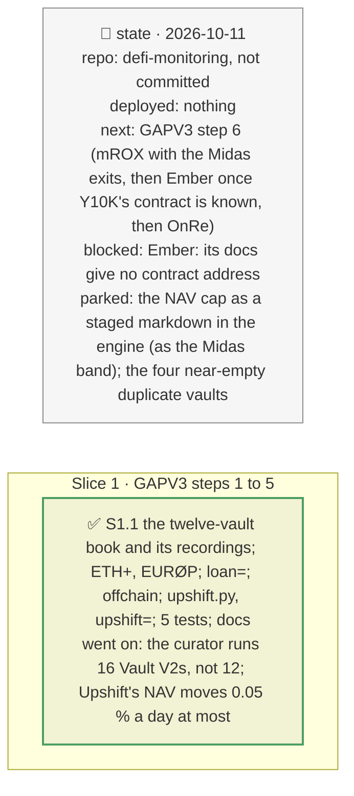

# GAPV3: the Upshift vault behind etrUSD, a loan-asset depeg, the exposure off the chain, and every RockawayX vault on Ethereum, plan

> **Status**: approved: the person, 2026-10-11, "Now go for gap 3" (`docs/analysis/GAPV3.md`, its "What to build first", steps 1 to 5). No interview: the decisions below are the agent's defaults.
> **Delivers**: step 1, the five small Morpho vaults found later, recorded (graph and incident) and added in a twelve-vault book; step 2, ETH+ (Reserve) as an issuer, its oracle classified; step 3, `loan=<the vault's asset>:<fall>`, the depositor's own asset depegging (EURØP); step 4, RockawayX's PST and PRIME exposure on Kamino, stated next to a book incident; step 5, Upshift's Tori Ecosystem Vault read on-chain behind etrUSD (its off-chain assets, the daily cap on its NAV, its exits and queue, its roles), `upshift=<loss>`, and its graph node.
> **Hard rule**: keyless reads, recorded under `fixtures/replay/upshift/` and each vault's `graph-`/`incident-` folder; the demo book `rockawayx-ethereum.json` is left as it is (tests, the README and the SPA quote its figures); `web/` untouched (`openapi.json` regenerated); the agent never commits.
> **Read against**: `docs/external/upschift/docs.upshift.finance-docs/` (contracts, vault interface, accounting) and the vault's verified source (`TokenizedVault`: `updateTotalAssets`, `getMaxAllowedChange`, `getChangePercentage`, `_previewRedemption`); `docs/external/ember/learn.ember.so-docs/` (no contract addresses: Y10K left for later); `docs/analysis/ROCK-VAULT.md`.
> **Left out**: §4 Flows and §5 State.

## The tracker

mandate: mode classic · no git, the person commits · inline · tests at the slice end · verify off

# Design

## 1. Why, and why not

The book stopped at seven vaults and at the Morpho venue; GAPV3 lists what that leaves out. **Non-goals**: a Solana reader (Kamino stays a stated line); Ember's Y10K (no address in its docs); mROX and OnRe (step 6).

## 8. Decisions

| id | Kind | Decision | Status | Source | Slice |
|---|---|---|---|---|---|
| D253 | contract | `upshift.load` from the pinned vault: total and off-chain assets, share price, last report, `maxChangePercent` (1/10,000 a day since the last report), `lagDuration`, `instantRedemptionFee` (1/10,000), `globalLiabilityShares` (queued), the share's supply, the scheduler's `TIMELOCK_DURATION`, owner and operator through `roles.read` | agreed, agent's default; found: 99.99 % of 17.15M trUSD is reported off-chain by an operator that is one key; the cap is 0.05 % a day; a request waits 7 days or pays 5 %; 36 % of etrUSD is queued; raising the cap waits 24 h | `TokenizedVault` source; Upshift docs | S1 |
| D254 | contract | `upshift=<loss of its off-chain assets>` as `token=etrUSD:` (the loss × the off-chain share), with the days the cap needs to report it (\|1 / (1 − fall) − 1\| ÷ the cap): 222 days for 10 %, unless the owner raises the cap through its timelock; the markdown is applied in full (the cap raised), the pace stated | agreed, agent's default | D253 | S1 |
| D255 | contract | a vault-incident kind `loan=<the vault's asset>:<fall>`: no market is hit; the vault's value falls by `fall`; what can leave now and is swapped out before the depeg escapes it (EXIT), what stays falls with it; Ø and O match alike (EURØP's on-chain symbol is EUROP) | agreed, agent's default | GAPV3 §1 | S1 |
| D256 | contract | registry `offchain`: RockawayX's lines on Kamino (Huma PST 42.5M held; the Huma and Prime markets of RWA USDC and Huma USDC lent against), from its published update, 2026-10-10; a book incident on the token states them: `holds` loses the markdown pro rata, `lends` is at risk, its loss not computed; `BookIncident.offchain_usd` | agreed, agent's default | GAPV3 §3 | S1 |
| D257 | contract | ETH+ (Reserve) in `issuers`: its basket read on-chain (0.401 wstETH, 0.226 weETH, 0.213 sfrxETH per ETH+), priors taken from wstETH; EURØP (Schuman Financial) in `stables` | agreed, agent's default; found: ETH+'s market prices it by Reserve's exchange rate (constant-price), so a market depeg liquidates nobody | `BasketHandler.quote` | S1 |
| D258 | contract | `examples/rockawayx-ethereum-all.json`, the twelve Vault V2 the curator runs with money in them; the seven-vault demo book unchanged | agreed, agent's default; found: the API lists 16 Vault V2 for the curator, four near-empty duplicates ($1 to $13) left out | Morpho API `vaultV2s` | S1 |

# Execution

## 9. The slices

| Slice | Done when | Went on |
|---|---|---|
| S1 | the five vaults and the Upshift vault replay offline; 415 tests pass | the twelve-vault book is worth 99.13M (the five add $17k); a 20 % PST markdown costs it 1.70M on Ethereum and 8.5M more on Kamino's Huma PST vault, not read; `loan=EURØP:0.1` costs the EUROP vault 1,120 USD, EXIT; `upshift=0.10` marks etrUSD down 10 %, which the cap needs 222 days to report; ETH+'s market liquidates nobody on a market depeg (exchange-rate oracle) |

## Interview log

No interview: the person asked for GAPV3.
