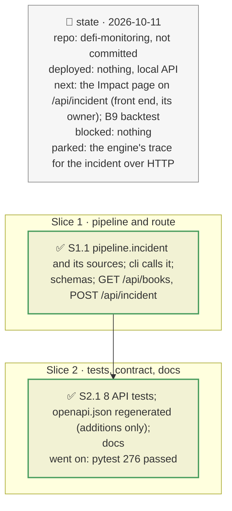

# The vault and book incident over HTTP, plan

> **Status**: approved: the person, 2026-10-11, "Implement the api endpoint, don't touch to the front-end". No interview: the decisions below are the agent's defaults.
> **Delivers**: `POST /api/incident` runs a known incident on a vault, an inline book or a shipped example book, and returns the book's sum and headline with each vault's detail (loss, engine figures, contagion, verdict, p\*, outside view); `GET /api/books` lists the example books. The same run as `analyze --vault` / `--book`: the orchestration moved from `cli.py` to `pipeline.incident`. Proof: the RockawayX book under PST −30 % over HTTP; one vault's answer equal to the CLI's JSON.
> **Hard rule**: `web/` untouched; routes only route and validate (`CLAUDE.md`); `openapi.json` regenerated in the same change; no recording over HTTP; the agent never commits.
> **Read against**: plans `2026-10-11-vault-book`, `2026-10-11-one-number`, `2026-10-11-breakeven`; plan `web-graph-react-flow` and `riskdep/api/` (the conventions).
> **Left out**: §4 Flows and §5 State: a request runs one pure pipeline under the existing fetch lock.

## The tracker

mandate: mode classic · no git, the person commits · inline · tests at the slice end · verify off

# Design

## 1. Why, and why not

The answer to the brief's question, a book under a known incident with a verdict and p\*, existed only in the terminal and `out/*.json`. The web app's Impact page replays a committed trace. An endpoint lets the front end show the real answer; the page itself is its owner's.

**Non-goals**: the page; the engine's propagation trace for this incident (it can follow as a field); recording vaults over HTTP (`--record` writes fixtures, a CLI job).

## 3. Modules, after

- **`pipeline.py`**: `incident`, `vault_source`, `vault_graph`, `pharos_snapshot`, `nexus_prices`, `REPLAY_DIR`, moved from `cli.py`'s private helpers.
- **`cli.py`**: `_vault_incident` calls `pipeline.incident`; `REPLAY_DIR` re-exported for the tests that import it.
- **`vault_book.py`**: `examples()`, the books in `examples/` by name.
- **`api/routes/incident.py`**, new; **`api/schemas.py`**: `IncidentRequest`, `BookIn`, `BookVaultIn`, `BookSummary`, `IncidentResponse`, `BookIncident`, `VaultLine`, `VaultIncident`, `MarketHit`.

## 8. Decisions

| id | Kind | Decision | Status | Source | Slice |
|---|---|---|---|---|---|
| D147 | contract | `POST /api/incident` takes exactly one of `vaults` (an ad hoc book), `book` (inline, as `examples/*.json`) or `example` (a shipped book by name), `shocks` in the CLI's syntax (at least one), `user`, `horizon` (days, default 30) and `live`; it answers `{book, vaults}`: the book's sum and headline, and each vault's incident, the same JSON as the CLI writes. A single vault is a book of one | agreed, agent's default: one shape for one or many vaults | — | S1 |
| D148 | contract | Errors: 422 for a bad request or shock; 404 for an unknown example or a vault with no recording (offline); 503 for an incomplete recording; 502 for a source failure; each detail says what to do (`live=true`) | agreed, follows `POST /api/analyze` | `api/routes/report.py` | S1 |
| D149 | module | Offline from the recordings by default, `live` reads the chain; nothing is saved and nothing is written to `out/`; the run holds `fetch_lock` like `/api/analyze` | agreed, agent's default | `api/artifacts.py` | S1 |

# Execution

## 9. The slices

| Slice | Done when | Went on |
|---|---|---|
| S1 | the CLI runs through `pipeline.incident` with its tests unchanged | — |
| S2 | the endpoint answers the RockawayX book offline; one vault equals the CLI; the OpenAPI diff is additions only; 276 tests pass | — |

## Interview log

No interview: the person asked for the endpoint and no front-end change.
