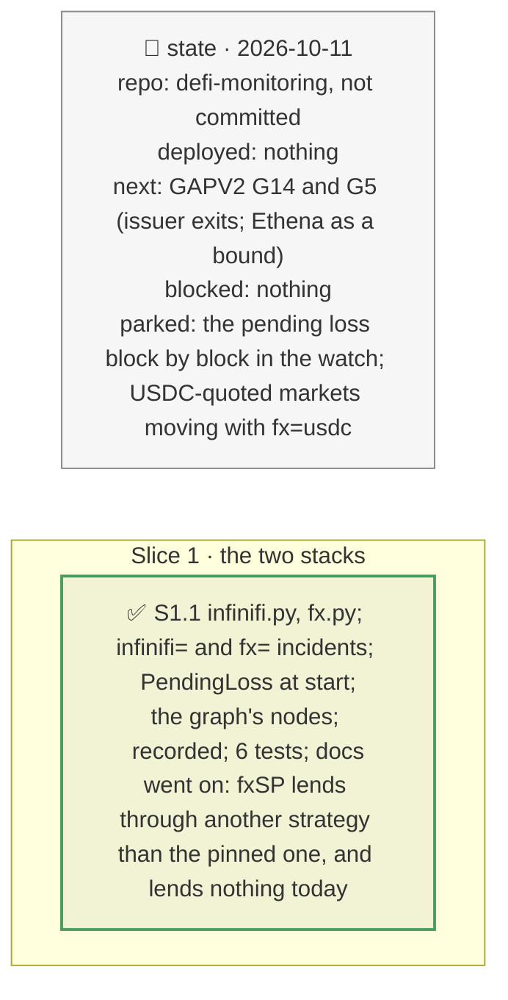

# Issuer stacks: infiniFi's waterfall and fxSAVE's NAV components, plan

> **Status**: approved: the person, 2026-10-11, "G18 and G13 now" (GAPV2). No interview: the decisions below are the agent's defaults.
> **Delivers**: G18: infiniFi's loss order read on-chain from siUSD (the safety buffer, liUSD, siUSD, every iUSD holder); `infinifi=<share>` turns a loss of its backing into the siUSD (and iUSD) markdown it causes; an `InfiniFi.PendingLoss` warning at the watch's start when `unaccruedYield()` is negative; the order drawn behind siUSD. G13: fxSP's NAV components read on-chain (fxUSD, USDC idle and lent on Aave); `fx=<fxusd|usdc|aave>:<loss>` turns a component's loss into fxSAVE's markdown; the components drawn behind fxSAVE; fxSP's cool-down and instant fee read (GAPV2 G14's data).
> **Hard rule**: keyless, on-chain, recorded under `fixtures/replay/infinifi/` and `fixtures/replay/fx/` at one block; `web/` untouched (`openapi.json` regenerated); the agent never commits.
> **Read against**: `docs/analysis/GAPV2.md` G18, G13; `docs/external/infini-protocol/infinifi-protocol/src/finance/YieldSharingV3.sol`, `docs/external/fx-protocol/fx-protocol-contracts/contracts/core/FxUSDBasePool.sol`; plans `2026-10-11-venues`, `2026-10-11-sky` (the same shape).
> **Left out**: §4 Flows and §5 State.

## The tracker

mandate: mode classic · no git, the person commits · inline · tests at the slice end · verify off

# Design

## 1. Why, and why not

A chosen markdown on siUSD or fxSAVE asked the user to guess what an incident does to them; both issuers publish the stack on-chain. **Non-goals**: infiniFi's farms one by one; f(x)'s long positions behind fxUSD; the pending loss block by block (start-up only).

## 8. Decisions

| id | Kind | Decision | Status | Source | Slice |
|---|---|---|---|---|---|
| D246 | contract | `infinifi.load` from siUSD: `yieldSharing()` → accounting, iUSD, the locking module; the backing (`totalAssetsValue`), the safety buffer (iUSD held by YieldSharing), liUSD (`totalBalance`), siUSD's iUSD, iUSD's supply, `unaccruedYield()`. `waterfall`, pure, in `_handleNegativeYield`'s order: the buffer only if it covers the whole loss, then liUSD, then siUSD, then the iUSD price; the siUSD and iUSD markdowns | agreed, agent's default; found: the buffer is skipped, not partly used, when the loss exceeds it | `YieldSharingV3.sol:343-376` | S1 |
| D247 | contract | `infinifi=<share of the backing>` as `token=siUSD:` (and `token=iUSD:`) markdowns, with the split in words; refused when nothing reaches the markets. `InfiniFi.PendingLoss` at the watch's start for a vault lending against siUSD: warn, critical when the pending loss is larger than liUSD and the buffer | agreed, agent's default | GAPV2 G18 | S1 |
| D248 | contract | `fx.load`: fxSP's fxUSD held (`totalYieldToken`) at its oracle's price (`getPrice`), its idle USDC and the USDC its strategy holds, the strategy read live from `allocations(USDC)` (the README's is no longer in use), at USDC's price; fxSP's `redeemCoolDownPeriod` and `instantRedeemFeeRatio` (1e18 precision) | agreed, agent's default; found: the pinned strategy is stale, and the live one holds 9 units | `FxUSDBasePool.sol:255` | S1 |
| D249 | contract | `fx=<fxusd|usdc|aave>:<loss>` as a `token=fxSAVE:` markdown, the component's share of fxSP's value × the loss (PT-fxSAVE follows through its wrap) | agreed, agent's default | GAPV2 G13 | S1 |

# Execution

## 9. The slices

| Slice | Done when | Went on |
|---|---|---|
| S1 | both stacks replay offline and drive the vault incidents; 405 tests pass | infiniFi: 58.5M of backing; buffer 0.025M, liUSD 15.2M, siUSD 43.0M; a 30 % loss costs siUSD 5.54 % (the siUSD/USDC market liquidates 425k), a 5 % loss stays with liUSD. f(x): fxSP 85.9M, 97.0 % fxUSD, 3.0 % USDC, none lent; a 10 % fxUSD depeg marks fxSAVE down 9.70 %; cool-down 1 h, instant fee 1 % |

## Interview log

No interview: the person asked for G18 and G13.
