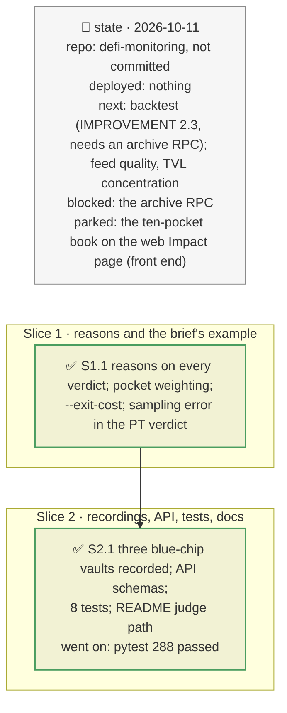

# The answer findable and every number defensible, plan

> **Status**: approved: the person, 2026-10-11, "Yes go for it" (the first bundle of `IMPROVEMENT.md`: 1.1, 1.2, 1.3, 2.1, 2.2; the web left to its owner). No interview: the decisions below are the agent's defaults.
> **Delivers**: the brief's own example as one command (`examples/brief-ten-pockets.json`, `--exit-cost 0.11`); three commands at the top of the README mapped to the criteria; no stale test counts; a reason on every vault and book verdict; no verdict reason inside the Monte Carlo's sampling error. Proof: ten 1M pockets under mGLOeuro −30 %: leaving the hit pocket costs 110,000 for sure against 53,445 saved: stay; `analyze --demo` says the carry and the expected loss are about equal.
> **Hard rule**: `web/` untouched; the verdicts' rules change only where a reason was not established; `openapi.json` regenerated; no file deleted; the agent never commits.
> **Read against**: `IMPROVEMENT.md`; plans `2026-10-11-vault-book`, `2026-10-11-breakeven`, `2026-10-10-defi-risk-dependency` (the PT verdict); `docs/archive/ANALYSIS_CURRENT.md` §5 (the sampling error).
> **Left out**: §4 Flows and §5 State: no new flow or state.

## The tracker

mandate: mode classic · no git, the person commits · inline · tests at the slice end · verify off

# Design

## 1. Why, and why not

`IMPROVEMENT.md`: a judge must find the answer in five minutes, and two numbers in the demo read as bugs or rest on noise. Its first bundle is the largest score gain per hour.

**Non-goals**: the web Impact page (its owner's); the backtest (needs an archive RPC); a new document (the README points to the right ones).

## 3. Modules, after

- **`vault_incident.py`**: the no-saving and small-saving reasons name their cause (the depositor's share of the vault, or what cannot leave; the forceDeallocate penalty); `breakeven(..., rate)`; `run(..., exit_cost_rate=)`; a flat exit cost also weighs on the verdict given the incident; fields `liquidity`, `exit_cost_rate`.
- **`vault_book.py`**: the `pocket` weighting and `BookVault.amount`; `pocket`, `reason` (pure); `VaultLine.reason`; the headline states the certain cost against the saving.
- **`pipeline.py`, `cli.py`, `api/`**: `exit_cost` / `--exit-cost`; the schemas follow.
- **`simulate.py`, `decide.py`**: `SimResult.expected_loss_se`; the PT verdict prints the expected loss's 95 % interval and does not REDUCE on a carry gap inside it.
- **`examples/brief-ten-pockets.json`**; **`fixtures/replay/incident-<vault>/`** for Gauntlet USDC Prime, Steakhouse Prime USDC, Spark Blue Chip USDT.

## 8. Decisions

| id | Kind | Decision | Status | Source | Slice |
|---|---|---|---|---|---|
| D150 | contract | A vault incident keeps what can leave (plain, forced, penalty) so a book can price any position in the vault | agreed, agent's default | `exit_queue.Liquidity` | S1 |
| D151 | contract | `--exit-cost r` (API `exit_cost`): leaving costs r × what leaves, instead of the yield given up; with it, the verdict given the incident is STAY when leaving first saves less than that cost | agreed, the brief's 11 % unwind | `GOAL.md` | S1 |
| D152 | contract | The `pocket` weighting: each vault enters the book at the `amount` (USD) its entry gives, a position first in the exit queue: loss if it stays pro rata, if it leaves first the exit queue's loss on what cannot leave; its own p\* and verdict | agreed, agent's default | the brief's book of pockets | S1 |
| D153 | contract | Every book line carries a one-clause reason (no bad debt; nothing to save, and why; leaving costs more than it saves; leaving pays above p\*); a hit vault with no p\* shows "n/a", not "—"; a vault's no-saving reason names its cause | agreed, `IMPROVEMENT.md` 2.1 | — | S1 |
| D154 | contract | The PT verdict prints the expected loss with its 95 % sampling interval (1.96 σ/√n); a carry gap inside it is "about equal" and no longer a reason to REDUCE on its own (revises the REDUCE rule of plan `2026-10-10-defi-risk-dependency`; the demo's REDUCE stands on its tail and liquidation reasons) | agreed, `IMPROVEMENT.md` 2.2; `docs/archive/ANALYSIS_CURRENT.md` §5 | — | S1 |

# Execution

## 9. The slices

| Slice | Done when | Went on |
|---|---|---|
| S1 | Confidential RWA's STAY says its depositor is 99 % of the vault; the demo's carry gap reads "about equal"; the ten-pocket book flips EXIT → STAY at an 11 % unwind | Belem's small positive saving fell in a second branch with the old vague reason: both branches now name the cause |
| S2 | the ten pockets recorded and served by the API; 288 tests pass | the Gauntlet graph (hundreds of sibling markets) did not finish: stopped; the three blue-chip vaults run without a graph, which the output says. A partial folder `fixtures/replay/graph-0x8c106eed…` was left for the person to delete (no `meta.json`, so it is ignored) |

## Interview log

No interview: the person approved the bundle.
